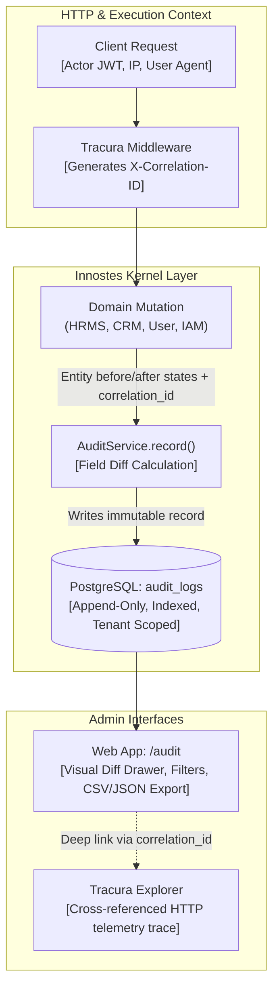

import { Diagram } from '@/components/docs/diagram';

The **Audit Trail Subsystem** (`kernel.audit`) is an immutable, append-only compliance ledger built into the Innostes ERP kernel. It records every domain state mutation, authentication action, and role-based access control (RBAC) adjustment across all ERP modules and tenants.

Unlike operational request telemetry (handled by [Tracura](/plugins/tracura)), the Audit Trail is legally binding, regulatory-compliant (SOC 2 Type II, ISO 27001, HIPAA), and guarantees complete non-repudiation.

---

## 1. Architectural Model & Ingestion Pipeline

The audit subsystem operates directly inside the Innostes Kernel, ensuring it cannot be bypassed or deactivated by tenant administrators:

<Diagram caption="Audit Subsystem ingestion architecture, field diff calculation, and Tracura correlation cross-reference.">

</Diagram>

---

## 2. Telemetry (Tracura) vs. Audit Trail

Innostes ERP maintains a strict separation of concerns between operational telemetry and regulatory audit trails:

| Feature | **Tracura (`plugins/tracura`)** | **Audit Trail (`kernel.audit`)** |
| :--- | :--- | :--- |
| **Primary Focus** | API latency, error rates, high-throughput debugging. | Non-repudiation, governance, compliance forensics. |
| **Scope** | HTTP envelope (`GET /api/v1/orders`, `duration_ms: 120`). | Domain entity mutations ("Alice updated Bob's salary to $165,000"). |
| **Storage Semantics** | In-memory queue / Redis buffer, rotating retention (30d). | Permanent PostgreSQL append-only table, never sampled. |
| **Actor Attribution** | Client IP, user-agent, API key prefix. | User ID, email snapshot, display name, IP, and justification reason. |
| **Cross-Link** | Emits `X-Correlation-ID` for end-to-end tracing. | Stores `correlation_id` to link directly to Tracura's request trace. |

---

## 3. Database Schema (`audit_logs`)

Audit records are persisted to the `audit_logs` table via Alembic migration `0007_create_audit_logs_table`:

```sql
CREATE TABLE audit_logs (
    id UUID PRIMARY KEY,
    tenant_id UUID REFERENCES tenants(id) ON DELETE CASCADE,
    actor_id UUID REFERENCES users(id) ON DELETE SET NULL,
    actor_email VARCHAR(255),
    actor_name VARCHAR(255),
    action VARCHAR(50) NOT NULL,
    entity_type VARCHAR(64) NOT NULL,
    entity_id VARCHAR(128) NOT NULL,
    entity_name VARCHAR(255),
    changes JSONB NOT NULL DEFAULT '{}',
    ip_address VARCHAR(45),
    user_agent VARCHAR(512),
    correlation_id VARCHAR(128),
    reason TEXT,
    status VARCHAR(20) NOT NULL DEFAULT 'SUCCESS',
    created_at TIMESTAMPTZ NOT NULL DEFAULT NOW()
);

CREATE INDEX ix_audit_logs_entity_history 
ON audit_logs (tenant_id, entity_type, entity_id, created_at);
```

### Before / After Diff Structure

The `changes` column stores clean, attribute-level modifications while scrubbing sensitive credentials:

```json
{
  "salary": {
    "old": 145000,
    "new": 165000
  },
  "title": {
    "old": "Senior Engineer",
    "new": "Staff Engineer"
  },
  "department": {
    "old": "Product Eng",
    "new": "Core Platform"
  }
}
```

> [!NOTE]
> Sensitive fields (passwords, hashed secrets, API key hashes, session tokens) are automatically redacted before the audit record is committed to PostgreSQL.

---

## 4. REST API Endpoints

The audit router mounts automatically under `/audit`:

| Method | Endpoint | Description |
| :--- | :--- | :--- |
| `GET` | `/audit/logs` | Search and filter audit records with pagination, action, and entity filters. |
| `GET` | `/audit/summary` | Retrieve high-level compliance KPIs (action breakdowns, top actors, mutation volume). |
| `GET` | `/audit/logs/{log_id}` | Inspect a single audit record with full before/after diffs. |
| `GET` | `/audit/entities/{type}/{id}` | Retrieve the complete chronological change history for any record. |
| `POST` | `/audit/logs` | Programmatic audit event emission for custom extension actions. |

---

## 5. Web Admin Panel (`/audit`)

Innostes ERP provides a built-in admin panel at `/audit` within the Web App:

- **KPI Analytics Cards**: Total events, state mutations, security/RBAC elevations, and active actors.
- **Multi-Filter Toolbar**: Search by actor email, entity name, reason, client IP, or correlation trace ID.
- **Slide-out Diff Inspector Drawer**: Side-by-side or unified view with color-coded diff highlights (green for added, red for deleted, amber for modified).
- **Tracura Deep Linking**: Click any correlation ID to jump directly to Tracura's operational trace of the request.
- **Export Tools**: Instant one-click CSV and JSON export for SOC 2 auditors.
