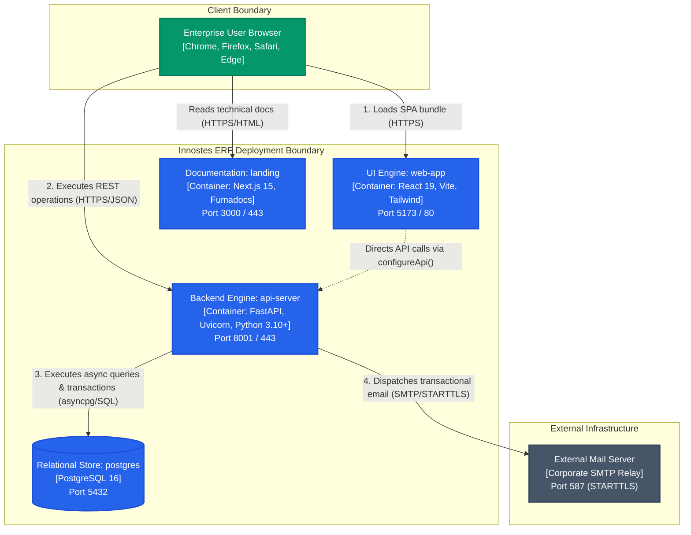
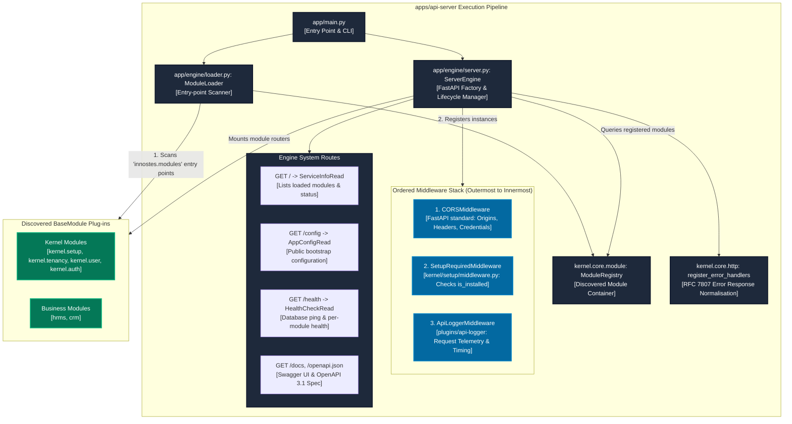
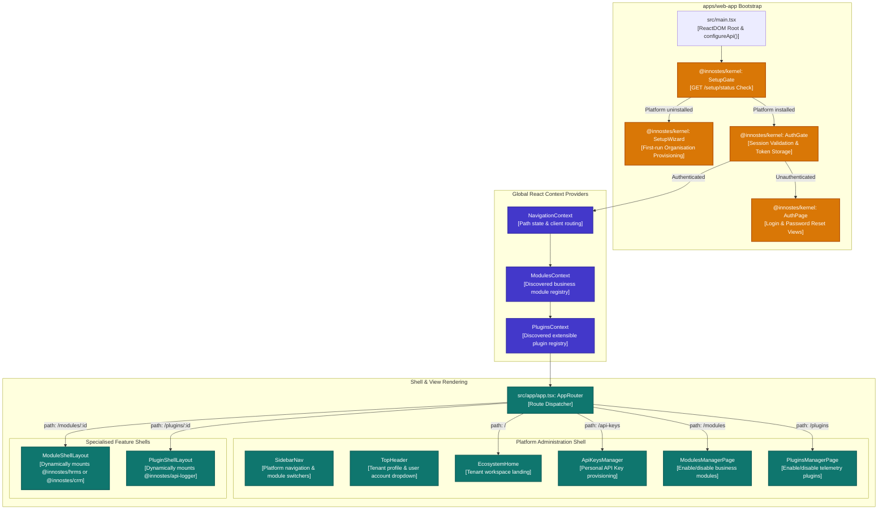
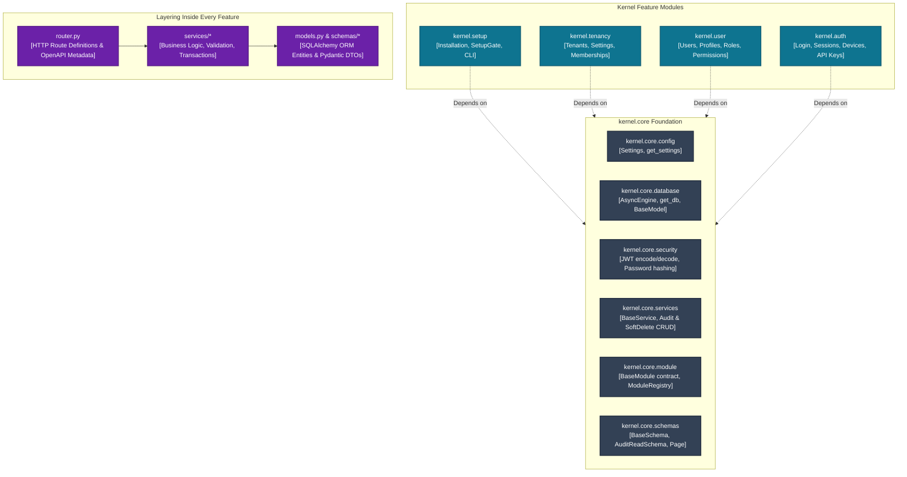

import { Diagram } from '@/components/docs/diagram';

The **Building Block View** (arc42 §5) explains the static decomposition of Innostes ERP. It decomposes the platform level by level using the C4 architecture model, mapping each block directly to its source code in the repository.

---

## 1. Container View (C4 Level 2)

The system decomposes into four deployable execution containers and one external relay service. Each container executes independently and communicates across standard networking protocols:

<Diagram caption="C4 Level 2 Container Diagram: Innostes ERP system decomposition and communication protocols.">

</Diagram>

### Container Responsibilities and Protocols

| Container | Directory | Technology | Role & Responsibilities | Upstream / Downstream Protocols |
|:---|:---|:---|:---|:---|
| **UI Engine** | [`apps/web-app`](/docs/apps/web-app) | React 19, Vite, Tailwind CSS, `@innostes/ui` | Single-page application (SPA) runtime. Bootstraps the enterprise shell, enforces client-side authentication and setup gates, dynamically routes to loaded modules, and renders responsive workspace views. | Serves static assets over HTTPS (port 5173 dev / 80 prod). Dispatches REST operations to `api-server`. |
| **Backend Engine** | [`apps/api-server`](/docs/apps/api-server) | Python 3.10+, FastAPI, Uvicorn, SQLAlchemy 2.0 | ASGI application runtime. Hosts discovered plug-ins, manages database connection pools, executes startup migrations, provides system telemetry (`/health`), and enforces multi-tenant boundaries. | Ingress via HTTPS (port 8001 dev / 443 prod). Connects to PostgreSQL via TCP port 5432 and SMTP via TCP port 587. |
| **Relational Database** | `docker-compose.yml` | PostgreSQL 16 Alpine | Canonical ACID data store. Stores platform state across 18 relational tables, enforcing unique constraints, foreign keys, row versioning, and advisory locks for migration concurrency. | Listens on TCP port 5432 (`postgresql+asyncpg://`). |
| **Docs Site** | [`apps/landing`](/docs/apps/landing) | Next.js 15, React 19, Fumadocs | Enterprise documentation portal and developer hub. Hosts arc42 architecture documents, interactive REST API references, and design system component guides. | Serves SSR/SSG content over HTTPS (port 3000 dev / 443 prod). |
| **External Mail Relay** | External system | Corporate SMTP (Postfix, Sendgrid, AWS SES) | Dispatches transactional messages: setup security tokens, password reset confirmations, and invitation notifications. | Inbound STARTTLS over TCP port 587. |

---

## 2. Backend Engine Components (C4 Level 3)

The backend engine (`apps/api-server`) contains no business capabilities. It acts as an orchestrator that initialises the ASGI pipeline, registers middleware, and hosts plug-in modules:

<Diagram caption="C4 Level 3 Component Diagram: apps/api-server internal execution pipeline and module hosting.">

</Diagram>

### Backend Pipeline Components

1. **Server Factory (`apps/api-server/app/engine/server.py: ServerEngine`)**:
   Constructs the `FastAPI` instance. Merges system OpenAPI tags with tags declared by modules, mounts system endpoints (`/`, `/config`, `/health`), and configures custom OpenAPI security schemes (`BearerAuth` and `SetupToken`).
2. **Lifespan Manager (`ServerEngine._lifespan`)**:
   An asynchronous context manager executed by Uvicorn.
   - **Startup sequence**: Runs Alembic database auto-migrations (`auto_migrate()`) if `AUTO_MIGRATE=true`, then invokes `on_startup(app)` across all registered modules in registration order.
   - **Shutdown sequence**: Invokes `on_shutdown(app)` across all registered modules, then cleanly disposes of the SQLAlchemy async connection pool via `close_db()`.
3. **Ordered Middleware Stack**:
   Middleware executes in strict onion order:
   - **Layer 1 (Outermost) — `CORSMiddleware`**: Configured with origins from `CORS_ORIGINS`. Placed outermost so that error responses emitted by inner middleware or plug-ins still receive valid CORS headers in browser requests.
   - **Layer 2 — `SetupRequiredMiddleware`** ([`kernel/backend/kernel/setup/middleware.py`](file:///home/sai/Documents/GitHub/innostes_projects/erp/kernel/backend/kernel/setup/middleware.py)): Intercepts all traffic when the platform is uninstalled. Allows only `/setup/*`, `/`, `/config`, `/health`, and `/docs`. All other requests receive HTTP 503 Service Unavailable (`setup_required`).
   - **Layer 3 — Plug-in Middleware**: Configured dynamically through `BaseModule.configure(app)`, such as request logging and latency telemetry in `plugins/api-logger`.
4. **Module Loader (`apps/api-server/app/engine/loader.py: ModuleLoader`)**:
   Uses Python's standard `importlib.metadata.entry_points(group="innostes.modules")` to discover plug-in packages installed in the environment. Handles imports gracefully: if a module raises an unhandled import error, it logs the exception and continues loading remaining modules without crashing the engine.
5. **Error Normalisation (`kernel/backend/kernel/core/http.py: register_error_handlers`)**:
   Translates domain service exceptions (`NotFoundError`, `ConflictError`, `ForbiddenError`, `ValidationError`) into uniform RFC 7807 problem payloads with corresponding HTTP status codes.

---

## 3. UI Engine Components (C4 Level 3)

The UI engine (`apps/web-app`) is a client-side Single Page Application built on React 19 and Vite. It renders the global application shell and delegates workspace rendering to active plug-ins:

<Diagram caption="C4 Level 3 Component Diagram: apps/web-app client-side component architecture and gate hierarchy.">

</Diagram>

### UI Engine Component Lifecycle

1. **Bootstrap & API Initialisation (`apps/web-app/src/main.tsx`)**:
   Reads `VITE_API_URL` (default `http://localhost:8001`) and initialises the singleton HTTP client in `@innostes/kernel` using `configureApi({ baseUrl })`.
2. **Setup Gate (`kernel/frontend/src/setup/SetupGate.tsx`)**:
   Performs an initial query to `GET /setup/status`. If the backend returns `installed: false`, normal rendering is halted and `<SetupWizard />` is presented to guide the initial administrator through organisation creation.
3. **Authentication Gate (`kernel/frontend/src/auth/AuthGate.tsx`)**:
   Verifies that a valid JWT access token or session exists. If unauthenticated, it presents `<AuthPage />`. Upon successful login, the session state is broadcast and child components render.
4. **App Router & Navigation (`apps/web-app/src/app/app.tsx`)**:
   Subscribes to `NavigationContext`. Evaluates the URL path:
   - `/modules/:moduleId`: Mounts `<ModuleShellLayout />`, rendering the respective module workspace (`@innostes/hrms` or `@innostes/crm`).
   - `/plugins/:pluginId`: Mounts `<PluginShellLayout />`, rendering plugin interfaces (`@innostes/api-logger`).
   - Standard paths (`/`, `/modules`, `/plugins`, `/api-keys`): Renders the primary administrative shell with `<SidebarNav />` and `<TopHeader />`.

<Callout type="info" title="Status: Dynamic Page & Menu Registry">
  **Current Implementation**: Modules register static UI manifests in `apps/web-app/src/app/catalog.ts` (`BUSINESS_MODULES_CATALOG` and `PLUGINS_CATALOG`).
  **Planned Evolution**: A runtime module manifest loader that dynamically discovers frontend plug-ins without compile-time imports in `apps/web-app` is planned for a future release (ADR-0003).
</Callout>

---

## 4. Kernel Architecture & Layering (C4 Level 3)

The kernel (`kernel/backend` and `kernel/frontend`) is the foundational plug-in. It provides core platform services, database schemas, and shared utilities.

<Diagram caption="C4 Level 3 Component Diagram: Kernel backend package layering and internal dependency directions.">

</Diagram>

### Kernel Subpackages and Responsibilities

| Package | Code Location | Responsibility | Allowed Dependencies |
|:---|:---|:---|:---|
| `kernel.core.config` | `kernel/backend/kernel/core/config/` | Application configuration loaded from environment variables and `.env` files using `pydantic-settings`. | Python standard library, `pydantic`. |
| `kernel.core.database` | `kernel/backend/kernel/core/database/` | Async SQLAlchemy 2.0 engine, `get_db` FastAPI session dependency, declarative `Base`, common column mixins (`AuditMixin`, `SoftDeleteMixin`), and Alembic runner. | `sqlalchemy`, `asyncpg`, `kernel.core.config`. |
| `kernel.core.module` | `kernel/backend/kernel/core/module/` | `BaseModule` abstract base class and `ModuleRegistry` container. | `fastapi`. |
| `kernel.core.schemas` | `kernel/backend/kernel/core/schemas/` | Reusable Pydantic models: `BaseSchema`, `AuditReadSchema`, `Page[T]`, and `ErrorResponse`. | `pydantic`. |
| `kernel.core.security` | `kernel/backend/kernel/core/security/` | Cryptographic utilities: bcrypt password hashing, JWT creation/validation, and actor identification. | `pyjwt`, `bcrypt`, `kernel.core.config`. |
| `kernel.core.services` | `kernel/backend/kernel/core/services/` | `BaseService[ModelT]` generic repository providing tenant-aware CRUD, soft-deletion, and domain error classes. | `kernel.core.database`, `kernel.core.schemas`. |
| `kernel.setup` | `kernel/backend/kernel/setup/` | First-run setup state cache, `installation` table, `setup_required` middleware, CLI installer (`python -m kernel.setup`). | `kernel.core.*`. |
| `kernel.tenancy` | `kernel/backend/kernel/tenancy/` | Multi-tenant organisation provisioning, membership mapping, tenant settings, and module activations. | `kernel.core.*`. |
| `kernel.user` | `kernel/backend/kernel/user/` | User identities, credential management, profile records, and Role-Based Access Control (RBAC). | `kernel.core.*`. |
| `kernel.auth` | `kernel/backend/kernel/auth/` | Authentication lifecycle: token issuance, refresh token family rotation, user sessions, and personal API keys. | `kernel.core.*`. |

### Feature Layering Rules

Every feature (within both kernel and business modules) strictly adheres to three-tier layering:
1. **Router Layer (`router.py`)**: Exclusively handles HTTP request extraction, parameter validation, dependency injection (`Depends(get_db)`, `Depends(get_current_user)`), and status code mapping. Routers never execute raw SQL.
2. **Service Layer (`services/*`)**: Houses domain business logic, cross-entity coordination, access checks, and transactional commits.
3. **Persistence & Contract Layer (`models.py`, `schemas/*`)**: Defines SQLAlchemy relational entities and Pydantic validation schemas.

### Automated Fitness Function Enforcement

Layering and dependency boundaries are checked automatically on every build:
- **Python Import Linter**: Configured in [`.importlinter`](file:///home/sai/Documents/GitHub/innostes_projects/erp/.importlinter). Enforces Rules 1 to 5.
- **TypeScript Workspace Boundaries**: Enforced by [`scripts/checks/check-ts-boundaries.mjs`](file:///home/sai/Documents/GitHub/innostes_projects/erp/scripts/checks/check-ts-boundaries.mjs). Prevents business modules from cross-importing private internals.
- **Relational Integrity**: Enforced by [`kernel/backend/tests/test_architecture_fitness.py`](file:///home/sai/Documents/GitHub/innostes_projects/erp/kernel/backend/tests/test_architecture_fitness.py). Verifies audit columns and table registrations.

---

## Related Documentation

- [Plug-in Contract & Catalogue](/docs/architecture/plugin-contract) — Detailed reference on creating compliant backend and frontend plug-ins.
- [Data Architecture](/docs/architecture/data-architecture) — Complete entity-relationship diagram and common database columns.
- [First-run Setup](/docs/architecture/setup) — Operational guide for initialising the platform.
