import { Diagram } from '@/components/docs/diagram';

The **Data Architecture** (arc42 §5 and §8) defines the persistent data model, multi-tenancy isolation boundaries, universal model mixins, and schema migration strategies governing Innostes ERP.

---

## 1. Entity-Relationship Overview

All relational models subclass [`kernel.core.database.Base`](file:///home/sai/Documents/GitHub/innostes_projects/erp/kernel/backend/kernel/core/database/base.py). The platform manages **18 core relational tables** in PostgreSQL 16:

```mermaid
erDiagram
    tenant_settings {
        UUID id PK
        UUID tenant_id FK
        VARCHAR namespace
        JSONB config
        INTEGER version
        DATETIME created_at
        UUID created_by
        DATETIME updated_at
        UUID updated_by
        DATETIME deleted_at
        UUID deleted_by
    }
    tenant_settings ||--o{ tenants : "id"
    tenants {
        UUID id PK
        VARCHAR name
        VARCHAR slug
        VARCHAR country
        VARCHAR timezone
        VARCHAR language
        VARCHAR date_format
        DATETIME created_at
        UUID created_by
        DATETIME updated_at
        UUID updated_by
        DATETIME deleted_at
        UUID deleted_by
    }
    tenant_members {
        UUID id PK
        UUID tenant_id FK
        UUID user_id FK
        VARCHAR status
        DATETIME joined_at
        DATETIME created_at
        UUID created_by
        DATETIME updated_at
        UUID updated_by
        DATETIME deleted_at
        UUID deleted_by
    }
    tenant_members ||--o{ tenants : "id"
    tenant_members ||--o{ users : "id"
    tenant_modules {
        UUID id PK
        UUID tenant_id FK
        VARCHAR module_id
        BOOLEAN is_enabled
        DATETIME enabled_at
        DATETIME created_at
        UUID created_by
        DATETIME updated_at
        UUID updated_by
        DATETIME deleted_at
        UUID deleted_by
    }
    tenant_modules ||--o{ tenants : "id"
    tenant_plugins {
        UUID id PK
        UUID tenant_id FK
        VARCHAR plugin_id
        BOOLEAN is_enabled
        DATETIME enabled_at
        DATETIME created_at
        UUID created_by
        DATETIME updated_at
        UUID updated_by
        DATETIME deleted_at
        UUID deleted_by
    }
    tenant_plugins ||--o{ tenants : "id"
    permissions {
        UUID id PK
        VARCHAR code
        VARCHAR name
        VARCHAR module
        TEXT description
        DATETIME created_at
        UUID created_by
        DATETIME updated_at
        UUID updated_by
        DATETIME deleted_at
        UUID deleted_by
    }
    role_permissions {
        UUID role_id PK,FK
        UUID permission_id PK,FK
    }
    role_permissions ||--o{ roles : "id"
    role_permissions ||--o{ permissions : "id"
    roles {
        UUID id PK
        UUID tenant_id FK
        VARCHAR name
        TEXT description
        BOOLEAN is_system
        DATETIME created_at
        UUID created_by
        DATETIME updated_at
        UUID updated_by
        DATETIME deleted_at
        UUID deleted_by
    }
    roles ||--o{ tenants : "id"
    user_roles {
        UUID user_id PK,FK
        UUID role_id PK,FK
        UUID tenant_id FK
    }
    user_roles ||--o{ users : "id"
    user_roles ||--o{ roles : "id"
    user_roles ||--o{ tenants : "id"
    user_devices {
        UUID id PK
        UUID user_id FK
        VARCHAR device_fingerprint
        VARCHAR device_name
        VARCHAR device_type
        VARCHAR os
        VARCHAR browser
        VARCHAR ip_address
        DATETIME first_seen_at
        DATETIME last_seen_at
        BOOLEAN is_trusted
        BOOLEAN is_blocked
        DATETIME created_at
        UUID created_by
        DATETIME updated_at
        UUID updated_by
        DATETIME deleted_at
        UUID deleted_by
    }
    user_devices ||--o{ users : "id"
    user_identities {
        UUID id PK
        UUID user_id FK
        VARCHAR identity_type
        VARCHAR identifier_hash
        TEXT identifier_encrypted
        BOOLEAN is_verified
        DATETIME verified_at
        DATETIME created_at
        UUID created_by
        DATETIME updated_at
        UUID updated_by
        DATETIME deleted_at
        UUID deleted_by
    }
    user_identities ||--o{ users : "id"
    password_histories {
        UUID id PK
        UUID user_id FK
        VARCHAR password_hash
        DATETIME created_at
    }
    password_histories ||--o{ users : "id"
    user_profiles {
        UUID id PK
        UUID user_id FK
        VARCHAR timezone
        VARCHAR locale
        VARCHAR avatar_url
        VARCHAR phone
        JSONB preferences
        DATETIME created_at
        UUID created_by
        DATETIME updated_at
        UUID updated_by
        DATETIME deleted_at
        UUID deleted_by
    }
    user_profiles ||--o{ users : "id"
    user_security {
        UUID id PK
        UUID user_id FK
        BOOLEAN mfa_enabled
        VARCHAR mfa_secret
        VARCHAR reset_token_hash
        DATETIME reset_token_expires_at
        DATETIME created_at
        UUID created_by
        DATETIME updated_at
        UUID updated_by
        DATETIME deleted_at
        UUID deleted_by
    }
    user_security ||--o{ users : "id"
    user_sessions {
        UUID id PK
        UUID user_id FK
        UUID device_id FK
        VARCHAR refresh_token_hash
        VARCHAR ip_address
        TEXT user_agent
        DATETIME expires_at
        DATETIME revoked_at
        DATETIME created_at
        UUID created_by
        DATETIME updated_at
        UUID updated_by
        DATETIME deleted_at
        UUID deleted_by
    }
    user_sessions ||--o{ users : "id"
    user_sessions ||--o{ user_devices : "id"
    users {
        UUID id PK
        VARCHAR first_name
        VARCHAR last_name
        VARCHAR email_hash
        TEXT email_encrypted
        VARCHAR mobile_hash
        TEXT mobile_encrypted
        VARCHAR password_hash
        VARCHAR status
        BOOLEAN is_super_admin
        BOOLEAN must_change_password
        DATETIME temp_password_expires_at
        INTEGER token_version
        INTEGER failed_login_attempts
        DATETIME blocked_until
        INTEGER key_version
        DATETIME created_at
        UUID created_by
        DATETIME updated_at
        UUID updated_by
        DATETIME deleted_at
        UUID deleted_by
    }
    installation {
        UUID id PK
        BOOLEAN singleton
        VARCHAR app_version
        UUID default_tenant_id FK
        DATETIME created_at
        UUID created_by
        DATETIME updated_at
        UUID updated_by
        DATETIME deleted_at
        UUID deleted_by
    }
    installation ||--o{ tenants : "id"
    api_keys {
        UUID id PK
        UUID tenant_id FK
        UUID user_id FK
        VARCHAR name
        VARCHAR key_prefix
        VARCHAR key_hash
        JSONB scopes
        DATETIME expires_at
        DATETIME last_used_at
        BOOLEAN is_revoked
        DATETIME revoked_at
        DATETIME created_at
        UUID created_by
        DATETIME updated_at
        UUID updated_by
        DATETIME deleted_at
        UUID deleted_by
    }
    api_keys ||--o{ tenants : "id"
    api_keys ||--o{ users : "id"
```

<Diagram caption="Entity-Relationship Diagram: All 18 core relational tables managed by Base.metadata in PostgreSQL 16.">

</Diagram>

---

## 2. Table Inventory Reference

| Table Name | Owning Feature | Purpose & Domain Data | Key Columns | Tenant Scoped? |
|:---|:---|:---|:---|:---:|
| `installation` | `kernel.setup` | Sentinel table enforcing single platform installation. | `singleton` (UNIQUE), `app_version`, `default_tenant_id` | No |
| `tenants` | `kernel.tenancy` | Organisation accounts, country, timezone, and date format. | `slug` (UNIQUE), `name`, `country` | Root |
| `tenant_settings` | `kernel.tenancy` | Namespaced tenant configuration JSON documents. | `tenant_id`, `namespace`, `config` | **Yes** |
| `tenant_members` | `kernel.tenancy` | Maps users to organisations with status and membership dates. | `tenant_id`, `user_id`, `status` | **Yes** |
| `tenant_modules` | `kernel.tenancy` | Feature module activations per organisation. | `tenant_id`, `module_id`, `is_enabled` | **Yes** |
| `tenant_plugins` | `kernel.tenancy` | Extensible plugin activations per organisation. | `tenant_id`, `plugin_id`, `is_enabled` | **Yes** |
| `users` | `kernel.user` | Enterprise user credentials, status, and lockouts. | `email_hash` (INDEX), `password_hash`, `status` | Shared |
| `user_profiles` | `kernel.user` | Extended profile metadata, preferences, and avatars. | `user_id`, `timezone`, `locale` | Shared |
| `user_identities` | `kernel.user` | Encrypted identities (email, mobile) with blind index hashes. | `identifier_hash` (UNIQUE), `identifier_encrypted` | Shared |
| `roles` | `kernel.user` | Role-Based Access Control (RBAC) definition records. | `tenant_id`, `name`, `is_system` | **Yes** |
| `permissions` | `kernel.user` | Atomic platform permission codes (e.g. `crm:leads:read`). | `code` (UNIQUE), `module` | Global |
| `role_permissions` | `kernel.user` | Join table binding permissions to roles. | `role_id`, `permission_id` | **Yes** |
| `user_roles` | `kernel.user` | Active role assignments scoped by tenant. | `user_id`, `role_id`, `tenant_id` | **Yes** |
| `api_keys` | `kernel.auth` | Permanent Personal API Keys (`inno_live_...`). | `key_prefix`, `key_hash`, `tenant_id`, `scopes` | **Yes** |
| `user_devices` | `kernel.auth` | Device tracking, fingerprints, and trusted status. | `user_id`, `device_fingerprint`, `is_trusted` | Shared |
| `user_sessions` | `kernel.auth` | Active user sessions and rotating refresh token hashes. | `user_id`, `device_id`, `refresh_token_hash` | Shared |
| `user_security` | `kernel.auth` | Multi-Factor Authentication (MFA) secrets and reset hashes. | `user_id`, `mfa_enabled`, `reset_token_hash` | Shared |
| `password_histories` | `kernel.auth` | Prior password hashes preventing recent credential reuse. | `user_id`, `password_hash`, `created_at` | Shared |

---

## 3. Universal Model Conventions

Every persistent domain model inherits from [`kernel.core.database.BaseModel`](file:///home/sai/Documents/GitHub/innostes_projects/erp/kernel/backend/kernel/core/database/base.py), guaranteeing standard columns across all tables:

```python title="kernel/backend/kernel/core/database/mixins.py"
class BaseModel(Base, UUIDPrimaryKeyMixin, TimestampMixin, AuditMixin, SoftDeleteMixin):
    __abstract__ = True
```

### 1. Primary Keys (`UUIDPrimaryKeyMixin`)
- **Type**: RFC 4122 UUID v4 (`sqlalchemy.dialects.postgresql.UUID`).
- **Generation**: Generated on the application layer via `uuid.uuid4()` before insertion. This allows primary keys to be referenced in sub-entities prior to database execution.

### 2. Timestamps (`TimestampMixin`)
- **Columns**: `created_at` and `updated_at`.
- **Timezone**: Strictly UTC (`DateTime(timezone=True)`).
- **Defaults**: `server_default=func.now()` and `onupdate=func.now()`.

### 3. Audit Attribution (`AuditMixin`)
- **Columns**: `created_by` (UUID) and `updated_by` (UUID).
- **Attribution**: Populated automatically from the active `actor_id` extracted from the Bearer JWT or API Key context. Nullable to permit system seeds and migration executions.

### 4. Universal Soft Delete (`SoftDeleteMixin`)
- **Columns**: `deleted_at` (DateTime, UTC) and `deleted_by` (UUID).
- **Deletion Mechanics**: Physical `DELETE` statements are prohibited. Deletions execute `UPDATE table SET deleted_at = now(), deleted_by = :actor_id WHERE id = :id`.
- **Query Scoping**: Queries executed through [`BaseService`](file:///home/sai/Documents/GitHub/innostes_projects/erp/kernel/backend/kernel/core/services/base.py) append `WHERE deleted_at IS NULL` by default.
- **Restoration**: Calling `service.restore(id)` sets `deleted_at = NULL` and `deleted_by = NULL`.
- **Index Interaction**: Unique constraints on mutable business attributes (such as `tenants.slug`) enforce partial indexes (`WHERE deleted_at IS NULL`) so that deleting an organization frees up its slug.

---

## 4. Multi-Tenancy Horizontal Isolation

Innostes ERP implements **pooled single-database multi-tenancy** (ADR-0004):

1. **Tenant Identification**: Inbound API requests supply the target organisation UUID in the `X-Tenant-ID` HTTP header.
2. **Membership Enforcement**: FastAPI dependencies verify that the authenticated user (`get_current_user`) is an active member in `tenant_members` for the given `X-Tenant-ID`.
3. **Application-Level Isolation**: All service methods require `tenant_id` and include `WHERE tenant_id = :t` in all SELECT, UPDATE, and DELETE queries.
4. **Cross-Tenant Access**: Super-administrators (`users.is_super_admin == true`) can query across tenants for platform auditing, while standard users cannot escape their tenant scope.

<Callout type="info" title="Status: Database Row-Level Security (RLS)">
  **Current Implementation**: Tenant isolation is enforced strictly at the application service and dependency injection layer (`BaseService`).
  **Planned Evolution**: PostgreSQL Row-Level Security (RLS) policies using session variables (`SET LOCAL app.current_tenant_id`) are planned for a subsequent hardening release (ADR-0004).
</Callout>

---

## 5. Schema Migration Strategy

Database migrations are managed via **Alembic** ([`kernel/backend/migrations/`](file:///home/sai/Documents/GitHub/innostes_projects/erp/kernel/backend/migrations/)):

- **Startup Concurrency Safety**: When `AUTO_MIGRATE=true`, [`kernel.core.database.migrations.auto_migrate()`](file:///home/sai/Documents/GitHub/innostes_projects/erp/kernel/backend/kernel/core/database/migrations.py) executes Alembic upgrades. It acquires a PostgreSQL transaction advisory lock:
  ```sql
  SELECT pg_advisory_xact_lock(727001);
  ```
  This guarantees that horizontally scaled container replicas do not race or execute conflicting DDL alterations.
- **Zero-Downtime Expand-and-Contract**:
  1. **Expand**: Add new columns as nullable. Deploy new application code that writes to both old and new columns.
  2. **Backfill**: Asynchronously populate historical data.
  3. **Contract**: Make the column non-nullable with a migration and remove deprecated code paths.

---

## 6. Data Lifecycle & Cryptographic Protection

| Data Category | Retention Policy | Protection Mechanism | Code Location |
|:---|:---|:---|:---|
| **Passwords** | Permanent until changed. Prior 5 hashes retained. | Salted bcrypt (`bcrypt.hashpw` with work factor 12). | `kernel.core.security` |
| **Identities (Email/Phone)** | Permanent until account deletion. | Blind indexing: SHA-256 HMAC for searches (`email_hash`), AES-256-CBC/Fernet for ciphertext (`email_encrypted`). | `kernel.core.crypto` |
| **API Keys** | Permanent until revoked. | Salted SHA-256 hash (`key_hash`). Plaintext only shown once during creation. | `kernel.auth.services` |
| **Audit Trails** | Retained indefinitely for regulatory compliance. | Immutable append-only audit fields (`created_at`, `created_by`, `updated_at`, `updated_by`). | `kernel.core.database.mixins` |
| **Soft-deleted Records** | Retained indefinitely in database; excluded from normal views. | Filtered queries (`WHERE deleted_at IS NULL`). | `kernel.core.services.base` |

---

## Related Documentation

- [Building Block View](/docs/architecture/building-blocks) — High-level container and component architecture.
- [Runtime View](/docs/architecture/runtime-view) — Transaction boundaries and request lifecycles.
- [Database Backup & Restore](/docs/operations/backup-restore) — Production backup runbook and point-in-time recovery.
