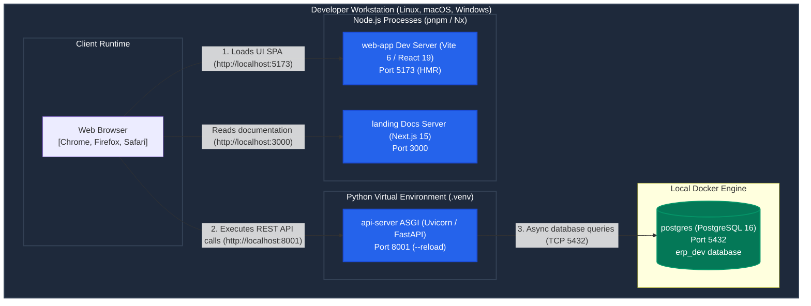
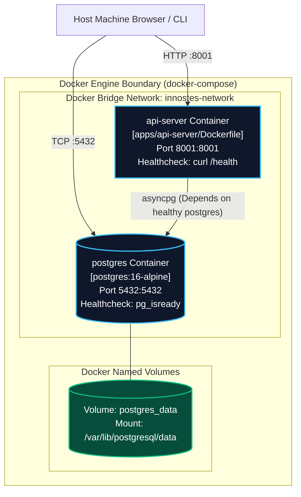
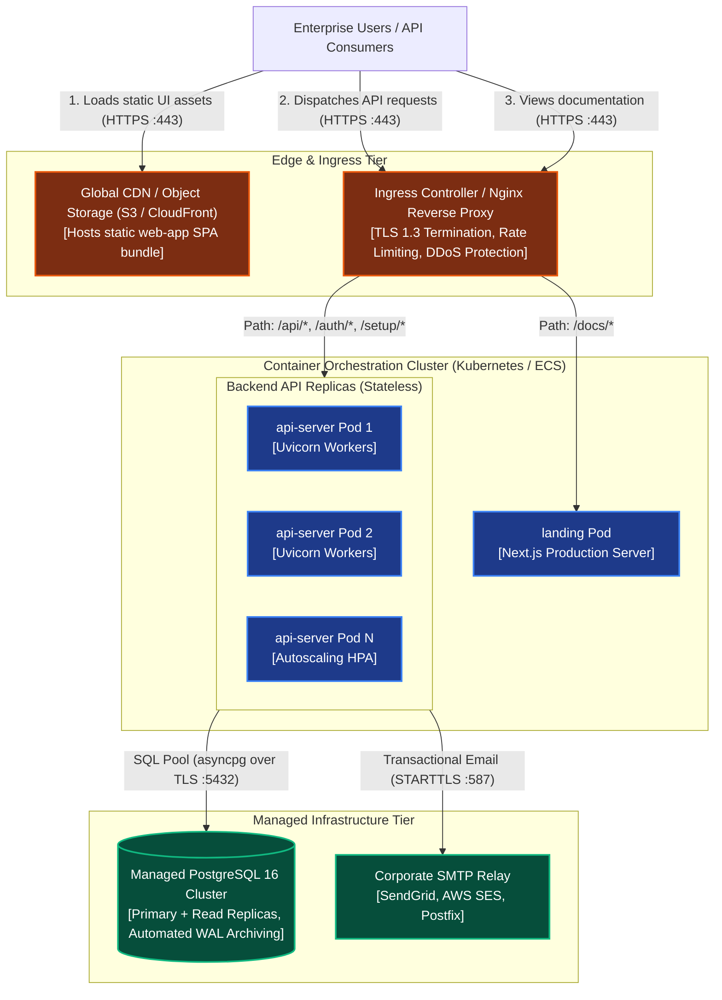

import { Diagram } from '@/components/docs/diagram';

The **Deployment View** (arc42 §7) describes the physical and containerised infrastructure hosting Innostes ERP across development, testing, and production environments.

---

## 1. Local Development Topology

During local engineering, developers run services directly via Nx and pnpm alongside a local PostgreSQL 16 database:

<Diagram caption="Deployment Diagram: Local developer machine execution topology and port bindings.">

</Diagram>

### Local Service Port Bindings

| Service | Technology | Port | Command | Role |
|:---|:---|:---:|:---|:---|
| `web-app` | React 19, Vite | **5173** | `pnpm nx dev web-app` | UI Single Page Application with Hot Module Replacement (HMR). |
| `api-server` | FastAPI, Python 3.10+ | **8001** | `pnpm nx dev api-server` | Backend ASGI engine with auto-reload enabled. |
| `landing` | Next.js 15, Fumadocs | **3000** | `pnpm nx dev landing` | Documentation portal and API reference explorer. |
| `postgres` | PostgreSQL 16 Alpine | **5432** | `docker compose up -d postgres` | Primary relational database (`erp_dev`). |

---

## 2. Docker Compose Topology

The repository provides a production-grade multi-container definition in [`docker-compose.yml`](file:///home/sai/Documents/GitHub/innostes_projects/erp/docker-compose.yml):

<Diagram caption="Deployment Diagram: Docker Compose container network, healthchecks, and volume persistence.">

</Diagram>

### Docker Compose Services & Health Checks

- **`postgres` Service**:
  - Image: `postgres:16-alpine`.
  - Storage: Persistent named volume `postgres_data` mounted at `/var/lib/postgresql/data`.
  - Health check: `pg_isready -U postgres -d erp_dev` executing every 5s with 5 retries.
- **`api-server` Service**:
  - Image: Built from [`apps/api-server/Dockerfile`](file:///home/sai/Documents/GitHub/innostes_projects/erp/apps/api-server/Dockerfile) (multi-stage Python build).
  - Health check: `curl -f http://localhost:8001/health || exit 1`.
  - Startup Dependency: Configured with `depends_on: { postgres: { condition: service_healthy } }` to guarantee that PostgreSQL accepts connections before Alembic migrations execute.

---

## 3. Recommended Production Topology

In production environments, Innostes ERP is deployed across a hardened, horizontally scalable infrastructure:

<Diagram caption="Deployment Diagram: Recommended production multi-tier topology with TLS termination, API replicas, and managed PostgreSQL.">

</Diagram>

### Production Architecture Invariants

1. **TLS Termination**: All public traffic terminates at the reverse proxy or Cloud Load Balancer using TLS 1.3. Plain HTTP traffic is permanently redirected (HTTP 301).
2. **Stateless Backend Replicas**: `api-server` instances store zero session state on local disk. Sessions and refresh token families reside in PostgreSQL. Instances scale horizontally based on CPU/RAM utilisation metrics.
3. **Database High Availability**: Managed PostgreSQL cluster with streaming replication across multiple availability zones and continuous Write-Ahead Log (WAL) archiving for Point-In-Time Recovery (PITR).
4. **Static UI Edge Delivery**: The Single Page Application bundle is pre-built and cached at the network edge via a Content Delivery Network (CDN), minimising origin load and latency for global branches.

---

## 4. Configuration Reference

The platform configuration is centrally managed by [`kernel.core.config.Settings`](file:///home/sai/Documents/GitHub/innostes_projects/erp/kernel/backend/kernel/core/config/settings.py). All settings are supplied via environment variables:

| Environment Variable | Type | Default | Secret? | Required in Prod? | Description & Security Policy |
|:---|:---:|:---:|:---:|:---:|:---|
| `APP_NAME` | `str` | `Innostes ERP API` | No | No | Identifier displayed in OpenAPI documentation and `/` responses. |
| `APP_VERSION` | `str` | `0.1.0` | No | No | Semver release tag. |
| `APP_ENV` | `str` | `development` | No | **Yes** | Set to `production` or `staging`. Controls error trace visibility. |
| `DEBUG` | `bool` | `False` | No | **Yes** | Must remain `false` in production. Enabling leaks internal stack traces. |
| `PORT` | `int` | `8001` | No | No | TCP listening port for Uvicorn ASGI workers. |
| `AUTO_MIGRATE` | `bool` | `False` | No | No | When `true`, automatically runs pending Alembic migrations at startup. |
| `CORS_ORIGINS` | `list[str]` | `[]` | No | **Yes** | Permitted browser origins (e.g. `["https://app.innostes.example"]`). |
| `SETUP_ENABLED` | `bool` | `True` | No | **Yes** | Set to `false` after initial installation to permanently disable `/setup` routes. |
| `SETUP_TOKEN` | `str` | `None` | **Yes** | No | 256-bit token for setup authorization. If omitted, generated into `var/setup-token`. |
| `JWT_SECRET_KEY` | `str` | `insecure-dev-key` | **Yes** | **Yes** | 256-bit cryptographic secret for signing JWT access tokens. |
| `JWT_ALGORITHM` | `str` | `HS256` | No | No | Signature algorithm (`HS256` or `RS256`). |
| `ACCESS_TOKEN_EXPIRE_MINUTES` | `int` | `30` | No | No | Lifespan of JWT bearer access tokens before requiring refresh. |
| `REFRESH_TOKEN_EXPIRE_DAYS` | `int` | `7` | No | No | Lifespan of rotating refresh token families. |
| `DB_HOST` | `str` | `localhost` | No | **Yes** | Hostname of the PostgreSQL cluster. |
| `DB_PORT` | `int` | `5432` | No | No | TCP port for PostgreSQL. |
| `DB_USER` | `str` | `postgres` | No | **Yes** | PostgreSQL service account username. |
| `DB_PASSWORD` | `str` | `postgres` | **Yes** | **Yes** | Database credentials. Must never use default values in production. |
| `DB_DATABASE` | `str` | `erp_dev` | No | **Yes** | Database name. |
| `DB_SSL_MODE` | `str` | `prefer` | No | **Yes** | Must be set to `require` or `verify-full` in production. |
| `DB_POOL_SIZE` | `int` | `20` | No | No | Maximum persistent async connections per API process. |
| `DB_MAX_OVERFLOW` | `int` | `10` | No | No | Maximum burst connection overflow per API process. |
| `SMTP_HOST` | `str` | `None` | No | **Yes** | Corporate SMTP server hostname for transactional email. |
| `SMTP_PORT` | `int` | `587` | No | No | SMTP relay port (typically 587 for STARTTLS). |
| `SMTP_USERNAME` | `str` | `None` | No | **Yes** | SMTP relay service username. |
| `SMTP_PASSWORD` | `str` | `None` | **Yes** | **Yes** | SMTP relay password or API token. |
| `BLIND_INDEX_PEPPER` | `str` | `insecure-pepper` | **Yes** | **Yes** | High-entropy HMAC secret for hashing sensitive searchable identities. |

<Callout type="warn" title="Production Security Warning">
  Default values for `JWT_SECRET_KEY`, `DB_PASSWORD`, and `BLIND_INDEX_PEPPER` are intended **strictly for local development**. Deploying to production without overriding these variables creates an immediate vulnerability.
</Callout>

---

## 5. Observability & Telemetry

### 1. Health Diagnostics (`GET /health`)
The `/health` endpoint serves as the readiness and liveness probe for Kubernetes and reverse proxies:
- **Database Diagnostic**: Issues `SELECT 1` via [`ping_db()`](file:///home/sai/Documents/GitHub/innostes_projects/erp/kernel/backend/kernel/core/database/session.py) with a 3.0s timeout. Reports connection latency in milliseconds.
- **Module Probes**: Iterates over all registered modules and invokes `module.health_check()`.
- **Status Codes**: Returns **200 OK** (`status: pass`) when healthy; emits **503 Service Unavailable** (`status: fail`) if database connectivity is lost.

### 2. Structured Telemetry
The `api_logger` plug-in captures latency, status codes, and request sizes for every transaction. Log events are emitted to stdout as structured JSON objects for ingestion by Fluentd, Vector, Datadog, or AWS CloudWatch.

---

## 6. Operations Runbooks

Detailed operational runbooks are maintained in the [`dev-docs/operations`](/docs/operations/deployment) section:

- **[Production Deployment Runbook](/docs/operations/deployment)**: Step-by-step procedure for deploying initial releases and provisioning organizations.
- **[Backup & Recovery Runbook](/docs/operations/backup-restore)**: PostgreSQL logical backup procedures (`pg_dump`) and transactional restoration (`pg_restore`).
- **[Cryptographic Key Rotation Runbook](/docs/operations/key-rotation)**: Procedures for rotating `JWT_SECRET_KEY`, database credentials, and versioned encryption keys.

---

## Related Documentation

- [Building Block View](/docs/architecture/building-blocks) — Static container and component architecture.
- [First-run Setup Guide](/docs/architecture/setup) — Initial platform provisioning and configuration.
- [REST API Reference](/api-reference) — Health and configuration endpoint specifications.
