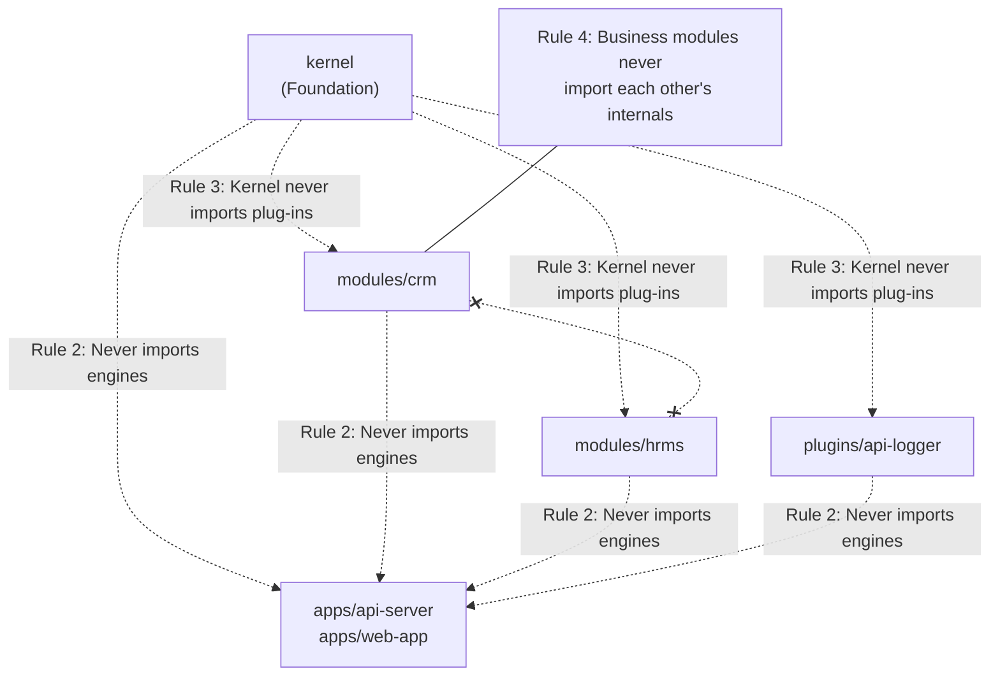

import { Diagram } from '@/components/docs/diagram';

The **Plug-in Contract** defines the interface boundaries, lifecycle guarantees, and architectural constraints governing all extensions in Innostes ERP. Both kernel features and business modules (such as HRMS and CRM) implement this contract to integrate seamlessly with the engines.

---

## 1. Backend Plug-in Contract

Every backend plug-in is an independent Python package installed in the Python environment of `apps/api-server`.

### The `BaseModule` Interface

A backend plug-in provides an instance of [`kernel.core.module.BaseModule`](file:///home/sai/Documents/GitHub/innostes_projects/erp/kernel/backend/kernel/core/module/base.py):

```python title="modules/crm/backend/crm/__init__.py"
from kernel.core.module import BaseModule
from crm.router import router

class CrmModule(BaseModule):
    name: str = "crm"
    version: str = "0.1.0"
    description: str = "Customer Relationship Management business module"
    router = router
    openapi_tags = [
        {
            "name": "CRM",
            "description": "Lead tracking, sales opportunities, and customer contact pipelines."
        }
    ]

    def configure(self, app):
        """Configure ASGI middleware before routers are mounted."""
        pass

    async def on_startup(self, app):
        """Initialise module resources, background workers, or caches."""
        pass

    async def on_shutdown(self, app):
        """Release allocated external resources."""
        pass

    async def health_check(self) -> dict:
        """Return diagnostic health status."""
        return {"status": "HEALTHY", "module": self.name, "version": self.version}

module = CrmModule()
```

### Contract Attributes & Lifecycle Hooks

| Member | Type | Required | Purpose & Lifecycle Timing |
|:---|:---|:---|:---|
| `name` | `str` | **Yes** | Unique identifier for the module. Emitted in `/` and `/health`. Used for tenant module activation checks. |
| `version` | `str` | **Yes** | Semantic version string (e.g. `0.1.0`). |
| `description` | `str` | **Yes** | Concise description displayed in API documentation and module catalogues. |
| `router` | `APIRouter \| None` | No | FastAPI `APIRouter` containing module HTTP endpoints. Mounted onto the root ASGI application by the engine. |
| `openapi_tags` | `list[dict[str, Any]]` | If router used | OpenAPI tag definitions describing endpoint groupings in Swagger UI and OpenAPI specifications. |
| `configure(app)` | Method | No | Executed during application assembly *before* routers and middleware are mounted. Used to register module middleware. |
| `on_startup(app)` | Async method | No | Executed inside the ASGI lifespan during server startup. Used to warm caches or establish outbound connections. |
| `on_shutdown(app)` | Async method | No | Executed inside the ASGI lifespan during server shutdown. Used to release connection pools and background tasks. |
| `health_check()` | Async method | No | Evaluated by `GET /health`. Must return a dict with a `"status"` key (`"HEALTHY"` or `"UNHEALTHY"`). |

### Registration & Discovery

Backend plug-ins register themselves using Python package entry points in `pyproject.toml`. The backend engine never imports a plug-in by static path; it discovers modules using `importlib.metadata.entry_points`:

```toml title="modules/crm/backend/pyproject.toml"
[project]
name = "innostes-crm"
version = "0.1.0"
dependencies = [
    "kernel",
    "fastapi>=0.115",
]

# Business modules register under "innostes.modules"
[project.entry-points."innostes.modules"]
crm = "crm:module"

# Extensible plugins register under "innostes.plugins"
# [project.entry-points."innostes.plugins"]
# api_logger = "api_logger:plugin"
```

---

## 2. Frontend Plug-in Contract

Frontend plug-ins are authored as pnpm workspace packages in `modules/<name>/frontend` or `plugins/<name>/frontend`.

### Package Manifest & Export Conditions

Frontend plug-ins use modern `@innostes/source` export conditions, allowing Vite to transpile TypeScript source directly without intermediate compilation:

```json title="modules/crm/frontend/package.json"
{
  "name": "@innostes/crm",
  "version": "0.1.0",
  "main": "./src/index.ts",
  "types": "./src/index.ts",
  "exports": {
    ".": {
      "@innostes/source": "./src/index.ts",
      "import": "./src/index.ts",
      "default": "./src/index.ts"
    }
  },
  "dependencies": {
    "@innostes/ui": "workspace:*",
    "@innostes/kernel": "workspace:*"
  }
}
```

### The UI Manifest Contract

Every frontend plug-in exports a typed manifest used by `apps/web-app` for shell navigation and the App Switcher:

```typescript title="modules/crm/frontend/src/manifest.ts"
export interface ModuleManifest {
  id: string;
  name: string;
  version: string;
  description: string;
  type: 'module' | 'plugin';
  tags: string[];
  tone: 'chart-1' | 'chart-2' | 'chart-3' | 'chart-4' | 'chart-5';
  href: string;
  subFeatures: { id: string; label: string; description: string }[];
}

export const crmManifest: ModuleManifest = {
  id: 'crm',
  name: 'Customer Relationships',
  version: '0.1.0',
  description: 'Manage sales pipelines, customer interactions, and deal stages.',
  type: 'module',
  tags: ['Sales', 'Pipeline', 'Deals'],
  tone: 'chart-2',
  href: '/modules/crm',
  subFeatures: [
    { id: 'leads', label: 'Lead Management', description: 'Track prospect conversions' },
    { id: 'deals', label: 'Deal Stages', description: 'Monitor pipeline revenue' },
  ],
};
```

---

## 3. Package Layout & Conventions

The repository follows a strict directory layout:

```text
erp/
├── apps/
│   ├── api-server/         # Backend ASGI Engine (FastAPI)
│   ├── web-app/            # UI SPA Engine (React 19 + Vite)
│   └── landing/            # Documentation Portal (Next.js + Fumadocs)
├── kernel/
│   ├── backend/            # Foundation Python package (kernel)
│   └── frontend/           # Foundation TypeScript package (@innostes/kernel)
├── modules/                # Business Domain Modules
│   ├── hrms/
│   │   ├── backend/        # innostes-hrms Python package
│   │   └── frontend/       # @innostes/hrms workspace package
│   └── crm/
│       ├── backend/        # innostes-crm Python package
│       └── frontend/       # @innostes/crm workspace package
└── plugins/                # Extensible System Plugins
    └── api-logger/
        ├── backend/        # innostes-api-logger Python package
        └── frontend/       # @innostes/api-logger workspace package
```

---

## 4. Engine Guarantees to Plug-ins

The backend and UI engines provide foundational guarantees that simplify module authoring:

1. **Database Session Management**: The engine injects managed async sessions via `Depends(get_db)`. Transactions commit or roll back automatically upon endpoint exit.
2. **Universal Identity & Context**: Authenticated endpoints receive the active user identity (`get_current_user`) and tenant context (`get_current_tenant_id`) from request headers and JWT claims.
3. **Database Migration Pipeline**: The engine runs Alembic auto-migrations at startup, using PostgreSQL advisory locks to guarantee that concurrent replicas do not execute conflicting schema alterations.
4. **CORS & Error Wrapping**: Outermost middleware wraps all responses, guaranteeing that RFC 7807 error responses always include appropriate CORS headers.
5. **Setup Gating**: The engine prevents uninitialised access by returning HTTP 503 until the platform is provisioned.

---

## 5. Architectural Invariants (Forbidden Anti-patterns)

Automated fitness functions strictly enforce five architectural boundary rules. Violating any rule fails CI:



| Rule | Description | Rationale | Automated Fitness Function |
|:---|:---|:---|:---|
| **Rule 1: No Circular Imports** | Modules must form a directed acyclic graph (DAG). | Prevents runtime initialisation deadlocks. | [`.importlinter`](file:///home/sai/Documents/GitHub/innostes_projects/erp/.importlinter) (`contracts.1`) |
| **Rule 2: Plug-ins Never Import Engines** | Neither `kernel`, `modules/*`, nor `plugins/*` may import from `apps/*`. | Preserves engine pluggability and independent deployability. | [`.importlinter`](file:///home/sai/Documents/GitHub/innostes_projects/erp/.importlinter) (`contracts.2`) |
| **Rule 3: Kernel Depends on No Plug-in** | `kernel` must never import from `modules/*` or `plugins/*`. | Guarantees that the platform foundation functions without optional modules. | [`.importlinter`](file:///home/sai/Documents/GitHub/innostes_projects/erp/.importlinter) (`contracts.3`) |
| **Rule 4: Modules Never Import Each Other** | Business modules (`crm`, `hrms`) must never import each other's internal models or services. | Decouples feature lifecycles and enables independent deployments. | [`.importlinter`](file:///home/sai/Documents/GitHub/innostes_projects/erp/.importlinter) (`contracts.4`) & [`scripts/checks/check-ts-boundaries.mjs`](file:///home/sai/Documents/GitHub/innostes_projects/erp/scripts/checks/check-ts-boundaries.mjs) |
| **Rule 5: Layering Inside Modules** | Routers may import services; services import models. Routers must never execute raw SQL directly. | Enforces clean separation of concerns and audit trail compliance. | [`.importlinter`](file:///home/sai/Documents/GitHub/innostes_projects/erp/.importlinter) (`contracts.5`) |

---

## 6. Discovered Module Catalogue

The platform currently hosts **7 active modules** across kernel, business domain, and extensible plugin categories. This catalogue is generated directly from module manifests and entry points:

| Module Identifier | Category | Python Package | Frontend Package | Entry Point | Routes Count | Relational Tables | Migrations Path |
|:---|:---|:---|:---|:---|:---:|:---|:---|
| `kernel.setup` | Kernel | `kernel` | `@innostes/kernel` | `kernel.setup:module` | 3 | `installation` | `kernel/backend/migrations` |
| `kernel.tenancy` | Kernel | `kernel` | `@innostes/kernel` | `kernel.tenancy:module` | 4 | `tenants`, `tenant_settings`, `tenant_members`, `tenant_modules`, `tenant_plugins` | `kernel/backend/migrations` |
| `kernel.user` | Kernel | `kernel` | `@innostes/kernel` | `kernel.user:module` | 4 | `users`, `user_profiles`, `user_identities`, `roles`, `permissions`, `role_permissions`, `user_roles` | `kernel/backend/migrations` |
| `kernel.auth` | Kernel | `kernel` | `@innostes/kernel` | `kernel.auth:module` | 8 | `user_devices`, `user_sessions`, `user_security`, `password_histories`, `api_keys` | `kernel/backend/migrations` |
| `hrms` | Business | `innostes-hrms` | `@innostes/hrms` | `hrms:module` | 3 | *(Domain tables pending)* | `modules/hrms/backend/migrations` |
| `crm` | Business | `innostes-crm` | `@innostes/crm` | `crm:module` | 3 | *(Domain tables pending)* | `modules/crm/backend/migrations` |
| `api_logger` | Extensible Plugin | `innostes-api-logger` | `@innostes/api-logger` | `api_logger:module` | 2 | *(In-memory telemetry)* | `plugins/api-logger/backend/migrations` |

---

## Related Documentation

- [Building a Feature Guide](/docs/guides/building-a-feature) — Step-by-step tutorial for scaffolding new business modules.
- [Building Block View](/docs/architecture/building-blocks) — High-level C4 container and component diagrams.
- [Data Architecture](/docs/architecture/data-architecture) — Entity-relationship diagrams and table schemas.
