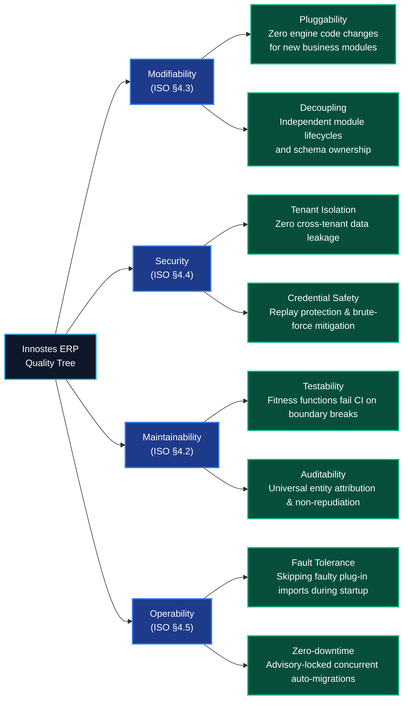

import { Diagram } from '@/components/docs/diagram';

The **Quality Requirements** (arc42 §10) refine the platform's top quality goals into concrete, measurable architectural scenarios structured according to the **ISO/IEC 25010 software product quality standard**.

---

## 1. ISO/IEC 25010 Quality Tree

The quality tree refines high-level quality attributes into specific engineering concerns for Innostes ERP:

<Diagram caption="Quality Tree: ISO/IEC 25010 architectural quality characteristics and platform concerns.">

</Diagram>

---

## 2. Six-Part Architectural Quality Scenarios

Each scenario follows the standard six-part SEI/arc42 specification:
- **Source**: Where the stimulus originates.
- **Stimulus**: The condition or event arriving at the system.
- **Artefact**: The architectural component affected.
- **Environment**: Runtime or development operational mode.
- **Response**: The required system behaviour.
- **Response Measure**: Quantifiable threshold determining success.

### Goal 1: Modifiability (Pluggability & Independence)

#### Scenario SC-MOD-01: Adding a New Backend Plug-in
- **Source**: Module developer.
- **Stimulus**: Authors and installs a new business module (`innostes-payroll`).
- **Artefact**: Backend ASGI engine (`apps/api-server`).
- **Environment**: Server restart or cold deployment.
- **Response**: `ModuleLoader` discovers the package entry point (`innostes.modules`), registers routes, mounts tags, and executes startup hooks.
- **Response Measure**: **Zero lines of code modified** inside `apps/api-server` or `kernel/backend`.
- **Verification**: Enforced by [ADR-0001](/docs/architecture/decisions/0001-engine-plugin-inversion) and verified by `ModuleLoader.discover()` tests.

#### Scenario SC-MOD-02: Decommissioning an Optional Module
- **Source**: System administrator.
- **Stimulus**: Uninstalls a plug-in package from the Python environment.
- **Artefact**: Backend engine and existing database tables.
- **Environment**: Standard runtime.
- **Response**: The engine starts cleanly, omitting routes and health probes for the removed module without breaking other modules.
- **Response Measure**: **Zero startup errors**; all other modules continue operating at 100% availability.
- **Verification**: Verified via `ServerEngine` unit tests in `kernel/backend/tests/`.

---

### Goal 2: Security (Multi-Tenant Isolation & Authentication)

#### Scenario SC-SEC-01: Cross-Tenant Data Tampering Prevention
- **Source**: Authenticated user belonging to Tenant A.
- **Stimulus**: Issues `GET /crm/leads` supplying `X-Tenant-ID: <Tenant-B-UUID>` in headers.
- **Artefact**: Tenancy dependency (`get_current_tenant_id`) and `BaseService`.
- **Environment**: Production API ingress.
- **Response**: Dependency validates membership in `tenant_members`, detects non-membership, and halts execution before reaching domain services.
- **Response Measure**: Emits **HTTP 403 Forbidden** within **< 15 milliseconds**; zero records from Tenant B are accessed or returned.
- **Verification**: Enforced by `kernel.tenancy.dependencies` and covered by automated test suites.

#### Scenario SC-SEC-02: Refresh Token Replay & Theft Mitigation
- **Source**: Malicious adversary with a stolen, previously-revoked refresh token.
- **Stimulus**: Submits revoked token to `POST /auth/refresh`.
- **Artefact**: Authentication service (`kernel.auth.services.AuthService`).
- **Environment**: Public ingress.
- **Response**: System detects token reuse within the token family, marks the entire family revoked, and terminates all active sessions for that device.
- **Response Measure**: Emits **HTTP 401 Unauthorized**; **100% of child and sibling sessions** for that device are terminated immediately.
- **Verification**: Enforced by [ADR-0015](/docs/architecture/decisions/0015-single-use-rotating-refresh-family) and verified by `test_auth_service.py`.

---

### Goal 3: Maintainability (Layering & Architectural Invariants)

#### Scenario SC-MAIN-01: Preventing Module Boundary Violations
- **Source**: Core engineer introducing a feature.
- **Stimulus**: Accidental import of business module code (`modules.crm`) inside `kernel/backend`.
- **Artefact**: Monorepo codebase.
- **Environment**: CI pull request validation.
- **Response**: Python import-linter contracts flag Rule 3 violation and halt the CI pipeline.
- **Response Measure**: **Build fails with exit code 1** before code can be merged into `main`.
- **Verification**: Enforced by [`.importlinter`](file:///home/sai/Documents/GitHub/innostes_projects/erp/.importlinter) contract `RULE-3`.

#### Scenario SC-MAIN-02: Enforcing Relational Model Audit Invariants
- **Source**: Developer creating a new persistent database entity.
- **Stimulus**: Forgets to inherit from `BaseModel` or omits primary key mixins.
- **Artefact**: Database schema metadata (`Base.metadata`).
- **Environment**: Unit test execution in CI.
- **Response**: Architecture fitness test inspects all registered tables and verifies the presence of `id`, `created_at`, `created_by`, `updated_at`, `updated_by`, `deleted_at`, and `deleted_by`.
- **Response Measure**: **Test suite fails** identifying the non-compliant model by name.
- **Verification**: Enforced by [`kernel/backend/tests/test_architecture_fitness.py`](file:///home/sai/Documents/GitHub/innostes_projects/erp/kernel/backend/tests/test_architecture_fitness.py).

---

### Goal 4: Operability (Concurrent Startup & Fault Tolerance)

#### Scenario SC-OPER-01: Concurrent Startup Across Multiple API Replicas
- **Source**: Deployment orchestrator (Kubernetes).
- **Stimulus**: Simultaneously boots 5 `api-server` container replicas with `AUTO_MIGRATE=true`.
- **Artefact**: Migration runner (`auto_migrate`) and PostgreSQL 16.
- **Environment**: Production deployment.
- **Response**: First replica acquires PostgreSQL transaction advisory lock `727001` and executes DDL upgrades; remaining 4 replicas block safely until the lock releases, then detect migrations are current and resume.
- **Response Measure**: **Zero migration deadlocks or DDL race errors**; all 5 replicas transition to healthy readiness within **< 10 seconds**.
- **Verification**: Enforced by [ADR-0005](/docs/architecture/decisions/0005-sqlalchemy-async-alembic) and verified by `kernel.core.database.migrations`.

#### Scenario SC-OPER-02: Resilience Against Broken Plug-in Import
- **Source**: Defective third-party plug-in package with syntax or dependency error.
- **Stimulus**: Installed into the api-server environment.
- **Artefact**: `ModuleLoader` discovery mechanism.
- **Environment**: Container startup.
- **Response**: Loader catches the import exception, logs an error with module name and stack trace, and proceeds to load remaining healthy plug-ins.
- **Response Measure**: **API server starts successfully**; healthy modules serve traffic without disruption.
- **Verification**: Enforced by [`apps/api-server/app/engine/loader.py:44`](file:///home/sai/Documents/GitHub/innostes_projects/erp/apps/api-server/app/engine/loader.py#L44).

---

## Related Documentation

- [Goals & ISO/IEC 25010 Quality Overview](/docs/architecture/goals) — Business requirements and stakeholder matrix.
- [Risks & Technical Debt](/docs/architecture/risks-and-technical-debt) — Open architectural findings and risk register.
- [Architecture Decisions Log](/docs/architecture/decisions) — Formal MADR 4.x records confirming quality choices.
