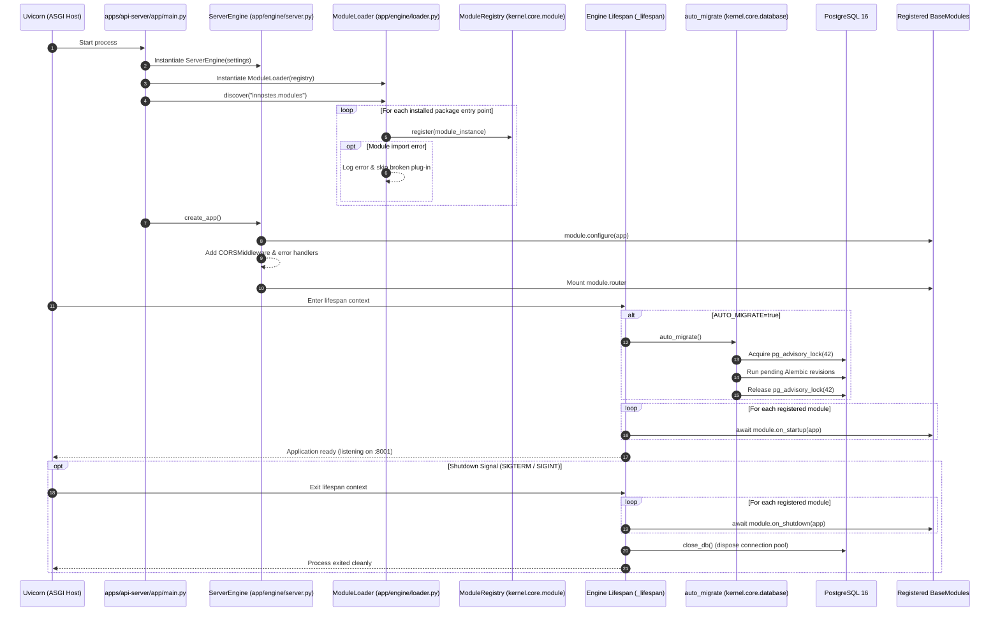
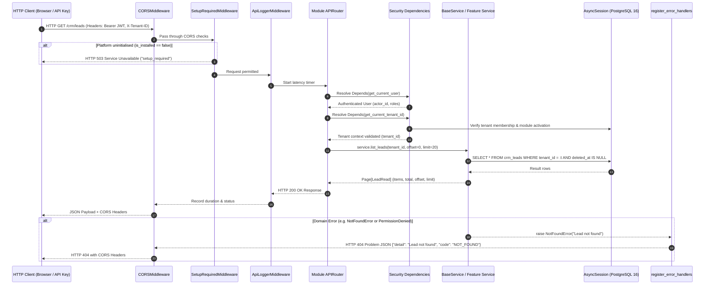
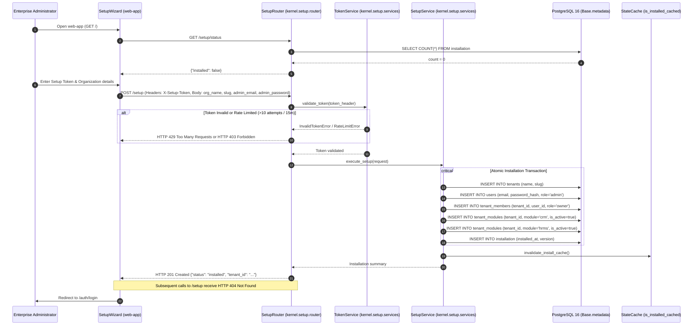
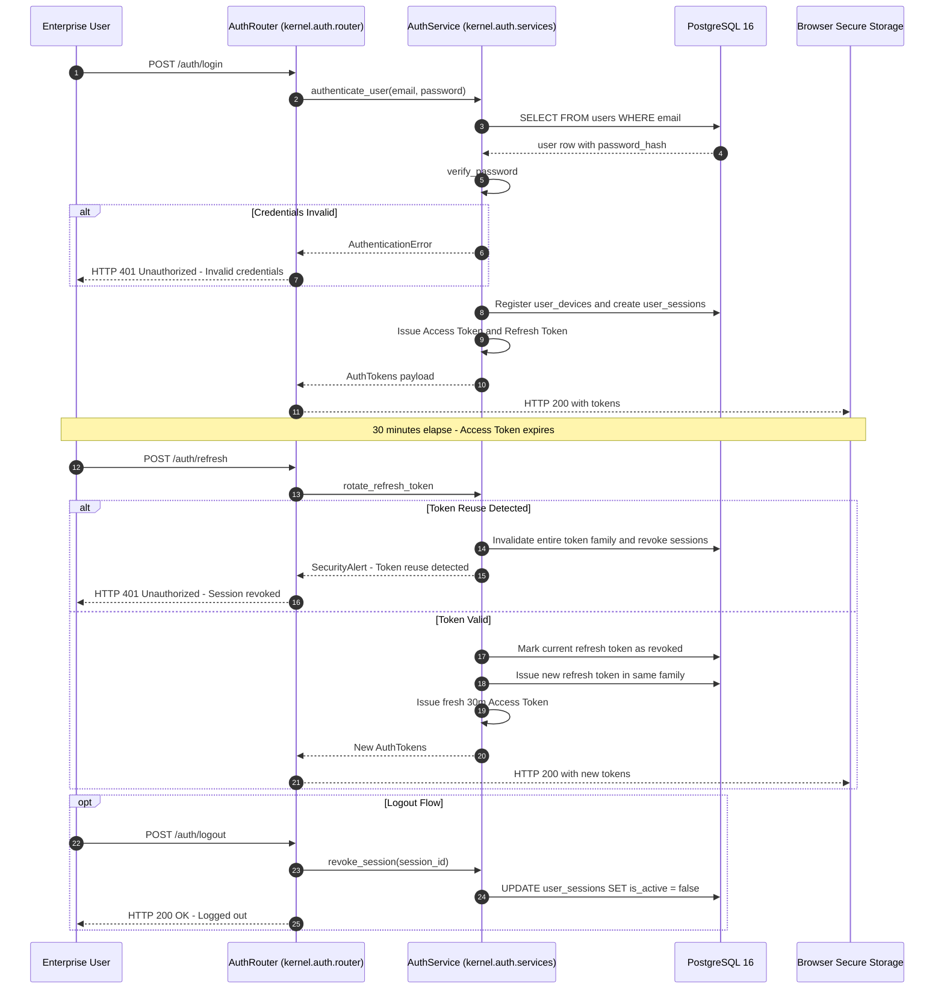
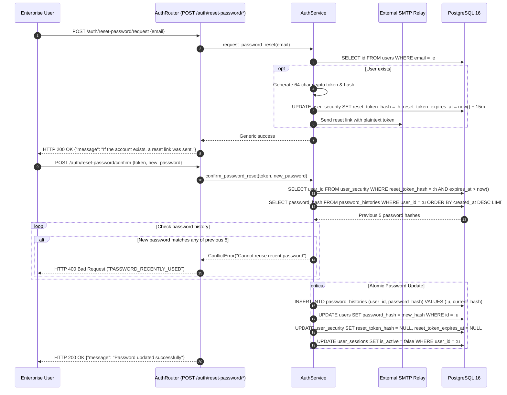
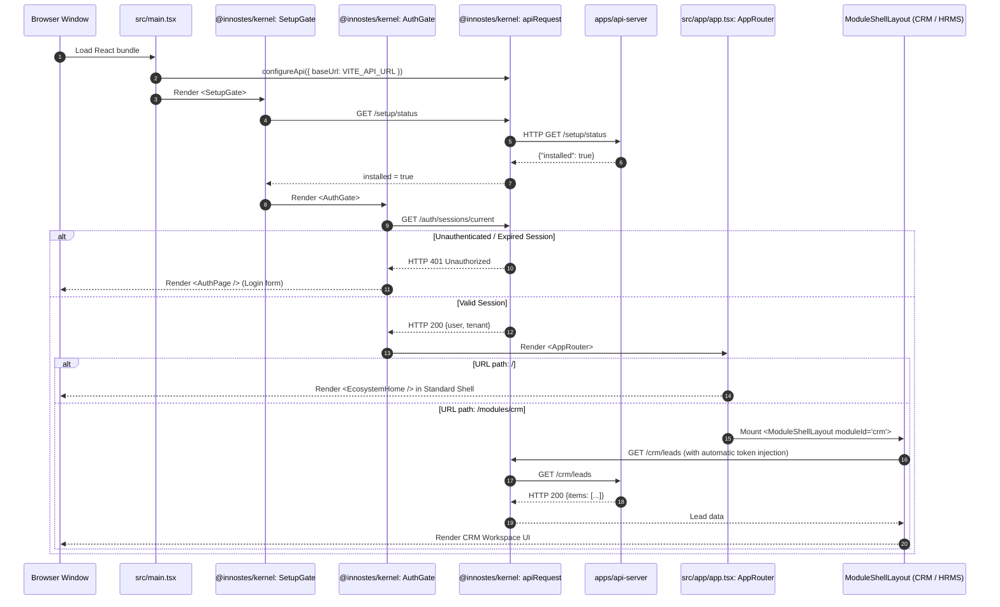
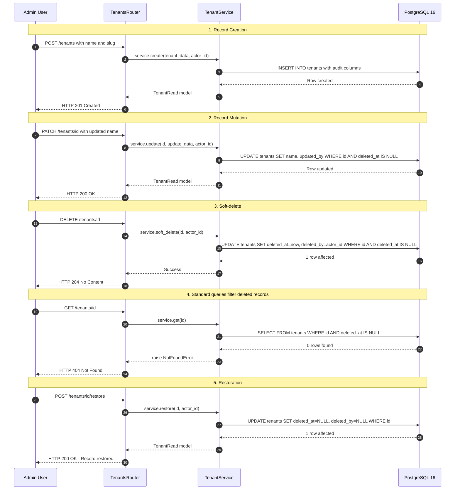

import { Diagram } from '@/components/docs/diagram';

The **Runtime View** (arc42 §6) explains how the platform's building blocks collaborate at runtime during critical lifecycle events. Each scenario is traced through the real implementation, detailing participants, request boundaries, error paths, and transaction semantics.

---

## 1. API Server Start-up Sequence

When Uvicorn boots the ASGI application, the engine coordinates configuration loading, database connection pooling, database migrations, and module initialisation:

<Diagram caption="Sequence Diagram: apps/api-server boot sequence, migration runner, and module discovery.">

</Diagram>

### Step-by-Step Execution

1. **Configuration Resolution**: [`kernel/backend/kernel/core/config/settings.py`](file:///home/sai/Documents/GitHub/innostes_projects/erp/kernel/backend/kernel/core/config/settings.py) loads environment variables and `.env` files via Pydantic Settings.
2. **Module Discovery**: [`ModuleLoader.discover()`](file:///home/sai/Documents/GitHub/innostes_projects/erp/apps/api-server/app/engine/loader.py) inspects the `innostes.modules` entry-point group. If a module fails to import, the engine logs an error and skips it, preventing a single faulty plug-in from taking down the API server.
3. **Application Assembly**: [`ServerEngine.create_app()`](file:///home/sai/Documents/GitHub/innostes_projects/erp/apps/api-server/app/engine/server.py) executes `module.configure(app)` for each module (allowing middleware registration), attaches outermost `CORSMiddleware`, registers RFC 7807 error handlers, and includes module routers.
4. **Lifespan Startup**:
   - If `AUTO_MIGRATE=true`, executes [`auto_migrate()`](file:///home/sai/Documents/GitHub/innostes_projects/erp/kernel/backend/kernel/core/database/migrations.py). Acquires PostgreSQL advisory lock `42` to prevent migration races across replicas.
   - Calls `await module.on_startup(app)` across all modules.
5. **Lifespan Shutdown**: On SIGTERM, executes `await module.on_shutdown(app)` and calls `close_db()` to drain the async connection pool.

---

## 2. Inbound Request Lifecycle & Tenant Isolation

Every HTTP request traverses the ordered middleware stack, security dependencies, and domain service boundaries:

<Diagram caption="Sequence Diagram: Authenticated multi-tenant request lifecycle and transaction boundary.">

</Diagram>

### Step-by-Step Execution

1. **CORS Evaluation**: [`CORSMiddleware`](file:///home/sai/Documents/GitHub/innostes_projects/erp/apps/api-server/app/engine/server.py) verifies origin against `CORS_ORIGINS`.
2. **Setup Mode Gate**: [`SetupRequiredMiddleware`](file:///home/sai/Documents/GitHub/innostes_projects/erp/kernel/backend/kernel/setup/middleware.py) checks cached install state. If uninstalled, all routes outside `/setup/*`, `/`, `/config`, `/health`, and `/docs` receive HTTP 503.
3. **Telemetry Capture**: [`ApiLoggerMiddleware`](file:///home/sai/Documents/GitHub/innostes_projects/erp/plugins/api-logger/backend/api_logger/middleware.py) captures start time, method, and URI path.
4. **Authentication Resolution**: Dependency `get_current_user` extracts and validates the Bearer JWT or Personal API Key (`inno_live_...`).
5. **Tenant Scoping**: Dependency `get_current_tenant_id` extracts `X-Tenant-ID`, queries `tenant_members` to verify the user belongs to the organization, and confirms that the requested module is enabled in `tenant_modules`.
6. **Service Execution & Transaction**: [`BaseService`](file:///home/sai/Documents/GitHub/innostes_projects/erp/kernel/backend/kernel/core/services/base.py) executes queries strictly scoped by `tenant_id` and filters out soft-deleted records (`deleted_at IS NULL`).
7. **Error Normalisation**: If an exception occurs, [`register_error_handlers`](file:///home/sai/Documents/GitHub/innostes_projects/erp/kernel/backend/kernel/core/http.py) maps domain errors to standard RFC 7807 responses.

---

## 3. First-run Setup Flow

Before initial installation, the platform operates in setup mode. The initial administrator provisions the organization through the web wizard or CLI:

<Diagram caption="Sequence Diagram: First-run setup token validation and organization provisioning.">

</Diagram>

### Step-by-Step Execution

1. **Status Check**: `GET /setup/status` evaluates the single-row `installation` table.
2. **Security Token Verification**: [`TokenService`](file:///home/sai/Documents/GitHub/innostes_projects/erp/kernel/backend/kernel/setup/services/token.py) validates the 256-bit token generated on first boot in `var/setup-token` or configured via `SETUP_TOKEN`. Enforces a strict rate limiter (maximum 10 failed attempts per 15 minutes).
3. **Atomic Setup Transaction**: [`SetupService`](file:///home/sai/Documents/GitHub/innostes_projects/erp/kernel/backend/kernel/setup/services/setup_service.py) provisions the primary tenant, the root administrator account, default memberships, and inserts the `installation` sentinel row.
4. **Cache Invalidation**: Clears the in-process setup cache. The `SetupRequiredMiddleware` immediately unblocks standard application routes. All subsequent `/setup` requests return HTTP 404.
5. **CLI Alternative**: Running `python -m kernel.setup install --from-env` executes identical provisioning steps directly without HTTP overhead.

---

## 4. Authentication, Token Rotation & Logout

Authentication employs 30-minute JWT access tokens coupled with 7-day single-use rotating refresh token families:

<Diagram caption="Sequence Diagram: Login, rotating refresh token family issuance, and logout.">

</Diagram>

### Step-by-Step Execution

1. **Authentication**: `POST /auth/login` verifies credentials with `bcrypt.checkpw()`.
2. **Session & Device Audit**: Creates entries in `user_devices` and `user_sessions`, capturing IP address and user-agent.
3. **Token Issuance**: Generates a 30-minute JWT containing user ID, tenant ID, and session ID, alongside a 7-day cryptographically random refresh token assigned to a token family UUID.
4. **Token Rotation & Replay Protection**: `POST /auth/refresh` validates the refresh token:
   - **Normal Rotation**: Revokes the supplied refresh token and issues a child refresh token in the same family.
   - **Reuse Detection**: If a previously revoked refresh token is presented, the system treats it as token theft. It immediately revokes the entire token family and terminates all active sessions for that device.
5. **Logout**: `POST /auth/logout` revokes the session and marks the active refresh token family as spent.

---

## 5. Password Reset Workflow

Password resets ensure secure self-service recovery while maintaining password history hygiene:

<Diagram caption="Sequence Diagram: Password reset request, token verification, and history checks.">

</Diagram>

### Step-by-Step Execution

1. **Reset Request**: `POST /auth/reset-password/request` generates a 64-character random token, stores its hash with a 15-minute expiration, and dispatches an email via SMTP. It returns a generic HTTP 200 message to prevent user enumeration.
2. **Token & History Verification**: `POST /auth/reset-password/confirm` validates the token hash and compares the new password against the last 5 entries in `password_histories`.
3. **Session Invalidation**: Commits the new hash, archives the old hash in `password_histories`, and revokes all active sessions for the user across all devices.

---

## 6. UI Engine Boot & Module Mounting

The browser Single Page Application (`apps/web-app`) coordinates bootstrapping, setup detection, authentication gating, and dynamic shell rendering:

<Diagram caption="Sequence Diagram: apps/web-app client boot sequence, gates, and dynamic module rendering.">

</Diagram>

### Step-by-Step Execution

1. **Client Boot**: [`apps/web-app/src/main.tsx`](file:///home/sai/Documents/GitHub/innostes_projects/erp/apps/web-app/src/main.tsx) initialises the API client.
2. **Setup Check**: `<SetupGate>` queries `GET /setup/status`. If uninstalled, `<SetupWizard>` mounts immediately.
3. **Authentication Check**: `<AuthGate>` evaluates current session cookies or local storage. If unauthenticated, `<AuthPage>` renders.
4. **Workspace Routing**: `<AppRouter>` evaluates the URL:
   - Root `/`: Renders standard shell with navigation and tenant overview.
   - Module path `/modules/crm`: Loads the `@innostes/crm` manifest and renders `<ModuleShellLayout />`.
5. **Transparent Refresh**: If any background API call returns HTTP 401, `apiRequest()` intercepts the failure, requests a new access token via `POST /auth/refresh`, and replays the original request without user interruption.

---

## 7. Entity Lifecycle: Create, Update, Soft-delete & Restore

All domain records (e.g. tenants, users, leads) follow uniform lifecycle and audit trail patterns:

<Diagram caption="Sequence Diagram: Universal entity audit trail, soft-delete, and restoration cycle.">

</Diagram>

### Step-by-Step Execution

1. **Creation**: [`BaseService.create()`](file:///home/sai/Documents/GitHub/innostes_projects/erp/kernel/backend/kernel/core/services/base.py) sets primary keys (`UUID v4`), `created_at = UTC now`, and `created_by = actor_id`.
2. **Update**: [`BaseService.update()`](file:///home/sai/Documents/GitHub/innostes_projects/erp/kernel/backend/kernel/core/services/base.py) mutates fields and updates `updated_at = UTC now`, `updated_by = actor_id`.
3. **Soft-deletion**: [`BaseService.soft_delete()`](file:///home/sai/Documents/GitHub/innostes_projects/erp/kernel/backend/kernel/core/services/base.py) sets `deleted_at = UTC now` and `deleted_by = actor_id`. The record remains physically intact in PostgreSQL.
4. **Default Query Filtering**: Queries executed through `BaseService` automatically append `WHERE deleted_at IS NULL`. Soft-deleted entities return HTTP 404 to standard users.
5. **Audit / Restoration**: Compliance administrators can view soft-deleted records using `include_deleted=true` and execute `POST /tenants/{id}/restore` to un-delete records by setting `deleted_at = NULL`.

---

## Related Documentation

- [Building Block View](/docs/architecture/building-blocks) — Static container and component decompositions.
- [Data Architecture](/docs/architecture/data-architecture) — Entity relationships, column mixins, and migration patterns.
- [REST API Reference](/api-reference) — Complete parameter specifications and operation payloads.
