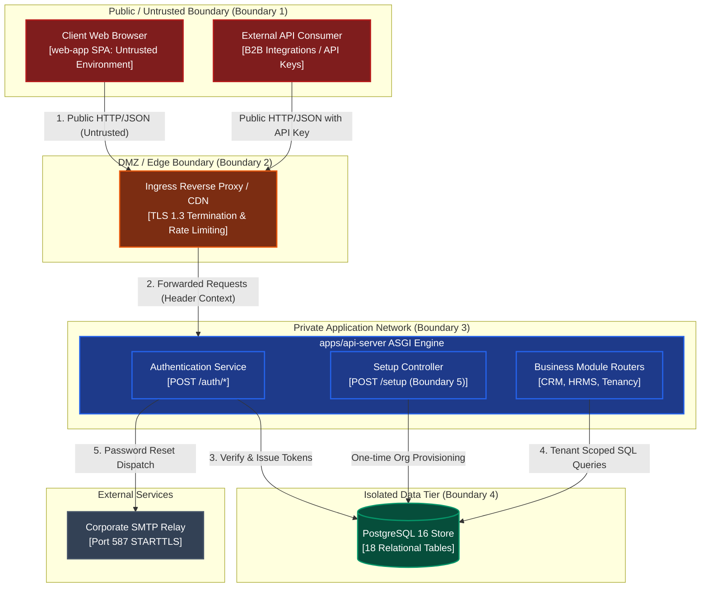

import { Diagram } from '@/components/docs/diagram';

The **Security Threat Model** (arc42 §8) systematically evaluates potential security risks facing Innostes ERP using the industry-standard **STRIDE methodology** (Spoofing, Tampering, Repudiation, Information Disclosure, Denial of Service, Elevation of Privilege).

---

## 1. Scope, Assumptions & Trust Boundaries

### Scope
The model encompasses the browser UI client (`apps/web-app`), the backend ASGI engine (`apps/api-server`), PostgreSQL 16 relational storage, the corporate SMTP relay, and administrative command-line installers.

### Core Security Assumptions
1. Host operating system access is restricted to authorized platform administrators.
2. Production traffic is encrypted in transit using TLS 1.3.
3. Database credentials and cryptographic keys are managed securely via environment secrets.

### Data Flow Diagram & Trust Boundaries

<Diagram caption="Data Flow Diagram (DFD): System processes, data stores, and 5 primary architectural trust boundaries.">

</Diagram>

### Trust Boundary Definitions

| Boundary | Description | Risk Profile | Primary Control |
|:---|:---|:---|:---|
| **Boundary 1: External Client ↔ Edge** | Public internet clients dispatching requests to reverse proxies. | High exposure to credential stuffing, DDoS, and XSS. | TLS 1.3, CSP headers, and CORS origins. |
| **Boundary 2: Edge ↔ Backend Engine** | Ingress routing traffic into the FastAPI ASGI pipeline. | Request spoofing and unauthorized header manipulation. | Proxy header verification (`--proxy-headers`) and setup gating. |
| **Boundary 3: Engine ↔ Database** | Application services dispatching SQL queries to PostgreSQL. | SQL injection, unauthorized cross-tenant data access. | SQLAlchemy 2.0 parameterized queries and `tenant_id` scoping. |
| **Boundary 4: Cross-Tenant Isolation** | Multi-tenant logical data boundary within shared PostgreSQL schema. | Tenant data leakage and cross-tenant tampering. | `get_current_tenant_id` validation in `BaseService`. |
| **Boundary 5: System Setup Gating** | Pre-installation state boundary before first-run provisioning. | Host takeover via unauthorized `/setup` invocation. | Single-row `installation` table and 256-bit setup tokens. |

---

## 2. Asset Classification

| Asset Category | Target Elements | Impact of Compromise | Classification |
|:---|:---|:---|:---:|
| **Authentication Secrets** | `JWT_SECRET_KEY`, `user_security.reset_token_hash` | Complete impersonation of enterprise identities. | **Critical** |
| **Data Encryption Keys** | `ENCRYPTION_KEYS` keyring, `BLIND_INDEX_PEPPER` | Exposure of encrypted PII (emails, phone numbers). | **Critical** |
| **Relational Credentials** | `DB_PASSWORD`, database connection strings | Full database breach and integrity destruction. | **Critical** |
| **Tenant Business Data** | Leads, deals, employee records, financial profiles | Industrial espionage, regulatory breach (GDPR/DPDP). | **High** |
| **User Identifiers & PII** | First names, last names, hashed email, mobile | Privacy violations and spear-phishing vulnerability. | **High** |
| **Setup Installation Token** | `var/setup-token`, `SETUP_TOKEN` | Unauthorized root organization provisioning. | **High** |

---

## 3. STRIDE Threat Analysis Matrix

The platform mitigates security threats across all six STRIDE categories:

### STRIDE Assessment Table

| Threat ID | Category | Threat Scenario & Target | Existing Mitigations in Code | Residual Risk | Recommended Action |
|:---|:---:|:---|:---|:---:|:---|
| **TM-001** | **Spoofing** | Adversary forges a JWT access token to impersonate an administrator. | Signed via HMAC-SHA256 (`JWT_SECRET_KEY`). Signature and expiry verified on every request in [`kernel/core/security/jwt.py:35`](file:///home/sai/Documents/GitHub/innostes_projects/erp/kernel/backend/kernel/core/security/jwt.py#L35). | **Low** | Support asymmetric RS256/EdDSA keys for zero-trust public key verification. |
| **TM-002** | **Tampering** | User alters `X-Tenant-ID` header to mutate records belonging to another tenant. | Dependency [`get_current_tenant_id`](file:///home/sai/Documents/GitHub/innostes_projects/erp/kernel/backend/kernel/tenancy/dependencies.py#L25) queries `tenant_members` to verify active membership before proceeding. | **Low** | Implement PostgreSQL Row-Level Security (RLS) as defense-in-depth. |
| **TM-003** | **Repudiation** | Rogue user deletes critical records and claims actions were performed by others. | Universal [`AuditMixin`](file:///home/sai/Documents/GitHub/innostes_projects/erp/kernel/backend/kernel/core/database/mixins.py#L40) and [`SoftDeleteMixin`](file:///home/sai/Documents/GitHub/innostes_projects/erp/kernel/backend/kernel/core/database/mixins.py#L55) record `actor_id` on every mutation. | **Low** | Export audit events to an immutable append-only external SIEM. |
| **TM-004** | **Information Disclosure** | Database dump exposes sensitive enterprise identities. | [`kernel/core/crypto/`](file:///home/sai/Documents/GitHub/innostes_projects/erp/kernel/backend/kernel/core/crypto/) encrypts email/phone with AES-256 and stores SHA-256 blind indexes for search. | **Low** | Enforce database-at-rest encryption (AWS RDS KMS / LUKS). |
| **TM-005** | **Denial of Service** | Credential stuffing attack on `/auth/login` exhausts CPU via bcrypt hashing. | Lockout policy locks accounts after 5 failures in [`kernel/auth/services/auth_service.py:120`](file:///home/sai/Documents/GitHub/innostes_projects/erp/kernel/backend/kernel/auth/services/auth_service.py#L120). | **Medium** | Introduce IP-based rate limiting at the reverse proxy tier. |
| **TM-006** | **Elevation of Privilege** | Standard employee attempts to invoke tenant provisioning routes. | Protected by [`require_super_admin`](file:///home/sai/Documents/GitHub/innostes_projects/erp/kernel/backend/kernel/core/security/dependencies.py#L65) checking `users.is_super_admin == true`. | **Low** | Audit super-admin access grants on a monthly schedule. |
| **TM-007** | **Tampering** | Stolen refresh token reused by attacker after victim performs standard refresh. | Token Family Rotation in [`kernel/auth/services/auth_service.py:180`](file:///home/sai/Documents/GitHub/innostes_projects/erp/kernel/backend/kernel/auth/services/auth_service.py#L180) revokes the family and all active sessions. | **Low** | Bind refresh tokens to client TLS certificates or device fingerprints. |
| **TM-008** | **Information Disclosure** | Uninstalled instance setup token intercepted by network eavesdropper. | 256-bit cryptographically generated token, file permissions `0600`, rate-limited to 10 attempts in [`kernel/setup/services/token.py:45`](file:///home/sai/Documents/GitHub/innostes_projects/erp/kernel/backend/kernel/setup/services/token.py#L45). | **Low** | Set `SETUP_ENABLED=false` immediately after provisioning. |

---

## 4. Top Architectural Security Risks

The threat model highlights two key findings handed over to the Architectural Risk Register (arc42 §11):

1. **ARC-014: Absence of IP-based Edge Rate Limiting**:
   While user accounts lock after 5 failed attempts, `/auth/login` and `/auth/reset-password/request` lack global IP-based rate limiting in local application code. In production, this must be mitigated at the reverse proxy (Nginx `limit_req` or Cloudflare WAF).
2. **ARC-015: Reliance on Application-Level Tenant Isolation**:
   Multi-tenancy relies on `BaseService` filtering. If an engineer writes a custom raw SQL query that omits `WHERE tenant_id = :t`, data leakage can occur. Defence-in-depth requires PostgreSQL Row-Level Security (RLS).

---

## 5. Review Cadence & Threat Model Lifecycle

This threat model is treated as **Architecture as Code**:
- **Continuous Triggers**: Any Pull Request altering authentication dependencies, introducing new public entry points, or modifying database session lifecycles must update this document.
- **Scheduled Cadence**: Formally reviewed by the Platform Security Architecture Team bi-annually.

---

## Related Documentation

- [Cross-cutting Concepts](/docs/architecture/cross-cutting) — Detailed implementation of authentication and error handling.
- [Key Rotation Runbook](/docs/operations/key-rotation) — Procedures for rotating cryptographic secrets and credentials.
- [Data Architecture](/docs/architecture/data-architecture) — Multi-tenancy isolation and column encryption.
