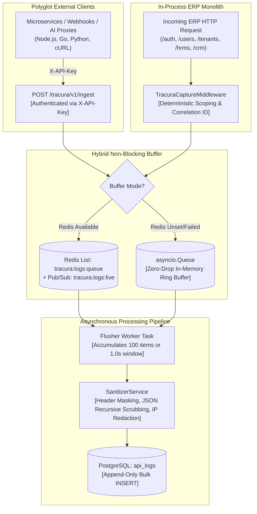

import { Diagram } from '@/components/docs/diagram';

The **Tracura Telemetry Subsystem** (`plugins/tracura`) is a high-throughput, enterprise-grade API observability, secret-scrubbing, and distributed request telemetry engine. It operates in dual mode: as an **in-process ASGI telemetry provider** for the host Innostes ERP, and as a **universal standalone telemetry sink** for external microservices, AI/LLM proxies, mobile backends, and third-party webhooks.

---

## 1. Architectural Model & Ingestion Pipeline

Tracura decouples request execution from telemetry persistence using a non-blocking queue and asynchronous flusher:

<Diagram caption="Tracura dual-ingestion architecture, hybrid buffer queue, PII redactor, and batch storage engine.">

</Diagram>

---

## 2. Universal Enterprise Scoping Hierarchy

Tracura organizes all telemetry records into a four-level hierarchy designed for multi-tenant, multi-cloud enterprises:

`Tenant (Organization)` &rarr; `Project (Application / Service)` &rarr; `Environment (Stage)` &rarr; `Telemetry Log`

```
Organization (Tenant Root)
 └── Projects (e.g. "Innostes ERP", "AI-Copilot", "Payment-Gateway", "Mobile-Backend")
      └── Environments (e.g. "Production", "Staging", "Development", "QA")
           └── Logs & Distributed Traces
```

### Deterministic Host ERP Resolution

When the ERP application monitors itself via ASGI middleware, it resolves scopes deterministically without performing database lookups:

| Dimension | Resolution Strategy | Default Fallback Value |
| :--- | :--- | :--- |
| **`tenant_id`** | Extracted from `request.state.tenant_id` or `X-Tenant-ID` header. | Global System Tenant: `00000000-0000-0000-0000-000000000001`. |
| **`project_id`** | Explicit `X-Project-ID` header or `uuid5(tenant_id, "project:innostes-erp")`. | Deterministic UUID for `"Innostes ERP"`. |
| **`environment_id`** | Explicit `X-Environment-ID` or `uuid5(project_id, "env:" + APP_ENV)`. | Maps to server runtime setting (`development`, `staging`, `production`). |

### The Multi-Tiered Fallback Ladder

If custom headers or environment variables are missing, Tracura follows a strict fallback ladder:

```
┌────────────────────────────────────────────────────────┐
│ 1. Header Override (X-Environment-ID / X-Environment)   │ -> Honors API Gateway / Proxy values
└──────────────────────────┬─────────────────────────────┘
                           │ (not found)
┌──────────────────────────▼─────────────────────────────┐
│ 2. Request State (request.state.environment)           │ -> Honors framework state
└──────────────────────────┬─────────────────────────────┘
                           │ (not found)
┌──────────────────────────▼─────────────────────────────┐
│ 3. Server Config (APP_ENV in .env or OS environment)   │ -> Reads active runtime stage
└──────────────────────────┬─────────────────────────────┘
                           │ (not set or empty)
┌──────────────────────────▼─────────────────────────────┐
│ 4. Safe Default                                        │ -> Falls back to "development"
└────────────────────────────────────────────────────────┘
```

---

## 3. Auto-Provisioned Project Catalog

When any tenant views Tracura in the Admin Panel (`/plugins/tracura`), `ProjectService` automatically verifies whether the host project exists. If uninitialized, it instantly provisions:

1. **Project Record**: `"Innostes ERP"` (`slug="innostes-erp"`) with the exact matching deterministic UUID.
2. **Environment Records**:
   - 🟢 **Production** (`slug="production"`, `color_badge="emerald"`)
   - 🟡 **Staging** (`slug="staging"`, `color_badge="amber"`)
   - 🔵 **Development** (`slug="development"`, `color_badge="blue"`)
   - 🟣 **Custom Environment** (If `APP_ENV` is non-standard, e.g. `qa`, `sandbox`, or `uat`, it is auto-created dynamically).

---

## 4. Multi-Vector Secret & PII Sanitization

Before logs reach persistent storage, `SanitizerService` scrubs sensitive fields in memory:

```py
SENSITIVE_HEADERS = {
    "authorization",
    "cookie",
    "x-api-key",
    "proxy-authorization",
    "set-cookie",
}

SENSITIVE_BODY_KEYS = {
    "password",
    "hashed_password",
    "secret",
    "token",
    "access_token",
    "refresh_token",
    "credit_card",
    "cvv",
    "ssn",
    "api_key",
}
```

- **Header Scrubbing**: Sensitive values are replaced with `[REDACTED]`.
- **Deep JSON Masking**: Recursively traverses nested dictionaries and lists, replacing credential fields with `********`.
- **IP Zero-Masking**: Zero-masks the last octet of IPv4 addresses (`192.168.1.0`) and last 80 bits of IPv6 addresses for GDPR compliance.
- **Oversized Body Truncation**: Truncates payloads exceeding `max_body_size_bytes` (default: 4096 bytes) to protect against denial-of-service memory exhaustion.

---

## 5. Correlation ID Cross-Referencing

Tracura and the Kernel Audit Trail share a unified tracing protocol via `X-Correlation-ID`:

```
User Request ───► Tracura Middleware ───► Generates: req_99b1a03f4e12
                        │
                        ├──► Tracura ApiLog:   correlation_id = req_99b1a03f4e12
                        │
                        └──► Domain Action  ───► Audit Trail: correlation_id = req_99b1a03f4e12
```

In the Web App:
- Viewing an **Audit Log** in `/audit` displays a deep link: **"View HTTP Trace in Tracura"**.
- Viewing a **Telemetry Log** in `/plugins/tracura` displays a cross-link: **"View Compliance Mutation in Audit Trail"**.

---

## 6. Database Storage Engine (`api_logs`)

Telemetry is written to the append-only `api_logs` table (Alembic migration `0006_create_tracura_tables`):

```sql
CREATE TABLE api_logs (
    id UUID PRIMARY KEY,
    tenant_id UUID NOT NULL,
    project_id UUID NOT NULL,
    environment_id UUID NOT NULL,
    api_key_id UUID,
    correlation_id VARCHAR(64) NOT NULL,
    user_id VARCHAR(64),
    client_ip VARCHAR(45),
    user_agent VARCHAR(512),
    http_method VARCHAR(10) NOT NULL,
    url TEXT NOT NULL,
    path VARCHAR(2048) NOT NULL,
    status_code SMALLINT NOT NULL,
    duration_ms DOUBLE PRECISION NOT NULL,
    request_headers JSONB,
    query_params JSONB,
    request_body JSONB,
    response_headers JSONB,
    response_body JSONB,
    error JSONB,
    meta JSONB,
    created_at TIMESTAMP WITH TIME ZONE DEFAULT NOW() NOT NULL
);

CREATE INDEX ix_api_logs_composite_filter 
ON api_logs (tenant_id, project_id, environment_id, created_at);
```

> [!NOTE]
> Foreign keys on `project_id` and `environment_id` in `api_logs` are non-enforcing by design. This guarantees zero lock contention during high-volume bulk batch flushes and facilitates partition drop archiving.

---

## 7. REST API Endpoints Reference

| Category | Method | Path | Auth | Description |
| :--- | :--- | :--- | :--- | :--- |
| **Ingestion** | `POST` | `/tracura/v1/ingest` | Ingestion Key (`X-API-Key`) | Single log ingestion into buffer ring. |
| **Ingestion** | `POST` | `/tracura/v1/ingest/batch` | Ingestion Key (`X-API-Key`) | Bulk log ingestion (up to 250 items). |
| **Projects** | `GET` | `/plugins/tracura/v1/projects` | Bearer Token / Key | List projects and active environments. |
| **Projects** | `POST` | `/plugins/tracura/v1/projects` | Bearer Token / Key | Create project with auto-seeded environments. |
| **Projects** | `DELETE` | `/plugins/tracura/v1/projects/{id}` | Bearer Token / Key | Delete project and associated telemetry. |
| **Keys** | `GET` | `/plugins/tracura/v1/keys` | Bearer Token / Key | List programmatic ingestion keys. |
| **Keys** | `POST` | `/plugins/tracura/v1/keys` | Bearer Token / Key | Generate scoped ingestion key. |
| **Keys** | `DELETE` | `/plugins/tracura/v1/keys/{id}` | Bearer Token / Key | Revoke ingestion key immediately. |
| **Settings** | `GET` | `/plugins/tracura/v1/settings` | Bearer Token / Key | Read effective retention and scrubbing rules. |
| **Settings** | `PATCH` | `/plugins/tracura/v1/settings` | Bearer Token / Key | Update retention days, sampling rate, exclusions. |
| **Logs** | `GET` | `/plugins/tracura/v1/logs` | Bearer Token / Key | Query telemetry logs with multi-attribute filtering. |
| **Logs** | `GET` | `/plugins/tracura/v1/logs/{id}` | Bearer Token / Key | Inspect full request and response payload drawer. |
| **Analytics**| `GET` | `/plugins/tracura/v1/analytics/dashboard` | Bearer Token / Key | Aggregated KPI cards, timeseries, status breakdown. |
| **Info** | `GET` | `/plugins/tracura/info` | Public | Plugin status, version, and feature capabilities. |
