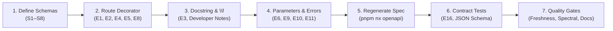

Every HTTP endpoint exposed by Innostes ERP is documented directly at the source in code. The committed OpenAPI 3.1 specification (`apps/api-server/openapi.json`) and the public documentation site at `/api-reference` are generated directly from the Python backend routers, Pydantic schemas, and docstrings.

This guide walks through documenting a new endpoint end to end, using `POST /invoices` in an invoicing module as the reference implementation. A fully functional, tested reference skeleton is available in [`kernel/backend/examples/module_template`](file:///home/sai/Documents/GitHub/innostes_projects/erp/kernel/backend/examples/module_template).

---

## The Documentation Workflow



---

## 1. Defining Pydantic Schemas (S1–S8)

Every request body, response model, and nested object is a Pydantic v2 model inheriting `BaseSchema` or `AuditReadSchema`.

```python title="kernel/backend/examples/module_template/schemas.py"
from decimal import Decimal
from enum import Enum
import uuid
from pydantic import ConfigDict, Field
from kernel.core.schemas import AuditReadSchema, BaseSchema, Page

# [S4] Enums list every value with its business meaning
class InvoiceStatus(str, Enum):
    """Lifecycle status of a customer invoice.

    - `DRAFT`: Initial draft state; editable and not yet sent to customer.
    - `ISSUED`: Finalised and dispatched to customer; awaiting settlement.
    - `PAID`: Full payment received and reconciled against general ledger.
    - `CANCELLED`: Voided prior to payment; retained for audit trail integrity.
    """
    DRAFT = "DRAFT"
    ISSUED = "ISSUED"
    PAID = "PAID"
    CANCELLED = "CANCELLED"


# [S1] Class docstring defines the schema description in the OpenAPI reference
class InvoiceItemCreate(BaseSchema):
    """Line item for invoice creation."""

    # [S2] Every field has description and examples
    # [S3] Constraints (min_length, max_length, ge) declared in the schema
    description: str = Field(
        min_length=1,
        max_length=255,
        description="Detailed product or service description.",
        examples=["Organic Darjeeling First Flush Tea (50kg Bag)"],
    )
    quantity: int = Field(
        ge=1,
        le=100000,
        description="Billed quantity in standard inventory units.",
        examples=[10],
    )
    unit_price: Decimal = Field(
        ge=Decimal("0.01"),
        description="Unit price per item excluding applicable taxes.",
        examples=[Decimal("2450.00")],
    )


# [S7] Consistent naming: InvoiceCreate
class InvoiceCreate(BaseSchema):
    """Request payload for creating a new customer invoice."""

    customer_name: str = Field(
        min_length=2,
        max_length=150,
        description="Legal trading name of the customer organisation.",
        examples=["Northwind Traders Pvt Ltd"],
    )
    customer_email: str = Field(
        max_length=255,
        pattern=r"^[\w\.-]+@[\w\.-]+\.\w+$",
        description="Billing contact email address.",
        examples=["priya.shah@northwind.example"],
    )
    currency: str = Field(
        default="INR",
        min_length=3,
        max_length=3,
        description="ISO 4217 three-letter currency code.",
        examples=["INR"],
    )
    items: list[InvoiceItemCreate] = Field(
        min_length=1,
        description="List of billable line items attached to this invoice.",
    )
    # [S5] Optional vs nullable: None default means optional field
    notes: str | None = Field(
        default=None,
        max_length=1000,
        description="Optional customer-facing payment instructions or remarks.",
        examples=["Payment due within 30 days via NEFT/RTGS transfer."],
    )

    # [S6] Complete, realistic example in model_config json_schema_extra
    # [E17] Enterprise example universe: Northwind Traders Pvt Ltd, .example domain
    model_config = ConfigDict(
        json_schema_extra={
            "examples": [
                {
                    "customer_name": "Northwind Traders Pvt Ltd",
                    "customer_email": "priya.shah@northwind.example",
                    "currency": "INR",
                    "items": [
                        {
                            "description": "Organic Darjeeling First Flush Tea (50kg Bag)",
                            "quantity": 10,
                            "unit_price": "2450.00",
                        }
                    ],
                    "notes": "Payment due within 30 days via NEFT/RTGS transfer.",
                }
            ]
        }
    )


# [S7] Consistent naming: InvoiceRead inheriting AuditReadSchema
class InvoiceRead(AuditReadSchema):
    """Complete public representation of a customer invoice.

    Inherits standard audit fields: id, created_at, created_by,
    updated_at, updated_by, deleted_at, deleted_by.
    """

    invoice_number: str = Field(
        description="Unique sequential invoice tracking code.",
        examples=["INV-2026-0042"],
    )
    customer_name: str = Field(
        description="Legal trading name of the customer organisation.",
        examples=["Northwind Traders Pvt Ltd"],
    )
    customer_email: str = Field(
        description="Billing contact email address.",
        examples=["priya.shah@northwind.example"],
    )
    currency: str = Field(
        description="ISO 4217 three-letter currency code.",
        examples=["INR"],
    )
    status: InvoiceStatus = Field(
        description="Current lifecycle status of the invoice.",
        examples=[InvoiceStatus.ISSUED],
    )
    subtotal: Decimal = Field(
        description="Total net amount before applicable taxes.",
        examples=[Decimal("24500.00")],
    )
    tax_amount: Decimal = Field(
        description="Calculated goods and services tax (18% GST).",
        examples=[Decimal("4410.00")],
    )
    total_amount: Decimal = Field(
        description="Total gross payable amount including tax.",
        examples=[Decimal("28910.00")],
    )
    # [S8] No internal database keys, salt hashes, or secret tokens are exposed
```

---

## 2. Declaring OpenAPI Tags (T1–T3)

Each module registers its OpenAPI tag in its `BaseModule` subclass.

```python title="kernel/backend/examples/module_template/__init__.py"
from typing import Any
from kernel.core.module import BaseModule
from .router import router

class InvoiceModule(BaseModule):
    name = "invoicing"
    version = "0.1.0"
    description = "Customer invoicing and payment tracking module"
    router = router

    # [T1] Description explains what the area covers and who uses it
    # [T2] Order is set logically in the module loader
    # [T3] Sentence case tag name ("Invoices", "User management")
    openapi_tags: list[dict[str, Any]] = [
        {
            "name": "Invoices",
            "description": "Customer invoicing operations, line-item billing, and payment tracking.",
        }
    ]
```

---

## 3. Decorating the Route (E1, E2, E4, E5, E8, E9)

Configure the endpoint decorator with all metadata required by OpenAPI:

```python title="kernel/backend/examples/module_template/router.py"
from typing import Annotated
import uuid
from fastapi import APIRouter, Header, HTTPException, Query, status
from kernel.core.schemas import error_responses
from kernel.core.services.errors import (
    ConflictError,
    ForbiddenError,
    NotFoundError,
    UnauthorizedError,
    UnprocessableContentError,
)

# [E4] Exactly one tag on the router
router = APIRouter(prefix="/invoices", tags=["Invoices"])

@router.post(
    "",
    # [E8] Correct HTTP status: 201 for creation
    status_code=status.HTTP_201_CREATED,
    # [E8] Explicit response_model
    response_model=InvoiceRead,
    # [E2] Imperative summary, sentence case, <= 60 chars, no full stop
    summary="Create a customer invoice",
    # [E1] snake_case operation_id: <feature>_<action>
    operation_id="invoices_create",
    # [E8] Human-readable response_description
    response_description="The created customer invoice with computed taxes and line items.",
    # [E9] Exact error classes matching raised exceptions (includes 401, 403, 409, 422)
    responses=error_responses(
        UnauthorizedError,
        ForbiddenError,
        UnprocessableContentError,
        ConflictError,
    ),
    # [E5] Explicit security declaration matching dependencies
    openapi_extra={"security": [{"BearerAuth": []}]},
)
```

---

## 4. Public Docstrings vs Developer Notes (`\f`) (E3)

FastAPI supports form-feed characters (`\f`) to split endpoint docstrings:
- **Before `\f`**: Public API documentation displayed in the generated reference and Swagger UI.
- **After `\f`**: Internal developer notes (such as `Args`, `Returns`, and `Raises`) stripped from the OpenAPI spec.

```python
async def create_invoice(
    payload: InvoiceCreate,
    x_tenant_id: Annotated[
        uuid.UUID,
        Header(
            description="Tenant identifier for multi-tenant data isolation.",
            examples=["3f2b1c9e-4d5a-6b7c-8e9f-0a1b2c3d4e5f"],
        ),
    ],
) -> InvoiceRead:
    """Create a new customer invoice with line items and computed taxes.

    Callable by authenticated users with accountant or billing administrative
    privileges. Computes net line totals, calculates applicable taxes (18% GST),
    and records an immutable creation audit timestamp. Not idempotent; repeated
    submissions generate separate sequential invoices.
    \f
    Args:
        payload: Invoice details and line items.
        x_tenant_id: Tenant context header.

    Returns:
        InvoiceRead object with generated UUID and fiscal totals.
    """
```

> [!WARNING]
> Anything placed **after** `\f` is invisible to API callers. Ensure all caller-relevant facts (required roles, side effects, idempotency) appear **before** `\f`.

---

## 5. Headers, Parameters, and Pagination (E6, E11, E12, E13)

### Custom Headers (E11)

Declare headers explicitly with `Header(...)`, providing clear descriptions and UUID examples:

```python
x_tenant_id: Annotated[
    uuid.UUID,
    Header(
        description="Tenant identifier for multi-tenant data isolation.",
        examples=["3f2b1c9e-4d5a-6b7c-8e9f-0a1b2c3d4e5f"],
    ),
]
```

### Pagination (E12)

Collection endpoints return a `Page[T]` envelope and must cap `limit` at 200:

```python
@router.get(
    "",
    response_model=InvoicePage,
    status_code=status.HTTP_200_OK,
    summary="List customer invoices",
    operation_id="invoices_list",
    response_description="A paginated list of customer invoices matching filter criteria.",
    responses=error_responses(
        UnauthorizedError,
        ForbiddenError,
        UnprocessableContentError,
    ),
    openapi_extra={"security": [{"BearerAuth": []}]},
)
async def list_invoices(
    # [E6] Parameter descriptions, examples, and bounds
    skip: Annotated[
        int,
        Query(
            ge=0,
            description="Number of records to skip for pagination offset.",
            examples=[0],
        ),
    ] = 0,
    limit: Annotated[
        int,
        Query(
            ge=1,
            le=200,
            description="Maximum number of invoice records to return (capped at 200).",
            examples=[20],
        ),
    ] = 20,
    # [E13] Soft-delete query parameter documented
    include_deleted: Annotated[
        bool,
        Query(
            description="Whether to include soft-deleted invoices in results.",
            examples=[False],
        ),
    ] = False,
) -> InvoicePage:
```

---

## 6. Machine Error Codes (E10)

If your endpoint returns specific error codes, define them in `kernel/backend/kernel/core/services/errors.py` as constants under `ErrorCode`:

```python title="kernel/backend/kernel/core/services/errors.py"
class ErrorCode:
    # Invoicing domain codes
    INVOICE_NOT_FOUND = "invoice_not_found"
    INVOICE_ALREADY_PAID = "invoice_already_paid"
    INVOICE_CURRENCY_MISMATCH = "invoice_currency_mismatch"
```

Raise exceptions carrying the code:

```python
raise ConflictError("Invoice is already paid and cannot be cancelled.", code=ErrorCode.INVOICE_ALREADY_PAID)
```

Add the code to the [Error Code Catalogue](/api-reference/policies/error-codes). The `check-catalogues.mjs` gate verifies that all Python `ErrorCode` constants appear in the catalogue.

---

## 7. Regenerating the OpenAPI Spec

After adding or modifying router decorators and schemas, export the updated specification:

```bash
pnpm nx run api-server:openapi
```

This updates `apps/api-server/openapi.json`. Verify the changes with `git diff`.

---

## 8. Authoring Contract Tests (E16)

Every documented response status code must have a corresponding contract test in `apps/api-server/tests/`:

```python title="apps/api-server/tests/test_contract_invoices.py"
import unittest
from jsonschema import validate, Draft202012Validator
from fastapi.testclient import TestClient
from app.engine.server import create_app
from tests.contract_helpers import get_response_schema

class TestInvoicesContract(unittest.TestCase):
    @classmethod
    def setUpClass(cls):
        cls.app = create_app()
        cls.client = TestClient(cls.app)

    def test_invoices_create_201_matches_schema(self):
        schema = get_response_schema("/invoices", "post", "201")
        response = self.client.post("/invoices", json={...}, headers={...})
        self.assertEqual(response.status_code, 201)
        Draft202012Validator(schema).validate(response.json())

    def test_invoices_create_422_matches_schema(self):
        schema = get_response_schema("/invoices", "post", "422")
        response = self.client.post("/invoices", json={}, headers={...})
        self.assertEqual(response.status_code, 422)
        Draft202012Validator(schema).validate(response.json())
```

---

## 9. Changelog Entries (When Changing Contracts)

If an endpoint is added, modified, deprecated, or removed, record the change in `apps/api-server/CHANGELOG.md` under `[Unreleased]` following [Keep a Changelog](https://keepachangelog.com/):

```markdown title="apps/api-server/CHANGELOG.md"
### Added
- `POST /invoices`: Create customer invoices with automated 18% GST calculation (`invoices_create`).
- `GET /invoices`: Paginated invoice listing with status filtering (`invoices_list`).
```

---

## 10. Verification Quality Gates

Run the automated quality gates before opening a pull request:

```bash
# 1. Verify committed openapi.json is in sync with Python code
pnpm nx run api-server:openapi-check

# 2. Run Spectral OAS linting and checklist validation
pnpm nx run api-server:openapi-lint

# 3. Execute all API contract and behaviour tests
pnpm nx run api-server:contract-test

# 4. Verify docs reference site build and links
pnpm nx run landing:docs-check
```

---

## What Reviewers Check (Manual Editorial Pass)

Automated quality gates cannot verify prose semantics. During code review, reviewers evaluate:

1. **E3 Description Quality**: Does the public docstring accurately state business side effects (e.g. general ledger updates, emails sent) and explain idempotency?
2. **E9 Tracing Correctness**: Does `responses=error_responses(...)` reflect every exception branch in the underlying service? Are any unhandled 500 errors possible?
3. **S5 Nullable vs Optional Accuracy**: Does the schema distinguish between a field omitted by the client versus a field explicitly set to `null`?
4. **E17 Enterprise Universe Realism**: Are all examples realistic, using Northwind Traders Pvt Ltd and `.example` domains, with no placeholder strings like `"foo"` or `"bar"`?

---

## Checklist Reference

Reviewers and module authors cite these checklist identifiers on pull requests:

### Operation Checklist (E1–E17)
- `E1`: Stable snake_case `operation_id` (`<feature>_<action>`).
- `E2`: Imperative summary, sentence case, 60 characters or fewer, no trailing full stop.
- `E3`: Public docstring before `\f` states what endpoint does, authorized roles, side effects, and idempotency.
- `E4`: Exactly one tag, and that tag is described in `openapi_tags`.
- `E5`: Explicit security requirement in `openapi_extra`.
- `E6`: Every parameter has description, example, format, constraints, and default.
- `E7`: Request body has schema, constraints, and complete example.
- `E8`: Success status code, `response_model`, and `response_description`.
- `E9`: `responses=error_responses(...)` lists exactly the errors possible.
- `E10`: Machine error codes defined in `ErrorCode` and catalogue.
- `E11`: Custom headers (`X-Tenant-ID`) declared in spec.
- `E12`: Collection endpoints use `Page` schema with `skip` and `limit` (maximum 200).
- `E13`: Soft delete and restore semantics documented.
- `E14`: Deprecated operations declare replacement and sunset date.
- `E15`: All examples validate against schema.
- `E16`: Contract tests cover every documented status code.
- `E17`: Examples use Northwind Traders Pvt Ltd data with `.example` domains.

### Schema Checklist (S1–S8)
- `S1`: Class docstring defines schema summary.
- `S2`: Every field has `description=` and `examples=[...]`.
- `S3`: Constraints (`ge`, `le`, `min_length`, `max_length`, `pattern`) declared in schema.
- `S4`: Enums document every allowable value and its meaning.
- `S5`: Optional vs nullable accurately represents data contracts.
- `S6`: Read schemas have complete examples in `json_schema_extra`.
- `S7`: Consistent naming (`<Entity>Create`, `<Entity>Update`, `<Entity>Read`, `<Entity>Page`).
- `S8`: No sensitive fields (passwords, salts, tokens) exposed in response schemas.

### Tag Checklist (T1–T3)
- `T1`: Tag description explains domain area and users.
- `T2`: Logical tag ordering.
- `T3`: Sentence case tag name ("Invoices", "User management").
