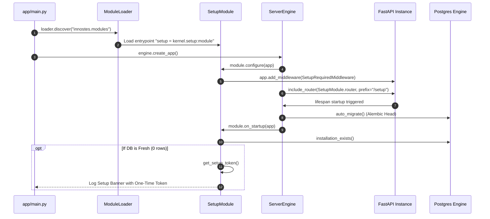
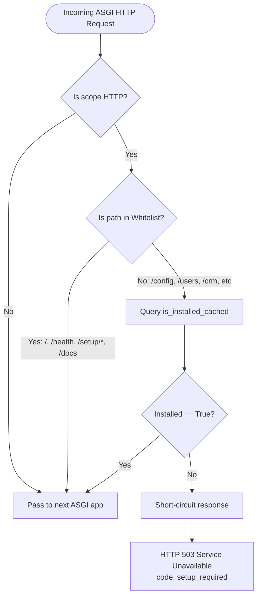
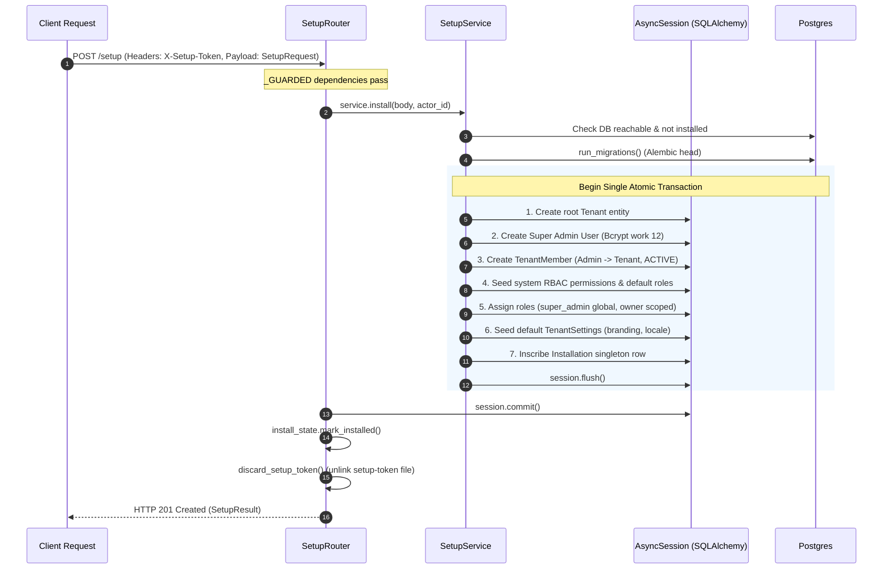
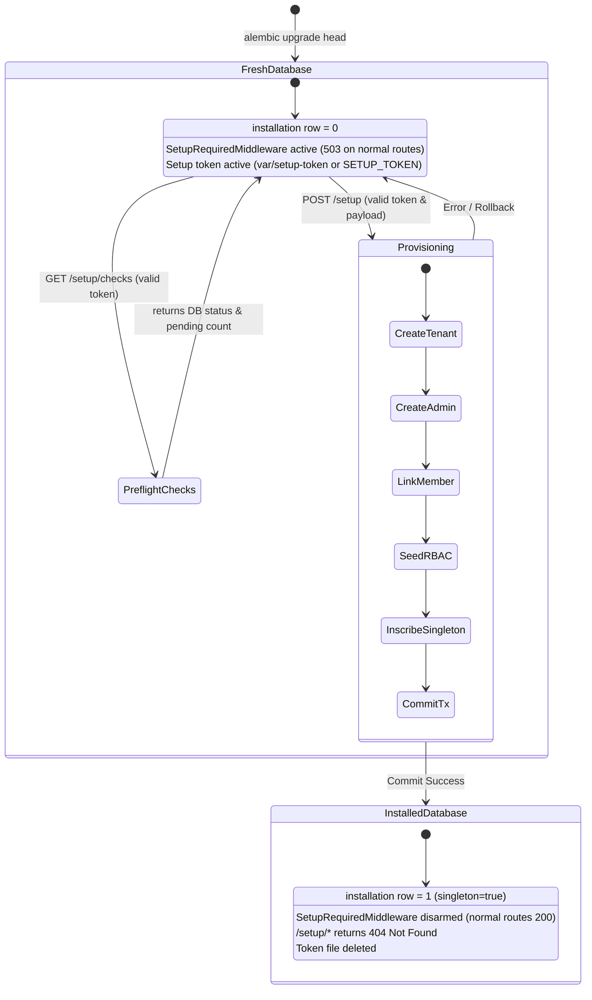

# Innostes ERP — First-Run Setup API Deep Dive & Technical Execution Flow

This document details the exact technical architecture, code execution flow, security mechanisms, and database transactions governing the **First-Run Setup API** subsystem within Innostes ERP.

---

## 1. Architectural Philosophy & System Invariants

The First-Run Setup system protects a fresh deployment from unauthorized root-tenant takeover while maintaining a zero-configuration developer experience.

```
                  ┌──────────────────────────────────────────────┐
                  │              Fresh Deployment                │
                  │   (Database schema exists, 0 install rows)   │
                  └──────────────────────┬───────────────────────┘
                                         │
                   ┌─────────────────────┴─────────────────────┐
                   ▼                                           ▼
       ┌────────────────────────┐                 ┌────────────────────────┐
       │   All Normal Routes    │                 │     Setup Routes       │
       │ (/config, /users, etc) │                 │     (/setup/*)         │
       └───────────┬────────────┘                 └───────────┬────────────┘
                   │                                           │
                   ▼                                           ▼
       Intercepted by ASGI Guard                  Protected by X-Setup-Token
       Returns 503 "setup_required"               Permits system installation
                   │                                           │
                   └─────────────────────┬─────────────────────┘
                                         │
                                         ▼
                         POST /setup Completes (Atomic Tx)
                                         │
                                         ▼
                  ┌──────────────────────────────────────────────┐
                  │             Installed Instance               │
                  │  - Singleton row inscribed in `installation` │
                  │  - Cache updated: `installed = True`         │
                  │  - Setup token destroyed                     │
                  │  - /setup/* permanently returns 404          │
                  │  - Normal routes unlock immediately          │
                  └──────────────────────────────────────────────┘
```

### Core Invariants

1. **The ASGI Firewall**: Until installation is complete, normal domain routes return `HTTP 503 Service Unavailable` with `{"code": "setup_required"}`.
2. **Cryptographic Setup Token**: Setup administrative actions (`GET /setup/checks`, `POST /setup`) require an out-of-band `X-Setup-Token` secret, guarding instances exposed to the open internet before setup.
3. **Database-Level Singleton Invariant**: The PostgreSQL table `installation` contains a database check constraint (`singleton = true`) and a unique index, mathematically preventing duplicate root tenant installations even under concurrent race conditions.
4. **Atomic Provisioning**: Schema upgrades, root tenant creation, super-admin account provisioning, RBAC seeding, and installation marking happen inside a single ACID database transaction.
5. **Self-Destructing Surface**: Once installed, the setup token file is deleted from disk, the in-memory cache transitions permanently to `installed = True`, and all setup routes switch to `HTTP 404 Not Found`.

---

## 2. Component Inventory & Source File Map

| Component | File Path | Primary Responsibility |
| :--- | :--- | :--- |
| **Module Descriptor** | `kernel/backend/kernel/setup/__init__.py` | Implements `SetupModule(BaseModule)`, registers ASGI middleware, runs startup token diagnostics. |
| **ASGI Middleware** | `kernel/backend/kernel/setup/middleware.py` | High-performance ASGI filter intercepting every HTTP request; enforces the 503 lock. |
| **Router & Endpoints** | `kernel/backend/kernel/setup/router.py` | Declares `/setup/status`, `/setup/checks`, and `POST /setup`. |
| **Route Dependencies** | `kernel/backend/kernel/setup/dependencies.py` | Injects token verification, rate limiting, and cached installation checks into FastAPI routes. |
| **Domain Service** | `kernel/backend/kernel/setup/services/setup_service.py` | Contains `SetupService`: executes pre-flight checks and the 7-step atomic database install sequence. |
| **Token & Limiter** | `kernel/backend/kernel/setup/services/token.py` | Token generator, constant-time `hmac.compare_digest` validator, and sliding-window `AttemptLimiter`. |
| **Process State Cache**| `kernel/backend/kernel/setup/services/state.py` | `InstallState`: Thread-safe in-memory cache preventing database roundtrips on every request. |
| **Data Model** | `kernel/backend/kernel/setup/models/installation.py` | SQLAlchemy model for `installation` table enforcing singleton constraint. |
| **Schemas** | `kernel/backend/kernel/setup/schemas/setup.py` | Pydantic v2 schemas: `SetupStatus`, `SetupChecks`, `SetupRequest`, `SetupResult`. |

---

## 3. Phase 1: Server Boot & Module Discovery

When Uvicorn or FastAPI dev boots `apps/api-server/app/main.py`, the setup subsystem initializes through Python entry-point metadata.



### Detailed Execution Steps

#### 1. Entry Point Discovery
In `apps/api-server/app/main.py`:
```python
loader = ModuleLoader(engine.registry)
loader.discover("innostes.modules")
```
Python queries package metadata defined in `kernel/backend/pyproject.toml`:
```toml
[project.entry-points."innostes.modules"]
setup = "kernel.setup:module"
```
The `SetupModule` singleton in `kernel/backend/kernel/setup/__init__.py` is instantiated and registered into the engine's `ModuleRegistry`.

#### 2. Middleware Registration
During `engine.create_app()`, `apps/api-server/app/engine/server.py` iterates over all discovered modules and triggers their `configure()` hooks:
```python
for module in self.registry.list_modules():
    module.configure(app)
```
Inside `kernel/backend/kernel/setup/__init__.py`:
```python
def configure(self, app: FastAPI) -> None:
    app.add_middleware(SetupRequiredMiddleware)
```
`SetupRequiredMiddleware` is positioned in the ASGI middleware stack immediately inside CORS and error-handling middleware.

#### 3. Lifespan Startup & Token Bootstrap
When the ASGI event loop begins (`apps/api-server/app/engine/server.py`):
1. **Schema Check**: If `AUTO_MIGRATE=true`, `kernel.core.database.migrations.auto_migrate()` runs `alembic upgrade head`, ensuring all tables (including empty `installation`) exist.
2. **Startup Hook**: Calls `SetupModule.on_startup(app)` in `kernel/backend/kernel/setup/__init__.py`:
   - Executes `await installation_exists()`. If the singleton row exists, it exits immediately.
   - If not installed, it invokes `get_setup_token(settings)` in `kernel/backend/kernel/setup/services/token.py`:
     - If `SETUP_TOKEN` is defined in `.env`, that value is used (`from_env=True`).
     - Otherwise, a 256-bit cryptographically secure token is generated via `secrets.token_urlsafe(32)` and written to `kernel/backend/var/setup-token` with strict POSIX file permissions `0o600` (`O_EXCL` flags prevent multi-worker races).
     - Prints the installation banner with the token to `stdout`/`stderr`.

---

## 4. Phase 2: The ASGI Firewall (`SetupRequiredMiddleware`)

Every single HTTP request sent to the API server passes through `SetupRequiredMiddleware` in `kernel/backend/kernel/setup/middleware.py` before reaching FastAPI routers.



### Path Whitelisting Rules
In `kernel/backend/kernel/setup/middleware.py`:
```python
ALWAYS_ALLOWED = ("/", "/health", "/docs", "/redoc", "/openapi.json")
ALLOWED_PREFIXES = ("/setup", "/docs/")

def is_allowed_before_setup(path: str) -> bool:
    return path in ALWAYS_ALLOWED or any(
        path == p or path.startswith(p if p.endswith("/") else p + "/") for p in ALLOWED_PREFIXES
    )
```

### High-Performance In-Memory Caching (`InstallState`)
To prevent hitting PostgreSQL on every single incoming API request, `kernel/backend/kernel/setup/services/state.py` implements a high-throughput caching strategy:

```python
class InstallState:
    def __init__(self, recheck_seconds: float = 2.0) -> None:
        self.recheck_seconds = recheck_seconds
        self._installed = False
        self._checked_at: float | None = None

    async def is_installed(self, check: Callable[[], Awaitable[bool]]) -> bool:
        if self._installed:
            return True  # Once True, cached permanently in process memory
        now = time.monotonic()
        if self._checked_at is not None and now - self._checked_at < self.recheck_seconds:
            return False  # Negative answers cached for 2 seconds to absorb burst traffic
        self._installed = await check()
        self._checked_at = now
        return self._installed
```

### Database Query: `installation_exists()`
In `kernel/backend/kernel/setup/services/setup_service.py`:
```python
async def installation_exists(engine: AsyncEngine | None = None) -> bool:
    async with (engine or get_engine()).connect() as conn:
        has_table = await conn.run_sync(
            lambda sync_conn: inspect(sync_conn).has_table(Installation.__tablename__)
        )
        if not has_table:
            return False
        result = await conn.execute(select(exists().where(Installation.singleton.is_(True))))
        return bool(result.scalar())
```
- Employs a dedicated connection that releases immediately back to the pool.
- Returns `False` if table is missing or if `SELECT EXISTS(...)` yields 0 rows.

---

## 5. Phase 3: Setup Route Handlers & Security Dependencies

All setup endpoints are declared in `kernel/backend/kernel/setup/router.py`.

```
                      /setup Endpoints
                             │
       ┌─────────────────────┼─────────────────────┐
       ▼                     ▼                     ▼
GET /setup/status     GET /setup/checks       POST /setup
(Public probe)        (Token-protected)     (Token-protected)
                             │                     │
                             └──────────┬──────────┘
                                        │
                                        ▼
                             Guarded by _GUARDED:
                     1. require_setup_available (404 check)
                     2. require_setup_token     (401/429 check)
```

### Route 1: `GET /setup/status`
* **Path**: `/setup/status`
* **Auth**: None (Public)
* **Dependency**: `installed: bool = Depends(is_installed_cached)`
* **Behavior**:
  - Fresh DB: returns `{"installed": false}` (HTTP 200).
  - Installed DB: returns `{"installed": true}` (HTTP 200).
  - DB Unreachable: returns `HTTP 503` with `DatabaseUnavailableError`.

### Route Guard Pipeline (`_GUARDED`)
Endpoints that perform administrative diagnostics or modifications enforce `_GUARDED = [Depends(require_setup_available), Depends(require_setup_token)]`.

#### Guard 1: `require_setup_available`
Defined in `kernel/backend/kernel/setup/dependencies.py`:
```python
async def require_setup_available() -> None:
    if not get_settings().setup_enabled:
        raise SetupNotAvailableError()  # HTTP 404
    if await is_installed_cached():
        raise SetupNotAvailableError()  # HTTP 404
```
**Key guarantee**: Once installed, this dependency raises HTTP 404 immediately. Attackers cannot even test tokens against `/setup/checks` or `POST /setup` because the endpoints behave as if they do not exist.

#### Guard 2: `require_setup_token`
Defined in `kernel/backend/kernel/setup/dependencies.py`:
1. **Rate Limit Probe**: Checks `AttemptLimiter.retry_after(client_ip)` in `kernel/backend/kernel/setup/services/token.py`. If more than 10 failed attempts have occurred from this IP in the past 15 minutes, aborts with **HTTP 429 Too Many Requests** carrying a calculated `Retry-After: <seconds>` header.
2. **Constant-Time Verification**: Calls `verify_setup_token(token)`:
   ```python
   hmac.compare_digest(candidate.encode("utf-8"), expected.encode("utf-8"))
   ```
   Prevents timing attacks against token string comparison.
3. **Failure Recording**: On failure, calls `attempt_limiter.record_failure(client_ip)` and raises **HTTP 401 Unauthorized** with `{"code": "invalid_setup_token"}`.
4. **Success Reset**: On success, resets failure counters for that IP.

### Route 2: `GET /setup/checks`
* **Path**: `/setup/checks`
* **Headers**: `X-Setup-Token: <token>`
* **Logic**: Calls `SetupService.checks()` in `kernel/backend/kernel/setup/services/setup_service.py`:
  - Pings the database pool (`ping_db(timeout=3.0)`).
  - Inspects Alembic script directory heads against database migration context using `pending_migrations(engine)`.
  - Returns `{"database_connected": true, "migrations_pending": 0}`.

---

## 6. Phase 4: Atomic Provisioning (`POST /setup`)

The installation transaction is implemented in `SetupService.install()` in `kernel/backend/kernel/setup/services/setup_service.py`.



### The 7-Step Atomic Transaction

Inside `kernel/backend/kernel/setup/services/setup_service.py`:

#### Step 1: Create Root Tenant
```python
tenant = await TenantService(self.session).create(data.organization, actor_id)
```
Inserts record into `tenants` table with `name`, `slug`, `country`, `timezone`, `language`, and `date_format`.

#### Step 2: Create Super Admin Account
```python
user_svc = UserService()
admin_user = await user_svc.create_user(
    session=self.session,
    data=data.admin,
    is_super_admin=True,
)
```
- Hashes password using `bcrypt` (work factor 12).
- Encrypts PII fields (email, mobile) using envelope AES-GCM-256 with key version 1.
- Computes blind search indexes using HMAC-SHA256 (`email_hash`).
- Sets `is_super_admin = True` and `status = 'active'`.

#### Step 3: Associate Admin with Root Tenant
```python
member = TenantMember(
    tenant_id=tenant.id,
    user_id=admin_user.id,
    status=TenantMemberStatus.ACTIVE,
    joined_at=datetime.now(timezone.utc),
)
self.session.add(member)
```

#### Step 4: Seed System Permissions and Default Roles
```python
roles = await seed_default_permissions_and_roles(self.session)
```
Seeds atomic system permissions (e.g., `user:read`, `tenant:update`, `module:activate`) and builds default roles (`super_admin`, `owner`, `admin`, `member`, `guest`).

#### Step 5: Assign Dual Roles to Super Admin
```python
# 1. Global Super Admin role (tenant_id = None)
await rbac_svc.assign_role_to_user(
    session=self.session,
    user_id=admin_user.id,
    role_id=roles["super_admin"].id,
    tenant_id=None,
    assigned_by=admin_user.id,
)
# 2. Scoped Organization Owner role (tenant_id = tenant.id)
await rbac_svc.assign_role_to_user(
    session=self.session,
    user_id=admin_user.id,
    role_id=roles["owner"].id,
    tenant_id=tenant.id,
    assigned_by=admin_user.id,
)
```

#### Step 6: Seed Tenant Modular Settings
```python
await seed_default_tenant_settings(
    session=self.session,
    tenant_id=tenant.id,
    organization_name=tenant.name,
    branding_input=branding_dict,
    timezone=tenant.timezone or "UTC",
    language=tenant.language or "en-US",
    date_format=tenant.date_format or "YYYY-MM-DD",
)
```
Configures brand colors, logo placeholders, session timeouts, and regional preferences in `tenant_settings`.

#### Step 7: Inscribe Installation Singleton Lock
```python
installation = Installation(
    app_version=self.app_version,
    default_tenant_id=tenant.id,
    created_by=effective_actor,
    updated_by=effective_actor,
)
self.session.add(installation)
await self.session.flush()
```
The database table definition guarantees single execution:
```python
# kernel/backend/kernel/setup/models/installation.py
singleton: Mapped[bool] = mapped_column(
    Boolean, nullable=False, default=True, server_default=true(), unique=True
)
__table_args__ = (CheckConstraint("singleton", name="singleton_true"),)
```
If two requests race, the second transaction fails at `session.flush()` with `IntegrityError` violating constraint `uq_installation_singleton`. The service catches this and emits **HTTP 409 Conflict** (`AlreadyInstalledError`).

---

## 7. Phase 5: Post-Install Transition & Cleanup

Once the session commits in `kernel/backend/kernel/setup/router.py`:

```python
result = await service.install(body, actor_id)
await service.session.commit()
install_state.mark_installed()
discard_setup_token()
return result
```

1. **Transaction Commit**: The database state becomes permanent.
2. **In-Memory Cache Flipped**: `install_state.mark_installed()` sets `self._installed = True`. All subsequent calls to `is_installed_cached()` return `True` in $O(1)$ time without database queries.
3. **Secret Destruction**: `discard_setup_token()` unlinks `kernel/backend/var/setup-token` from the local filesystem.
4. **Immediate Firewall Disarm**: On the very next request:
   - `SetupRequiredMiddleware` observes `installed = True` and permits normal traffic to all routes (`/config`, `/users`, `/crm`, etc.).
   - `_GUARDED` dependencies on `/setup/checks` and `POST /setup` observe `installed = True` and return **HTTP 404 Not Found**.

---

## 8. State Transition Diagram



---

## 9. Error Codes Reference

| HTTP Status | Error Code (`code`) | Trigger Condition | Originating Source |
| :--- | :--- | :--- | :--- |
| **`503 Service Unavailable`** | `setup_required` | Normal route accessed on an uninstalled instance. | `kernel/backend/kernel/setup/middleware.py` |
| **`503 Service Unavailable`** | `database_unavailable` | Database unreachable during setup check or installation. | `kernel/backend/kernel/setup/services/setup_service.py` |
| **`401 Unauthorized`** | `invalid_setup_token` | Missing or incorrect `X-Setup-Token` header. | `kernel/backend/kernel/setup/dependencies.py` |
| **`429 Too Many Requests`** | `too_many_requests` | Exceeded 10 failed token attempts within 15 minutes. | `kernel/backend/kernel/setup/services/token.py` |
| **`404 Not Found`** | `setup_not_available` | `/setup/checks` or `POST /setup` called after setup completed or when `SETUP_ENABLED=false`. | `kernel/backend/kernel/setup/dependencies.py` |
| **`409 Conflict`** | `already_installed` | Concurrent installation race won by another request. | `kernel/backend/kernel/setup/services/setup_service.py` |
| **`409 Conflict`** | `slug_taken` | Desired organization slug is already taken. | `kernel/backend/kernel/tenancy/services/tenant_service.py` |
