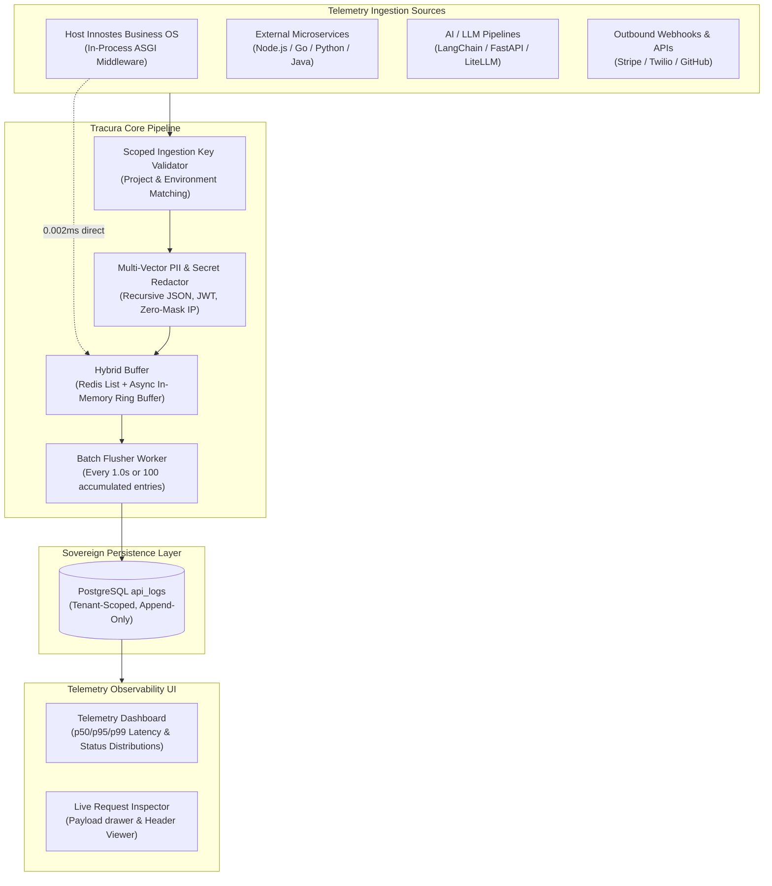

# Tracura: Universal API Telemetry & Observability Engine

**Tracura** is the open-source universal API telemetry, distributed tracing, and request observability engine built for the **Innostes Business Operating System (Business OS)**.

It is engineered to function both as an **in-process telemetry provider** for the host Innostes Business OS platform and as a **central, high-throughput external telemetry sink** for any microservice, AI/LLM proxy, mobile gateway, or third-party webhook across your organization.

---

## 1. Core Architecture



---

## 2. Key Capabilities

1. **Dual Ingestion**:
   - **Internal Host**: In-process ASGI capture without network hops, HTTP loopbacks, or database contention.
   - **External Polyglot**: Ingestion endpoints (`POST /tracura/v1/ingest`, `POST /tracura/v1/ingest/batch`) authenticated with scoped API keys (`X-API-Key: inno_log_live_...`).
2. **Hybrid Queue Buffer**:
   - Redis buffer mode (`REDIS_URL`) with WebSocket pub/sub live tailing.
   - In-memory asynchronous ring buffer fallback (`asyncio.Queue`) if Redis is unavailable, guaranteeing zero dropped logs.
3. **Multi-Vector PII & Secret Scrubbing**:
   - Automatically redacts headers (`Authorization`, `Cookie`, `X-API-Key`).
   - Recursively redacts sensitive payload keys (`password`, `token`, `secret`, `credit_card`, `ssn`).
   - Zero-masks IP addresses (`192.168.1.0` / `2001:db8::`) for GDPR/privacy compliance.
4. **Correlation Tracing**:
   - Generates and propagates `X-Correlation-ID` across HTTP calls.
   - Cross-references with the **Kernel Audit Trail** to view exact state mutations tied to every API transaction.

---

## 3. Package Structure

```
plugins/tracura/
├── backend/                  # Python 3.12+ ASGI engine and ingestion endpoints
├── frontend/                 # React 19 live telemetry dashboard and inspector
├── ARCHITECTURE.md           # Full technical specification & architecture blueprint
└── README.md                 # Plugin overview
```

---

## 4. Quick Links

- [Backend Documentation](backend/README.md): Configuration, REST endpoints, and cURL / Node.js samples.
- [Frontend Documentation](frontend/README.md): Live telemetry visualizer and dashboard components.
- [Full Technical Specification](ARCHITECTURE.md): Deep-dive into buffer algorithms and partition strategies.

---

## 5. License

Open-source software licensed under the **[MIT License](../../LICENSE)**.
