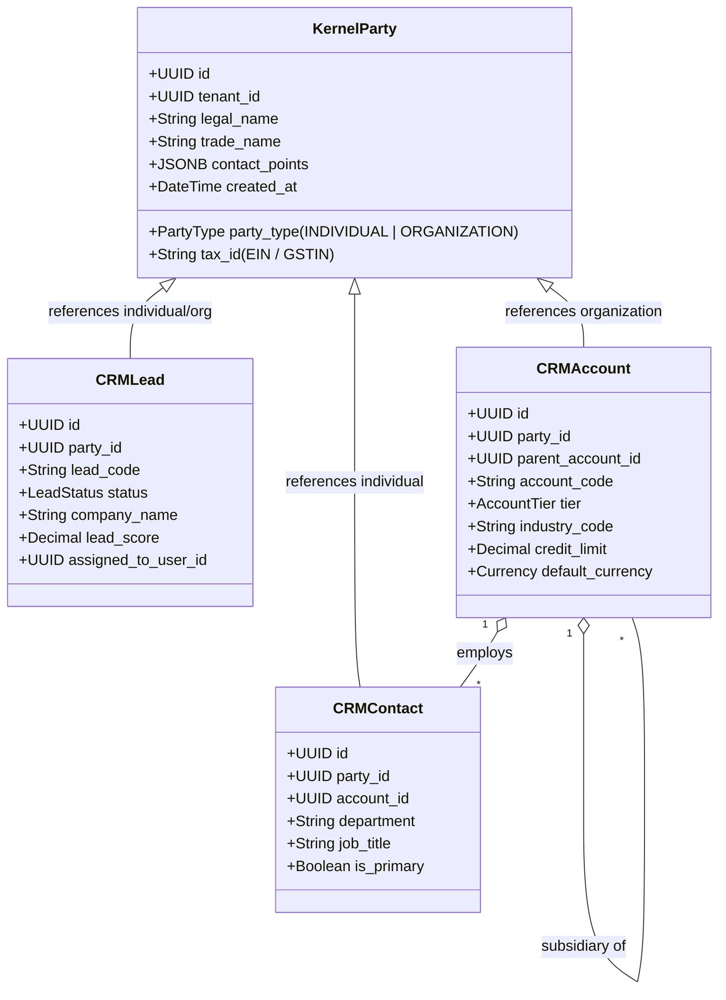
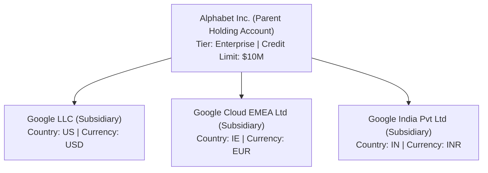
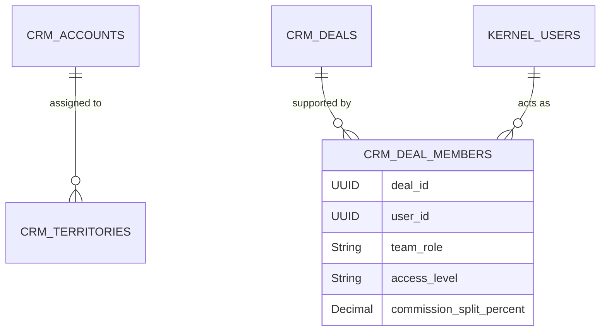

# Innostes CRM (SalesFlow) Specification: Core Architecture & Party Model

**Document ID:** `CRM-SPEC-001`  
**Classification:** Core System Architecture  
**Status:** Approved  

---

## 1. Architectural Philosophy & Principles

SalesFlow is designed as an enterprise-grade Customer Relationship Management (CRM) and Revenue Operations (RevOps) platform. Unlike legacy CRMs that operate as disconnected data silos, SalesFlow adheres to five fundamental design invariants:

1. **Polymorphic Party Federation:** Every human and legal entity in Innostes (Lead, Contact, Account, Vendor, Employee) roots back to the centralized `kernel.party` foundation. A Contact can be simultaneously an active buyer, an ex-employee, and an external contractor without duplicate records or split identity.
2. **Multi-Tenant Data Isolation with Hierarchy:** Strict Row-Level Security (`tenant_id`) enforced across every table, paired with parent-child corporate hierarchy trees (`parent_account_id`) supporting global multinational conglomerates, holding companies, and operating subsidiaries.
3. **Event-Driven Lifecycle State Machine:** Leads, Deals, Quotes, and Orders transition through deterministic Finite State Machines (FSMs) with audited timestamps, transition actors, and strict stage-gate validation hooks.
4. **Decoupled CPQ & Order-to-Cash Invariant:** The quoting engine is mathematically decoupled from the financial general ledger until the exact moment of order confirmation, ensuring dynamic sales pricing freedom without risking GAAP/IFRS accounting integrity.
5. **Contract-First Extensibility:** Every business entity exposes strict Pydantic v2 schemas and OpenAPI 3.1 contracts, permitting headless execution via automation bots, external webhooks, or the `@innostes/ui` interface.

---

## 2. Unified Party Model Integration

In legacy CRMs (e.g. Salesforce, early Zoho), Leads, Contacts, and Accounts are entirely distinct database structures with redundant phone, address, and name columns. When a Lead converts, fields are manually copied, causing sync breaks and fragmented communication history.

Innostes utilizes a **Single Legal Party** architecture:

### 2.1 Party Resolution Rules
* **Lead Ingestion:** Creates an unverified `KernelParty` (Type: `INDIVIDUAL`) with embedded raw email/phone contact points.
* **Lead Conversion:** Converts the `CRMLead` record to `QUALIFIED`. Atomically promotes or links the underlying `KernelParty` to a corporate `CRMAccount` (if company name present) and a personal `CRMContact`.
* **Universal Search & Deduplication:** Queries against `KernelParty.legal_name`, `KernelParty.tax_id`, and `contact_points->>'email'` detect existing customers across all modules before a sales rep creates a duplicate lead.

---

## 3. Account Hierarchies & Multi-Subsidiary Trees

Enterprises demand parent-child account mapping for global billing, consolidated roll-up reporting, and territory assignments.

### 3.1 Hierarchy Inheritance Model
* **Credit Limit Roll-up:** A parent account can enforce a global credit ceiling across all operating children, or grant independent credit lines per subsidiary.
* **Contracted Price Books:** Price books negotiated at the parent holding company level are automatically inherited by subsidiaries unless explicitly overridden.
* **Pipeline Roll-up:** RevOps executives can view deal velocity and ARR forecasts at either the discrete subsidiary level or consolidated holding level using PostgreSQL Common Table Expressions (Recursive CTEs).

---

## 4. Territory Management & Sales Ownership

SalesFlow implements a flexible matrix ownership structure:

1. **Named Account Ownership (`owner_id`):** Primary account executive responsible for account relationship and ARR growth.
2. **Sales Territories:** Defined by geography (e.g. `NAM-EAST`, `EMEA-DACH`), industry vertical (e.g. `HEALTHCARE`, `FINTECH`), or market segment (`SMB`, `MID_MARKET`, `ENTERPRISE`).
3. **Opportunity Teams:** Multi-disciplinary deal teams supporting complex B2B sales:
   * *Account Executive (AE):* Commercial lead, pipeline owner.
   * *Sales Development Rep (SDR):* Originator, qualification owner.
   * *Solutions Architect (SE):* Technical validation, proof of concept (PoC).
   * *Customer Success Manager (CSM):* Post-sale onboarding, expansion lead.

---

## 5. Security & Access Control Matrix

SalesFlow uses Kernel's RBAC system with scoped permissions:

| Security Context | Scope | Capabilities |
| :--- | :--- | :--- |
| `salesflow:read` | `own` / `team` / `all` | View assigned leads, contacts, deals, and quotes. |
| `salesflow:write`| `own` / `team` / `all` | Create and modify leads, deals, quotes, and activity notes. |
| `salesflow:admin`| `tenant` | Configure pipelines, stages, commission rules, assignment rotaries, and territory definitions. |
| `salesflow:cpq_approver` | `tenant` | Override discount ceilings, approve custom payment terms, and unlock margin-floor exceptions. |

Row-level data filtering dynamically applies predicates based on the caller's role:
* **Rep:** `WHERE owner_id = :user_id OR id IN (SELECT deal_id FROM crm_deal_members WHERE user_id = :user_id)`
* **Manager:** `WHERE owner_id IN (SELECT employee_id FROM team_hierarchy WHERE manager_id = :user_id)`
* **Executive / RevOps Admin:** `WHERE tenant_id = :tenant_id`
