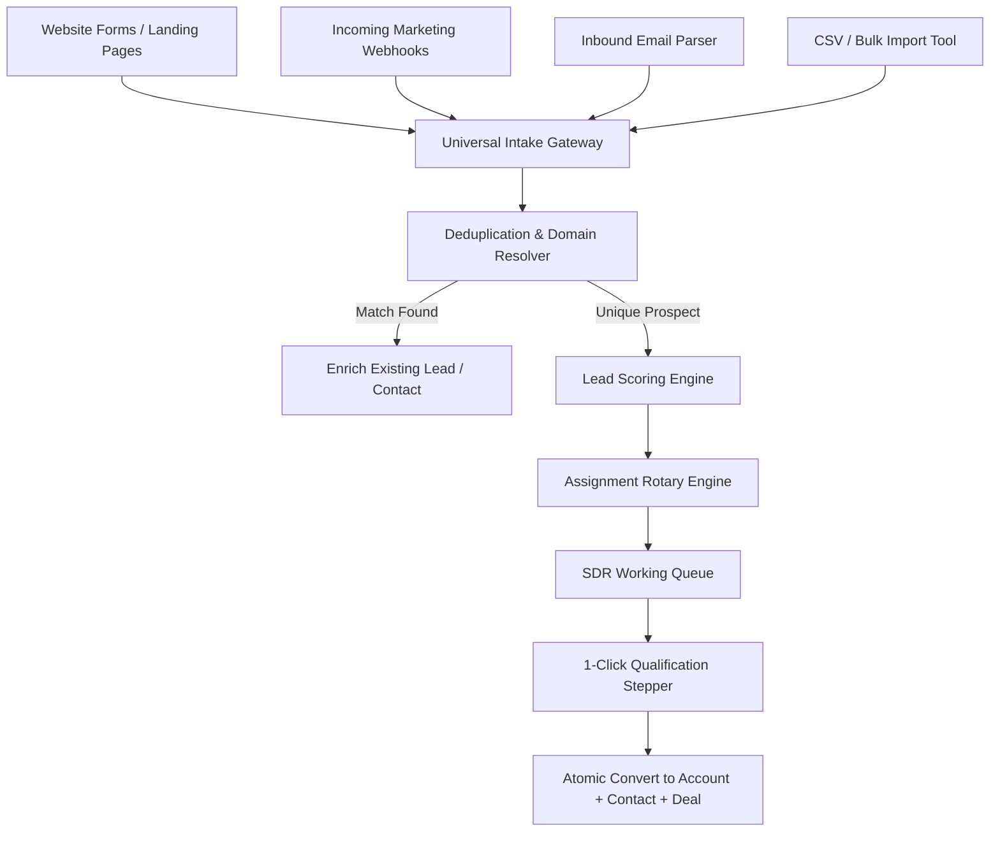
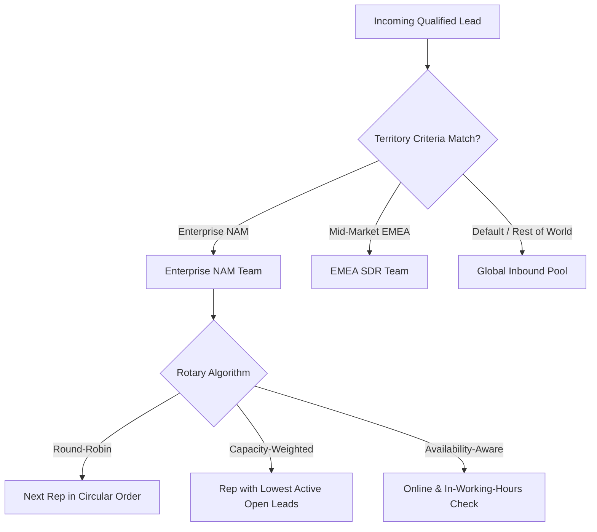
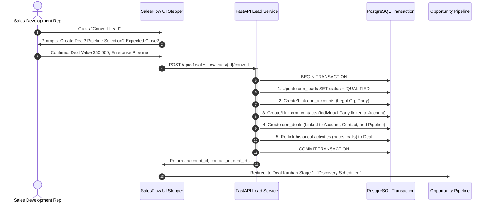

# Innostes CRM (SalesFlow) Specification: Lead Management & Intake Engine

**Document ID:** `CRM-SPEC-002`  
**Classification:** Operational Engine Specification  
**Status:** Approved  

---

## 1. Overview & Intake Architecture

The Lead Intake Engine handles the high-velocity ingestion, enrichment, scoring, deduplication, routing, and qualification of prospective buyers.



---

## 2. Multi-Channel Ingestion & Universal Gateway

SalesFlow exposes a public, unauthenticated (token-gated) webhook intake endpoint:
`POST /api/v1/salesflow/leads/intake?public_token={token}`

### 2.1 Payload Specification
```json
{
  "first_name": "Alexander",
  "last_name": "Hamilton",
  "work_email": "alexander@treasury.gov",
  "phone": "+1-202-555-0143",
  "company_name": "Department of the Treasury",
  "website": "https://treasury.gov",
  "job_title": "Secretary of the Treasury",
  "country_code": "US",
  "source": "WEBSITE_DEMO_REQUEST",
  "campaign_utm": {
    "source": "google_ads",
    "medium": "cpc",
    "campaign": "q4_enterprise_revops"
  },
  "custom_fields": {
    "annual_revenue": "10000000",
    "employee_count": 500,
    "primary_crm_pain": "Pipeline leakage & manual CPQ"
  }
}
```

---

## 3. Deduplication & Domain Matching Algorithms

Before persisting a new lead, the intake gateway executes a three-tier deduplication check:

1. **Exact Email Match:**
   ```sql
   SELECT id, status, assigned_to_user_id FROM crm_leads 
   WHERE tenant_id = :tenant_id AND lower(work_email) = lower(:email);
   ```
   *Action if match:* Append activity log, increment touch count, touch `last_activity_at`, do not spawn duplicate lead.

2. **Domain-to-Account Mapping:**
   Extracts root domain from `work_email` (excluding common consumer webmails: `gmail.com`, `outlook.com`, `yahoo.com`, `proton.me`):
   ```sql
   SELECT a.id, a.account_code, a.owner_id 
   FROM crm_accounts a 
   JOIN kernel_parties p ON a.party_id = p.id
   WHERE a.tenant_id = :tenant_id AND (
     p.contact_points->>'domain' = :extracted_domain OR 
     lower(a.website) LIKE '%' || :extracted_domain || '%'
   );
   ```
   *Action if match:* Automatically flags lead as an existing customer contact, routing directly to the existing Account Executive rather than an SDR.

3. **Fuzzy Legal Name & Tax ID Check:**
   Uses PostgreSQL `pg_trgm` similarity threshold ($\ge 0.85$) on company name and exact match on Tax ID (EIN/GSTIN).

---

## 4. Dual-Track Lead Scoring Engine

SalesFlow implements a composite lead score ($0 - 100$ points) updated in real time:

$$\text{Total Score} = \text{Demographic Fit Score} (50\%) + \text{Behavioral Intent Score} (50\%)$$

### 4.1 Demographic Fit Matrix (Max 50 pts)
* **Company Size / Employee Count:**
  * $>1,000$ employees: $+20$ pts
  * $250 - 999$ employees: $+15$ pts
  * $50 - 249$ employees: $+10$ pts
  * $<50$ employees: $+5$ pts
* **Job Seniority Level:**
  * C-Level / VP / Founder: $+20$ pts
  * Director / Head of Department: $+15$ pts
  * Manager: $+10$ pts
  * Individual Contributor / Student: $0$ pts
* **Target Geographic Market:**
  * Core expansion geography: $+10$ pts
  * Non-serviceable territory: $-20$ pts

### 4.2 Behavioral Intent Matrix (Max 50 pts)
* Demo Request Form Submitted: $+30$ pts
* Pricing Page Viewed $>3$ times: $+15$ pts
* Whitepaper / Technical Doc Downloaded: $+10$ pts
* High-bounce / Disposable Email Detected: $-40$ pts

### 4.3 Qualification Thresholds
* **Unqualified / Cold:** $< 30$ pts (Nurture sequence)
* **Marketing Qualified Lead (MQL):** $30 - 69$ pts (SDR outreach within 4 hours)
* **Sales Qualified Lead (SQL):** $\ge 70$ pts (Instant rotary assign, immediate SLA: 15-minute response)

---

## 5. Assignment Rotary Engine (Routing Rules)

When an MQL/SQL is ingested, the assignment engine selects an SDR or AE using one of three policies:



### 5.1 Working Hours & Presence Awareness
Linked with the **PeopleOps Attendance & Shift** engine:
* If a sales rep is clocked out, on approved leave (via `peopleops.leave`), or outside their scheduled shift, the rotary skips the rep automatically, avoiding stalled inbound leads.

---

## 6. Atomic 1-Click Qualification & Conversion Stepper

When an SDR conducts a discovery call and qualifies the prospect, SalesFlow executes an atomic database transaction.



### 6.1 Transaction Guarantees
* **All-or-Nothing Invariant:** If deal creation fails validation, the lead remains un-converted and no orphan account/contact records are created.
* **Audit Lineage:** The created deal, contact, and account retain a permanent foreign key reference to `converted_from_lead_id` for conversion rate reporting.
