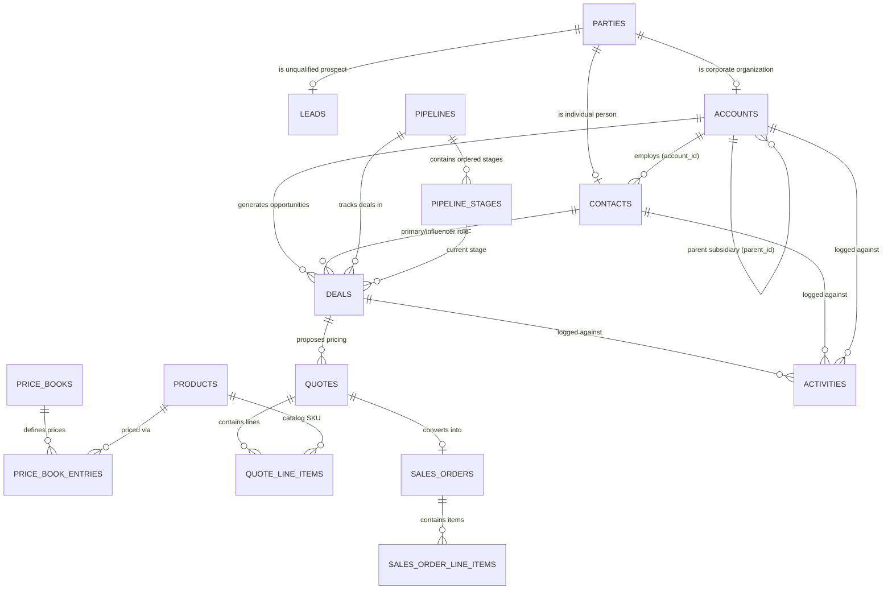

# Innostes Business OS: CRM (SalesFlow) Consolidated Specification

**Target Module:** `SalesFlow` (`modules/salesflow`)  
**Classification:** Canonical Domain Specification & Technical Implementation Blueprint  
**Status:** Consolidated & Approved for Core Engineering  

---

## 1. Executive Summary

This folder contains the consolidated, production-grade functional and technical specifications for the **CRM & RevOps Suite (SalesFlow)** of the Innostes Business Operating System.

It synthesizes findings from:
* **Enterprise Benchmarks:** Salesforce Sales Cloud, HubSpot Sales Hub Enterprise, NetSuite CRM, Zoho CRM, and Odoo Sales.
* **Modern Rep & RevOps UX:** Ultra-fast drag-and-drop Kanban pipeline boards, 1-click lead qualification to account/contact/deal, 360-degree timeline engagement history, and keyboard-first CPQ line-item builders.
* **Unified Party Architecture:** Single polymorphic `parties` model from `kernel.party` ensuring that an Account, Contact, Lead, Vendor, or Employee shares canonical legal identity, contact points, and deduplication logic.
* **Configure, Price, Quote (CPQ) Precision:** Multi-currency price books, volume-tier discounts, dynamic bundling rules, margin floor validations, and automated approval matrices.
* **Order-to-Cash (O2C) Financial Invariants:** Real-time credit limit checking against LedgerFlow, atomic Sales Order confirmation, inventory reservation triggers, and zero-leakage AR invoicing.

---

## 2. Document Index & Navigation

| Document | Focus Area | Key Deliverables |
| :--- | :--- | :--- |
| **[`01_architecture_and_party_model.md`](./01_architecture_and_party_model.md)** | Core Architecture & Entity Topology | Unified Party-to-CRM model, Lead vs Account vs Contact relations, multi-subsidiary account trees, and sales territory routing. |
| **[`02_lead_management_and_intake.md`](./02_lead_management_and_intake.md)** | Lead Intake & Conversion Engine | Multi-channel ingestion, demographic & behavioral scoring, round-robin/territory assignment rules, fuzzy deduplication, and atomic 1-click conversion stepper. |
| **[`03_deal_pipeline_and_opportunity_governance.md`](./03_deal_pipeline_and_opportunity_governance.md)** | Deal Governance & Multi-Pipeline Engine | Multi-pipeline topology, stage entrance/exit validation gates, win probabilities, close date slippage detection, deal rotting velocity timers, and MEDDPICC qualification. |
| **[`04_cpq_pricing_and_quote_engine.md`](./04_cpq_pricing_and_quote_engine.md)** | CPQ, Bundling & Discount Approvals | Multi-currency price books, volume breaks, promotional coupon rules, contract pricing, bundle validation DAGs, margin floors, and pixel-perfect PDF export. |
| **[`05_order_to_cash_and_sales_orders.md`](./05_order_to_cash_and_sales_orders.md)** | Sales Orders & O2C Bridge | Quote-to-Order conversion, real-time credit hold verification with LedgerFlow, stock allocation triggers, line-item lock, and downstream AR invoice dispatch. |
| **[`06_api_contracts_and_database_schema.md`](./06_api_contracts_and_database_schema.md)** | Database DDL & REST APIs | Complete PostgreSQL relational schema (40+ canonical tables), indexes, constraints, triggers, and full REST OpenAPI 3.1 endpoint catalog. |
| **[`07_ui_ux_specifications_and_hubspot_benchmark.md`](./07_ui_ux_specifications_and_hubspot_benchmark.md)** | Modern Sales UX & Design Specs | HubSpot/Salesforce benchmarked UX, visual Kanban board, 360 Account drawer, inline-editable data tables, and `@innostes/ui` token mappings. |
| **[`08_activity_timeline_and_omnichannel_engagement.md`](./08_activity_timeline_and_omnichannel_engagement.md)** | Omnichannel Engagement & Activity Feed | Unified audit feed for calls, meetings, notes, tasks, emails; email thread sync, task SLAs, and automated follow-up cadences. |
| **[`09_dynamic_masters_and_tenant_seeders.md`](./09_dynamic_masters_and_tenant_seeders.md)** | Dynamic Masters & Tenant Seeders | Configurable picklists (Lead Sources, Industries, Loss Reasons), code-first seed packs (B2B SaaS, Wholesale, Services), and idempotent re-seeders. |
| **[`10_analytics_forecasting_and_commission_rules.md`](./10_analytics_forecasting_and_commission_rules.md)** | Revenue Forecasting & Sales Compensation | Weighted revenue forecasting, Commit vs Best Case, rep quota attainment leaderboards, tiered accelerators, and split commission calculations. |

---

## 3. High-Level Entity-Relationship Model

---

## 4. Phase 0 to Parallel Jules Bot Execution Roadmap

Following the proven execution model from HRMS (PeopleOps), CRM (SalesFlow) implementation will proceed through two structured phases:

1. **Phase 0 (Core Anchor Scaffolding):**
   * Database migration generating all canonical CRM tables.
   * SQLAlchemy ORM models (`modules/salesflow/backend/salesflow/models.py`).
   * Root aggregator router and sub-package modular layout (`leads`, `accounts`, `contacts`, `deals`, `quotes`, `orders`, `masters`).
   * Frontend page layout, navigation shell wiring, and placeholder tabs.
2. **Phase 1 (Parallel Jules Bots Execution):**
   * Dispatched parallel Jules agents assigned to discrete sub-modules.
   * Independent domain logic, schemas, and unit tests without cross-file merge collisions.
   * Quality gate verification (`test_*.py`, `pnpm run arch-check`, `check-ts-boundaries`, `nx build web-app`).
