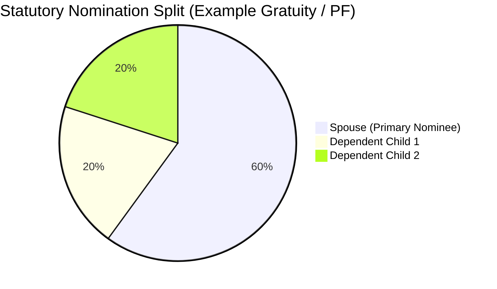
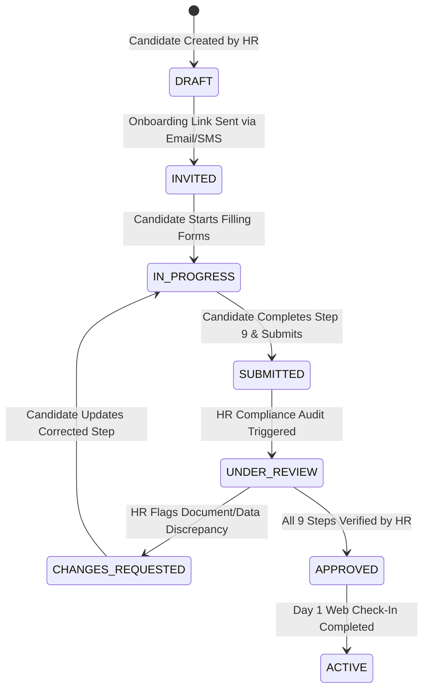
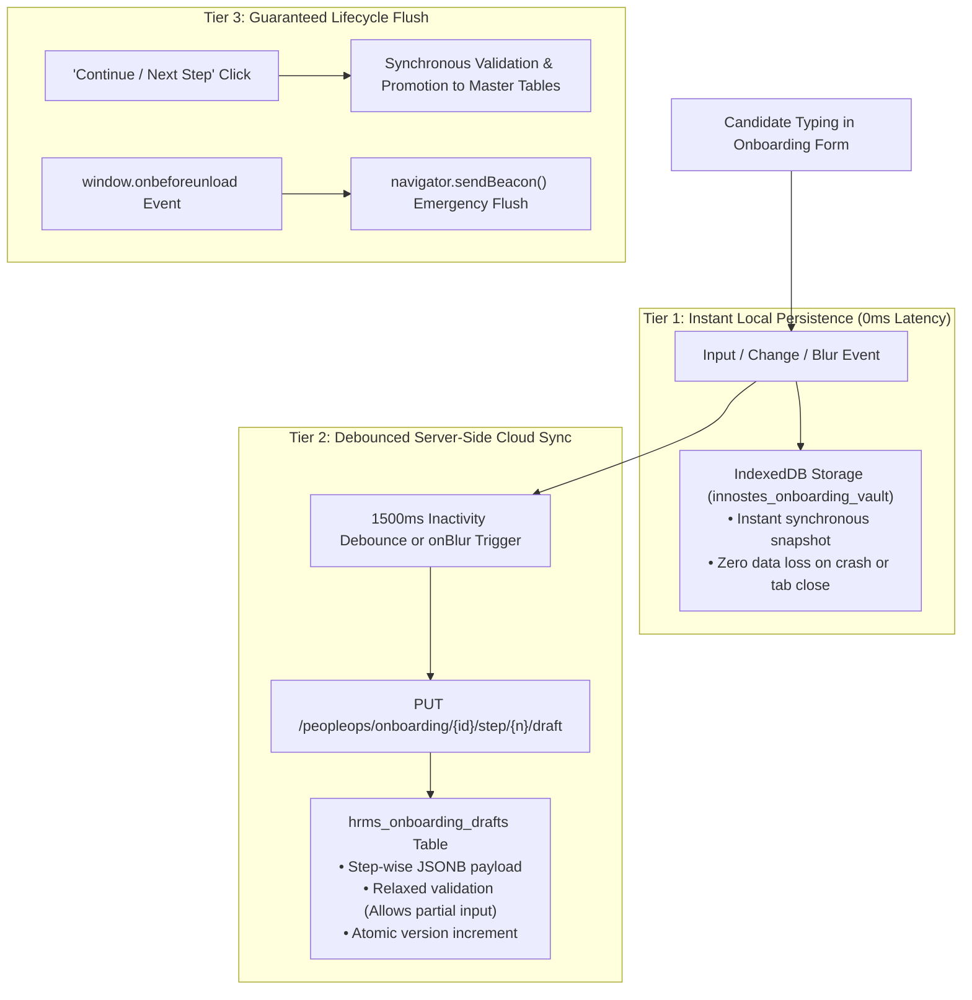

# HRMS Specification: Core Architecture, Master Employee Data Model & Onboarding Lifecycle

**Document Reference:** `research/final_modules/hrms/01_architecture_and_party_model.md`  
**Classification:** Enterprise Domain Specification & Master Data Architecture  
**Market Benchmark:** Darwinbox, Zoho People, Keka, GreytHR, Workday HCM  
**Compliance Standard:** Indian Statutory Acts (EPF, ESI, Gratuity, Income Tax, Aadhaar Act) & International (US W-4/I-9, GDPR)  
**Status:** Approved Canonical Specification  

---

## 1. Architectural Philosophy: Decoupled, Multi-Tenant & Audit-Hardened

The Innostes PeopleOps architecture separates identity from contractual tenure, isolates personally identifiable information (PII) within an encrypted vault, and structures employee intake into a formal multi-step onboarding pipeline:

1. **Two-Tier Identity Model**: Separates the human entity (`parties`) from tenant-specific contractual employment records (`employees`). A single person can hold sequential or concurrent contracts (e.g., subsidiary transfers, international relocation, contractor-to-permanent conversion) without duplicating identity records.
2. **Encrypted Zero-Knowledge PII Vault**: National identifiers (Aadhaar, PAN, SSN) and financial data (bank account numbers) are encrypted at rest using AES-256 via PostgreSQL `pgcrypto`. Unmasked values are never logged, sent to analytics, or transmitted over plain API payloads.
3. **Multi-Step Onboarding Stepper**: Employee data ingestion is structured into 9 sequential, verified steps. Each step supports draft persistence, validation constraints, and dedicated HR verification audits.
4. **Decoupled Headless Consumption**: The backend exposes strict OpenAPI 3.1 endpoints. The data intake engine functions identically whether driven by the Innostes Web portal, an employee self-service mobile app, or headless API integrations.

---

## 2. Two-Tier Identity Model: Party vs. Employment Entity

```mermaid
flowchart TD
    subgraph Global_Identity["Global Identity Layer (Single Source of Truth)"]
        Party["Party (Master Person Record)<br/>• Immutable UUID<br/>• Full Legal Name (First, Middle, Last)<br/>• Date of Birth & Gender<br/>• Nationality & Blood Group<br/>• Father's, Mother's & Spouse's Legal Names"]
        PartyVault["Encrypted Identity Vault<br/>• Aadhaar Number (AES-256)<br/>• PAN Card (AES-256)<br/>• Passport & Driving License<br/>• Biometric/Aadhaar Virtual ID"]
        Party --> PartyVault
    end

    subgraph Tenant_Contracts["Tenant & Contractual Employment Layer"]
        EmpIndia["Employment Contract #1 (Tenant: Innostes India)<br/>• Employee Code: INN-00104<br/>• Legal Entity: Innostes Technologies Pvt Ltd<br/>• Band: L4 Senior Engineer<br/>• Reporting: Engineering VP"]
        EmpUS["Employment Contract #2 (Tenant: Innostes US)<br/>• Employee Code: INN-US-0042<br/>• Legal Entity: Innostes Inc.<br/>• Band: M1 Engineering Manager<br/>• Status: Active"]
    end

    Party -->|Contract 1 (2022 - 2024)| EmpIndia
    Party -->|Contract 2 (2024 - Present)| EmpUS
```

---

## 3. The 9-Step Master Employee Data Catalog

Enterprise-grade HRMS requires a comprehensive, multi-step data model. Innostes PeopleOps implements an 8-step Phase 1 onboarding schema (with electronic document signing deferred to Phase 2):

```
EMPLOYEE DATA INTAKE PIPELINE (PHASE 1: 8 STEPS + SUBMISSION)
├── Step 1: Core Personal & Demographic Identity
├── Step 2: Contact Details, Addresses & Emergency Contacts
├── Step 3: Statutory & National Identity Vault (India & Global)
├── Step 4: Banking, Disbursement & Direct Deposit Information
├── Step 5: Employment, Band Taxonomy & Dual-Matrix Hierarchies
├── Step 6: Educational Qualifications & Professional Certifications
├── Step 7: Prior Employment & Experience Verification
├── Step 8: Family Dependents & Statutory Nominees (Form 2 / Form F)
└── Review & Submit: Candidate Review & Formal Submission to HR

[NOTE: Contractual Electronic Document Signing (Aadhaar eSign / DocuSign) is deferred to Phase 2]
```

---

### Step 1: Core Personal & Demographic Identity

Captures personal details required for corporate directories, medical insurance, and statutory filings:

| Attribute | Data Type | Constraint | Description & Validation Rules |
| :--- | :--- | :--- | :--- |
| `salutation` | `VARCHAR(10)` | Optional | `Mr.`, `Ms.`, `Mrs.`, `Dr.`, `Prof.` |
| `first_name` | `VARCHAR(100)` | NOT NULL | Legal first name matching government ID. |
| `middle_name` | `VARCHAR(100)` | Nullable | Legal middle name. |
| `last_name` | `VARCHAR(100)` | NOT NULL | Legal surname/last name. |
| `display_name` | `VARCHAR(150)` | NOT NULL | Preferred name for Slack, email, and directory. |
| `date_of_birth` | `DATE` | NOT NULL | Validated at service layer based on jurisdiction labor laws. |
| `gender` | `ENUM` | NOT NULL | `MALE`, `FEMALE`, `NON_BINARY`, `PREFER_NOT_TO_SAY`. |
| `marital_status`| `ENUM` | Nullable | Optional: `SINGLE`, `MARRIED`, `DIVORCED`, `WIDOWED`. |
| `marriage_date` | `DATE` | Nullable | Optional: Required only if claiming spouse benefits. |
| `blood_group` | `ENUM` | Nullable | Optional: `A+`, `A-`, `B+`, `B-`, `AB+`, `AB-`, `O+`, `O-` (never blocks Day 1 hire). |
| `nationality` | `VARCHAR(50)` | NOT NULL | ISO 3166-1 alpha-2 code (e.g., `IN`, `US`, `GB`). |
| `father_name` | `VARCHAR(150)` | Nullable | Optional in master record; conditionally verified only for Indian EPF Form 2/11. |
| `mother_name` | `VARCHAR(150)` | Nullable | Optional. |
| `spouse_name` | `VARCHAR(150)` | Nullable | Optional: Required only for married gratuity/insurance nomination. |
| `is_differently_abled` | `BOOLEAN` | DEFAULT FALSE | Person with Disabilities (PwD) classification. |
| `disability_details` | `TEXT` | Nullable | Nature of disability, certificate number, and % impairment. |

---

### Startup-First Ergonomics: 60-Second Quick-Add vs. Self-Service Intake

Startups cannot afford multi-step administrative gridlock when bringing on new teammates. Innostes implements a **Dual-Mode Intake Architecture**:

1. **The 60-Second Founder Quick-Add (`POST /peopleops/employees/quick-add`)**:
   * Admin enters only 4 essential fields: `Legal Name`, `Work Email`, `Designation`, and `Monthly Compensation`.
   * An active employee profile is generated immediately with status `INVITED / ONBOARDING`.
   * An onboarding magic link is dispatched to the candidate's personal email/SMS.
   * **Instant Day 1 Access:** The employee can immediately log in, access internal announcements, and record daily attendance even while their background document uploads are in progress.
2. **Progressive Self-Service Completion**:
   * The candidate completes their bank details, addresses, and statutory IDs on their own time via mobile web.
   * If a candidate takes 3 days to find their graduation degree certificate, their profile and check-in access are **never blocked**.

---

### Step 2: Contact Details, Addresses & Emergency Contacts

Tracks multi-mode communication channels and addresses:

#### 1. Communication Channels
* `personal_email`: Personal email address (used for initial invitation, onboarding, and alumni tax forms). Unique across active parties.
* `work_email`: Company-issued email (`@innostes.com`). Unique within tenant.
* `mobile_number`: E.164 formatted primary mobile (e.g., `+919876543210`). Verified via SMS OTP.
* `alternate_phone`: Secondary contact number.

#### 2. Address Architecture (`addresses` table)
Each employee maintains two verified addresses:
* **Current / Present Residential Address**:
  * Address Line 1 & Line 2 (Building, Street, Landmark).
  * City, District, State / Province, Postal / PIN Code (Validated against Indian Postal Index Directory: 6-digit integer `^[1-9][0-9]{5}$`).
  * Country Code (ISO-3166).
  * Residence Type: `OWNED`, `RENTED`, `COMPANY_PROVIDED`, `PARENTAL`.
  * Address Proof Document Reference (Electricity bill, rental agreement, or gas connection).
* **Permanent Residential Address**:
  * Fields identical to current address.
  * Fast-fill toggle: `is_same_as_current` (clones fields automatically).

#### 3. Emergency Contacts (`employee_emergency_contacts` table)
Every profile requires at least one primary and one secondary contact:
* `contact_name`: Full name of emergency contact.
* `relationship`: `SPOUSE`, `PARENT`, `SIBLING`, `CHILD`, `FRIEND`, `GUARDIAN`.
* `primary_phone`: Validated E.164 phone number.
* `alternate_phone`: Optional backup number.
* `residential_address`: Physical location of contact.
* `is_primary`: Flag distinguishing primary responder from secondary escalation.

---

### Step 3: Statutory & National Identity Vault (India & International)

Statutory compliance requires rigorous verification, encryption at rest, and algorithmic validation.

```
+-------------------------------------------------------------------------------------------------------+
| INDIAN STATUTORY IDENTITY VAULT                                                                       |
+-------------------------------------------------------------------------------------------------------+
| 1. Aadhaar Card (UIDAI):                                                                              |
|    - 12-Digit Verhoeff Algorithm Checksum Validation                                                  |
|    - AES-256 Storage in PostgreSQL pgcrypto vault                                                     |
|    - Masked Display: XXXX-XXXX-1234 (Compliant with Aadhaar Regulations)                              |
|    - Virtual ID (VID) / Enrolment ID support for unissued physical cards                              |
|                                                                                                       |
| 2. Permanent Account Number (PAN) (Income Tax Department):                                            |
|    - 10-Character Alphanumeric Format: ^[A-Z]{5}[0-9]{4}[A-Z]{1}$                                     |
|    - 4th Character Check: Must be 'P' for Individual / Person                                         |
|    - Mandatory for TDS Section 192, Form 16, and Annual 26AS reconciliation                           |
|                                                                                                       |
| 3. Universal Account Number (UAN) (EPFO):                                                             |
|    - 12-Digit Numeric String (Issued by Employees' Provident Fund Organisation)                       |
|    - Previous Member ID: State/Office/Establishment/Extension/Account (e.g. KN/BNG/0012345/000/0001042)  |
|    - Automated EPFO Portal Transfer Form 13 Generation                                                |
|                                                                                                       |
| 4. Employees' State Insurance (ESIC):                                                                 |
|    - 17-Digit ESIC Insurance Number (Mandatory for employees earning Gross <= INR 21,000/mo)          |
|    - Dispensary Code and Branch Office mapping                                                        |
|                                                                                                       |
| 5. Professional Tax (PT) & Labour Welfare Fund (LWF):                                                 |
|    - State PT Circle Registration (e.g., Karnataka, Maharashtra, Telangana slabs)                     |
|    - State Labour Welfare Fund Worker Classification                                                  |
|                                                                                                       |
| 6. Passport & Immigration Details:                                                                    |
|    - Passport Number, Place of Issue, Date of Issue, Expiry Date                                       |
|    - Visa Type (B1/B2, H-1B, L-1, Schengen), Visa Number, Visa Expiry Date                            |
|                                                                                                       |
| 7. Driving License & Voter ID (EPIC):                                                                 |
|    - DL Number, State of Issue, Expiry Date (Field/Logistics staff validation)                        |
|    - Voter ID Number for secondary national verification                                              |
+-------------------------------------------------------------------------------------------------------+
```

#### International Compliance Modules (Modular Pluggability):
* **United States**: Social Security Number (9-digit SSN, encrypted, masked `XXX-XX-1234`), Form I-9 Alien Registration Number / USCIS Number, State Tax ID.
* **United Kingdom**: National Insurance Number (NINO - 9 characters), HMRC Tax Code.
* **European Union**: National Tax Identification Number (TIN), Right to Work Permit.

---

### Step 4: Banking, Disbursement & Direct Deposit Information

Prevents payroll disbursement failures through rigorous banking validations:

| Field Name | Type | Validation Rules | Description |
| :--- | :--- | :--- | :--- |
| `bank_name` | `VARCHAR(150)` | NOT NULL | Legal name of the scheduled banking institution. |
| `branch_name` | `VARCHAR(150)` | NOT NULL | Branch location. |
| `account_number_enc`| `BYTEA` | Encrypted AES-256 | Account number. Encrypted via `pgp_sym_encrypt`. |
| `account_number_masked`| `VARCHAR(30)` | NOT NULL | Formatted preview: `••••••••3821`. |
| `account_type` | `ENUM` | NOT NULL | `SAVINGS`, `SALARY_CORPORATE`, `CURRENT`. |
| `ifsc_code` | `VARCHAR(11)` | Regex: `^[A-Z]{4}0[A-Z0-9]{6}$` | 11-character Indian Financial System Code. Automatic bank and branch resolver via RBI NEFT/RTGS directory. |
| `micr_code` | `VARCHAR(9)` | 9 digits | Magnetic Ink Character Recognition code for clearing. |
| `account_holder_name`| `VARCHAR(150)` | NOT NULL | Legal name as recorded with the bank. Verified against `display_name` via Levenshtein distance check. |
| `penny_drop_status`| `ENUM` | `PENDING`, `VERIFIED`, `FAILED` | NPCI/IMPS penny-drop bank account validation status. |
| `disbursal_mode` | `ENUM` | NOT NULL | `NEFT`, `RTGS`, `IMPS`, `ACH`, `WIRE_TRANSFER`, `CHEQUE`. |
| `is_primary` | `BOOLEAN` | DEFAULT TRUE | Designates main payroll account. |

---

### Step 5: Employment, Band Taxonomy & Dual-Matrix Hierarchies

Binds the employee to legal and operational enterprise structures:

```
+-------------------------------------------------------------------------------------------------------+
| EMPLOYMENT & ORGANIZATIONAL HIERARCHY ARCHITECTURE                                                    |
+-------------------------------------------------------------------------------------------------------+
| 1. Identifiers:                                                                                       |
|    - Employee ID: Gapless, atomic sequential code (e.g. INN-00104)                                    |
|    - Biometric / RFID Badge ID: Hardware attendance reader key (e.g. BIO-8842)                        |
|                                                                                                       |
| 2. Corporate Taxonomy:                                                                                |
|    - Legal Entity: Foreign key to legal company (e.g. Innostes Technologies Pvt Ltd)                  |
|    - Business Unit (BU): Enterprise division (e.g. Cloud Platforms, FinOps)                           |
|    - Department & Sub-Department: Operational unit (e.g. Engineering > Core Kernel)                   |
|    - Cost Center: Financial allocation code for LedgerFlow GL mapping (e.g. CC-ENG-104)               |
|                                                                                                       |
| 3. Role & Seniority Band:                                                                             |
|    - Designation: Functional title (e.g. Staff Distributed Systems Engineer)                          |
|    - Grade / Band: Standardized tier (e.g. L1-Junior, L2-Associate, L3-Mid, L4-Senior, L5-Staff,       |
|      M1-Manager, M2-Director, E1-VP, E2-C-Suite)                                                      |
|                                                                                                       |
| 4. Work Location & Shift Schedule:                                                                    |
|    - Primary Worksite: Physical branch/facility with geofence bounds (e.g. Bengaluru Tech Park)        |
|    - Work Mode: IN_OFFICE, REMOTE_WFH, HYBRID, CLIENT_SITE                                            |
|    - Shift Policy: Assigned shift topology (General Shift 09:00-18:00, US Shift, Rotational Shift)    |
|    - Holiday Calendar: Associated regional/state holiday list (e.g. Karnataka Holiday Calendar 2026)  |
|                                                                                                       |
| 5. Contractual Tenure:                                                                                |
|    - Date of Joining (DOJ): Official first day of employment                                          |
|    - Confirmation Date: Date probation is formally evaluated and approved                            |
|    - Probation Duration: Configurable days (e.g. 90 days, 180 days)                                   |
|    - Notice Period (Probation): Days required during probation (e.g. 15 days, 30 days)                |
|    - Notice Period (Confirmed): Days required post-confirmation (e.g. 60 days, 90 days)               |
|    - Employment Classification: PERMANENT_FULL_TIME, PERMANENT_PART_TIME, CONTRACTOR, INTERN,        |
|      RETAINER_CONSULTANT                                                                              |
|                                                                                                       |
| 6. Dual-Matrix Reporting Tree:                                                                        |
|    - Primary Line Manager (Solid-Line): Daily operations, leaves, approvals, and appraisals           |
|    - Project / Functional Manager (Dotted-Line): Secondary project allocation and deliverables        |
|    - Assigned HR Business Partner (HRBP): PeopleOps escalation point                                  |
+-------------------------------------------------------------------------------------------------------+
```

---

### Step 6: Educational Qualifications & Professional Certifications

Maintains structured academic records for compliance, client contracts, and ISO/CMMI audit certifications:

#### 1. Educational Degrees (`employee_education` table)
* `qualification_level`: `DOCTORATE`, `POST_GRADUATE`, `UNDERGRADUATE`, `DIPLOMA`, `HIGHER_SECONDARY`, `SECONDARY`.
* `degree_name`: Full degree (e.g., *Bachelor of Technology*, *Master of Business Administration*).
* `field_of_study`: Major specialization (e.g., *Computer Science & Engineering*).
* `institution_name`: College / University name.
* `board_or_university`: Affiliated governing university.
* `start_year` & `passing_year`: Academic tenure dates.
* `scoring_format`: `PERCENTAGE`, `CGPA_10_SCALE`, `GPA_4_SCALE`, `GRADE_LETTER`.
* `score_value`: Scored grade (e.g., `8.75`, `82.4%`).
* `document_attachment_id`: Reference to uploaded degree certificate PDF.

#### 2. Professional Certifications (`employee_certifications` table)
* `certification_name`: (e.g., *AWS Certified Solutions Architect - Professional*, *CISSP*, *Chartered Accountant*).
* `issuing_authority`: (e.g., *Amazon Web Services*, *ICAI*, *Project Management Institute*).
* `license_number`: Unique credential identification code.
* `issue_date` & `expiry_date`: Validity window. Flag for lifelong validity (`never_expires = true`).
* `verification_url`: Direct credential validation URL.

---

### Step 7: Prior Employment & Experience Verification

Captures previous career history for salary benchmarking, gratuity continuity, and background verification (BGV):

| Attribute | Data Type | Description |
| :--- | :--- | :--- |
| `company_name` | `VARCHAR(200)` | Previous employer corporate name. |
| `designation` | `VARCHAR(150)` | Final title held at previous organization. |
| `start_date` & `end_date` | `DATE` | Exact tenure. Used to compute total aggregate industry experience. |
| `last_drawn_annual_ctc` | `NUMERIC(15,2)` | Gross annual cost-to-company. |
| `company_website` | `VARCHAR(255)` | Verification domain. |
| `reporting_manager_name`| `VARCHAR(150)` | Prior reference supervisor. |
| `reporting_manager_contact`| `VARCHAR(100)` | Reference phone or work email for BGV agency checks. |
| `reason_for_leaving` | `TEXT` | Career transition reason. |
| `previous_pf_member_id` | `VARCHAR(50)` | EPFO establishment and member code for online transfer. |
| `has_relieving_letter` | `BOOLEAN` | Verified receipt of formal relieving/experience letter. |
| `document_attachment_ids`| `UUID[]` | Array links to relieving letter, pay slips, and Form 16. |

---

### Step 8: Family Dependents & Statutory Nominees (Form 2 / Form F Compliance)

Indian statutory laws (*Payment of Gratuity Act 1972*, *Employees' Provident Funds Act 1952*, and *ESIC Act 1948*) mandate explicit nomination filings. Innostes enforces strict percentage allocation invariants:



#### Schema: `employee_dependents_nominees`
* `full_name`: Legal name of family member / nominee.
* `relationship`: `SPOUSE`, `SON`, `DAUGHTER`, `FATHER`, `MOTHER`, `BROTHER`, `SISTER`, `GUARDIAN`.
* `date_of_birth`: Date of birth.
* `is_minor`: Boolean derived flag ($< 18$ years of age). If true, mandates `guardian_name` and `guardian_relationship`.
* `address`: Physical residential address of nominee.
* **Statutory Nomination Percentages (Must sum to exactly 100.00% across all nominees per fund)**:
  * `pf_nomination_percent`: Provident fund accumulated corpus share.
  * `eps_nomination_percent`: Pension scheme benefit share.
  * `gratuity_nomination_percent`: Statutory gratuity disbursal share (Form F).
  * `gtli_nomination_percent`: Group Term Life Insurance benefit allocation.
* **Medical Insurance Dependent Coverage (GMC)**:
  * `is_covered_under_mediclaim`: Flag including dependent in corporate health insurance policy.
  * `pre_existing_conditions`: Medical declaration required by underwriter.

---

### Document Uploads & Phase 2 Electronic Signing

In Phase 1, supporting compliance documents (Aadhaar card copy, PAN copy, cancelled bank cheque, educational certificates, and relieving letters) are uploaded contextually within their respective steps (Steps 2, 3, 4, 6, and 7) and stored securely in `hrms_document_vault`.

> [!NOTE] Phase 2 Scope: Electronic Document Signatures (eSign)
> Automated digital signing workflows (such as Aadhaar eSign, DocuSign / HelloSign integrations, and legal contract signature tracking for Employment Agreements and NDAs) are deferred to Phase 2. In Phase 1, executed physical offer letters or signed agreement scans can be attached directly to the employee profile.

---

## 4. Algorithmic Validations & Cryptographic Storage Engine

### 4.1 Aadhaar 12-Digit Verhoeff Checksum Engine

The Aadhaar number uses the **Verhoeff algorithm** (based on the dihedral group $D_5$). Any entry failing the Verhoeff multiplication permutation table is rejected client-side and server-side before reaching the cryptographic vault:

$$\text{Verhoeff Check: } \sum_{i=0}^{n-1} d(inv, p(i \pmod 8, a_i)) = 0$$

* Once validated, the raw 12-digit number is encrypted via `pgp_sym_encrypt(raw_aadhaar, vault_key)`.
* Only the masked representation (`XXXX-XXXX-` + last 4 digits) is retained in the queryable text column `aadhaar_masked`.

### 4.2 Income Tax PAN Format & Individual Persona Check

The Permanent Account Number follows a strict 10-character regular expression:

$$\text{Regex: } \mathtt{\hat{\ }[A-Z]\{3\}[P][A-Z]\{1\}[0-9]\{4\}[A-Z]\{1\}\$}$$

* Characters 1–3: Alphabetic series (`AAA` to `ZZZ`).
* **Character 4: Entity Category Flag.** For employee records, this character **must strictly be `'P'`** (representing a Person / Individual). Any other category (such as `'C'` for Company, `'F'` for Firm, or `'T'` for Trust) is blocked.
* Character 5: First character of employee's legal last name.
* Characters 6–9: Sequential sequential numeric digits (`0001` to `9999`).
* Character 10: Alphabetic checksum digit.

### 4.3 RBI Indian Financial System Code (IFSC) Resolver

The bank branch IFSC code follows:

$$\text{Regex: } \mathtt{\hat{\ }[A-Z]\{4\}0[A-Z0-9]\{6\}\$}$$

* Characters 1–4: Bank alphabetic code (e.g., `HDFC`, `ICIC`, `SBIN`).
* Character 5: Reserved digit, **strictly `'0'`**.
* Characters 6–11: Specific branch code.
* On entry, the system calls an in-memory Redis lookup against the Reserve Bank of India IFSC registry, auto-populating `bank_name`, `branch_name`, and `branch_city`.

---

## 5. The Multi-Step Onboarding Lifecycle & State Machine

Candidate intake moves through explicit, auditable lifecycle states:



### Onboarding Steps Tracking Table: `employee_onboarding_progress`

| Step Index | Step Title | Mandatory Fields Status | Verification Status |
| :---: | :--- | :--- | :--- |
| **Step 1** | Personal & Demographics | First/Last Name, DOB, Gender, Marital Status | Auto-validated |
| **Step 2** | Addresses & Emergency | Current Address, Permanent Address, 2 Emergency Contacts | Auto-validated |
| **Step 3** | Statutory ID Vault | Aadhaar (Verhoeff), PAN (Format), UAN | HR Document Verification |
| **Step 4** | Bank Disbursement | IFSC, Account Number, Penny Drop Match | Penny-Drop / HR Check |
| **Step 5** | Employment & Hierarchy | Department, Role, Band, Reporting Manager | HR Configured |
| **Step 6** | Academic Qualifications| Highest Degree, Passing Year, Degree Certificate | HR Document Verification |
| **Step 7** | Prior Employment | Relieving Letter, Last 3 Payslips, Prior PF ID | Background Verification (BGV) |
| **Step 8** | Statutory Nominees | PF, EPS, and Gratuity Nominees (100% split) | Statutory Compliance Audit |
| **Final Review** | Candidate Submission | Review summary across all 8 steps before submission | Final Self-Verification |
| **Phase 2** | Contract eSign (Deferred) | Electronic signature workflows (Aadhaar eSign/DocuSign) | Deferred to Phase 2 |

---

## 6. Enterprise Step-Wise Auto-Save & Draft Synchronization Strategy

Ingesting extensive enterprise onboarding records (personal, statutory IDs, banking details, degrees, previous employment, and family nominees) across 9 steps introduces severe risk of user fatigue and data loss if accidental tab closure, network dropout, or device switching occurs. 

Innostes PeopleOps implements a **Dual-Tier Auto-Save & Draft Synchronization Engine**:



### 6.1 Architectural Principles: Draft Mode vs. Submission Mode

A major failure point in legacy forms is triggering strict validation during auto-save. For example, if a candidate has typed only 6 digits of a 12-digit Aadhaar or 7 characters of an IFSC code, a strict validation endpoint will reject the request with HTTP 400 Bad Request, failing to persist progress.

Innostes cleanly separates validation into two distinct evaluation engines:

| Feature Dimension | Auto-Save Draft Mode (`/step/{n}/draft`) | Formal Step Promotion Mode (`/step/{n}/commit`) |
| :--- | :--- | :--- |
| **Endpoint** | `PUT /peopleops/onboarding/{id}/step/{n}/draft` | `POST /peopleops/onboarding/{id}/step/{n}/commit` |
| **Validation Rules** | **Relaxed / Non-blocking**: Accepts incomplete strings, partial forms, missing mandatory fields, and unverified files. Validates only payload structure and JSON sanitization. | **Strict / Invariant-Enforced**: Enforces all mandatory fields, 12-digit Verhoeff Aadhaar algorithm, PAN regex, 100% nominee distribution, and required document uploads. |
| **Storage Target** | `hrms_onboarding_drafts` (`draft_payload JSONB`). | Promoted directly to canonical relational tables (`hrms_parties`, `hrms_addresses`, `hrms_statutory_identities`, etc.). |
| **Trigger Mechanism**| Debounced keystroke timer (1500ms) or field blur (`onBlur`). | Explicit user click on `"Save & Continue"` or `"Submit for Review"`. |
| **State Mutation** | Updates `last_saved_at` timestamp and returns HTTP 200 OK with `client_version`. | Marks `step_{n}_completed = true` in `hrms_onboarding_steppers`. |

### 6.2 Guaranteed Lifecycle Flush & Tab Exit Safety

To guarantee zero data loss when a candidate abruptly navigates away or closes their laptop:

1. **`navigator.sendBeacon` Integration**:
   * The client hooks into the browser `visibilitychange` and `beforeunload` events.
   * If unsaved changes exist in memory, the browser dispatches an asynchronous `POST` via `navigator.sendBeacon` to `/peopleops/onboarding/{id}/beacon-flush`.
   * This guarantees transmission even after the page process has been terminated by the operating system.
2. **Step Transition Flushes**:
   * Clicking `"Continue: Step N+1"` or `"Back: Step N-1"` cancels any pending debounce timers and synchronously validates and commits the active step before rendering the adjacent view.

### 6.3 Cross-Device Cloud Hydration & Conflict Resolution

Candidates frequently begin onboarding on a mobile device and complete document uploads on a laptop:

* **Session Hydration**: When the candidate opens the onboarding portal on any device:
  1. The client requests `GET /peopleops/onboarding/{id}/stepper`.
  2. The server returns the active step index and the latest `draft_payload` for that step.
  3. The client compares the server timestamp with local `IndexedDB` timestamps.
  4. If server data is newer, it hydrates the form seamlessly.
  5. If an offline conflict is detected (e.g. changes made offline on mobile while another tab was active on desktop), a non-destructive prompt asks:
     * *"You have unsaved changes from another session (Desktop, 14 minutes ago). [ Resume from Cloud ] or [ Keep Local Draft ]"*.

---

## 7. Gapless Sequential Employee Code Invariant

Human-readable employee codes (e.g., `INN-00104`) are legal identifiers tied to tax filings, provident fund returns, and social security. They must never contain gaps or duplicates.

### Implementation Architecture
```sql
CREATE OR REPLACE FUNCTION generate_next_employee_code(p_tenant_id UUID, p_prefix VARCHAR(10))
RETURNS VARCHAR(30) AS $$
DECLARE
    v_next_val BIGINT;
    v_code VARCHAR(30);
BEGIN
    -- Atomic row-lock on tenant sequence counter to prevent concurrency races
    INSERT INTO tenant_sequences (tenant_id, sequence_type, current_value)
    VALUES (p_tenant_id, 'EMPLOYEE_CODE', 1)
    ON CONFLICT (tenant_id, sequence_type)
    DO UPDATE SET current_value = tenant_sequences.current_value + 1
    RETURNING current_value INTO v_next_val;

    -- Format: PREFIX-PADDED_NUMBER (e.g. INN-00104)
    v_code := p_prefix || '-' || LPAD(v_next_val::TEXT, 5, '0');
    RETURN v_code;
END;
$$ LANGUAGE plpgsql;
```

This ensures that even during high-concurrency batch onboarding (such as university campus hire cohorts), codes are generated sequentially without deadlocks or skipped integers.
