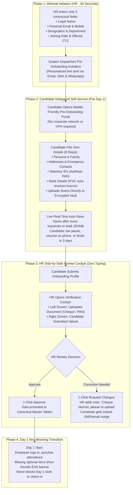
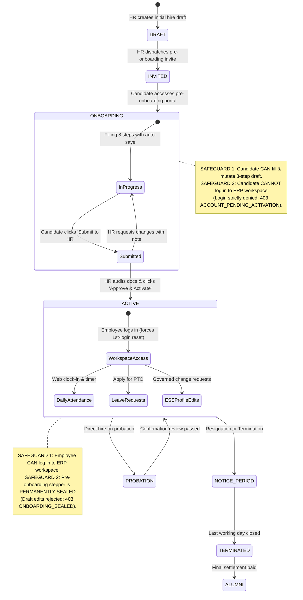
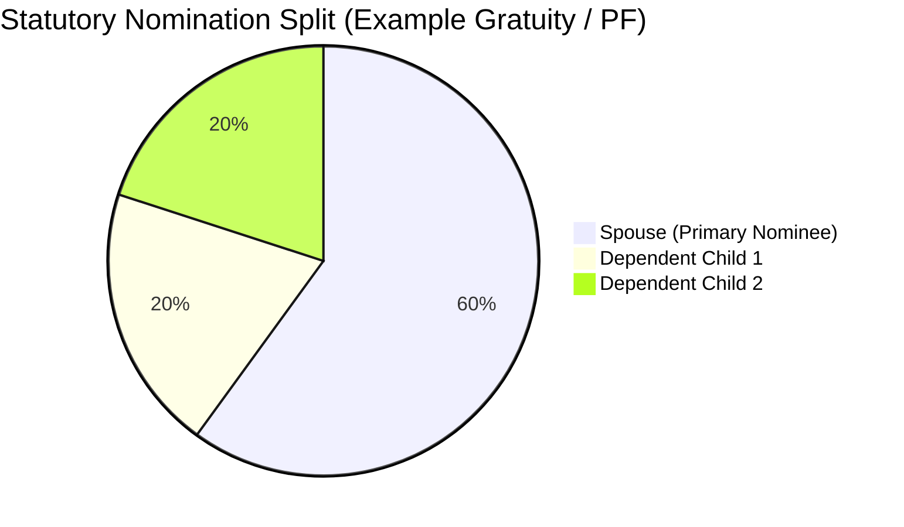
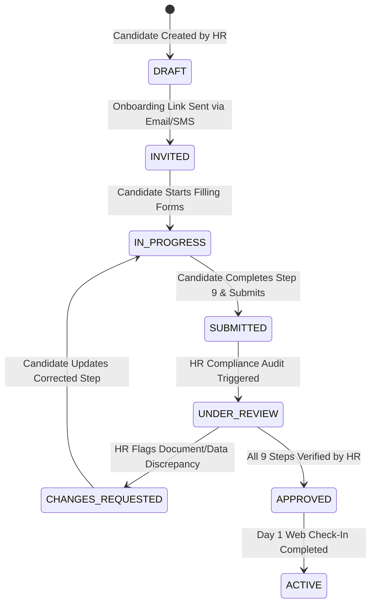
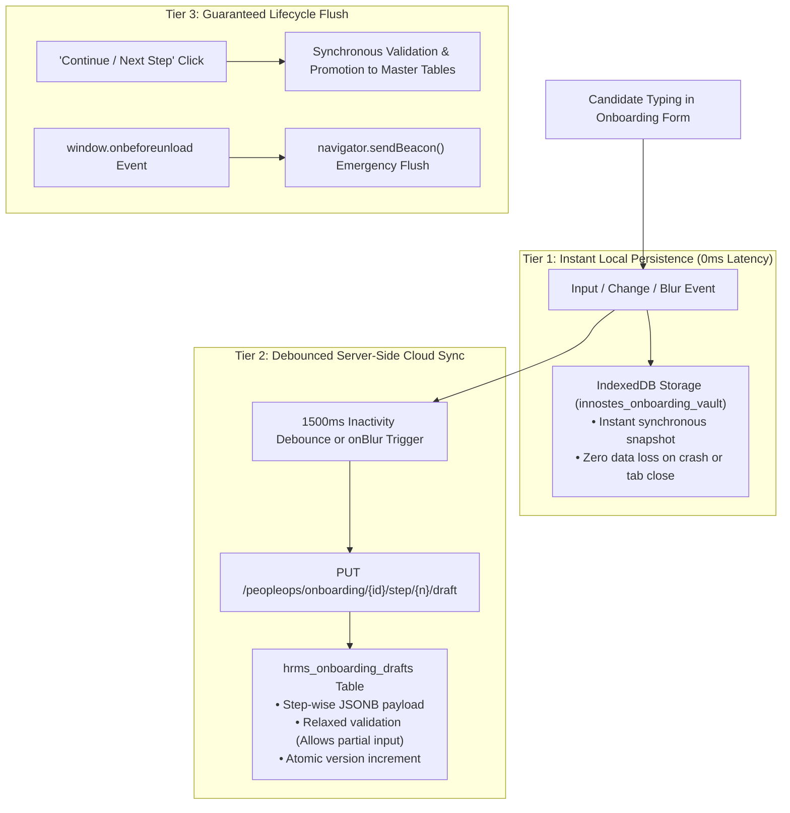
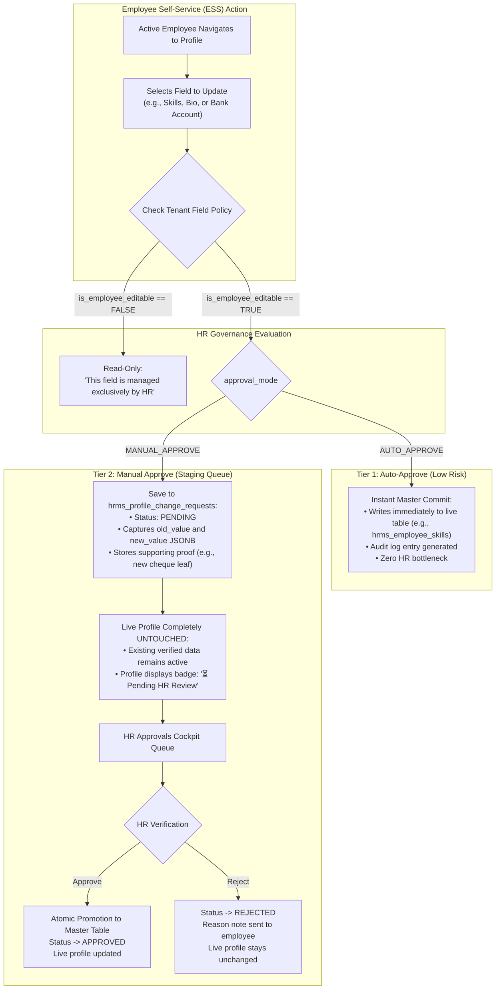

# HRMS Specification: Core Architecture, Master Employee Data Model & Onboarding Lifecycle

**Document Reference:** `research/final_modules/hrms/01_architecture_and_party_model.md`  
**Classification:** Enterprise Domain Specification & Master Data Architecture  
**Market Benchmark:** Darwinbox, Zoho People, Keka, GreytHR, Workday HCM  
**Compliance Standard:** Indian Statutory Acts (EPF, ESI, Gratuity, Income Tax, Aadhaar Act) & International (US W-4/I-9, GDPR)  
**Status:** Approved Canonical Specification  

---

## 1. Architectural Philosophy: Decoupled, Multi-Tenant & Audit-Hardened

The Innostes PeopleOps architecture separates identity from contractual tenure, isolates personally identifiable information (PII) within an encrypted vault, and structures employee intake into a formal multi-step onboarding pipeline:

1. **Two-Tier Identity Model**: Separates the human entity (`parties`) from tenant-specific contractual employment records (`employees`). A single person can hold sequential or concurrent contracts (e.g., subsidiary transfers, international relocation, contractor-to-permanent conversion) without duplicating identity records.
2. **Encrypted Zero-Knowledge PII Vault**: National identifiers (Aadhaar, PAN, SSN) and financial data (bank account numbers) are encrypted at rest using AES-256 via PostgreSQL `pgcrypto`. Unmasked values are never logged, sent to analytics, or transmitted over plain API payloads.
3. **Multi-Step Onboarding Stepper**: Employee data ingestion is structured into 9 sequential, verified steps. Each step supports draft persistence, validation constraints, and dedicated HR verification audits.
4. **Decoupled Headless Consumption**: The backend exposes strict OpenAPI 3.1 endpoints. The data intake engine functions identically whether driven by the Innostes Web portal, an employee self-service mobile app, or headless API integrations.

---

## 2. Two-Tier Identity Model: Party vs. Employment Entity

```mermaid
flowchart TD
    subgraph Global_Identity["Global Identity Layer (Single Source of Truth)"]
        Party["Party (Master Person Record)<br/>• Immutable UUID<br/>• Full Legal Name (First, Middle, Last)<br/>• Date of Birth & Gender<br/>• Nationality & Blood Group<br/>• Father's, Mother's & Spouse's Legal Names"]
        PartyVault["Encrypted Identity Vault<br/>• Aadhaar Number (AES-256)<br/>• PAN Card (AES-256)<br/>• Passport & Driving License<br/>• Biometric/Aadhaar Virtual ID"]
        Party --> PartyVault
    end

    subgraph Tenant_Contracts["Tenant & Contractual Employment Layer"]
        EmpIndia["Employment Contract #1 (Tenant: Innostes India)<br/>• Employee Code: INN-00104<br/>• Legal Entity: Innostes Technologies Pvt Ltd<br/>• Band: L4 Senior Engineer<br/>• Reporting: Engineering VP"]
        EmpUS["Employment Contract #2 (Tenant: Innostes US)<br/>• Employee Code: INN-US-0042<br/>• Legal Entity: Innostes Inc.<br/>• Band: M1 Engineering Manager<br/>• Status: Active"]
    end

    Party -->|Contract 1 (2022 - 2024)| EmpIndia
    Party -->|Contract 2 (2024 - Present)| EmpUS
```

---

## 3. The 10-Section Master Employee Pre-Onboarding Data Catalog

Enterprise-grade HRMS requires a comprehensive pre-hire intake model comparable to tier-1 enterprise onboarding systems (such as TCS iON, Infosys Launchpad, and Darwinbox). Innostes PeopleOps organizes candidate data collection across 10 specialized sections:

```
ENTERPRISE EMPLOYEE PRE-ONBOARDING INTAKE PIPELINE (10 CANONICAL SECTIONS)
├── Section 1: Core Personal & Demographic Identity (DOB, Blood Group, Marital, Languages Known)
├── Section 2: Contact Details, Addresses & Emergency Contacts (Current, Permanent, Escalations)
├── Section 3: Statutory & National Identity Vault (Aadhaar, PAN, UAN/EPFO, Passport, ESIC)
├── Section 4: Banking, Disbursement & Direct Deposit (IFSC Lookup, Dual A/C Entry, Cheque Scan)
├── Section 5: Prior Employment & Work History (Previous Companies, Relieving Letters, Payslips, Form 16, BGV)
├── Section 6: Technical Skillsets, Tools & Professional Certifications (Skills, Proficiency, Cloud Certs)
├── Section 7: Educational Qualifications (10th, 12th, UG, PG, Doctorate with Marksheet & Degree Scans)
├── Section 8: Family Dependents & Statutory Nominees (EPF, EPS, Gratuity Form F 100% Split, GMC Mediclaim)
├── Section 9: Work Equipment, Asset & Office Preferences (Laptop OS, T-Shirt Size, Dietary Preferences)
└── Section 10: Final Review & Submission to HR (Read-Only Summary, Declarations, Submission Commit)

[NOTE: Contractual Electronic Document Signing (Aadhaar eSign / DocuSign) is deferred to Phase 2]
```

---

### Dedicated Pre-Onboarding Portal Shell (Isolated Application Experience)

When an incoming candidate in `ONBOARDING` status signs into the system (or opens their secure onboarding link), they do **not** see the standard enterprise ERP layout:
* They are not exposed to the global company navigation, module switchers, CRM pipelines, accounting ledgers, inventory trees, or organization-wide employee directories.
* Instead, the application automatically mounts the **Dedicated Candidate Onboarding Portal Shell (`CandidateOnboardingLayout`)**.

#### Characteristics of the Candidate Onboarding Portal:
1. **Distraction-Free Branded Shell**: Modern pre-hire experience featuring company branding, candidate greeting, target start date countdown, and overall onboarding progress bar (`[████████░░] 75% Complete`).
2. **Dedicated Left Sidebar Navigation**: The sidebar contains **only** the 10 onboarding sections. Each section displays its real-time completion state:
   * `[ ✓ ] Completed & Validated`
   * `[ • ] In Progress (Draft auto-saved)`
   * `[ ○ ] Pending`
   * `[ ⚠️ Action Required ]` (Flagged by HR with review notes for revision)
3. **Painless Asynchronous Completion**: The candidate can jump freely between sections (e.g. fill Work History today, and upload Bank Cheque tomorrow) with zero fear of data loss due to continuous auto-saving.
4. **HR Cross-Checking & Manual Discussion**:
   * HR's responsibility is solely to cross-check submitted items against scans in the HR Verification Cockpit.
   * If there is an issue (e.g., blurry image or discrepancy in prior PF member ID), HR can either leave an inline correction note (which instantly flags the item in the candidate's sidebar) or conduct a quick call/discussion with the candidate.

---

### Step 1: Core Personal & Demographic Identity

Captures personal details required for corporate directories, medical insurance, and statutory filings:

| Attribute | Data Type | Constraint | Description & Validation Rules |
| :--- | :--- | :--- | :--- |
| `salutation` | `VARCHAR(10)` | Optional | `Mr.`, `Ms.`, `Mrs.`, `Dr.`, `Prof.` |
| `first_name` | `VARCHAR(100)` | NOT NULL | Legal first name matching government ID. |
| `middle_name` | `VARCHAR(100)` | Nullable | Legal middle name. |
| `last_name` | `VARCHAR(100)` | NOT NULL | Legal surname/last name. |
| `display_name` | `VARCHAR(150)` | NOT NULL | Preferred name for Slack, email, and directory. |
| `date_of_birth` | `DATE` | NOT NULL | Validated at service layer based on jurisdiction labor laws. |
| `gender` | `ENUM` | NOT NULL | `MALE`, `FEMALE`, `NON_BINARY`, `PREFER_NOT_TO_SAY`. |
| `marital_status`| `ENUM` | Nullable | Optional: `SINGLE`, `MARRIED`, `DIVORCED`, `WIDOWED`. |
| `marriage_date` | `DATE` | Nullable | Optional: Required only if claiming spouse benefits. |
| `blood_group` | `ENUM` | Nullable | Optional: `A+`, `A-`, `B+`, `B-`, `AB+`, `AB-`, `O+`, `O-` (never blocks Day 1 hire). |
| `nationality` | `VARCHAR(50)` | NOT NULL | ISO 3166-1 alpha-2 code (e.g., `IN`, `US`, `GB`). |
| `father_name` | `VARCHAR(150)` | Nullable | Optional in master record; conditionally verified only for Indian EPF Form 2/11. |
| `mother_name` | `VARCHAR(150)` | Nullable | Optional. |
| `spouse_name` | `VARCHAR(150)` | Nullable | Optional: Required only for married gratuity/insurance nomination. |
| `is_differently_abled` | `BOOLEAN` | DEFAULT FALSE | Person with Disabilities (PwD) classification. |
| `disability_details` | `TEXT` | Nullable | Nature of disability, certificate number, and % impairment. |
| `mother_tongue` | `VARCHAR(50)` | Nullable | Primary native language. |
| `languages_known` | `JSONB` | DEFAULT '[]' | Array of `{ language: 'English', can_read: true, can_write: true, can_speak: true }`. |

---

### The Delegated Pre-Onboarding Strategy: Eliminating the "Email and Manual HR Entry" Anti-Pattern

In conventional company setups, HR teams face an exhausting, error-prone workflow when onboarding new hires:
1. HR does not have the candidate's statutory, banking, or educational data prior to onboarding.
2. HR sends an email asking the candidate to "please reply with scanned copies of your Aadhaar, PAN, cancelled cheque, degree certificate, and payslips."
3. The candidate sends fragmented emails, WhatsApp photos, or PDFs over several days.
4. HR sits and manually transcribes 16-digit bank account numbers, IFSC codes, PANs, and addresses into the HRMS.

#### Why the Traditional Email-and-Manual-Entry Approach Fails:
* **Severe Typo Risk:** A single miskeyed digit in an IFSC code or bank account number causes salary disbursement failures on payday.
* **PII Security & Compliance Violations:** Sensitive government IDs and bank cheques sit permanently unencrypted in corporate email inboxes and chat logs, violating UIDAI and DPDP/GDPR regulations.
* **Clerical Time Drain:** HR wastes 2 to 3 hours per hire performing manual data entry instead of employee orientation and culture building.

---

### The Innostes Solution: Delegated Pre-Onboarding Intake Pipeline

Innostes flips the paradigm from **HR manual transcription** to **Delegated Candidate Self-Service with Zero-Typing HR Verification**:



#### 1. Phase 1: Minimal Initiation (HR - 30 Seconds)
* The HR administrator or founder enters only the essential contractual details the company decides:
  * Legal First & Last Name
  * Personal Email Address & Mobile Phone
  * Designation / Job Title & Department
  * **Reporting To / Direct Lead (`manager_id`)**: Searchable dropdown to assign their manager (vital for routing punch regularizations, leave requests, and monthly timesheet approvals).
  * Date of Joining & Offered CTC
* HR clicks **`[ Send Pre-Onboarding Invitation ]`**.
* HR does **not** collect, ask for, or type bank accounts, Aadhaar, PAN, emergency contacts, or previous work history.

#### 2. Phase 2: Candidate Delegated Self-Service (Pre-Joining)
* The candidate receives an invitation via email, SMS, and WhatsApp: *"Welcome to Acme Corp! Please complete your onboarding profile before your start date on 15 Nov."*
* The candidate opens the secure onboarding portal on their phone or laptop.
* **Instant Auto-Validation While Typing**:
  * **IFSC Lookup**: Entering an IFSC code immediately queries the RBI bank branch directory, auto-populating the Bank Name, Branch, and MICR code (zero typing mistakes).
  * **Dual Account Number Confirmation**: Bank account number must be entered twice to prevent clerical typos.
  * **Algorithmic Checksums**: Aadhaar is verified in real-time via the Verhoeff algorithm; PAN is validated against the individual persona regex (`[A-Z]{5}[0-9]{4}[A-Z]{1}` with 4th character `'P'`).
* **Direct Encrypted Document Upload**:
  * Scans of the cancelled cheque, Aadhaar, PAN, and degree certificates are uploaded directly into the AES-256 envelope-encrypted PII vault. Scans never pass through unencrypted corporate email servers.
* **Continuous Auto-Save**:
  * Every input is debounced and auto-saved to `hrms_onboarding_drafts`. If the candidate stops at Step 3 to find their bank passbook and returns the next day on their phone, all progress is preserved.

#### 3. Phase 3: HR Side-by-Side Zero-Typing Review Cockpit
* When the candidate submits their onboarding package (or completes individual milestones), HR receives an in-app and email alert: *"Candidate Sarah Chen submitted onboarding details for review"*.
* HR opens the **Side-by-Side Verification Cockpit**:
  * **Left Pane**: Scanned document preview (e.g. Cancelled Cheque image or PAN card).
  * **Right Pane**: The candidate's submitted text values (Account Number, IFSC, Account Holder Name).
* **Zero Typing for HR**:
  * HR simply verifies: *"Does the account holder name on the cheque match 'Sarah Chen'? Yes. Does the account number match? Yes."*
  * HR clicks **`[ ✓ Approve Step ]`** $\implies$ The system automatically promotes the data into canonical database tables (`hrms_bank_accounts`, `hrms_statutory_identities`).
  * If an issue is spotted: HR clicks **`[ ✕ Request Correction ]`** and enters a quick note (e.g., *"Cheque photo is cropped; please re-upload showing full account number"*). The candidate receives an instant SMS/email notification and can fix it in 30 seconds without starting over.

#### 4. Phase 4: Automated Pre-Joining Reminders & Tracking
* **Automated Nudge Schedule**: The system automatically dispatches polite reminder notifications to the candidate at **T-7 days**, **T-3 days**, and **T-1 day** before their joining date.
* **HR Pipeline Tracker**: HR has an instant overview of all incoming hires:
  * `[ Sarah Chen | Senior Engineer | Joining 15 Nov | 80% Complete | Awaiting: Cheque Leaf | [ 📲 Nudge ] ]`
  * `[ Rohan Gupta | Product Designer | Joining 18 Nov | 100% Submitted | Ready for HR Review | [ Review ] ]`
* **1-Click WhatsApp / Email Nudge**: HR can click `[ Nudge Candidate ]` at any time to send a friendly pre-templated reminder directly to the candidate's WhatsApp or personal email.

#### 5. Phase 5: Day 1 Non-Blocking Progression
* If a candidate has completed their bank and statutory info, but has not yet located their previous company's relieving letter or college degree certificate by Day 1:
  * **The employee is NEVER blocked** from Day 1 orientation, Slack/email access, or web check-in once activated.
  * The pending items are non-blocking and appear as a gentle action banner on their Employee Self-Service (ESS) home page:
    `[ ⚠️ Onboarding 85% Complete: Please upload your previous company relieving letter by 30 Nov ]`.
  * The only hard deadline is bank account + PAN submission before the monthly payroll cutoff date (enforced with automated 5-day warning countdowns).

---

### Employment Status State Machine & Mutual Access Safeguards

A critical security principle governs the boundary between candidate onboarding and active enterprise access: **Strict State-Gated Mutual Isolation**.



#### Safeguard 1: Pre-Active Application Login Gate (`status != ACTIVE`)
* **Hard Block on Application Login**: An employee account is strictly forbidden from logging in to the ERP application (dashboards, team directories, announcements, attendance punch clock) while their status is `DRAFT`, `INVITED`, or `ONBOARDING`.
* **API Enforcement**:
  * When `POST /auth/login` is executed, the authentication gateway checks the employee's active status.
  * If `status != 'ACTIVE'` (and not `'PROBATION'`), authentication returns `HTTP 403 Forbidden`:
    ```json
    {
      "error": "ACCOUNT_PENDING_ACTIVATION",
      "message": "Your onboarding package is currently in review. Full system access will be activated by HR on your start date.",
      "status": "ONBOARDING",
      "joining_date": "2026-11-15"
    }
    ```
* **Security Outcome**: Unverified candidates cannot wander through company systems, view proprietary internal data, or record phantom attendance hours prior to formal HR verification and Day 1 activation.

#### Safeguard 2: Onboarding Stepper Hard-Lock (`status == ONBOARDING`)
* **Exclusive Mutability in Onboarding State**: The candidate can view, edit, and auto-save the 8-step onboarding wizard (`/onboarding/[token]` and `/peopleops/onboarding/{id}/step/*`) **only and exclusively** while their status is `INVITED` or `ONBOARDING`.
* **Permanent Sealing Upon Activation**:
  * When HR approves the onboarding package in the Verification Cockpit, the system flips `hrms_employees.status = 'ACTIVE'` and sets `hrms_onboarding_steppers.is_sealed = TRUE`.
  * Any subsequent API calls to `PUT /peopleops/onboarding/{id}/step/{n}/draft` or `POST /peopleops/onboarding/{id}/step/{n}/commit` are rejected with `HTTP 403 Forbidden`:
    ```json
    {
      "error": "ONBOARDING_SEALED",
      "message": "Onboarding has already been approved and sealed by HR. All subsequent profile updates must be submitted via Employee Self-Service change requests."
    }
    ```
* **Post-Activation Governance**: Once an employee is `ACTIVE`, any changes to critical fields (such as Bank Account, IFSC, or PAN) cannot be made via an unauthenticated stepper. They require a formal **ESS Change Request** that routes to HR for re-verification to prevent payroll fraud.

---

### Employee Credential Lifecycle: Auto-Generated Temporary Password with Mandatory First-Login Reset

A fundamental requirement in startup and enterprise onboarding: **How are employee initial login credentials handled securely and frictionlessly?**

* **The Anti-Pattern to Avoid (Static Passwords):**
  * Admins assigning a static default password (such as `Welcome@123` or `Company@2026`) is a major security vulnerability. Anyone who knows a new hire's work email before Day 1 could log in, impersonate them, or view confidential payroll data.
  * Admins must **never** set, store, or view an employee's permanent confidential password.

Innostes implements the **Auto-Generated Temporary Password & Mandatory First-Login Reset Architecture**:

```mermaid
flowchart TD
    QuickAdd["Admin / Founder Creates Employee<br/>(Enters Name, Work Email, Role)"] --> AutoGen["System Auto-Generates Temporary Password<br/>(High-entropy random string e.g., 'inn-7kPx-9mRt')"]
    
    AutoGen --> DBFlags["Database Flags Set in kernel_users:<br/>• must_change_password = TRUE<br/>• temp_password_expires_at = 72h<br/>• password_hash = hash(temp_password)"]
    
    DBFlags --> Delivery["Credentials Hand-off:<br/>1. Welcome email dispatched to employee<br/>2. Confirmation modal shows temp password with '[Copy Credentials]' button"]
    
    Delivery --> FirstLogin["Employee Signs In at /auth/login<br/>Enters Work Email + Auto-Generated Temp Password"]
    
    FirstLogin --> CheckFlag{"must_change_password == TRUE?"}
    
    CheckFlag -->|Yes| HardLock["Hard-Locked Screen Interception:<br/>Redirects directly to /auth/first-login<br/>• All dashboards, menus, and APIs strictly blocked<br/>• Employee enters & confirms confidential permanent password"]
    
    HardLock --> PermanentStore["System Promotes to Permanent Password:<br/>• Stores new Argon2id / bcrypt hash<br/>• must_change_password = FALSE<br/>• temp_password_expires_at = NULL<br/>• Temporary credentials permanently destroyed"]
    
    PermanentStore --> Dashboard["Employee Lands on Personal Dashboard<br/>(Zero-Knowledge: Admin never knows permanent password)"]
```



#### 1. Creation-Time Auto-Generation & Delivery
* **Zero Admin Guesswork**: The admin never types or devises passwords. When the employee is created, the cryptographic engine automatically generates a high-entropy temporary password (e.g., `inn-7kPx-9mRt`).
* **Instant Hand-Off**:
  * An automated welcome email containing the login URL and temporary password is sent to the employee's work and personal email.
  * The creation modal immediately reveals a confirmation card with a **`[ 📋 Copy Credentials ]`** button, allowing founders to paste it directly into Slack or WhatsApp for Day 1 in-person or remote hires whose corporate email might still be propagating.

#### 2. First-Login Mandatory Reset (Screen Hard-Lock)
* **Interception**: When the employee enters their work email and temporary password on the login screen, the authentication endpoint verifies the temporary password and detects `must_change_password: true`.
* **Hard Barrier**: Rather than granting an open session, the auth API issues a restricted, single-purpose temporary token and forces the browser to `/auth/first-login`.
* **Zero Bypass**: The frontend strictly prevents access to any ERP module, dashboard widget, or background API. The employee cannot proceed without providing:
  * `new_password` (evaluated against strength policies: minimum length, uppercase, numbers, symbols)
  * `confirm_new_password`
* **Commit**: Upon submission, the temporary password is wiped, the new permanent password is saved, `must_change_password` is flipped to `FALSE`, and a full session JWT is issued.

#### 3. Administrative Governance & Ongoing Resets
* **Admins Cannot Edit Passwords**: The administrator never has a field to edit, view, or override an employee's permanent password.
* **Locked Out / Forgotten Passwords**:
  * **Self-Service**: The employee can click *"Forgot Password"* on the login page anytime to receive a 15-minute reset token.
  * **Administrative Reset**: If an employee is locked out, the admin clicks **`[ 🔄 Regenerate Temporary Password / Reset ]`** from the Employee Directory. This invalidates active sessions ([`token_version += 1`](file:///home/sai/Documents/GitHub/innostes_projects/erp/kernel/backend/kernel/user/models/user.py#L58)), auto-generates a fresh temporary password with `must_change_password = TRUE`, and forces the employee to reset it on their next login.
* **In-App Password Changes**: Employees changing their password from user profile settings must provide their `current_password` to prevent unauthorized changes on unlocked laptops.

---

### Step 2: Contact Details, Addresses & Emergency Contacts

Tracks multi-mode communication channels and addresses:

#### 1. Communication Channels
* `personal_email`: Personal email address (used for initial invitation, onboarding, and alumni tax forms). Unique across active parties.
* `work_email`: Company-issued email (`@innostes.com`). Unique within tenant.
* `mobile_number`: E.164 formatted primary mobile (e.g., `+919876543210`). Verified via SMS OTP.
* `alternate_phone`: Secondary contact number.

#### 2. Address Architecture (`addresses` table)
Each employee maintains two verified addresses:
* **Current / Present Residential Address**:
  * Address Line 1 & Line 2 (Building, Street, Landmark).
  * City, District, State / Province, Postal / PIN Code (Validated against Indian Postal Index Directory: 6-digit integer `^[1-9][0-9]{5}$`).
  * Country Code (ISO-3166).
  * Residence Type: `OWNED`, `RENTED`, `COMPANY_PROVIDED`, `PARENTAL`.
  * Address Proof Document Reference (Electricity bill, rental agreement, or gas connection).
* **Permanent Residential Address**:
  * Fields identical to current address.
  * Fast-fill toggle: `is_same_as_current` (clones fields automatically).

#### 3. Emergency Contacts (`employee_emergency_contacts` table)
Every profile requires at least one primary and one secondary contact:
* `contact_name`: Full name of emergency contact.
* `relationship`: `SPOUSE`, `PARENT`, `SIBLING`, `CHILD`, `FRIEND`, `GUARDIAN`.
* `primary_phone`: Validated E.164 phone number.
* `alternate_phone`: Optional backup number.
* `residential_address`: Physical location of contact.
* `is_primary`: Flag distinguishing primary responder from secondary escalation.

---

### Step 3: Statutory & National Identity Vault (India & International)

Statutory compliance requires rigorous verification, encryption at rest, and algorithmic validation.

```
+-------------------------------------------------------------------------------------------------------+
| INDIAN STATUTORY IDENTITY VAULT                                                                       |
+-------------------------------------------------------------------------------------------------------+
| 1. Aadhaar Card (UIDAI):                                                                              |
|    - 12-Digit Verhoeff Algorithm Checksum Validation                                                  |
|    - AES-256 Storage in PostgreSQL pgcrypto vault                                                     |
|    - Masked Display: XXXX-XXXX-1234 (Compliant with Aadhaar Regulations)                              |
|    - Virtual ID (VID) / Enrolment ID support for unissued physical cards                              |
|                                                                                                       |
| 2. Permanent Account Number (PAN) (Income Tax Department):                                            |
|    - 10-Character Alphanumeric Format: ^[A-Z]{5}[0-9]{4}[A-Z]{1}$                                     |
|    - 4th Character Check: Must be 'P' for Individual / Person                                         |
|    - Mandatory for TDS Section 192, Form 16, and Annual 26AS reconciliation                           |
|                                                                                                       |
| 3. Universal Account Number (UAN) (EPFO):                                                             |
|    - 12-Digit Numeric String (Issued by Employees' Provident Fund Organisation)                       |
|    - Previous Member ID: State/Office/Establishment/Extension/Account (e.g. KN/BNG/0012345/000/0001042)  |
|    - Automated EPFO Portal Transfer Form 13 Generation                                                |
|                                                                                                       |
| 4. Employees' State Insurance (ESIC):                                                                 |
|    - 17-Digit ESIC Insurance Number (Mandatory for employees earning Gross <= INR 21,000/mo)          |
|    - Dispensary Code and Branch Office mapping                                                        |
|                                                                                                       |
| 5. Professional Tax (PT) & Labour Welfare Fund (LWF):                                                 |
|    - State PT Circle Registration (e.g., Karnataka, Maharashtra, Telangana slabs)                     |
|    - State Labour Welfare Fund Worker Classification                                                  |
|                                                                                                       |
| 6. Passport & Immigration Details:                                                                    |
|    - Passport Number, Place of Issue, Date of Issue, Expiry Date                                       |
|    - Visa Type (B1/B2, H-1B, L-1, Schengen), Visa Number, Visa Expiry Date                            |
|                                                                                                       |
| 7. Driving License & Voter ID (EPIC):                                                                 |
|    - DL Number, State of Issue, Expiry Date (Field/Logistics staff validation)                        |
|    - Voter ID Number for secondary national verification                                              |
+-------------------------------------------------------------------------------------------------------+
```

#### International Compliance Modules (Modular Pluggability):
* **United States**: Social Security Number (9-digit SSN, encrypted, masked `XXX-XX-1234`), Form I-9 Alien Registration Number / USCIS Number, State Tax ID.
* **United Kingdom**: National Insurance Number (NINO - 9 characters), HMRC Tax Code.
* **European Union**: National Tax Identification Number (TIN), Right to Work Permit.

---

### Step 4: Banking, Disbursement & Direct Deposit Information

Prevents payroll disbursement failures through rigorous banking validations:

| Field Name | Type | Validation Rules | Description |
| :--- | :--- | :--- | :--- |
| `bank_name` | `VARCHAR(150)` | NOT NULL | Legal name of the scheduled banking institution. |
| `branch_name` | `VARCHAR(150)` | NOT NULL | Branch location. |
| `account_number_enc`| `BYTEA` | Encrypted AES-256 | Account number. Encrypted via `pgp_sym_encrypt`. |
| `account_number_masked`| `VARCHAR(30)` | NOT NULL | Formatted preview: `••••••••3821`. |
| `account_type` | `ENUM` | NOT NULL | `SAVINGS`, `SALARY_CORPORATE`, `CURRENT`. |
| `ifsc_code` | `VARCHAR(11)` | Regex: `^[A-Z]{4}0[A-Z0-9]{6}$` | 11-character Indian Financial System Code. Automatic bank and branch resolver via RBI NEFT/RTGS directory. |
| `micr_code` | `VARCHAR(9)` | 9 digits | Magnetic Ink Character Recognition code for clearing. |
| `account_holder_name`| `VARCHAR(150)` | NOT NULL | Legal name as recorded with the bank. Verified against `display_name` via Levenshtein distance check. |
| `penny_drop_status`| `ENUM` | `PENDING`, `VERIFIED`, `FAILED` | NPCI/IMPS penny-drop bank account validation status. |
| `disbursal_mode` | `ENUM` | NOT NULL | `NEFT`, `RTGS`, `IMPS`, `ACH`, `WIRE_TRANSFER`, `CHEQUE`. |
| `is_primary` | `BOOLEAN` | DEFAULT TRUE | Designates main payroll account. |

---

### Step 5: Employment, Band Taxonomy & Dual-Matrix Hierarchies

Binds the employee to legal and operational enterprise structures:

```
+-------------------------------------------------------------------------------------------------------+
| EMPLOYMENT & ORGANIZATIONAL HIERARCHY ARCHITECTURE                                                    |
+-------------------------------------------------------------------------------------------------------+
| 1. Identifiers:                                                                                       |
|    - Employee ID: Gapless, atomic sequential code (e.g. INN-00104)                                    |
|    - Biometric / RFID Badge ID: Hardware attendance reader key (e.g. BIO-8842)                        |
|                                                                                                       |
| 2. Corporate Taxonomy:                                                                                |
|    - Legal Entity: Foreign key to legal company (e.g. Innostes Technologies Pvt Ltd)                  |
|    - Business Unit (BU): Enterprise division (e.g. Cloud Platforms, FinOps)                           |
|    - Department & Sub-Department: Operational unit (e.g. Engineering > Core Kernel)                   |
|    - Cost Center: Financial allocation code for LedgerFlow GL mapping (e.g. CC-ENG-104)               |
|                                                                                                       |
| 3. Role & Seniority Band:                                                                             |
|    - Designation: Functional title (e.g. Staff Distributed Systems Engineer)                          |
|    - Grade / Band: Standardized tier (e.g. L1-Junior, L2-Associate, L3-Mid, L4-Senior, L5-Staff,       |
|      M1-Manager, M2-Director, E1-VP, E2-C-Suite)                                                      |
|                                                                                                       |
| 4. Work Location & Shift Schedule:                                                                    |
|    - Primary Worksite: Physical branch/facility with geofence bounds (e.g. Bengaluru Tech Park)        |
|    - Work Mode: IN_OFFICE, REMOTE_WFH, HYBRID, CLIENT_SITE                                            |
|    - Shift Policy: Assigned shift topology (General Shift 09:00-18:00, US Shift, Rotational Shift)    |
|    - Holiday Calendar: Associated regional/state holiday list (e.g. Karnataka Holiday Calendar 2026)  |
|                                                                                                       |
| 5. Contractual Tenure:                                                                                |
|    - Date of Joining (DOJ): Official first day of employment                                          |
|    - Confirmation Date: Date probation is formally evaluated and approved                            |
|    - Probation Duration: Configurable days (e.g. 90 days, 180 days)                                   |
|    - Notice Period (Probation): Days required during probation (e.g. 15 days, 30 days)                |
|    - Notice Period (Confirmed): Days required post-confirmation (e.g. 60 days, 90 days)               |
|    - Employment Classification: PERMANENT_FULL_TIME, PERMANENT_PART_TIME, CONTRACTOR, INTERN,        |
|      RETAINER_CONSULTANT                                                                              |
|                                                                                                       |
| 6. Dual-Matrix Reporting Tree:                                                                        |
|    - Primary Line Manager (Solid-Line): Daily operations, leaves, approvals, and appraisals           |
|    - Project / Functional Manager (Dotted-Line): Secondary project allocation and deliverables        |
|    - Assigned HR Business Partner (HRBP): PeopleOps escalation point                                  |
+-------------------------------------------------------------------------------------------------------+
```

---

### Step 6: Prior Employment, Work History & Relieving Documents

Modeled after tier-1 enterprise pre-hire systems (such as TCS and Infosys), this section captures comprehensive prior employment records for background verification (BGV), statutory PF/EPS continuity, and tax computation:

| Attribute | Data Type | Constraint | Description & Validation Rules |
| :--- | :--- | :--- | :--- |
| `company_name` | `VARCHAR(200)` | NOT NULL | Previous employer corporate entity name. |
| `designation` | `VARCHAR(150)` | NOT NULL | Final title held at previous organization. |
| `department` | `VARCHAR(100)` | Nullable | Functional department. |
| `start_date` & `end_date` | `DATE` | NOT NULL | Verified tenure; validates `end_date >= start_date`. Computes total prior experience. |
| `last_drawn_annual_ctc` | `NUMERIC(15,2)`| Nullable | Last drawn compensation for benchmark audit. |
| `reason_for_leaving` | `TEXT` | Nullable | Resignation reason / career transition. |
| `previous_pf_member_id` | `VARCHAR(50)` | Nullable | EPFO establishment code + member ID (required for online EPF Form 13 transfer). |
| `reporting_manager_name`| `VARCHAR(150)` | Nullable | Direct supervisor name for BGV reference checks. |
| `reporting_manager_email`| `VARCHAR(255)` | Nullable | Official work email of reference supervisor. |
| `reporting_manager_phone`| `VARCHAR(32)` | Nullable | Supervisor direct phone. |
| `hr_contact_email` | `VARCHAR(255)` | Nullable | HR email of previous organization for formal experience verification. |
| `relieving_letter_id` | `UUID` | Nullable | Encrypted vault reference to uploaded Relieving Letter / Service Certificate. |
| `payslips_doc_ids` | `UUID[]` | Nullable | Array of vault references for last 3 consecutive months' payslips. |
| `form_16_doc_id` | `UUID` | Nullable | Part B / Tax certificate for accurate financial year TDS calculation. |

---

### Step 7: Technical Skillsets, Competencies & Industry Certifications

Captures self-assessed and verified competencies for talent mapping, project staffing, and client audit compliance:

#### 1. Skillsets & Competencies (`hrms_employee_skills`)
* `skill_code`: Natural key from tenant skill taxonomy (e.g., `TECH_REACT`, `TECH_PYTHON`, `FIN_IFRS`, `OPS_KUBERNETES`).
* `skill_name`: Human-readable label (e.g., *React.js*, *Python / FastAPI*, *System Architecture*).
* `proficiency_level`:
  * `BEGINNER`: Conceptual knowledge, requires guidance.
  * `INTERMEDIATE`: Able to deliver features independently.
  * `EXPERT`: Deep domain authority, architects solutions and mentors peers.
  * `MASTER`: Recognized industry authority or core contributor.
* `years_of_experience`: Hands-on tenure (e.g., `4.5` years).
* `is_primary`: Flag distinguishing top 3 core competencies from secondary skills.

#### 2. Professional Industry Certifications (`hrms_certifications`)
* `certification_name`: (e.g., *AWS Certified Solutions Architect - Professional*, *Certified Kubernetes Administrator (CKA)*, *PMP*, *Chartered Accountant*).
* `issuing_authority`: (e.g., *Amazon Web Services*, *Cloud Native Computing Foundation*, *PMI*, *Microsoft*).
* `license_number`: Unique credential identification code.
* `issue_date` & `expiry_date`: Validity duration. Flag for lifelong validity (`never_expires = true`).
* `verification_url`: Direct credential validation URL (e.g. Credly or issuer portal).
* `certificate_doc_id`: Encrypted vault reference to uploaded certificate PDF.

#### 3. Professional Links
* `github_url`: Open-source repositories and contributions.
* `linkedin_url`: Professional profile network.
* `portfolio_url`: Personal website, Behance/Dribbble, or research publications.

---

### Step 8: Educational Qualifications (10th Standard to Doctorate)

Maintains structured academic records for statutory compliance and client master services agreements:

* `qualification_level`: `SECONDARY_10TH`, `HIGHER_SECONDARY_12TH`, `DIPLOMA`, `UNDERGRADUATE`, `POST_GRADUATE`, `DOCTORATE_PHD`.
* `degree_name`: Full degree (e.g., *Bachelor of Engineering*, *Master of Computer Applications*).
* `field_of_study`: Major specialization (e.g., *Computer Science*, *Finance*, *Mechanical*).
* `institution_name`: College or school name.
* `board_or_university`: Affiliated state board or governing university (e.g., *CBSE*, *VTU*, *Anna University*).
* `start_year` & `passing_year`: Academic tenure dates.
* `scoring_format`: `PERCENTAGE`, `CGPA_10_SCALE`, `GPA_4_SCALE`, `GRADE_LETTER`.
* `score_value`: Scored grade (e.g., `8.75` CGPA, `84.2%`).
* `marksheet_doc_id`: Encrypted vault reference to uploaded marksheet or degree certificate scan.

---

### Step 9: Family Dependents & Statutory Nominees (Form 2 / Form F Compliance)

Indian statutory acts mandate explicit nomination filings. Innostes enforces strict percentage allocation invariants:



#### Schema: `hrms_employee_nominees`
* `full_name`: Legal name of family member / nominee.
* `relationship`: `SPOUSE`, `SON`, `DAUGHTER`, `FATHER`, `MOTHER`, `BROTHER`, `SISTER`, `GUARDIAN`.
* `date_of_birth`: Date of birth.
* `is_minor`: Boolean derived flag ($< 18$ years of age). If true, mandates `guardian_name` and `guardian_relationship`.
* `address`: Physical residential address of nominee.
* **Statutory Nomination Percentages (Must sum to exactly 100.00% across all nominees per fund)**:
  * `pf_nomination_percent`: Provident fund accumulated corpus share.
  * `eps_nomination_percent`: Pension scheme benefit share.
  * `gratuity_nomination_percent`: Statutory gratuity disbursal share (Form F).
  * `gtli_nomination_percent`: Group Term Life Insurance benefit allocation.
* **Medical Insurance Dependent Coverage (GMC)**:
  * `is_covered_under_mediclaim`: Flag including dependent in corporate health insurance policy.
  * `pre_existing_conditions`: Medical declaration required by underwriter.

---

### Step 10: Work Equipment, Asset & Office Preferences

Eliminates Day 1 IT bottlenecks and personalizes the new hire welcome experience:

* `laptop_preference`: Hardware and operating system choice:
  * `MACOS_PRO` (Apple MacBook Pro M-Series)
  * `MACOS_AIR` (Apple MacBook Air)
  * `LINUX_DEV` (ThinkPad / Dell XPS with Ubuntu LTS)
  * `WINDOWS_ENTERPRISE` (Dell Latitude / HP EliteBook Windows 11)
* `tshirt_size`: Corporate welcome merchandise size (`XS`, `S`, `M`, `L`, `XL`, `XXL`, `3XL`).
* `dietary_preference`: Catering and Day 1 welcome lunch preference:
  * `VEGETARIAN`, `NON_VEGETARIAN`, `VEGAN`, `JAIN`, `HALAL`, `EGGETARIAN`, `GLUTEN_FREE`.
* `ergonomic_accommodations`: Optional notes for IT/Facilities (e.g., dual monitor setup, ergonomic vertical mouse, screen magnifier, mobility ramp access).

---

### Step 11: Final Candidate Review & Formal Submission to HR

* **Read-Only Accordion Summary**: Comprehensive review of all entered details and uploaded attachments across all prior 10 steps.
* **Integrity Declaration**: Candidate confirms: *"I hereby declare that all information, work history, and academic documents submitted are genuine and accurate."*
* **Commit Submission**: Clicking `[ Submit Onboarding Package to HR ]` transitions status to `SUBMITTED`, notifies HR, and locks the stepper into review mode.

---

### Document Uploads & Phase 2 Electronic Signing

In Phase 1, supporting compliance documents (Aadhaar card copy, PAN copy, cancelled bank cheque, educational certificates, and relieving letters) are uploaded contextually within their respective steps (Steps 2, 3, 4, 6, and 7) and stored securely in `hrms_document_vault`.

> [!NOTE] Phase 2 Scope: Electronic Document Signatures (eSign)
> Automated digital signing workflows (such as Aadhaar eSign, DocuSign / HelloSign integrations, and legal contract signature tracking for Employment Agreements and NDAs) are deferred to Phase 2. In Phase 1, executed physical offer letters or signed agreement scans can be attached directly to the employee profile.

---

## 4. Algorithmic Validations & Cryptographic Storage Engine

### 4.1 Aadhaar 12-Digit Verhoeff Checksum Engine

The Aadhaar number uses the **Verhoeff algorithm** (based on the dihedral group $D_5$). Any entry failing the Verhoeff multiplication permutation table is rejected client-side and server-side before reaching the cryptographic vault:

$$\text{Verhoeff Check: } \sum_{i=0}^{n-1} d(inv, p(i \pmod 8, a_i)) = 0$$

* Once validated, the raw 12-digit number is encrypted via `pgp_sym_encrypt(raw_aadhaar, vault_key)`.
* Only the masked representation (`XXXX-XXXX-` + last 4 digits) is retained in the queryable text column `aadhaar_masked`.

### 4.2 Income Tax PAN Format & Individual Persona Check

The Permanent Account Number follows a strict 10-character regular expression:

$$\text{Regex: } \mathtt{\hat{\ }[A-Z]\{3\}[P][A-Z]\{1\}[0-9]\{4\}[A-Z]\{1\}\$}$$

* Characters 1–3: Alphabetic series (`AAA` to `ZZZ`).
* **Character 4: Entity Category Flag.** For employee records, this character **must strictly be `'P'`** (representing a Person / Individual). Any other category (such as `'C'` for Company, `'F'` for Firm, or `'T'` for Trust) is blocked.
* Character 5: First character of employee's legal last name.
* Characters 6–9: Sequential sequential numeric digits (`0001` to `9999`).
* Character 10: Alphabetic checksum digit.

### 4.3 RBI Indian Financial System Code (IFSC) Resolver

The bank branch IFSC code follows:

$$\text{Regex: } \mathtt{\hat{\ }[A-Z]\{4\}0[A-Z0-9]\{6\}\$}$$

* Characters 1–4: Bank alphabetic code (e.g., `HDFC`, `ICIC`, `SBIN`).
* Character 5: Reserved digit, **strictly `'0'`**.
* Characters 6–11: Specific branch code.
* On entry, the system calls an in-memory Redis lookup against the Reserve Bank of India IFSC registry, auto-populating `bank_name`, `branch_name`, and `branch_city`.

---

## 5. The Multi-Step Onboarding Lifecycle & State Machine

Candidate intake moves through explicit, auditable lifecycle states:



### Onboarding Steps Tracking Table: `employee_onboarding_progress`

| Step Index | Step Title | Mandatory Fields Status | Verification Status |
| :---: | :--- | :--- | :--- |
| **Step 1** | Personal & Demographics | First/Last Name, DOB, Gender, Marital Status | Auto-validated |
| **Step 2** | Addresses & Emergency | Current Address, Permanent Address, 2 Emergency Contacts | Auto-validated |
| **Step 3** | Statutory ID Vault | Aadhaar (Verhoeff), PAN (Format), UAN | HR Document Verification |
| **Step 4** | Bank Disbursement | IFSC, Account Number, Penny Drop Match | Penny-Drop / HR Check |
| **Step 5** | Employment & Hierarchy | Department, Role, Band, Reporting Manager | HR Configured |
| **Step 6** | Academic Qualifications| Highest Degree, Passing Year, Degree Certificate | HR Document Verification |
| **Step 7** | Prior Employment | Relieving Letter, Last 3 Payslips, Prior PF ID | Background Verification (BGV) |
| **Step 8** | Statutory Nominees | PF, EPS, and Gratuity Nominees (100% split) | Statutory Compliance Audit |
| **Final Review** | Candidate Submission | Review summary across all 8 steps before submission | Final Self-Verification |
| **Phase 2** | Contract eSign (Deferred) | Electronic signature workflows (Aadhaar eSign/DocuSign) | Deferred to Phase 2 |

---

## 6. Enterprise Step-Wise Auto-Save & Draft Synchronization Strategy

Ingesting extensive enterprise onboarding records (personal, statutory IDs, banking details, degrees, previous employment, and family nominees) across 9 steps introduces severe risk of user fatigue and data loss if accidental tab closure, network dropout, or device switching occurs. 

Innostes PeopleOps implements a **Dual-Tier Auto-Save & Draft Synchronization Engine**:



### 6.1 Architectural Principles: Draft Mode vs. Submission Mode

A major failure point in legacy forms is triggering strict validation during auto-save. For example, if a candidate has typed only 6 digits of a 12-digit Aadhaar or 7 characters of an IFSC code, a strict validation endpoint will reject the request with HTTP 400 Bad Request, failing to persist progress.

Innostes cleanly separates validation into two distinct evaluation engines:

| Feature Dimension | Auto-Save Draft Mode (`/step/{n}/draft`) | Formal Step Promotion Mode (`/step/{n}/commit`) |
| :--- | :--- | :--- |
| **Endpoint** | `PUT /peopleops/onboarding/{id}/step/{n}/draft` | `POST /peopleops/onboarding/{id}/step/{n}/commit` |
| **Validation Rules** | **Relaxed / Non-blocking**: Accepts incomplete strings, partial forms, missing mandatory fields, and unverified files. Validates only payload structure and JSON sanitization. | **Strict / Invariant-Enforced**: Enforces all mandatory fields, 12-digit Verhoeff Aadhaar algorithm, PAN regex, 100% nominee distribution, and required document uploads. |
| **Storage Target** | `hrms_onboarding_drafts` (`draft_payload JSONB`). | Promoted directly to canonical relational tables (`hrms_parties`, `hrms_addresses`, `hrms_statutory_identities`, etc.). |
| **Trigger Mechanism**| Debounced keystroke timer (1500ms) or field blur (`onBlur`). | Explicit user click on `"Save & Continue"` or `"Submit for Review"`. |
| **State Mutation** | Updates `last_saved_at` timestamp and returns HTTP 200 OK with `client_version`. | Marks `step_{n}_completed = true` in `hrms_onboarding_steppers`. |

### 6.2 Guaranteed Lifecycle Flush & Tab Exit Safety

To guarantee zero data loss when a candidate abruptly navigates away or closes their laptop:

1. **`navigator.sendBeacon` Integration**:
   * The client hooks into the browser `visibilitychange` and `beforeunload` events.
   * If unsaved changes exist in memory, the browser dispatches an asynchronous `POST` via `navigator.sendBeacon` to `/peopleops/onboarding/{id}/beacon-flush`.
   * This guarantees transmission even after the page process has been terminated by the operating system.
2. **Step Transition Flushes**:
   * Clicking `"Continue: Step N+1"` or `"Back: Step N-1"` cancels any pending debounce timers and synchronously validates and commits the active step before rendering the adjacent view.

### 6.3 Cross-Device Cloud Hydration & Conflict Resolution

Candidates frequently begin onboarding on a mobile device and complete document uploads on a laptop:

* **Session Hydration**: When the candidate opens the onboarding portal on any device:
  1. The client requests `GET /peopleops/onboarding/{id}/stepper`.
  2. The server returns the active step index and the latest `draft_payload` for that step.
  3. The client compares the server timestamp with local `IndexedDB` timestamps.
  4. If server data is newer, it hydrates the form seamlessly.
  5. If an offline conflict is detected (e.g. changes made offline on mobile while another tab was active on desktop), a non-destructive prompt asks:
     * *"You have unsaved changes from another session (Desktop, 14 minutes ago). [ Resume from Cloud ] or [ Keep Local Draft ]"*.

---

## 7. Gapless Sequential Employee Code Invariant

Human-readable employee codes (e.g., `INN-00104`) are legal identifiers tied to tax filings, provident fund returns, and social security. They must never contain gaps or duplicates.

### Implementation Architecture
```sql
CREATE OR REPLACE FUNCTION generate_next_employee_code(p_tenant_id UUID, p_prefix VARCHAR(10))
RETURNS VARCHAR(30) AS $$
DECLARE
    v_next_val BIGINT;
    v_code VARCHAR(30);
BEGIN
    -- Atomic row-lock on tenant sequence counter to prevent concurrency races
    INSERT INTO tenant_sequences (tenant_id, sequence_type, current_value)
    VALUES (p_tenant_id, 'EMPLOYEE_CODE', 1)
    ON CONFLICT (tenant_id, sequence_type)
    DO UPDATE SET current_value = tenant_sequences.current_value + 1
    RETURNING current_value INTO v_next_val;

    -- Format: PREFIX-PADDED_NUMBER (e.g. INN-00104)
    v_code := p_prefix || '-' || LPAD(v_next_val::TEXT, 5, '0');
    RETURN v_code;
END;
$$ LANGUAGE plpgsql;
```

This ensures that even during high-concurrency batch onboarding (such as university campus hire cohorts), codes are generated sequentially without deadlocks or skipped integers.

---

## 8. Post-Onboarding Employee Self-Service (ESS) Governance: Field Mutability & Two-Tier Approval Matrix

Once onboarding is completed and an employee transitions to `ACTIVE`, they will need to update certain aspects of their profile over time (e.g. adding new technical skills, uploading certifications, updating emergency contacts, or reporting a changed residential address or bank account).

However, **the platform never hardcodes what an employee can or cannot edit**. Instead, Innostes implements a tenant-configurable **Field-Level Mutability & Approval Matrix** managed directly by HR.



### 8.1 The Tenant Field Governance Matrix

HR administrators configure field mutability and approval workflows in **HR Settings (`/hrms/settings/profile-governance`)**. For each section and attribute, HR ticks whether employees can edit it and whether changes require manual HR verification:

| Section Code | Typical Attributes | Default Employee Editable? | Default Approval Mode | Mandatory Document Proof? |
| :--- | :--- | :--- | :--- | :--- |
| `SKILLS` | Primary Skills, Tools, Frameworks, Proficiency | **Yes (Ticked)** | `AUTO_APPROVE` | No |
| `CERTIFICATIONS` | Industry Certifications, License IDs, Credentials | **Yes (Ticked)** | `AUTO_APPROVE` | Optional (Cert PDF) |
| `EQUIPMENT_PREFS`| T-Shirt Size, Dietary Preferences, Ergonomic Notes | **Yes (Ticked)** | `AUTO_APPROVE` | No |
| `EMERGENCY_CONTACTS`| Contact Name, Relationship, Phone, Address | **Yes (Ticked)** | `AUTO_APPROVE` | No |
| `ADDRESS_CURRENT`| Current Residential Address | **Yes (Ticked)** | `AUTO_APPROVE` | Optional |
| `ADDRESS_PERMANENT`| Legal Permanent Address | **Yes (Ticked)** | `MANUAL_APPROVE` | **Yes (Address Proof)** |
| `BANK_ACCOUNT` | Bank Account Number, IFSC Code, Account Type | **Yes (Ticked)** | `MANUAL_APPROVE` | **Yes (Cancelled Cheque)** |
| `NOMINEES_FAMILY` | Gratuity / PF Nominee Shares, Dependents | **Yes (Ticked)** | `MANUAL_APPROVE` | No |
| `EDUCATION` | New Post-Hire Degrees (e.g., Executive MBA) | **Yes (Ticked)** | `MANUAL_APPROVE` | **Yes (Degree Scan)** |
| `CORE_STATUTORY` | Legal Name, PAN, Aadhaar Number, DOB | **No (Unticked)** | `HR_ONLY` | Strict Legal Order |
| `ORGANIZATION` | Job Title, Department, Manager, Band, CTC | **No (Unticked)** | `HR_ONLY` | Admin Promotion Cycle |

### 8.2 Staging Invariant: Live Data Never Mutates Until HR Approves

For any field configured with `MANUAL_APPROVE`:
1. **Zero Premature Writes**: The system strictly forbids writing unverified employee inputs directly into master tables (`hrms_bank_accounts`, `hrms_addresses`, etc.).
2. **Staged Change Request Record**:
   * The delta is stored in `hrms_profile_change_requests` containing:
     * `old_value`: Exact JSONB snapshot of current verified live data.
     * `new_value`: Proposed changes submitted by the employee.
     * `supporting_document_id`: Reference to uploaded supporting evidence.
     * `status`: `PENDING`.
3. **UI Transparency**:
   * The employee's profile view continues to display the old verified information.
   * Adjacent to the field, an informative badge is rendered:
     `[ ⏳ Pending HR Approval: Change to ICICI Bank ••••5678 requested on 02 Nov ]`.
   * A link allows the employee to view their submission or cancel the pending request.
4. **HR Verification & Promotion**:
   * The request routes to the **HR Approvals Cockpit (`/hrms/approvals/profile-changes`)**.
   * HR inspects the side-by-side diff (Old Value vs. Proposed New Value + Scanned Attachment).
   * **Upon Approval**: An atomic database transaction applies the update to the canonical table, updates `reviewed_by` and `reviewed_at`, and flips `status = 'APPROVED'`.
   * **Upon Rejection**: The request is marked `REJECTED` with an explanatory note. The live profile remains 100% intact without any rollback side-effects.
