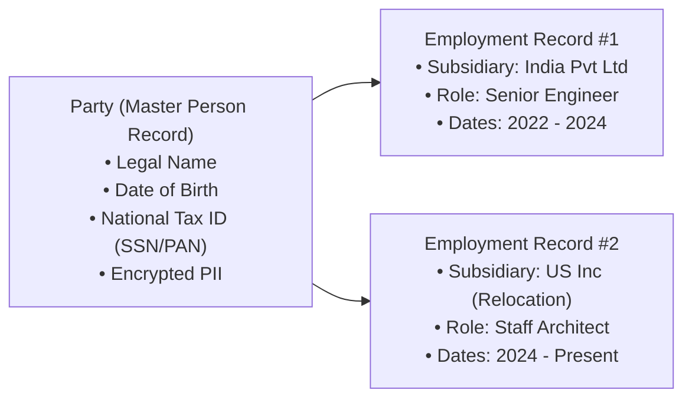
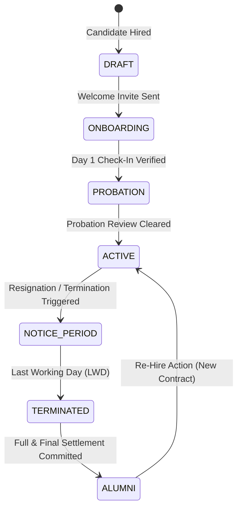

# HRMS Specification: Core Architecture, Party Model & Organizational Hierarchy

**Document Target:** `research/final_modules/hrms/01_architecture_and_party_model.md`  
**Classification:** Systems Architecture & Domain Entities  

---

## 1. Architectural Philosophy: Decoupled & Multi-Tenant

The HRMS suite (`PeopleOps`) is engineered with strict decoupling from both other domain modules and presentation layers:
1. **Decoupled Engine**: The core business logic, validation rules, and database models reside strictly within `modules/peopleops/backend`. It exposes strict REST OpenAPI 3.1 endpoints and never directly queries tables of sibling modules (such as SalesFlow or StockFlow).
2. **Hardened Multi-Tenancy**: Every employee, attendance event, leave application, and payroll calculation contains an indexed `tenant_id` foreign key. The Kernel tenancy middleware enforces tenant validation on every incoming request.
3. **Pluggable Identity**: Personal identity records are abstracted from employment contracts, enabling seamless multi-entity, contractor-to-full-time, and re-hire operations.

---

## 2. The Unified Party-to-Employee Data Model

Traditional HR systems tightly couple personal data with employment contracts, causing critical failures when an employee works across two subsidiaries or transitions from contractor to permanent staff.

Innostes establishes a **Two-Tier Identity Model**:

### 2.1 The Party Record (Personal Entity)
Represents the human being. Immutable across employment transitions:
* **Identification**: Full legal name, preferred name, date of birth, gender, nationality.
* **Statutory Identification**: Tax residency country, primary national ID (SSN for US, PAN/Aadhaar for India, National Insurance for UK).
* **Contact & Emergency**: Personal email, mobile phone, physical residential address, primary and secondary emergency contact records.
* **Encryption Requirement**: National ID and banking credentials must be encrypted at rest using AES-256 before writing to the database.

### 2.2 The Employment Record (Contractual Entity)
Represents the contractual relationship between a Party and a specific Legal Entity (Tenant/Subsidiary):
* **Identifiers**: Unique system UUID, human-readable employee code (e.g., `EMP-1042`).
* **Contract Details**: Job title, department ID, division, location ID, employment classification (`FULL_TIME`, `PART_TIME`, `CONTRACTOR`, `INTERN`).
* **Timeline**: Hire date, probationary end date, contract renewal date, actual termination date.
* **Managerial Linkage**: Solid-line reporting manager ID, optional dotted-line project manager ID.

---

## 3. Organizational Hierarchies: Legal vs. Operational Topologies

Modern organizations operate in matrix environments where legal liability diverges from operational reporting.

### 3.1 Legal Subsidiary Hierarchy
Binds the employee to an operating corporate entity.
* **Purpose**: Governs statutory taxation, payroll compliance, labor union laws, and legal jurisdiction.
* **Constraint**: An employment record belongs to exactly one legal entity at any given time.

### 3.2 Operational Reporting Hierarchy
Defines the management tree for day-to-day operations:
* **Solid-Line Manager (Direct)**:
  * Primary manager responsible for performance evaluations, salary revisions, leave approvals, and punch regularization sign-offs.
  * Formulated as a self-referential foreign key: `employees.manager_id -> employees.id`.
* **Dotted-Line Manager (Matrix / Project)**:
  * Secondary manager overseeing cross-functional project deliverables.
  * Stored in a many-to-many relationship table: `employee_matrix_managers(employee_id, manager_id, project_id)`.
  * Permissions allow viewing project-related attendance without exposing salary components.

---

## 4. Employee Lifecycle State Machine

The employment lifecycle transitions through deterministic, auditable states:

| Lifecycle State | System Behavior & Access Rights |
| :--- | :--- |
| **`DRAFT`** | Initial profile created by HR or imported from HireFlow. No system login permitted. |
| **`ONBOARDING`** | Temporary portal access enabled for profile completion, document upload, and bank detail submission. |
| **`PROBATION`** | Full access to daily check-in, directory, and tasks. Subject to probationary review workflows. |
| **`ACTIVE`** | Regular full access. Automatic monthly leave accruals and standard payroll generation. |
| **`NOTICE_PERIOD`** | Resignation recorded; triggers handoff tasks, offboarding checklist, and manager exit interview. |
| **`TERMINATED`** | Access to internal tools and SSO revoked immediately on Last Working Day (LWD). Read-only portal for tax documents. |
| **`ALUMNI`** | Full and Final (F&F) settlement finalized; read-only access to historic payslips and Form 16 / W-2 forms. |

---

## 5. Secure Compliance Document Vault

Every employee profile includes a dedicated digital document vault:
* **Document Types**: Signed employment offer, NDAs, identification cards, academic transcripts, prior experience letters, Form W-4 / Form 16 tax documents.
* **Access Control**: Governed by strict RBAC:
  * Employee: Can view own documents; upload pending onboarding items.
  * Line Manager: Zero access to confidential tax forms or salary letters.
  * HR Administrator: Full access with audit logging for every document download.
* **Audit Enforcement**: Document downloads and views emit audit records directly to `kernel.audit` capturing actor ID, timestamp, and IP address.

---

## 6. Gapless Sequential Employee Code Invariant

Human-readable employee codes (e.g., `EMP-001042`) must remain strictly gapless per tenant:
* **Implementation**: Managed via a dedicated atomic tenant counter table (`tenant_sequences`) with database-level row locking (`SELECT ... FOR UPDATE`) during the transition from `DRAFT` to `ONBOARDING`.
* **Preservation**: If an employee is terminated or soft-deleted, their employee code remains permanently reserved and is never re-assigned.
