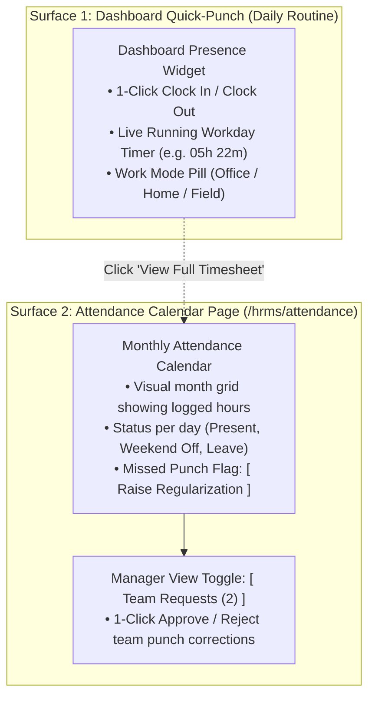
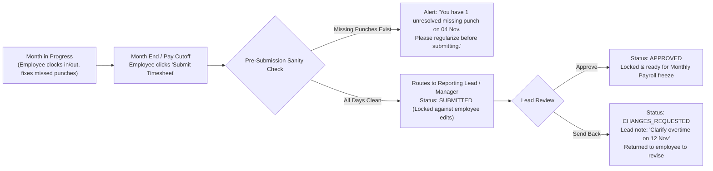
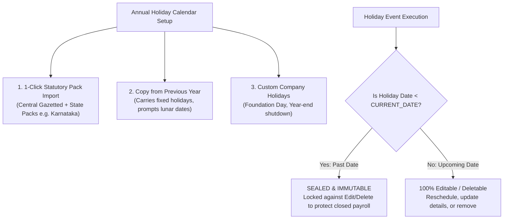

# HRMS Specification: Time & Attendance — Dashboard Punch & Monthly Calendar

**Document Reference:** `research/final_modules/hrms/02_time_attendance_and_shifts.md`  
**Classification:** Operational Specification & UX Architecture  
**Design Principle:** Radical Simplicity — Zero Redundant Menus, Single-Purpose Calendar  

---

## 1. The Core Philosophy: Two Surfaces Only

Employees and managers should never have to wade through multi-layered menus or navigate to a dedicated "Punch Page" just to clock in or out. 

Innostes eliminates redundant legacy attendance pages and consolidates time tracking into exactly **two clean surfaces**:



1. **Daily Action (Dashboard Widget)**:
   * 99% of daily employee interactions happen directly on the **Dashboard Quick-Punch Widget** (`AttendanceCockpitWidget`) and the persistent mobile header pill.
   * There is **no separate page** for punching in or out.
2. **History & Exceptions (Monthly Calendar Page)**:
   * When an employee opens the **Attendance** menu item (or clicks *"View Timesheet"* on their dashboard widget), they land directly on a clean, visual **Monthly Attendance Calendar**.
   * It serves two simple functions:
     * Reviewing daily logged-in time across the month.
     * Raising a 1-click **Punch Regularization** if they forgot to clock in or out.

---

## 2. Multi-Horizon (Month / Day) & Dual-Mode (Calendar / List) Presentation

To accommodate both visual thinkers and data-dense operators, the Attendance cockpit features a **Dual-Axis Control Bar**:
1. **Time Horizon Switcher**: `[ Month ]` (Default 30-day view) | `[ Day ]` (Single-day granular punch timeline)
2. **Presentation Mode Switcher**: `[ Calendar View ]` (Visual cards with clear badges) | `[ List Mode ]` (Sortable, high-density table)

```
+-----------------------------------------------------------------------------------------------------------------------+
| TIME & ATTENDANCE                                                 [ < November 2026 > ] [ Today ]                     |
| Horizon: (•) Month   ( ) Day                   | Mode: (•) Calendar View   ( ) List Mode                              |
| View Toggle: [• My Attendance]  [ Team Requests (1) ]                                                                 |
+-----------------------------------------------------------------------------------------------------------------------+
```

---

### 2.1 Month Horizon: Calendar View with Clear Status Labels

The calendar view displays each day of the month as a visual card with color-coded, human-readable status labels:

```
+--------------------+--------------------+--------------------+--------------------+---------------+
| MON 02 NOV         | TUE 03 NOV         | WED 04 NOV         | THU 05 NOV         | FRI 06 NOV    |
| 09:14 AM - 06:18 PM| 09:30 AM - 06:30 PM| 09:10 AM - [MISSING| 09:15 AM - 06:20 PM| 09:00 - 05:00 |
| Net: 08h 19m (45m B| Net: 08h 30m (30m B| [ Missing OUT ]    | Net: 08h 20m (45m B| Net: 07h 30m  |
| Mode: [ Office ]   | Mode: [ Home/WFH ] | Mode: [ Office ]   | Mode: [ Office ]   | Mode: [ Office|
| [ Present ]        | [ Present ]        | [ Regularize ]     | [ Present ]        | [ Present ]   |
+--------------------+--------------------+--------------------+--------------------+---------------+
| SAT 07 NOV         | SUN 08 NOV         | MON 09 NOV         | TUE 10 NOV         | WED 11 NOV    |
| WEEKLY OFF         | WEEKLY OFF         | 09:20 AM - 06:15 PM| 09:15 AM - 06:10 PM| DIWALI        |
| Saturday           | Sunday             | Net: 08h 15m       | Net: 08h 15m       | Gazetted      |
| [ Weekend Off ]    | [ Weekend Off ]    | [ Present ]        | [ Present ]        | [ Holiday ]   |
+--------------------+--------------------+--------------------+--------------------+---------------+
```

* **Clear Label System**:
  * `[ Present ]` (Emerald badge): Normal workday with complete IN and OUT punches matching shift thresholds.
  * `[ Missing OUT ]` (Amber badge): Incomplete session. Prompts the employee with an inline **`[ Regularize ]`** trigger.
  * `[ Pending Manager Review ]` (Amber outline): Regularization submitted, waiting for supervisor sign-off.
  * `[ Approved Leave ]` (Blue badge): Casual Leave, Sick Leave, or Earned PTO.
  * `[ Gazetted Holiday ]` (Purple badge): Company-wide observed holiday with holiday name.
  * `[ Weekend Off ]` (Muted Zinc badge): Saturday / Sunday weekly off.

---

### 2.2 Month Horizon: List Mode (Dense Sortable Table)

For employees or managers who prefer scanning high-density tabular logs or filtering by exception:

```
+-----------------------------------------------------------------------------------------------------------------------+
| TIME & ATTENDANCE: LIST MODE (NOVEMBER 2026)                       Quick Filters: [ All (30) ] [ Missing (1) ] [ Export v]
+-----------------------------------------------------------------------------------------------------------------------+
| DATE       | DAY | STATUS LABEL       | FIRST IN | LAST OUT | GROSS HRS | BREAKS  | NET HRS | WORK MODE| ACTIONS          |
+------------+-----+--------------------+----------+----------+-----------+---------+---------+----------+------------------+
| 06 Nov 2026| Fri | [ Present ]        | 09:00 AM | 05:00 PM | 08h 00m   | 30 mins | 07h 30m | Office   | [ View Details ] |
| 05 Nov 2026| Thu | [ Present ]        | 09:15 AM | 06:20 PM | 09h 05m   | 45 mins | 08h 20m | Office   | [ View Details ] |
| 04 Nov 2026| Wed | [ Missing OUT ]    | 09:10 AM | --:-- -- | --h --m   | 0 mins  | --h --m | Office   | [ Regularize ]   |
| 03 Nov 2026| Tue | [ Present ]        | 09:30 AM | 06:30 PM | 09h 00m   | 30 mins | 08h 30m | Home/WFH | [ View Details ] |
| 02 Nov 2026| Mon | [ Present ]        | 09:14 AM | 06:18 PM | 09h 04m   | 45 mins | 08h 19m | Office   | [ View Details ] |
| 01 Nov 2026| Sun | [ Weekend Off ]    | --:-- -- | --:-- -- | --        | --      | --      | --       | --               |
+-----------------------------------------------------------------------------------------------------------------------+
```
* **Instant Filtering**: 1-click filter pill `[ Missing (1) ]` immediately isolates any days requiring regularization without hunting through rows.
* **Inline Action**: Clicking `[ Regularize ]` directly on the row opens the regularization modal in 0ms.

---

### 2.3 Day Horizon: Granular Timeline & Punch Breakdown

Clicking `[ Day ]` or selecting any date opens a granular single-day timeline showing multiple punch pairs and break intervals:

```
+-----------------------------------------------------------------------------------------------------------------------+
| ATTENDANCE BREAKDOWN: WEDNESDAY, 04 NOVEMBER 2026                                      [ < Previous Day ] [ Next Day > ]|
| Summary: Recorded Clock-In at 09:10 AM | Status: [ ⚠️ Incomplete Session — Missing OUT Punch ]                          |
+-----------------------------------------------------------------------------------------------------------------------+
| VISUAL TIMELINE:                                                                                                      |
| [████████████████████████████████████████████░░░░░░░░░░░░░░░░░░░░░░░░░░░░░░░░░░░░░░░░░░░░░░░░░░░░░░░░]                 |
| 09:10 AM (IN)                                01:00 PM (LUNCH) 01:45 PM           06:00 PM (Expected OUT)               |
|                                                                                                                       |
| RAW PUNCH CHRONOLOGY:                                                                                                 |
| • 09:10:24 AM — CLOCK IN    | Source: Web Portal      | IP: 192.168.1.45 (Office Corporate Wi-Fi)                     |
| • 01:00:15 PM — BREAK START | Type: Lunch Break       | Source: Mobile App (GPS: 12.9716° N, 77.5946° E)              |
| • 01:45:30 PM — BREAK END   | Duration: 45 minutes    | Source: Mobile App                                            |
| • [ MISSING OUT PUNCH ]     | Expected Out: ~06:30 PM | Status: No exit punch recorded before shift window closed     |
|                                                                                                                       |
| RESOLUTION ACTION:                                                                                                    |
| [ ⚡ Raise Regularization for this Day ]                                                                               |
+-----------------------------------------------------------------------------------------------------------------------+
```

---

### 2.4 The 1-Click Missed-Punch Regularization Modal & Automatic Hours Recalculation
If an employee forgets to clock out, the system flags the day as `MISSING_OUT`.
1. Clicking **`[ Regularize ]`** (from either Calendar, List, or Day view) opens this clean 3-field modal:

```
+-----------------------------------------------------------------------------------+
| RAISE ATTENDANCE REGULARIZATION                                               [X] |
+-----------------------------------------------------------------------------------+
| Date: Wednesday, 04 November 2026                                                 |
| Recorded Clock-In: 09:10 AM                                                       |
|                                                                                   |
| Proposed Clock-Out Time *                                                         |
| [ 06:30 PM                    ]                                                   |
|                                                                                   |
| Reason for Regularization *                                                       |
| [ Forgot to punch out while leaving office                                      ] |
|                                                                                   |
| [ Cancel ]                                             [ Submit to Manager -> ]   |
+-----------------------------------------------------------------------------------+
```
2. Once submitted, the status immediately reflects: `[ Pending Manager Approval ]`.
3. **Automatic Real-Time Hours Adjustment**:
   * The moment the manager clicks **`[ Approve Punch ]`**:
     * The system pairs the recorded `09:10 AM` with the approved `06:30 PM`.
     * Calculates gross elapsed duration: `09h 20m`.
     * Subtracts recorded breaks (`45m` lunch) -> Net Duration: **`08h 35m`**.
     * Day status flips from amber `[ Missing OUT ]` to green `[ Present (08h 35m) ]`.
     * The monthly cumulative total (`159h 25m` -> `168h 00m`) and present day count (`19` -> `20 days`) update **automatically in real time**. Zero manual calculation required.

---

## 3. Monthly Timesheet Submission & Team Lead Approval Workflow

At the end of each calendar month / pay cycle, an optional monthly sign-off workflow guarantees that all hours and attendance records are verified before payroll runs:



### 3.1 Employee Monthly Submission
On the last day of the month, the attendance header displays a prominent action: **`[ Submit Monthly Timesheet for Approval ]`**.
* Clicking it opens a pre-submission review:
  * Total Logged Hours: `168h 00m / 160h Target`
  * Total Present Days: `20 Days` | Leaves: `1 Day` | Holidays: `1 Day`
  * Unresolved Missing Punches: `0`
* Once submitted, the month is locked against employee changes, and a review task is assigned to their designated **Reporting Lead / Manager**.

### 3.2 Lead / Manager Monthly Sign-Off
The manager opens their **`[ Team Requests ]`** tab to audit the monthly timesheets of their direct reports:

```
+---------------------------------------------------------------------------------------------------+
| PENDING MONTHLY TIMESHEET APPROVALS (NOVEMBER 2026)                                               |
+---------------------------------------------------------------------------------------------------+
| Sarah Chen — Senior Backend Engineer (Reports to: John Doe)                                       |
| Total Logged: 168h 00m (Target: 160h) | Present: 20 Days | Leaves: 1 Day | Regularized: 1 Day     |
| Status: [ SUBMITTED FOR REVIEW ]                                                                  |
|                                                                                                   |
| [ View Full Month Calendar ]              [ Approve Timesheet ]    [ Send Back with Comment ]     |
+---------------------------------------------------------------------------------------------------+
```
* **1-Click Approval**: Clicking `[ Approve Timesheet ]` marks the timesheet as `APPROVED`.
* **Send Back**: If the lead notices an anomaly, clicking `[ Send Back with Comment ]` prompts a note (e.g. *"Please regularize 14 Nov before we close the month"*), unlocking the employee's calendar to make the correction.

---

## 4. Manager Approvals Tab (`[ Team Requests ]`)

If the logged-in user is a reporting manager with direct reports, the top of the calendar displays a clean secondary tab: **`[ Team Requests (N) ]`**:

```
+---------------------------------------------------------------------------------------------------+
| PENDING TEAM ATTENDANCE REGULARIZATIONS (1 PENDING)                                               |
+---------------------------------------------------------------------------------------------------+
| Sarah Chen (Senior Backend Engineer)                                                              |
| Date: Wed, 04 Nov 2026 | Recorded Punch: 09:10 AM (Missing OUT)                                    |
| Requested OUT Time: 06:30 PM (Total Effective Duration: 09h 20m)                                  |
| Reason: "Forgot to punch out while leaving office"                                                |
|                                                                                                   |
|                                                 [ Approve Punch ]   [ Reject with Note ]          |
+---------------------------------------------------------------------------------------------------+
```
* **1-Click Action**: Manager clicks `[ Approve Punch ]` -> the punch record is updated to `REGULARIZED`, the day status turns green `[ Present ]`, and the employee is notified.

---

## 5. Strict Separation from Payroll

Attendance is strictly an **operational presence log**, not a financial calculation engine.
* **What Attendance Produces**:
  * Clean, aggregate monthly counts: `present_days`, `half_days`, `absent_days`, and `total_hours_worked`.
* **What Attendance Does NOT Do**:
  * Attendance does **not** compute salary deductions, Loss of Pay (LOP) currency amounts, or overtime payouts.
  * All payroll formulas, salary deduction rules, and tax withholding logic live exclusively in the dedicated **Payroll Module & Setup Page (`/hrms/payroll/setup`)**.
  * Payroll queries attendance data as an input during the monthly payroll run, keeping the attendance interface completely clean and clutter-free.

---

## 6. Startup-First Mode: Option to Disable Attendance Tracking Entirely

In modern tech startups and asynchronous remote teams (e.g. 5 to 20 engineers working output-first), tracking daily check-in hours creates friction and damages trust.

In Innostes Company Settings, administrators have a master toggle:

```
[ ] Enable Attendance & Clock-In Tracking
    (Toggle OFF for pure output-driven, asynchronous teams.
     When disabled, daily check-in widgets and the attendance menu are hidden.
     Payroll automatically pays full salary based on calendar days, 
     deducting only approved unpaid leaves.)
```

* **When Disabled (`enable_attendance_tracking = false`)**:
  * The Dashboard Check-In widget is **completely hidden**.
  * The Attendance menu item disappears from the application sidebar.
  * Zero clock-in overhead for employees.
* **When Enabled (`enable_attendance_tracking = true`)**:
  * Employees use the Dashboard widget for 1-click punches.
  * The Attendance calendar provides monthly history and missed-punch regularizations.

---

## 7. Lightweight Punch Ingestion Rules

For teams that use attendance tracking:
1. **60-Second De-Bounce**: If an employee double-clicks the check-in button or scans a biometric reader twice in rapid succession, duplicate events within 60 seconds are discarded automatically.
2. **Automatic Session Pairing**: The earliest punch of the day is `IN`, and the latest is `OUT`.
3. **Trust-First Defaults**: Arriving after 09:15 logs an informational timestamp, but never incurs automated salary penalties unless the company explicitly chooses an enterprise strict mode in Payroll Setup.

---

## 8. Holiday Calendar Architecture & Annual Management Strategy

Holidays are an integral foundation of the attendance engine: they determine whether a non-working day is classified as a paid `Holiday` versus an unexcused `Absent` day, adjust monthly expected working hours, and trigger automated Compensatory Off (Comp-Off) workflows.



### 8.1 The "Never Type 15 Holidays Every Year" Setup Strategy
Requiring HR administrators to manually type 15 to 20 holiday names and dates every January is an operational anti-pattern. Innostes provides an intelligent 3-way setup pipeline:

1. **Pre-Seeded Regional & Statutory Jurisdiction Packs**:
   * Innostes maintains verified statutory public holiday schedules for current and upcoming years (e.g. 2026, 2027, 2028...) categorized by country and state:
     * **India Central Gazetted**: Republic Day (Jan 26), Independence Day (Aug 15), Gandhi Jayanti (Oct 02), Christmas (Dec 25), etc.
     * **State-Specific Gazetted**: Karnataka (Kannada Rajyotsava, Ugadi), Maharashtra (Maharashtra Day, Ganesh Chaturthi), Tamil Nadu (Pongal), Telangana (Bonalu), etc.
     * **International Packs**: US Federal, UK Bank Holidays, UAE Public Holidays, Singapore, etc.
   * **1-Click Import**: When setting up a new year or a new office branch, the administrator simply clicks:  
     **`[ 1-Click Import: 2027 Karnataka Gazetted Holidays ]`** $\implies$ Instantly populates the entire annual calendar in 1 second.
2. **"Copy from Previous Year" Engine**:
   * For companies with custom traditions (e.g. Founder's Day, Annual Hackathon Off, Year-End Shutdown Dec 24–31), clicking **`[ Copy from Previous Year ]`**:
     * Automatically clones all fixed-date holidays.
     * Flags variable lunar/religious dates (Diwali, Eid, Holi, Good Friday) for 1-click date confirmation.
3. **Custom Corporate Holidays**:
   * Admin can click **`[ + Add Custom Holiday ]`** at any point to insert ad-hoc corporate holidays (e.g. *"Mental Health Day"* or *"Series B Celebration Day"*).

---

### 8.2 The Core Law: Past Holidays are Strictly Locked & Immutable

A central architectural requirement of an enterprise ERP is the **Past Holiday Immutability Invariant**:

$$\text{IF } \mathtt{holiday\_date} < \mathtt{CURRENT\_DATE} \implies \textbf{LOCKED (Read-Only)}$$

#### Why Past Holidays Must Never Be Edited or Deleted:
1. **Preservation of Closed Attendance Cycles**: Attendance for past months has already been recorded, verified, and paired. Deleting a past holiday would retroactively convert a legitimate holiday into an unexcused absence for every employee in the company.
2. **Integrity of Approved Timesheets**: Past monthly timesheets have already been audited and signed off by reporting leads.
3. **Protection of Committed Payroll & Financial Ledgers**: Past payroll runs have already executed gross-to-net calculations, deducted Loss of Pay (LOP) based on historical working days ($26$ vs $25$ days), generated bank disbursement files, and posted balancing journal entries to General Ledger (`LedgerFlow`). Mutating a past holiday would corrupt the financial audit trail.

#### Two-Tier Immutability Enforcement:
1. **Frontend UI Enforcement**:
   * In the Holiday Calendar management table, any row where $\text{holiday\_date} < \text{CURRENT\_DATE}$ renders with a muted **`[ Locked (Past) ]`** badge. The `[ Edit ]` and `[ Delete ]` buttons are permanently disabled.
   * Tooltip: *"Past holidays are sealed to preserve the integrity of completed attendance and payroll cycles."*
2. **Database Trigger Hard Guard**:
   * A PostgreSQL trigger (`trg_guard_past_holiday_mutation`) unconditionally aborts any `UPDATE` or `DELETE` statement targeting a historical holiday:
     ```sql
     CREATE OR REPLACE FUNCTION fn_guard_past_holidays()
     RETURNS TRIGGER AS $$
     BEGIN
         IF OLD.holiday_date < CURRENT_DATE THEN
             RAISE EXCEPTION 'PAST_HOLIDAY_LOCKED: Cannot modify or delete historical holiday on % because past attendance and payroll cycles have already closed.', OLD.holiday_date;
         END IF;
         RETURN NEW;
     END;
     $$ LANGUAGE plpgsql;
     ```
3. **Upcoming Holidays ($\ge \mathtt{CURRENT\_DATE}$) are 100% Dynamic**:
   * Administrators have complete freedom to add new holidays, reschedule upcoming dates, edit holiday descriptions, or delete upcoming holidays.
4. **Handling Past Corrections**:
   * If a historical holiday was entered on the wrong date and caused an improper salary deduction 2 months ago, it is **never** fixed by mutating the historical calendar. Instead, it is resolved via a **Payroll Retroactive Adjustment / Arrears Credit** in the current payroll run, maintaining a complete audit trail.

---

### 8.3 Multi-Calendar Architecture (Locations & Distributed Teams)

In distributed companies, holidays differ by branch and geography:
* **Location-Based Inheritance**:
  * Each physical office (`hrms_locations`) points to its applicable holiday calendar (e.g. `Bengaluru HQ Calendar`, `Mumbai Branch Calendar`, `US Remote Calendar`).
* **Employee-Level Override**:
  * If an employee is permanently remote in another state, their `hrms_employees.holiday_calendar_id` overrides the office default.
* **Tenant Default Fallback**:
  * If neither is specified, the employee inherits the tenant's primary default calendar.

---

### 8.4 Restricted / Floating Holidays Self-Service (ESS)

To support cultural and regional diversity, companies can configure **Floating / Optional Holidays**:
1. The company calendar lists e.g. 8 designated floating festival days (e.g. Onam, Chhath Puja, Karwa Chauth, Guru Nanak Jayanti, Easter, Eid-e-Milad).
2. The company policy sets a cap: e.g. `floating_holidays_allowed = 2` days per year.
3. In Employee Self-Service (ESS), the employee views the upcoming floating holidays list and checks any 2.
4. Submitting marks those 2 days as approved paid floating holidays on their personal attendance calendar without consuming their Casual or Privilege Leave balance.

---

### 8.5 Automated Comp-Off Generation on Holiday Work

If an employee works on a declared mandatory holiday:
1. The punch ingestion engine recognizes that the day is a scheduled holiday for the employee's calendar.
2. The work session is tagged as `HOLIDAY_WORK`.
3. If verified working duration is $\ge 4.0$ hours, the system generates an automated **Comp-Off Approval Request** in the reporting lead's `[ Team Requests ]` queue.
4. Upon manager sign-off, $+1.0$ (or $+0.5$) day is credited to the employee's `hrms_leave_ledger` under action `ACCRUED` with a 60-day expiration window.
