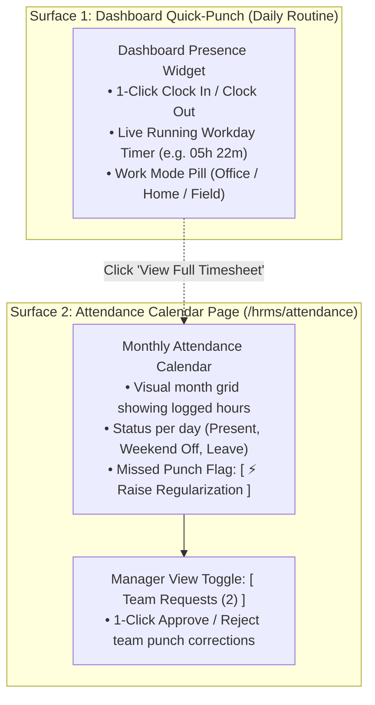

# HRMS Specification: Time & Attendance — Dashboard Punch & Monthly Calendar

**Document Reference:** `research/final_modules/hrms/02_time_attendance_and_shifts.md`  
**Classification:** Operational Specification & UX Architecture  
**Design Principle:** Radical Simplicity — Zero Redundant Menus, Single-Purpose Calendar  

---

## 1. The Core Philosophy: Two Surfaces Only

Employees and managers should never have to wade through multi-layered menus or navigate to a dedicated "Punch Page" just to clock in or out. 

Innostes eliminates redundant legacy attendance pages and consolidates time tracking into exactly **two clean surfaces**:



1. **Daily Action (Dashboard Widget)**:
   * 99% of daily employee interactions happen directly on the **Dashboard Quick-Punch Widget** (`AttendanceCockpitWidget`) and the persistent mobile header pill.
   * There is **no separate page** for punching in or out.
2. **History & Exceptions (Monthly Calendar Page)**:
   * When an employee opens the **Attendance** menu item (or clicks *"View Timesheet"* on their dashboard widget), they land directly on a clean, visual **Monthly Attendance Calendar**.
   * It serves two simple functions:
     * Reviewing daily logged-in time across the month.
     * Raising a 1-click **Punch Regularization** if they forgot to clock in or out.

---

## 2. Multi-Horizon (Month / Day) & Dual-Mode (Calendar / List) Presentation

To accommodate both visual thinkers and data-dense operators, the Attendance cockpit features a **Dual-Axis Control Bar**:
1. **Time Horizon Switcher**: `[ Month ]` (Default 30-day view) | `[ Day ]` (Single-day granular punch timeline)
2. **Presentation Mode Switcher**: `[ 📅 Calendar View ]` (Visual cards with clear badges) | `[ ☰ List Mode ]` (Sortable, high-density table)

```
+-----------------------------------------------------------------------------------------------------------------------+
| TIME & ATTENDANCE                                                 [ < November 2026 > ] [ Today ]                     |
| Horizon: (•) Month   ( ) Day                   | Mode: (•) 📅 Calendar View   ( ) ☰ List Mode                         |
| View Toggle: [• My Attendance]  [ Team Requests (1) ]                                                                 |
+-----------------------------------------------------------------------------------------------------------------------+
```

---

### 2.1 Month Horizon: Calendar View with Clear Status Labels

The calendar view displays each day of the month as a visual card with color-coded, human-readable status labels:

```
+--------------------+--------------------+--------------------+--------------------+---------------+
| MON 02 NOV         | TUE 03 NOV         | WED 04 NOV         | THU 05 NOV         | FRI 06 NOV    |
| 09:14 AM - 06:18 PM| 09:30 AM - 06:30 PM| 09:10 AM - [MISSING| 09:15 AM - 06:20 PM| 09:00 - 05:00 |
| Net: 08h 19m (45m B| Net: 08h 30m (30m B| ⚠️ Missing OUT     | Net: 08h 20m (45m B| Net: 07h 30m  |
| Mode: [ Office ]   | Mode: [ Home/WFH ] | Mode: [ Office ]   | Mode: [ Office ]   | Mode: [ Office|
| [ ✓ Present ]      | [ ✓ Present ]      | [⚡Regularize]     | [ ✓ Present ]      | [ ✓ Present ] |
+--------------------+--------------------+--------------------+--------------------+---------------+
| SAT 07 NOV         | SUN 08 NOV         | MON 09 NOV         | TUE 10 NOV         | WED 11 NOV    |
| WEEKLY OFF         | WEEKLY OFF         | 09:20 AM - 06:15 PM| 09:15 AM - 06:10 PM| DIWALI        |
| Saturday           | Sunday             | Net: 08h 15m       | Net: 08h 15m       | Gazetted      |
| [ ☕ Weekend Off ] | [ ☕ Weekend Off ] | [ ✓ Present ]      | [ ✓ Present ]      | [ 🪔 Holiday ]|
+--------------------+--------------------+--------------------+--------------------+---------------+
```

* **Clear Label System**:
  * `[ ✓ Present ]` (Emerald badge): Normal workday with complete IN and OUT punches matching shift thresholds.
  * `[ ⚠️ Missing OUT ]` (Amber badge): Incomplete session. Prompts the employee with an inline **`[ ⚡ Regularize ]`** trigger.
  * `[ ⏳ Pending Manager Review ]` (Amber outline): Regularization submitted, waiting for supervisor sign-off.
  * `[ 🌴 Approved Leave ]` (Blue badge): Casual Leave, Sick Leave, or Earned PTO.
  * `[ 🪔 Gazetted Holiday ]` (Purple badge): Company-wide observed holiday with holiday name.
  * `[ ☕ Weekend Off ]` (Muted Zinc badge): Saturday / Sunday weekly off.

---

### 2.2 Month Horizon: List Mode (Dense Sortable Table)

For employees or managers who prefer scanning high-density tabular logs or filtering by exception:

```
+-----------------------------------------------------------------------------------------------------------------------+
| TIME & ATTENDANCE: LIST MODE (NOVEMBER 2026)                       Quick Filters: [ All (30) ] [ Missing (1) ] [ Export v]
+-----------------------------------------------------------------------------------------------------------------------+
| DATE       | DAY | STATUS LABEL       | FIRST IN | LAST OUT | GROSS HRS | BREAKS  | NET HRS | WORK MODE| ACTIONS          |
+------------+-----+--------------------+----------+----------+-----------+---------+---------+----------+------------------+
| 06 Nov 2026| Fri | [ ✓ Present ]      | 09:00 AM | 05:00 PM | 08h 00m   | 30 mins | 07h 30m | Office   | [ View Details ] |
| 05 Nov 2026| Thu | [ ✓ Present ]      | 09:15 AM | 06:20 PM | 09h 05m   | 45 mins | 08h 20m | Office   | [ View Details ] |
| 04 Nov 2026| Wed | [ ⚠️ Missing OUT ]  | 09:10 AM | --:-- -- | --h --m   | 0 mins  | --h --m | Office   | [⚡Regularize]   |
| 03 Nov 2026| Tue | [ ✓ Present ]      | 09:30 AM | 06:30 PM | 09h 00m   | 30 mins | 08h 30m | Home/WFH | [ View Details ] |
| 02 Nov 2026| Mon | [ ✓ Present ]      | 09:14 AM | 06:18 PM | 09h 04m   | 45 mins | 08h 19m | Office   | [ View Details ] |
| 01 Nov 2026| Sun | [ ☕ Weekend Off ]  | --:-- -- | --:-- -- | --        | --      | --      | --       | --               |
+-----------------------------------------------------------------------------------------------------------------------+
```
* **Instant Filtering**: 1-click filter pill `[ Missing (1) ]` immediately isolates any days requiring regularization without hunting through rows.
* **Inline Action**: Clicking `[ ⚡ Regularize ]` directly on the row opens the regularization modal in 0ms.

---

### 2.3 Day Horizon: Granular Timeline & Punch Breakdown

Clicking `[ Day ]` or selecting any date opens a granular single-day timeline showing multiple punch pairs and break intervals:

```
+-----------------------------------------------------------------------------------------------------------------------+
| ATTENDANCE BREAKDOWN: WEDNESDAY, 04 NOVEMBER 2026                                      [ < Previous Day ] [ Next Day > ]|
| Summary: Recorded Clock-In at 09:10 AM | Status: [ ⚠️ Incomplete Session — Missing OUT Punch ]                          |
+-----------------------------------------------------------------------------------------------------------------------+
| VISUAL TIMELINE:                                                                                                      |
| [████████████████████████████████████████████░░░░░░░░░░░░░░░░░░░░░░░░░░░░░░░░░░░░░░░░░░░░░░░░░░░░░░░░]                 |
| 09:10 AM (IN)                                01:00 PM (LUNCH) 01:45 PM           06:00 PM (Expected OUT)               |
|                                                                                                                       |
| RAW PUNCH CHRONOLOGY:                                                                                                 |
| • 09:10:24 AM — CLOCK IN    | Source: Web Portal      | IP: 192.168.1.45 (Office Corporate Wi-Fi)                     |
| • 01:00:15 PM — BREAK START | Type: Lunch Break       | Source: Mobile App (GPS: 12.9716° N, 77.5946° E)              |
| • 01:45:30 PM — BREAK END   | Duration: 45 minutes    | Source: Mobile App                                            |
| • [ MISSING OUT PUNCH ]     | Expected Out: ~06:30 PM | Status: No exit punch recorded before shift window closed     |
|                                                                                                                       |
| RESOLUTION ACTION:                                                                                                    |
| [ ⚡ Raise Regularization for this Day ]                                                                               |
+-----------------------------------------------------------------------------------------------------------------------+
```

---

### 2.4 The 1-Click Missed-Punch Regularization Modal
If an employee forgets to clock out, the system flags the day as `MISSING_OUT`.
1. Clicking **`[ ⚡ Regularize ]`** (from either Calendar, List, or Day view) opens this clean 3-field modal:

```
+-----------------------------------------------------------------------------------+
| RAISE ATTENDANCE REGULARIZATION                                               [X] |
+-----------------------------------------------------------------------------------+
| Date: Wednesday, 04 November 2026                                                 |
| Recorded Clock-In: 09:10 AM                                                       |
|                                                                                   |
| Proposed Clock-Out Time *                                                         |
| [ 06:30 PM                    ]                                                   |
|                                                                                   |
| Reason for Regularization *                                                       |
| [ Forgot to punch out while leaving office                                      ] |
|                                                                                   |
| [ Cancel ]                                             [ Submit to Manager -> ]   |
+-----------------------------------------------------------------------------------+
```
2. Once submitted, the status immediately reflects: `[ ⏳ Pending Manager Approval ]`.
3. The reporting manager receives a notification and reviews it in their approvals tab.

---

## 3. Manager Approvals Tab (`[ Team Requests ]`)

If the logged-in user is a reporting manager with direct reports, the top of the calendar displays a clean secondary tab: **`[ Team Requests (N) ]`**:

```
+---------------------------------------------------------------------------------------------------+
| PENDING TEAM ATTENDANCE REGULARIZATIONS (1 PENDING)                                               |
+---------------------------------------------------------------------------------------------------+
| Sarah Chen (Senior Backend Engineer)                                                              |
| Date: Wed, 04 Nov 2026 | Recorded Punch: 09:10 AM (Missing OUT)                                    |
| Requested OUT Time: 06:30 PM (Total Effective Duration: 09h 20m)                                  |
| Reason: "Forgot to punch out while leaving office"                                                |
|                                                                                                   |
|                                                 [ ✓ Approve Punch ]   [ ✕ Reject with Note ]      |
+---------------------------------------------------------------------------------------------------+
```
* **1-Click Action**: Manager clicks `[ ✓ Approve Punch ]` $\implies$ the punch record is updated to `REGULARIZED`, the day status turns green `[ ✓ Present ]`, and the employee is notified.

---

## 4. Strict Separation from Payroll

Attendance is strictly an **operational presence log**, not a financial calculation engine.
* **What Attendance Produces**:
  * Clean, aggregate monthly counts: `present_days`, `half_days`, `absent_days`, and `total_hours_worked`.
* **What Attendance Does NOT Do**:
  * Attendance does **not** compute salary deductions, Loss of Pay (LOP) currency amounts, or overtime payouts.
  * All payroll formulas, salary deduction rules, and tax withholding logic live exclusively in the dedicated **Payroll Module & Setup Page (`/hrms/payroll/setup`)**.
  * Payroll queries attendance data as an input during the monthly payroll run, keeping the attendance interface completely clean and clutter-free.

---

## 5. Startup-First Mode: Option to Disable Attendance Tracking Entirely

In modern tech startups and asynchronous remote teams (e.g. 5 to 20 engineers working output-first), tracking daily check-in hours creates friction and damages trust.

In Innostes Company Settings, administrators have a master toggle:

```
[ ] Enable Attendance & Clock-In Tracking
    (Toggle OFF for pure output-driven, asynchronous teams.
     When disabled, daily check-in widgets and the attendance menu are hidden.
     Payroll automatically pays full salary based on calendar days, 
     deducting only approved unpaid leaves.)
```

* **When Disabled (`enable_attendance_tracking = false`)**:
  * The Dashboard Check-In widget is **completely hidden**.
  * The Attendance menu item disappears from the application sidebar.
  * Zero clock-in overhead for employees.
* **When Enabled (`enable_attendance_tracking = true`)**:
  * Employees use the Dashboard widget for 1-click punches.
  * The Attendance calendar provides monthly history and missed-punch regularizations.

---

## 6. Lightweight Punch Ingestion Rules

For teams that use attendance tracking:
1. **60-Second De-Bounce**: If an employee double-clicks the check-in button or scans a biometric reader twice in rapid succession, duplicate events within 60 seconds are discarded automatically.
2. **Automatic Session Pairing**: The earliest punch of the day is `IN`, and the latest is `OUT`.
3. **Trust-First Defaults**: Arriving after 09:15 logs an informational timestamp, but never incurs automated salary penalties unless the company explicitly chooses an enterprise strict mode in Payroll Setup.
