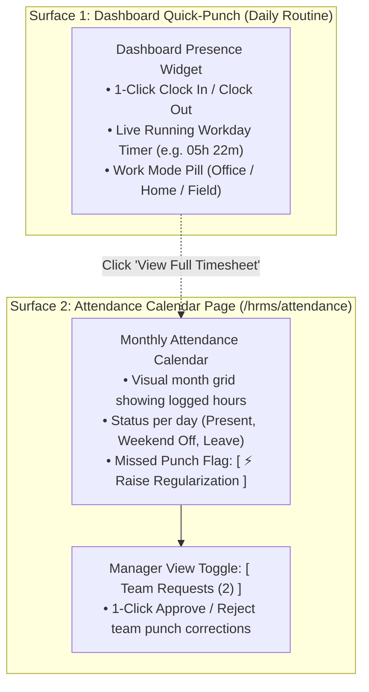

# HRMS Specification: Time & Attendance — Dashboard Punch & Monthly Calendar

**Document Reference:** `research/final_modules/hrms/02_time_attendance_and_shifts.md`  
**Classification:** Operational Specification & UX Architecture  
**Design Principle:** Radical Simplicity — Zero Redundant Menus, Single-Purpose Calendar  

---

## 1. The Core Philosophy: Two Surfaces Only

Employees and managers should never have to wade through multi-layered menus or navigate to a dedicated "Punch Page" just to clock in or out. 

Innostes eliminates redundant legacy attendance pages and consolidates time tracking into exactly **two clean surfaces**:



1. **Daily Action (Dashboard Widget)**:
   * 99% of daily employee interactions happen directly on the **Dashboard Quick-Punch Widget** (`AttendanceCockpitWidget`) and the persistent mobile header pill.
   * There is **no separate page** for punching in or out.
2. **History & Exceptions (Monthly Calendar Page)**:
   * When an employee opens the **Attendance** menu item (or clicks *"View Timesheet"* on their dashboard widget), they land directly on a clean, visual **Monthly Attendance Calendar**.
   * It serves two simple functions:
     * Reviewing daily logged-in time across the month.
     * Raising a 1-click **Punch Regularization** if they forgot to clock in or out.

---

## 2. The Monthly Attendance Calendar (`/hrms/attendance`)

The Attendance page is a single, distraction-free calendar grid:

```
+---------------------------------------------------------------------------------------------------+
| TIME & ATTENDANCE                                                   [ < November 2026 > ] [ Today]|
| Monthly Summary: 168h Logged / 160h Target | 20 Days Present | 1 Missing Punch | 1 Approved Leave |
| View Toggle: [• My Attendance Calendar]  [ Team Requests (1) ]                                    |
+---------------------------------------------------------------------------------------------------+
| MON 02 NOV         | TUE 03 NOV         | WED 04 NOV         | THU 05 NOV         | FRI 06 NOV    |
| 09:14 AM - 06:18 PM| 09:30 AM - 06:30 PM| 09:10 AM - [MISSING| 09:15 AM - 06:20 PM| 09:00 - 05:00 |
| Total: 09h 04m     | Total: 09h 00m     | ⚠️ Missing OUT     | Total: 09h 05m     | Total: 08h 00m|
| [ ✓ Present ]      | [ ✓ Present ]      | [⚡Regularize]     | [ ✓ Present ]      | [ ✓ Present ] |
+--------------------+--------------------+--------------------+--------------------+---------------+
| MON 09 NOV         | TUE 10 NOV         | WED 11 NOV         | THU 12 NOV         | FRI 13 NOV    |
| 09:20 AM - 06:15 PM| 09:15 AM - 06:10 PM| DIWALI HOLIDAY     | CASUAL LEAVE       | 09:10 - 06:05 |
| Total: 08h 55m     | Total: 08h 55m     | Declared Holiday   | Full Day Approved  | Total: 08h 55m|
| [ ✓ Present ]      | [ ✓ Present ]      | [ Gazetted Off ]   | [ Approved Leave ] | [ ✓ Present ] |
+---------------------------------------------------------------------------------------------------+
```

### 2.1 The "Forgot to Punch Out" Scenario: 1-Click Regularization
If an employee leaves the office and forgets to punch out, the engine flags the record as `MISSING_OUT`.
1. The calendar day box displays an amber warning badge: `[ ⚠️ Missing OUT ]` with a prominent button: **`[ ⚡ Regularize ]`**.
2. Clicking the button opens a clean, 3-field modal:

```
+-----------------------------------------------------------------------------------+
| RAISE ATTENDANCE REGULARIZATION                                               [X] |
+-----------------------------------------------------------------------------------+
| Date: Wednesday, 04 November 2026                                                 |
| Recorded Clock-In: 09:10 AM                                                       |
|                                                                                   |
| Proposed Clock-Out Time *                                                         |
| [ 06:30 PM                    ]                                                   |
|                                                                                   |
| Reason for Regularization *                                                       |
| [ Forgot to punch out while leaving office                                      ] |
|                                                                                   |
| [ Cancel ]                                             [ Submit to Manager -> ]   |
+-----------------------------------------------------------------------------------+
```
3. Once submitted, the day card updates to `[ ⏳ Regularization Pending Manager Approval ]`.
4. The employee's reporting manager receives a notification and sees it in their approvals queue.

---

## 3. Manager Approvals Tab (`[ Team Requests ]`)

If the logged-in user is a reporting manager with direct reports, the top of the calendar displays a clean secondary tab: **`[ Team Requests (N) ]`**:

```
+---------------------------------------------------------------------------------------------------+
| PENDING TEAM ATTENDANCE REGULARIZATIONS (1 PENDING)                                               |
+---------------------------------------------------------------------------------------------------+
| Sarah Chen (Senior Backend Engineer)                                                              |
| Date: Wed, 04 Nov 2026 | Recorded Punch: 09:10 AM (Missing OUT)                                    |
| Requested OUT Time: 06:30 PM (Total Effective Duration: 09h 20m)                                  |
| Reason: "Forgot to punch out while leaving office"                                                |
|                                                                                                   |
|                                                 [ ✓ Approve Punch ]   [ ✕ Reject with Note ]      |
+---------------------------------------------------------------------------------------------------+
```
* **1-Click Action**: Manager clicks `[ ✓ Approve Punch ]` $\implies$ the punch record is updated to `REGULARIZED`, the day status turns green `[ ✓ Present ]`, and the employee is notified.

---

## 4. Strict Separation from Payroll

Attendance is strictly an **operational presence log**, not a financial calculation engine.
* **What Attendance Produces**:
  * Clean, aggregate monthly counts: `present_days`, `half_days`, `absent_days`, and `total_hours_worked`.
* **What Attendance Does NOT Do**:
  * Attendance does **not** compute salary deductions, Loss of Pay (LOP) currency amounts, or overtime payouts.
  * All payroll formulas, salary deduction rules, and tax withholding logic live exclusively in the dedicated **Payroll Module & Setup Page (`/hrms/payroll/setup`)**.
  * Payroll queries attendance data as an input during the monthly payroll run, keeping the attendance interface completely clean and clutter-free.

---

## 5. Startup-First Mode: Option to Disable Attendance Tracking Entirely

In modern tech startups and asynchronous remote teams (e.g. 5 to 20 engineers working output-first), tracking daily check-in hours creates friction and damages trust.

In Innostes Company Settings, administrators have a master toggle:

```
[ ] Enable Attendance & Clock-In Tracking
    (Toggle OFF for pure output-driven, asynchronous teams.
     When disabled, daily check-in widgets and the attendance menu are hidden.
     Payroll automatically pays full salary based on calendar days, 
     deducting only approved unpaid leaves.)
```

* **When Disabled (`enable_attendance_tracking = false`)**:
  * The Dashboard Check-In widget is **completely hidden**.
  * The Attendance menu item disappears from the application sidebar.
  * Zero clock-in overhead for employees.
* **When Enabled (`enable_attendance_tracking = true`)**:
  * Employees use the Dashboard widget for 1-click punches.
  * The Attendance calendar provides monthly history and missed-punch regularizations.

---

## 6. Lightweight Punch Ingestion Rules

For teams that use attendance tracking:
1. **60-Second De-Bounce**: If an employee double-clicks the check-in button or scans a biometric reader twice in rapid succession, duplicate events within 60 seconds are discarded automatically.
2. **Automatic Session Pairing**: The earliest punch of the day is `IN`, and the latest is `OUT`.
3. **Trust-First Defaults**: Arriving after 09:15 logs an informational timestamp, but never incurs automated salary penalties unless the company explicitly chooses an enterprise strict mode in Payroll Setup.
