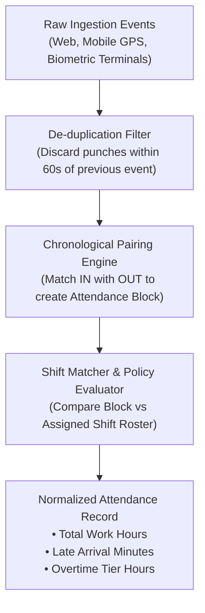

# HRMS Specification: Time, Attendance & Shift Scheduling

**Document Target:** `research/final_modules/hrms/02_time_attendance_and_shifts.md`  
**Classification:** Operational Engine & Mathematical Formulation  

---

## 1. The Modern Employee Experience (Zoho People Benchmark)

Employees should never have to navigate through multi-layered menus to record daily presence.

Upon loading the Innostes dashboard, the employee is greeted with the **Daily Presence Cockpit**:
1. **1-Click Web Check-In / Check-Out**: A single, prominent primary button that toggles state instantly.
2. **Real-Time Workday Counter**: A live running stopwatch displaying total elapsed active working time (e.g., `06h 42m 18s`).
3. **Work Location Selector**: A segmented pill allowing employees to tag where they are working today (`Office`, `Home`, or `Field / Client Site`).
4. **Current Status Banner**: Clear indicators showing whether the employee is on break, clocked in, or finished for the day.

---

## 2. Shift Topologies & Roster Configurations

The attendance engine evaluates raw punches against assigned shift definitions:

| Shift Type | Rules & Mechanics | Common Application |
| :--- | :--- | :--- |
| **Fixed Shift** | Strict start and end boundaries (e.g., 09:00 to 18:00). Punches before or after are evaluated for late arrival or overtime. | Corporate headquarters, administrative roles. |
| **Flexible Shift** | Total required hours threshold (e.g., 8 hours) required within an open daily window (07:00 to 21:00). | Software engineering, remote knowledge workers. |
| **Split Shift** | Two discrete working sessions per day (e.g., 10:00–14:00 and 18:00–22:00) separated by an unpaid mandatory break. | Hospitality, retail, and customer support. |
| **Rotational Shift** | Multi-week cyclic patterns (e.g., 4 days day-shift, 4 days night-shift, 4 days off). | 24/7 infrastructure SREs, logistics hubs. |

---

## 3. High-Throughput Punch Ingestion & Normalization Pipeline

The attendance ingestion engine consumes punch events from multiple heterogeneous sources:
* **Web Portal**: Direct browser punch with user session token.
* **Mobile Application**: Geo-fenced punches validating device GPS against office geofences ($r \le 150 \text{ meters}$).
* **Biometric Hardware**: Automated JSON webhook ingestion from ZKTeco, Matrix, or Suprema fingerprint/facial recognition terminals.

### 3.1 De-duplication Rule
If an employee triggers multiple biometric scans or clicks the web button in rapid succession, the engine enforces a **60-second de-bounce window**:
$$\text{IF } (t_{\text{punch}} - t_{\text{previous}}) < 60 \text{ seconds} \implies \text{DISCARD(Event)}$$

### 3.2 Chronological Pairing Algorithm
Punches are processed in temporal order to generate discrete `attendance_blocks`:
1. Find earliest unpaired `IN` punch for date $D$.
2. Find corresponding `OUT` punch occurring before the shift maximum span (default 16 hours).
3. Compute block duration:
   $$\text{Duration} = t_{\text{OUT}} - t_{\text{IN}}$$
4. If an `IN` punch lacks an `OUT` punch after shift window expiry:
   * Mark block status as `MISSING_OUT`.
   * Automatically spawn a **Punch Regularization Request** assigned to the employee.

---

## 4. Grace Periods, Punctuality Tracking & Loss of Pay (LOP)

### 4.1 Startup-First Default: Trust-First Presence (Zero Automatic Penalties)

In modern knowledge startups, software teams, and creative agencies, strict clock-watching destroys morale and fails to reflect output. 

* **Default Mode: `enable_tardiness_lop_penalties = FALSE`**:
  * Attendance check-ins serve strictly as **Presence Awareness** (*"Jane is online from Home"*, *"Sarah is in the Office"*).
  * Arriving after 09:15 records an informational timestamp for team visibility, but **incurs zero salary deductions or financial penalties**.
* **Enterprise Strict Mode (Optional Opt-In)**:
  * For manufacturing plants, customer support desks, and physical retail stores with fixed shift staffing requirements, administrators can explicitly enable progressive tardiness penalties.

### 4.2 Progressive Late Penalty Rule (Enterprise Mode Only)
When explicitly enabled by an enterprise administrator (`enable_tardiness_lop_penalties = TRUE`):
* **1st & 2nd Late Mark in Calendar Month**: Soft notification emitted.
* **3rd Late Mark in Calendar Month**: Incurs a **0.5 Day Loss of Pay (LOP)** deduction.
* **4th+ Late Mark**: Incurs full **1.0 Day LOP** deduction per occurrence.

### 4.3 Loss of Pay (LOP) Deduction Formulation
When an employee incurs approved unpaid leave or unexcused full-day absence, the deduction is computed against their base compensation:

$$\text{Per-Day Base Rate} = \frac{\text{Monthly Base Salary}}{\text{Total Calendar Days in Month (or Standard Working Days)}}$$

$$\text{Total LOP Deduction} = \text{Unexcused Absent Days} \times \text{Per-Day Base Rate}$$

---

## 5. Overtime (OT) Multi-Rate Multipliers

Overtime is calculated strictly for hours worked exceeding the scheduled shift duration, subject to statutory limits.

### Overtime Tier Formulation
$$\text{Hourly Base Rate} = \frac{\text{Monthly Base Salary}}{\text{Standard Monthly Working Hours}}$$

$$\text{Total OT Payout} = \sum_{k=1}^{3} \left( \text{OT Hours}_k \times \text{Hourly Base Rate} \times \text{Multiplier}_k \right)$$

| Overtime Tier | Trigger Condition | Multiplier ($\text{Multiplier}_k$) |
| :--- | :--- | :--- |
| **Tier 1: Standard Overtime** | Work exceeding standard shift on regular working day | **1.5x** |
| **Tier 2: Weekend Overtime** | Work performed on weekly off (Saturday / Sunday) | **2.0x** |
| **Tier 3: Statutory Holiday OT**| Work performed on declared public / gazetted holiday | **2.5x** |
