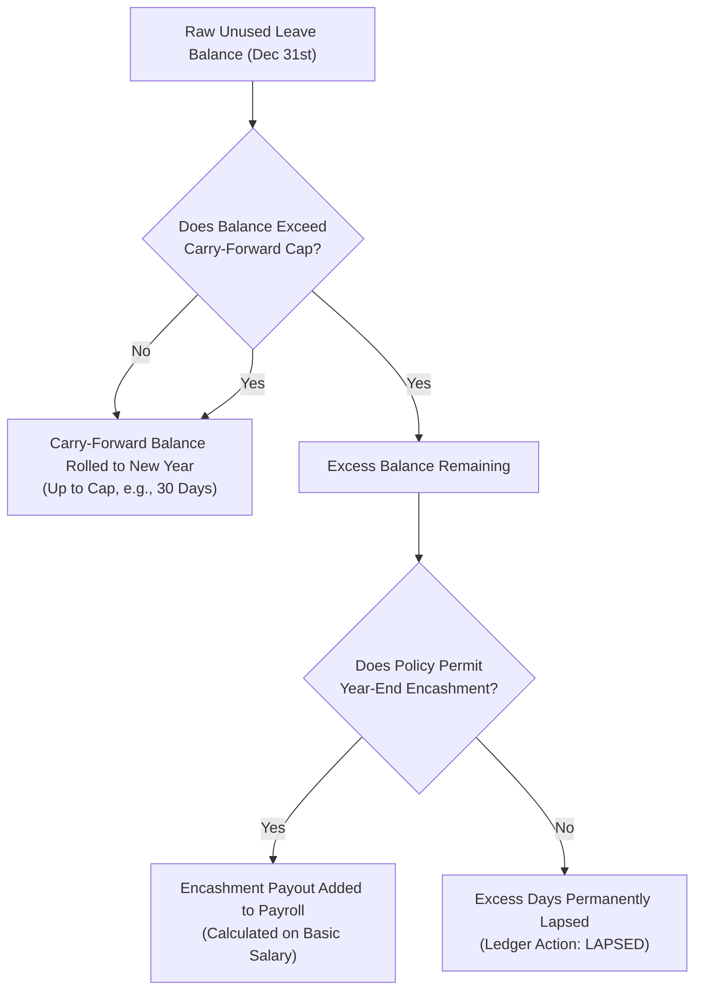

# HRMS Specification: Leave Governance, Accrual Engines & Policy Rules

**Document Target:** `research/final_modules/hrms/03_leave_governance_and_accruals.md`  
**Classification:** Operational Engine & Statutory Policy Specifications  

---

## 1. Leave Classification & Structural Policies

The Innostes Leave Governance Engine categorizes time-off into distinct policy types with independent accrual, carry-over, and encashment behaviors:

| Leave Type | Accrual Method | Carry-Forward Policy | Encashable | Statutory Mandate |
| :--- | :--- | :--- | :--- | :--- |
| **Paid Time Off (PTO) / Earned Leave (EL)** | Periodic (1.75 days/mo) or Annual (21 days) | Capped (max 30 or 45 days rollover) | Yes (upon exit or annual window) | Governed by Factories/Shops & Est. Act |
| **Casual Leave (CL)** | Lump-sum (e.g., 7–12 days on Jan 1st) | Zero rollover (lapses on Dec 31st) | No | Non-encashable personal time |
| **Sick Leave (SL)** | Annual grant (e.g., 10–12 days) | Cumulative or Lapse depending on region | No | Medical certificate mandatory if $> 2$ days |
| **Maternity Leave** | Event-triggered (26 weeks / 182 calendar days) | Full duration fixed | No | Mandatory statutory paid leave |
| **Paternity Leave** | Event-triggered (1 to 2 weeks) | Must consume within 6 months of childbirth | No | Company policy or regional statutory rule |
| **Compensatory Off (Comp-Off)** | Earned by working declared weekly off/holiday | Expires within 60 or 90 days of earning | No | Requires manager verification of weekend punch |
| **Unpaid Leave (Loss of Pay)** | Unlimited upon approval | N/A | N/A | Directly reduces monthly payroll base earnings |

---

## 2. Automated Accrual Engine & Proration Formulations

Leave balances are granted via automated, scheduled cron jobs executing on the first calendar day of the cycle.

### 2.1 Periodic Monthly Accrual
For policies that credit days on an ongoing basis:
$$\text{Monthly Credit} = \frac{\text{Annual Entitlement}}{12}$$
*(e.g., 21 days annual entitlement $\implies +1.75$ days credited on the 1st of each month).*

### 2.2 Proration Formulation for Mid-Cycle Joiners
When an employee joins mid-month or mid-year, their opening grant is calculated with mathematical precision:

$$\text{Prorated Grant} = \text{Annual Policy Entitlement} \times \left( \frac{\text{Active Days Remaining in Fiscal Cycle}}{\text{Total Calendar Days in Fiscal Cycle}} \right)$$

*Rounding Invariant:* Computed proration is rounded to the nearest half-day ($0.5$ or $1.0$). Values $< 0.25$ round down; values between $0.25$ and $0.74$ round to $0.5$; values $\ge 0.75$ round up to $1.0$.

---

## 3. Year-End Balances: Carry-Forward Caps & Leave Encashment

At the fiscal year close, the balance closure routine evaluates all active employee accounts against policy caps:

### 3.1 Leave Encashment Financial Formulation
When leave is encashed (either during an annual corporate encashment window or upon employee separation):

$$\text{Per-Day Encashment Rate} = \frac{\text{Monthly Basic Salary}}{\text{Standard Monthly Working Days (e.g., 26 or 30)}}$$

$$\text{Encashment Financial Payout} = \text{Encashed Days} \times \text{Per-Day Encashment Rate}$$

*Accounting Rule:* Encashment is calculated strictly on **Basic Salary** (excluding HRA, special allowances, or performance bonuses) to comply with statutory severance standards.

---

## 4. The Regional Sandwich Rule Engine (Disabled by Default)

The **Sandwich Rule** (converting weekend days into deducted leave when an employee takes both Friday and Monday off) is an aggressive legacy rule that modern tech startups strongly reject.

* **Startup-First Default: `is_sandwich_rule_active = FALSE`**:
  * Taking Friday and Monday off deducts exactly **2 days** of PTO. Saturday and Sunday remain paid weekly rest days.
* **Legacy Enterprise Mode (Optional Opt-In)**:
  * Companies operating under specific factory standing orders or legacy agreements can explicitly enable `is_sandwich_rule_active = TRUE` on specific leave types. When active:
    $$\text{IF } (\text{Leave on Friday} \land \text{Leave on Monday}) \implies (\text{Saturday} + \text{Sunday}) \text{ are converted to Leave}$$

---

## 5. Approval Workflows: 1-Step Startup Simplicity vs. Multi-Tier Enterprise

### 5.1 Startup-First Default: 1-Step Direct Approval
In a 5 to 50-person organization, there are no complex corporate hierarchies:
* **The Route**: Employee submits leave $\implies$ Line Manager (or Founder) approves in 1 click directly from their Dashboard.
* **Auto-Resolution**: If an employee has no assigned manager, the request routes directly to the Organization Administrator. Zero stuck requests.

### 5.2 Enterprise Multi-Tier Mode (Optional Opt-In)
When `enable_multi_tier_approvals = TRUE` is toggled on:
1. **Standard Request ($\le 3$ Days)**: Employee $\implies$ Direct Line Manager.
2. **Extended Request ($> 3$ Days)**: Employee $\implies$ Direct Line Manager $\implies$ Department Head / Skip-Level.
3. **Statutory Long-Term Request (Maternity / Medical Sabbatical)**: Employee $\implies$ Direct Manager $\implies$ HR Compliance Specialist.

---

## 6. The Immutable Leave Ledger Invariant

Leave balances are never stored as mutable numbers directly on the employee profile. Instead, the balance is the dynamic sum of an append-only transaction ledger (`leave_ledger`):

$$\text{Available Balance} \equiv \sum_{\text{all transactions}} \text{ledger\_days}$$

| Transaction Action | Sign | Trigger Event |
| :--- | :--- | :--- |
| **`ACCRUED`** | **$+$** | Monthly or annual automated accrual cron execution |
| **`CONSUMED`** | **$-$** | Approved leave application execution |
| **`ENCASHED`** | **$-$** | Year-end or exit financial encashment processing |
| **`LAPSED`** | **$-$** | Year-end balance truncation above carry-forward cap |
| **`REVERSED`** | **$+$** | Manager-approved cancellation of previously approved leave |
