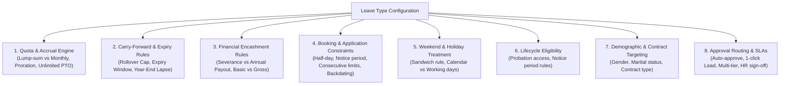
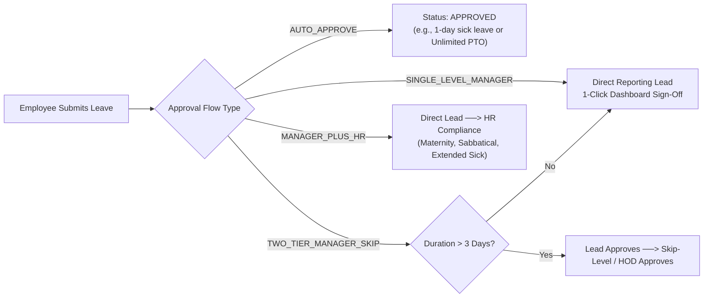
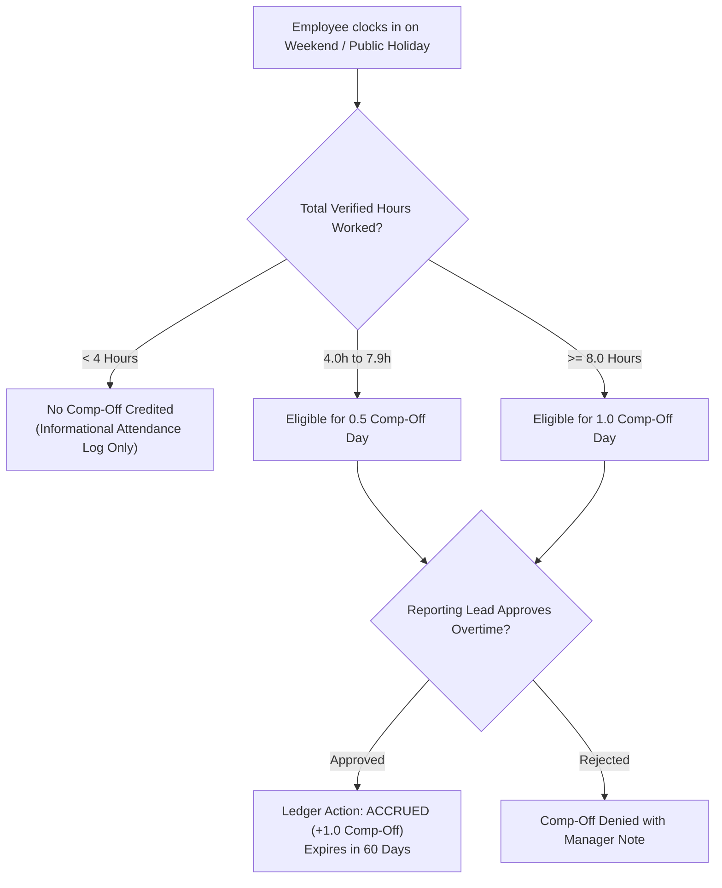

# HRMS Specification: Leave Governance, Accrual Engines & Modular Policy Configuration

**Document Reference:** `research/final_modules/hrms/03_leave_governance_and_accruals.md`  
**Classification:** Core Time-Off Engine, Statutory Compliance & Enterprise Policy Matrix  
**Status:** Canonical Implementation Specification  

---

## 1. Architectural Philosophy: 100% Admin-Configurable Time-Off

In Innostes Business OS, leave management is not a hardcoded set of rules. It is an **extensible, multi-dimensional policy engine**. Every organization—from a 10-person remote software startup with Unlimited PTO to a 5,000-employee manufacturing enterprise governed by the Factories Act—can configure its time-off policies without writing code or requesting database migrations.

### The Core Law of Innostes Leave Governance
1. **Dynamic Master-Driven Leave Types**: Administrators define leave types (`CL`, `SL`, `PL`, `MATERNITY`, `COMP_OFF`, etc.) via the Admin Settings UI.
2. **Modular 8-Dimension Policy Configuration**: Every leave type has an independent set of rules controlling accruals, carry-forwards, encashment, sandwich treatment, probation eligibility, and approval flows.
3. **Immutable Double-Entry Leave Ledger**: Leave balances are never stored as mutable numbers directly on employee records. Every credit, consumption, encashment, and lapse is an append-only ledger transaction (`hrms_leave_ledger`).

---

## 2. Complete Enterprise Leave Catalog & Statutory Alignments

The Innostes seed engine provides ready-to-use policy templates aligned with Indian and international statutory standards, while giving admins full freedom to customize or create new leave types:

| Leave Type Code | Human Label | Standard Accrual Model | Carry-Forward Default | Encashable | Statutory Alignment |
| :--- | :--- | :--- | :--- | :--- | :--- |
| **`PL` / `EL`** | Privilege / Earned Leave | Monthly Pro-Rata (1.5 to 1.75 days/mo) | Capped (max 30 or 45 days rollover) | Yes (Exit / Annual Window) | Factories Act / Shops & Establishments Act |
| **`CL`** | Casual Leave | Annual Lump-Sum (e.g., 12 days on Jan 1st) | Zero rollover (lapses Dec 31st) | No | Non-encashable personal unplanned time |
| **`SL`** | Sick / Medical Leave | Annual Lump-Sum or Monthly Pro-Rata | Capped or Lapse (Admin setting) | No | Medical cert mandatory if $> 2$ days |
| **`MATERNITY`** | Statutory Maternity Leave | Event-Triggered (26 weeks / 182 days) | Fixed event duration | No | Maternity Benefit Act, 1961 |
| **`PATERNITY`** | Paternity Leave | Event-Triggered (1 to 2 weeks) | Must consume within 6 months of childbirth | No | Company policy / State norms |
| **`COMP_OFF`** | Compensatory Off | Earned by working weekend/holiday punch | Expires in 60 or 90 days from punch | No | Overtime compensation compliance |
| **`BEREAVEMENT`**| Bereavement / Compassionate | Event-Triggered (3 to 7 days) | Immediate event consumption | No | Compassionate leave policy |
| **`MARRIAGE`** | Marriage Leave | Event-Triggered (3 to 5 days) | 1-time grant for first marriage | No | Company milestone benefit |
| **`FLOATING`** | Floating / Optional Holiday | Lump-Sum (e.g., choose 2 from 8 festivals) | Lapses Dec 31st | No | Cultural & regional diversity inclusion |
| **`SABBATICAL`** | Study / Extended Sabbatical | Application-Driven (1 to 12 months) | N/A | No | Seniority & tenure-gated policy |
| **`UNPAID_LOP`** | Loss of Pay (Unpaid Leave) | Unlimited upon manager sign-off | N/A | N/A | Salary deduction in Payroll Engine |

---

## 3. The 8 Modular Policy Dimensions (Admin Configuration Matrix)

When an administrator navigates to **Settings > Leave Policies > Create/Edit Leave Type**, the system exposes an intuitive 4-tab policy builder covering 8 distinct operational dimensions:



---

### Dimension 1: Quota, Accrual Engine & Proration
The administrator determines how and when employees receive time-off credits:

* **Accrual Models**:
  * **`ANNUAL_LUMP_SUM`**: The full annual quota is credited upfront on the first day of the cycle (e.g. 12 days on Jan 1st or Apr 1st).
  * **`MONTHLY_PRO_RATA`**: Quota is divided across 12 months and credited automatically on the 1st of each month (e.g. $18 \div 12 = 1.5$ days/month).
  * **`QUARTERLY`**: Credited in 4 equal quarterly installments.
  * **`UNLIMITED_PTO`**: Quota tracking is disabled. Output-driven startups grant trust-first time-off without tracking leave banks.
  * **`EVENT_BASED`**: No scheduled accrual. Granted manually or upon life-event declaration (e.g. Maternity, Bereavement).
* **Accrual Timing**:
  * `BEGINNING_OF_PERIOD`: Advance credit (employee can use days starting on the 1st).
  * `END_OF_PERIOD`: Earned credit (employee earns days after completing the month).
* **New Joiner Proration Formulas**:
  * `EXACT_DAYS`:
    $$\text{Prorated Days} = \text{Annual Quota} \times \left( \frac{\text{Days Remaining in Cycle}}{\text{Total Days in Cycle}} \right)$$
  * `MID_MONTH_CUTOFF`: If joined on or before the 15th, full monthly credit; if joined after the 15th, 0.5 month credit.
  * `NONE`: Full annual quota granted regardless of join date.
* **Rounding Invariant**: Prorated balances round to the nearest half-day ($0.5$ or $1.0$).

---

### Dimension 2: Carry-Forward, Rollover & Expiry Rules
What happens to unused leave when the calendar or financial year ends?

```
YEAR-END BALANCE EVALUATION PIPELINE
Unused Balance at Cycle Cutoff
   │
   ├── Can Carry Forward = FALSE ──> Entire Unused Balance Lapses (LAPSED in Ledger)
   │
   └── Can Carry Forward = TRUE
         │
         ├── Up to Carry-Forward Cap (e.g. 30 Days) ──> Transferred to New Year (ACCRUED)
         │     │
         │     └── Carry-Forward Expiry Window (e.g. 90 Days)
         │           └── Must be consumed before 31 March, or expires
         │
         └── Excess Balance Above Cap
               ├── Is Encashable = TRUE  ──> Converted to Payroll Cash Payout
               └── Is Encashable = FALSE ──> Excess Days Permanently Lapsed
```

* **`can_carry_forward`** (`true / false`): Master toggle for balance rollover.
* **`carry_forward_cap`** (e.g. `30.0 days`): Maximum days an employee can carry into the next cycle. Any days beyond this cap are either encashed or lapsed.
* **`carry_forward_expiry_months`** (e.g. `3 months` / `90 days`): If set, carried-forward days must be consumed within this window (e.g. by March 31st), or the system automatically posts a `LAPSED` transaction.

---

### Dimension 3: Financial Encashment Rules
Allows organizations to monetize unused leave balances either at year-end or during employee offboarding:

* **`is_encashable`** (`true / false`): Master toggle allowing financial liquidation.
* **`encashment_mode`**:
  * `UPON_SEPARATION_ONLY`: Encashed strictly during Full & Final (F&F) settlement when leaving the company.
  * `ANNUAL_WINDOW`: Employees can liquidate excess leave during an annual December/March payroll window.
  * `ON_DEMAND`: Employees can request leave encashment at any time subject to HR approval.
* **`encashment_min_balance_retained`**: Minimum days that must remain in the employee's bank (e.g. must maintain at least 15 days of PL; only excess can be encashed).
* **`encashment_max_days_per_year`**: Maximum days eligible for encashment in a single year (e.g. max 10 days).
* **`encashment_salary_basis`**:
  * `BASIC_SALARY` (Statutory Standard): $\text{Per Day Rate} = \frac{\text{Monthly Basic Salary}}{26 \text{ or } 30}$
  * `GROSS_SALARY`: Computed on total gross earnings excluding variable bonuses.

---

### Dimension 4: Booking & Application Constraints
Rules to prevent operational disruption, staffing shortages, and fraudulent backdating:

* **Half-Day Booking**:
  * `allow_half_day` (`true / false`): When enabled, employees can apply for `FIRST_HALF` (morning) or `SECOND_HALF` (afternoon) taking $0.5$ days.
* **Advance Notice Requirement**:
  * `min_notice_days` (e.g. `7 days` for planned PL, `0 days` for emergency Sick Leave).
* **Maximum Consecutive Days**:
  * `max_consecutive_days` (e.g. max 3 days for Casual Leave; longer durations require Privilege Leave or HR review).
* **Backdated Application (Past-Dating)**:
  * `allow_past_dating` (`true / false`): Can an employee apply for leave after taking it?
  * `max_past_days` (e.g. max 3 days for Sick Leave; 0 days for Casual Leave).
* **Overdraft & Negative Balance**:
  * `allow_negative_balance` (`true / false`): Can employees borrow from future monthly accruals?
  * `max_negative_days` (e.g. up to `-3.0` days). Negative balances are settled against subsequent monthly credits or deducted from payroll if the employee exits.
* **Mandatory Documentation & Attachments**:
  * `requires_attachment` (`true / false`).
  * `attachment_mandatory_above_days` (e.g. if Sick Leave $> 2$ consecutive days, medical certificate upload is **mandatory** before submission).

---

### Dimension 5: Weekend & Holiday Treatment (Sandwich Rule Engine)
Governs how weekly rest days (Saturdays/Sundays) and declared public holidays are counted when falling within or adjacent to a leave period:

| Setting Key | Startup Default | Legacy Enterprise Option | Explanation |
| :--- | :--- | :--- | :--- |
| `include_weekends` | `false` | `true` | When `false`, taking a full week off (Mon to Fri) deducts **5 days**, not 7. |
| `include_holidays` | `false` | `true` | When `false`, a public holiday falling on Wednesday during a week-long leave is not deducted. |
| `sandwich_rule_mode` | `DISABLED` | `SANDWICH_WEEKENDS` or `SANDWICH_ALL` | When enabled, taking Friday and Monday off automatically converts the intervening Saturday and Sunday into deducted leave days. |

#### Detailed Sandwich Rule Formulations:
* **`DISABLED` (Innostes Modern Default)**:
  $$\text{Leave on Friday} + \text{Leave on Monday} \implies \text{Total Deducted} = \mathbf{2.0 \text{ Days}}$$
* **`SANDWICH_WEEKENDS` (Legacy Manufacturing / Strict Corporate)**:
  $$\text{Leave on Friday} + \text{Weekend (Sat+Sun)} + \text{Leave on Monday} \implies \text{Total Deducted} = \mathbf{4.0 \text{ Days}}$$
* **Transparent UI Display**: When the sandwich rule triggers, the application modal explicitly warns the employee:
  > *"Sandwich Rule Applied: Your leave spans Friday and Monday. Saturday and Sunday (2 days) have been included in your deduction. Total days deducted: 4.0."*

---

### Dimension 6: Life-Cycle Eligibility (Probation & Notice Period)
How does an employee's employment stage restrict leave availability?

* **Probation Governance (`probation_rule`)**:
  * `FULL_ACCESS`: Available from Day 1 (equal treatment).
  * `ACCRUE_ONLY_LOCKED`: Leaves accrue monthly in the background, but balance is locked and cannot be applied until the employee passes probation.
  * `LOSS_OF_PAY_ONLY`: Any absence during probation is treated as unpaid Loss of Pay.
* **Notice Period Governance (`notice_period_rule`)**:
  * `PROHIBITED`: Employees serving their notice period cannot apply for leave.
  * `MANAGER_DISCRETION`: Manager can approve in exceptional situations.
  * `EXTENDS_NOTICE_PERIOD`: Taking 1 day of leave during notice period automatically shifts the employee's Last Working Day (LWD) forward by 1 day.

---

### Dimension 7: Demographic & Contract Targeting
Restricts leave types to appropriate employee cohorts:

* **Gender Targeting (`applicable_gender`)**:
  * `ALL` (Standard for CL, SL, PL)
  * `FEMALE_ONLY` (Maternity Leave)
  * `MALE_ONLY` (Paternity Leave)
* **Marital Status Targeting (`applicable_marital_status`)**:
  * `ALL` vs `MARRIED_ONLY` (Childcare / Family Leave) vs `UNMARRIED_ONLY` (Marriage Leave)
* **Employment Type Targeting (`applicable_employment_types`)**:
  * Array of codes: `['PERMANENT_FULL_TIME', 'PERMANENT_PART_TIME']`. Excludes short-term interns or ad-hoc contractors who do not accrue statutory paid leave.

---

### Dimension 8: Approval Routing, SLAs & Auto-Escalation
Multi-tier routing tailored to organizational size and request severity:



* **Manager SLA & Auto-Escalation**:
  * If the direct manager takes no action within `sla_hours` (e.g. 48 hours), the system sends an urgent reminder. If unresolved after 72 hours, it escalates to their skip-level manager or organization HR.

---

## 4. The Compensatory Off (Comp-Off) Generator Engine

Compensatory Off is not accrued on a schedule. It is **earned dynamically** when an employee performs approved work on a declared weekly off (Saturday/Sunday) or public holiday:



* **Validity & Expiry Engine**: Every Comp-Off grant carries an `expires_at` timestamp (default: 60 or 90 days from the work date). If unused by that date, the daily balance closure cron issues an automatic `LAPSED` transaction.

---

## 5. The Immutable Leave Ledger Specification

Leave balances are governed by the **Double-Entry Ledger Principle**. The application never runs: `UPDATE employees SET leave_balance = leave_balance - 1`. Such mutations destroy auditability and make retrospective error diagnosis impossible.

### Dynamic Balance Calculation
An employee's real-time balance for any leave type is always derived:

$$\text{Current Available Balance} = \sum_{t \in \text{Ledger}} \text{transaction\_days}(t) - \sum_{a \in \text{Pending Applications}} \text{requested\_days}(a)$$

### Ledger Action Codes (`leave_action`)

| Ledger Action | Sign | Trigger Description |
| :--- | :--- | :--- |
| **`ACCRUED`** | **$+$** | Automated monthly/annual accrual cron or approved Comp-Off grant |
| **`CONSUMED`** | **$-$** | Deduction triggered upon manager approval of a leave application |
| **`ENCASHED`** | **$-$** | Balance liquidated for financial payout in Payroll |
| **`LAPSED`** | **$-$** | Expired unused balance at year-end or expired Comp-Off |
| **`REVERSED`** | **$+$** | Reversal of consumed leave when an approved leave is subsequently cancelled |
| **`ADJUSTED`** | **$\pm$** | Manual administrative correction with mandatory HR audit reason note |

---

## 6. Real-Time Application Sanity & Sandwich Preview

When an employee opens the leave application modal:
1. **Live Ledger Balance Check**: Displays available balance, pending requests, and post-deduction balance.
2. **Real-Time Calendar Radar**: Highlights weekends, declared public holidays, and existing approved leaves of team members.
3. **Instant Sandwich Warning**: If the selected dates trigger a sandwich rule, the modal visually updates the day counter before submission:
   * *"Base Days: 2.0 (Fri, Mon) + Sandwich Rest Days: 2.0 (Sat, Sun) = Total Deduction: 4.0 Days."*
4. **Zero-Knowledge Manager Routing**: The employee does not pick their approver. The request automatically routes to their active `manager_id`. If `manager_id` is null, it falls back to the Organization HR Administrator.

---

## 7. Startup-First Mode: Single-Toggle Unlimited PTO

For modern early-stage startups (5 to 30 engineers) that find traditional leave banks and accrual formulas bureaucratic, the entire leave system can be converted to **Unlimited PTO** in 1 click:

In **Company Settings > Leave Configuration**:
```
[✓] Enable Unlimited Trust-First PTO
    (When enabled, all annual quotas, accrual cron jobs, carry-forward caps, 
     and sandwich rules are bypassed. Employees simply notify their lead 
     when taking time off. Attendance calendar tracks presence without deducting leave banks.)
```

When Unlimited PTO is active:
* Employees submit dates so the team knows they are away.
* Line managers approve for scheduling transparency.
* Zero balance math, zero encashment liabilities on the company balance sheet, and zero administrative overhead.
