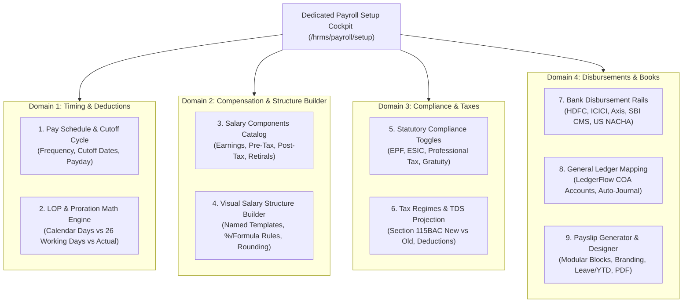
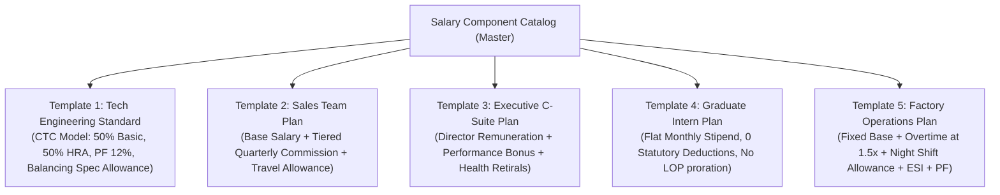
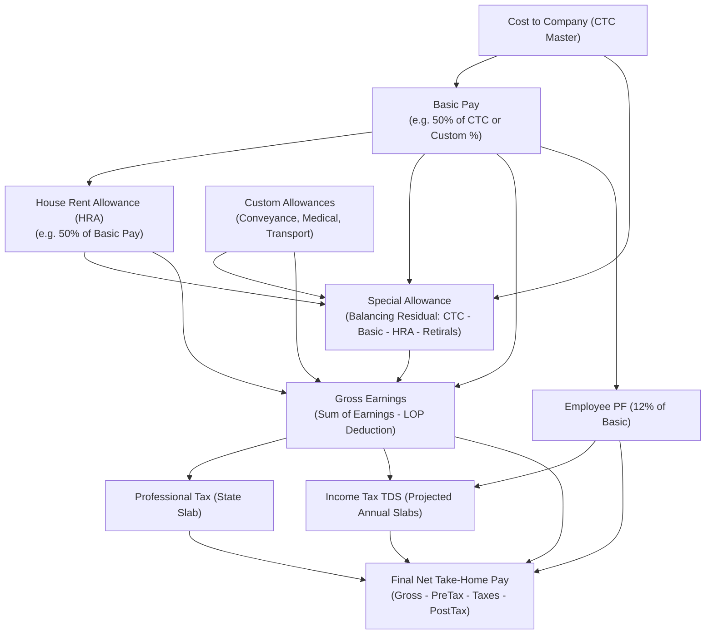
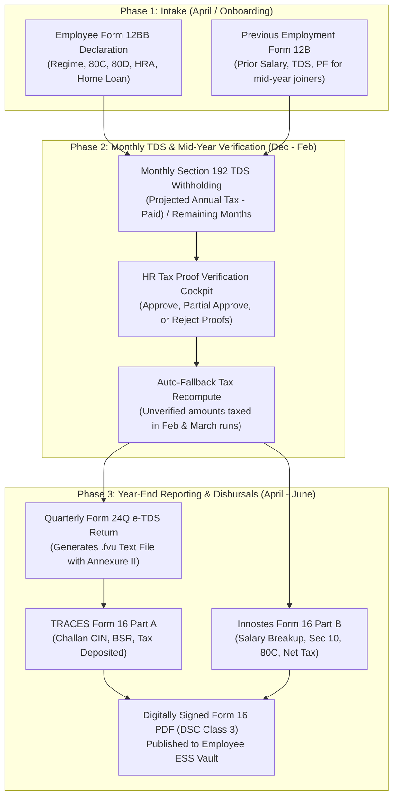
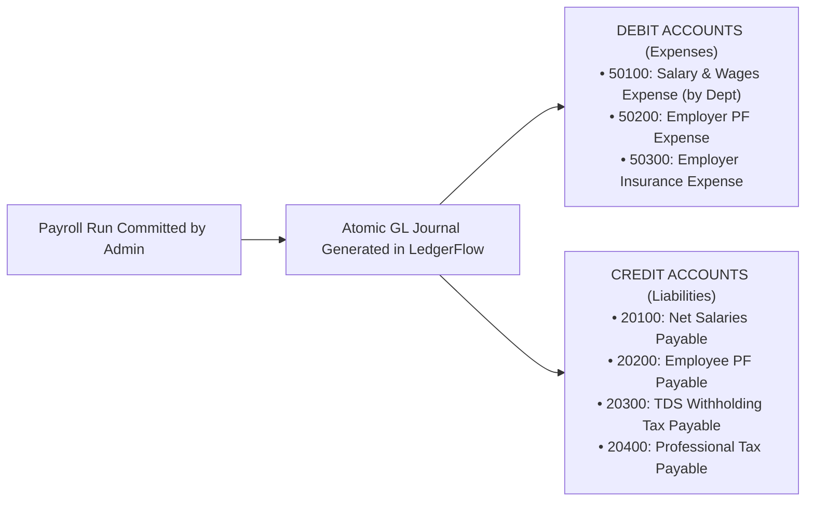

# HRMS Specification: Modular Payroll Engine, Statutory Rules & Comprehensive Payroll Setup

**Document Reference:** `research/final_modules/hrms/04_payroll_engine_and_statutory_rules.md`  
**Classification:** Core Financial Calculation Engine, Statutory Localization & Payroll Operations  
**Status:** Canonical Implementation Specification  

---

## 1. Architectural Philosophy: Startup Simplicity First, Enterprise Depth When Ready

Traditional enterprise payroll systems (SAP, Oracle, Workday) fail startups because they impose heavy statutory setup ceremonies before a company can run its first payroll. Conversely, simplistic payroll tools fail as companies scale because they lack multi-state tax slabs, customizable formula graphs, and double-entry General Ledger integrations.

Innostes Business OS resolves this duality with a **Modular, Two-Tier Payroll Architecture**:

1. **Day-1 Startup Mode (Zero-Ceremony Payroll)**:
   * A 5 to 20-person startup can disburse salaries on Day 1 using a single fixed monthly compensation:
     $$\text{Net Pay} = \text{Base Salary} - \text{TDS (if applicable)}$$
   * All statutory compliance modules (EPF, ESIC, Professional Tax) are **modular toggles, disabled by default until required by headcount thresholds**.
   * No forced establishment codes, no 25-line salary breakdowns, and no circular formula errors.
2. **Enterprise Scale Mode (Mathematical DAG Evaluator)**:
   * As organizations grow past statutory thresholds (e.g. 20 employees in India triggering mandatory EPF), administrators enable statutory modules with 1 click.
   * Full Directed Acyclic Graph (DAG) component evaluator, multi-regime income tax projections (Section 115BAC), LOP deduction math, corporate bank disbursement batches (NEFT/RTGS/ACH), and atomic General Ledger journal postings.

---

## 2. Dedicated Payroll Setup Page Architecture (`/hrms/payroll/setup`)

Innostes strictly isolates operational time-tracking from financial payroll configuration. To prevent the severe responsive failure of cramming 8 horizontal tabs across small desktop, laptop, or tablet screens (which causes horizontal overflow, awkward wrapping, and hidden off-screen tabs), the **Payroll Setup Cockpit** (`/hrms/payroll/setup`) implements a **Two-Column Vertical Settings Architecture** (modeled after Stripe, Linear, and GitHub Settings):

* **Desktop Viewport (`>= 1024px`)**: A `w-64` vertical sub-navigation sidebar on the left, organized into 4 logical configuration domains with real-time status badges, paired with the active section form canvas on the right.
* **Tablet & Mobile Viewport (`< 1024px`)**: The sidebar collapses into a clean sticky top section selector dropdown (`[ Domain: Section ▾ ]`), granting the form canvas 100% viewport width without clipping or layout shifts.



---

## Domain 1: Timing & Deductions

### Section 1: Pay Schedule & Cutoff Cycle Configuration
Defines when and how frequently employees are paid, and the exact cutoffs for attendance and expense ingestion:

| Setting Key | Startup Default | Enterprise Options | Purpose & Impact |
| :--- | :--- | :--- | :--- |
| `pay_frequency` | `MONTHLY` | `MONTHLY`, `BI_WEEKLY`, `SEMI_MONTHLY`, `WEEKLY` | Monthly standard for India/EU; Bi-Weekly standard for US/North America. |
| `cycle_start_day` | `1` (1st of month) | `1`, `21`, `26` (Custom cutoff day) | Standard cycle (1st to 30th/31st) vs Mid-Month cutoff (e.g. 26th to 25th) to give payroll teams 5 days to audit before month-end payday. |
| `payout_day` | `LAST_DAY_OF_MONTH`| `LAST_DAY_OF_MONTH`, `1ST_OF_NEXT_MONTH`, `5TH`, `7TH` | Day on which funds are disbursed to employee bank accounts. |
| `attendance_cutoff_day` | Same as cycle end | `3` days before payday | Cutoff date after which unapproved attendance regularizations roll into the subsequent payroll cycle. |

---

### Section 2: Loss of Pay (LOP) & Proration Mathematical Engine
When an employee takes unpaid leave, has unregularized missing punches, or joins mid-month, how is a single day's salary deducted?

Administrators configure the exact calculation denominator:

$$\text{Per Day Salary Rate} = \frac{\text{Monthly Base Salary}}{\mathbf{\text{Divisor Determined by Selected LOP Method}}}$$

| LOP Calculation Method | Formula Divisor | Example (INR 120,000 Base in 31-Day Month) | Ideal For |
| :--- | :--- | :--- | :--- |
| **Method A: Calendar Days in Month** (Default) | $\text{Actual Days in Target Month}$ (28, 29, 30, or 31) | $\text{Daily Rate} = \frac{120,000}{31} = \mathbf{\text{INR } 3,870.97}$ | Tech startups, remote teams, modern software companies. |
| **Method B: Fixed 26 Working Days** | Fixed at $26.0$ every month (assuming 4 Sundays off) | $\text{Daily Rate} = \frac{120,000}{26} = \mathbf{\text{INR } 4,615.38}$ | Manufacturing, factories, companies under Industrial Standing Orders. |
| **Method C: Actual Scheduled Work Days** | $\text{Total Calendar Days} - (\text{Weekly Offs} + \text{Gazetted Holidays})$ | If 21 working days in month: $\text{Daily Rate} = \frac{120,000}{21} = \mathbf{\text{INR } 5,714.28}$ | Output-driven professional services, hourly billing agencies. |

#### Mid-Month Joiner & Leaver Proration Formulation
When an employee starts on November 15th:
$$\text{Payable Days} = \text{Total Active Days from Join Date to Cycle End}$$
$$\text{Prorated Earnings} = \text{Monthly Base Salary} \times \left( \frac{\text{Payable Days}}{\text{Divisor Determined by LOP Method}} \right)$$

---

## Domain 2: Compensation & Visual Structure Builder

### Section 3: Dynamic Salary Component Catalog & Calculation Modes

In Innostes, no salary component is hardcoded. Administrators can create unlimited custom components with complete mathematical freedom:

#### 1. The 5 Component Classifications
1. **`EARNING`**: Additions to gross pay (Basic Pay, House Rent Allowance, Dearness Allowance, Conveyance Allowance, Special Allowance, Shift Allowance, Overtime, Performance Bonus).
2. **`DEDUCTION_PRE_TAX`**: Deductions that reduce taxable gross income prior to tax calculations (Employee Provident Fund under Sec 80C, 401(k) pre-tax, Voluntary PF, Group Medical Insurance).
3. **`STATUTORY_TAX`**: Mandatory government withholdings (TDS under Section 192, State Professional Tax, FICA Social Security & Medicare).
4. **`DEDUCTION_POST_TAX`**: Non-tax-exempt deductions recovered from net earnings (Salary advances, loan repayments, asset damage recoveries, canteen fees).
5. **`EMPLOYER_CONTRIBUTION` / `RETIRALS`**: Company costs that do not reduce employee take-home pay (Employer PF 12%, Employer ESI 3.25%, Gratuity Accrual 4.81%, Group Term Insurance). Configurable as either **Part of CTC** or **Above CTC**.

#### 2. The 5 Mathematical Calculation Modes
Each component defines how its currency amount is computed:

| Calculation Mode | Description & Evaluation Logic | Example Configuration |
| :--- | :--- | :--- |
| **`FLAT_AMOUNT`** | Fixed currency figure per pay cycle. Does not change unless updated. | `Broadband Allowance = INR 1,500.00` |
| **`PERCENTAGE_OF`** | Exact percentage of another component or aggregate metric. | `HRA = 50% of [BASIC]`, `EPF = 12% of [BASIC]` |
| **`FORMULA_EXPRESSION`** | Arbitrary mathematical formula evaluated by Directed Acyclic Graph (DAG) parser. Supports variables, operators (`+`, `-`, `*`, `/`), and functions (`MAX`, `MIN`, `ROUND`). | `Special Allowance = MAX(0, CTC - (BASIC + HRA + CONVEYANCE + EMPLOYER_PF))` |
| **`STATUTORY_SLAB`** | Dynamic lookup against official statutory tables based on employee location or income. | `Professional Tax = LOOKUP_PT_SLAB(WORK_STATE, GROSS_PAY)` |
| **`MONTHLY_VARIABLE`** | Ingested or entered each payroll run (e.g. approved sales commissions, reimbursements, spot bonuses). | `Sales Incentive = IMPORTED_PAYROLL_VARIABLE` |

#### 3. Component Behavior & Policy Flags
* **`is_lop_prorated`**: `TRUE` (amount is reduced proportionally by unpaid leaves/missing punches) or `FALSE` (fixed amount regardless of days worked, e.g. Fixed Internet Reimbursement).
* **`tax_exemption_rule`**: Exemption code under applicable tax laws (e.g. `SEC_10_13A_HRA`, `SEC_10_14_CONVEYANCE`, `NON_TAXABLE_REIMBURSEMENT`).
* **`part_of_ctc`**: Controls whether this component is included in the employee's annualized Cost to Company figure.
* **`show_on_payslip`**: Toggle whether this component appears on the employee's printed/downloaded payslip.
* **`hide_if_zero`**: When enabled, if an employee has `0.00` for this component in a month, the row is automatically suppressed from the payslip.

---

### Section 4: Visual Multi-Structure Salary Template Builder & Assignment Engine

Organizations do not use a single rigid compensation structure. Different departments, seniority levels, and contract types require distinct salary packages.

#### 1. Multi-Structure Salary Templates
Administrators create and manage named **Salary Structures (Templates)**:



#### 2. Directed Acyclic Graph (DAG) Component Evaluator
Within each structure, components form a mathematical graph evaluated in topological order:



#### 3. Component Rounding Rules
For every structure, the administrator selects the rounding precision:
* `NEAREST_INTEGER`: Rounds to whole currency units (`INR 42,150.00`).
* `CEILING`: Always rounds up to the next integer.
* `FLOOR`: Truncates fractional amounts.
* `EXACT_DECIMAL`: Preserves 2 decimal places (`INR 42,150.48`).

#### 4. Employee Assignment Engine & Versioned Revisions
* **Assignment Hierarchy**:
  1. Organization Default Template (fallback)
  2. Department Default Template (e.g. all `SALES` employees get Sales Plan)
  3. Designation Default Template (e.g. all `INTERN` get Stipend Plan)
  4. Individual Contract Overrides (custom negotiated packages)
* **Effective-Date Versioning**: When an employee receives a salary revision or promotion, a new versioned contract is created with an `effective_from` date (e.g. `2026-04-01`). Historical payroll runs remain immutable and permanently verifiable.

---

## Domain 3: Compliance & Taxes

### Section 5: Modular Statutory Compliance Toggles (India & Global)

Statutory deductions are strictly modular. Startups toggle ON compliance features only when they reach the statutory employee count thresholds:

```
STATUTORY COMPLIANCE TOGGLES (SETTINGS > PAYROLL > STATUTORY)
[ ] Enable Employee Provident Fund (EPF & EPS)
    (Mandatory in India once company reaches 20 employees. Toggle OFF for early startups.)

[ ] Enable Employee State Insurance (ESIC)
    (Applicable only if gross wages <= INR 21,000/month. Toggle OFF for tech knowledge workers.)

[ ] Enable State Professional Tax (PT)
    (Auto-deducts state-specific monthly slab rates e.g. Karnataka INR 200, Maharashtra INR 200/300.)

[ ] Enable Labour Welfare Fund (LWF)
    (Annual/Bi-annual state welfare deduction e.g. Maharashtra, Karnataka.)

[ ] Enable Statutory Gratuity Provisioning
    (Accrues 15/26 of monthly basic per year of tenure on company balance sheet.)
```

#### Detailed Statutory Rules When Enabled:

1. **Provident Fund (EPF & EPS - India)**:
   * **Employee Contribution**: 12% of (Basic + DA).
   * **Employer Contribution**: 12% total:
     * 8.33% allocated to Employee Pension Scheme (EPS) — **Cap Option**: Admin toggles whether EPS is capped at statutory ceiling of INR 15,000 ($\implies \text{max INR 1,250/month}$) or contributed on actual full basic pay.
     * Remaining 3.67% allocated to EPF.
     * Employer also pays 0.5% EDLI (insurance) + 0.5% EPF administrative charges.
2. **Employee State Insurance (ESIC - India)**:
   * **Applicability Threshold**: Gross monthly earnings $\le \text{INR } 21,000$.
   * Employee Deduction: 0.75% of gross wages.
   * Employer Contribution: 3.25% of gross wages.
3. **State Professional Tax (PT - India)**:
   * Computed based on employee's office location state:
     * **Karnataka**: INR 200/month if gross salary $> \text{INR } 25,000$; zero if $\le \text{INR } 25,000$.
     * **Maharashtra**: INR 200/month (INR 300 in February) if gross $> \text{INR } 10,000$ (Men) or $> \text{INR } 25,000$ (Women).
     * **Telangana / Andhra Pradesh**: INR 200/month if gross $> \text{INR } 20,000$.
4. **United States Statutory Engine (When Configured for US)**:
   * **FICA Social Security**: 6.2% Employee + 6.2% Employer (capped at annual statutory wage base).
   * **FICA Medicare**: 1.45% Employee + 1.45% Employer (no wage cap; +0.9% Additional Medicare on earnings $> \$200,000$).
   * **Federal Income Tax Withholding (FITW)**: Computed based on employee Form W-4 declarations.
   * **State & Local Income Tax (SIT/LIT)**: Computed per employee work state nexus.

---

### Section 6: Indian Income Tax Engine, Form 12BB Declarations, Verification & Form 16 Lifecycle

Innostes implements an end-to-end, statutory-grade Indian Income Tax calculation engine under Section 192 of the Income Tax Act, 1961, bridging the two-way lifecycle between employee input declarations and employer statutory filings.



---

#### 1. Tax Regime Selection & Mathematical Slab Engine

Employees select between two statutory regimes:

##### A. Section 115BAC New Tax Regime (Default)
* **Standard Deduction**: Increased to **INR 75,000** (Finance Act 2024 / FY 2024-25 onwards).
* **Section 87A Rebate**: Full tax rebate up to INR 25,000 for taxable income $\le \text{INR } 7,00,000$ (Zero tax liability up to INR 7.75 Lakhs including standard deduction).
* **Marginal Relief**: Automatically applied if taxable income marginally exceeds INR 7,00,000.
* **Annual Tax Slabs**:
  * Up to INR 3,00,000: **0% (Nil)**
  * INR 3,00,001 to INR 7,00,000: **5%**
  * INR 7,00,001 to INR 10,00,000: **10%**
  * INR 10,00,001 to INR 12,00,000: **15%**
  * INR 12,00,001 to INR 15,00,000: **20%**
  * Above INR 15,00,000: **30%**
* **Deductions Disallowed**: Chapter VI-A deductions (80C, 80D, 80E) and Section 10 exemptions (HRA, LTA) are disabled, except Employer NPS contribution u/s 80CCD(2) up to 14% of (Basic + DA).

##### B. Old Tax Regime (Optional Choice)
* **Standard Deduction**: **INR 50,000**.
* **Section 87A Rebate**: Up to INR 12,500 for taxable income $\le \text{INR } 5,00,000$ (Zero tax liability up to INR 5.5 Lakhs).
* **Annual Tax Slabs**:
  * Up to INR 2,50,000: **0% (Nil)**
  * INR 2,50,001 to INR 5,00,000: **5%**
  * INR 5,00,001 to INR 10,00,000: **20%**
  * Above INR 10,00,000: **30%**
* **Universal Health & Education Cess**: **4%** levied on aggregate income tax liability across both regimes.
* **Surcharge Slabs on High Earners**: 10% (> 50L), 15% (> 1 Cr), 25% (> 2 Cr) with marginal relief calculations.

---

#### 2. Information Required FROM the Employee (Self-Service Intake)

##### A. Statutory Form 12BB (Rule 26C Declaration)
Employees submit their deduction claims in ESS across 5 statutory categories:

1. **House Rent Allowance (HRA) Exemption u/s 10(13A)**:
   * **Required Inputs**: Monthly rent paid, rental property address, landlord legal name, and landlord address.
   * **Statutory Guard (Landlord PAN)**: If annual rent paid exceeds **INR 1,00,000**, the system mandates entry of the Landlord's valid PAN (CBDT Circular) or Form 60 declaration before exemption is factored into monthly TDS.
   * **Exemption Math**: The engine dynamically calculates the exact statutory exemption:
     $$\text{HRA Exemption} = \min \begin{cases} \text{Actual HRA Received} \\ \text{Rent Paid} - 10\% \text{ of (Basic + DA)} \\ 50\% \text{ of (Basic + DA) [Metro: Delhi, Mumbai, Kolkata, Chennai]} \text{ or } 40\% \text{ [Non-Metro]} \end{cases}$$
2. **Deduction of Interest on Borrowing for House Property u/s 24(b)**:
   * Self-occupied property: Maximum deduction of **INR 2,00,000** for interest paid.
   * Let-out property: Actual interest with net loss capped at INR 2,00,000 per financial year.
   * **Required Inputs**: Lender Name, Lender PAN/TAN, Loan Account Number, and Provisional Interest Certificate issued by the bank/NBFC.
3. **Chapter VI-A Deductions (Old Regime)**:
   * **Section 80C (Maximum Cap: INR 1,50,000)**:
     * *System-Auto Ingested*: Employee Provident Fund (EPF) contributions made through payroll are automatically populated into 80C without requiring manual employee entry.
     * *Employee Declared*: Equity Linked Savings Schemes (ELSS), Life Insurance Premiums (LIC), Public Provident Fund (PPF), 5-Year Tax Saver Bank FDs, Children Tuition Fees (up to 2 children), Sukanya Samriddhi Yojana, National Savings Certificates (NSC), and Stamp Duty / Registration charges for house purchase.
   * **Section 80CCD(1B)**: Additional voluntary contribution to National Pension System (NPS) up to **INR 50,000** over and above the Section 80C cap.
   * **Section 80D (Health Insurance Premium & Preventive Health Checkup)**:
     * Self, Spouse & Children: Up to **INR 25,000** (INR 50,000 if self/spouse is senior citizen $\ge 60$).
     * Parents: Additional **INR 25,000** (INR 50,000 if parents are senior citizens $\ge 60$).
     * Preventive Health Checkup: Up to **INR 5,000** within the overall 80D ceiling.
   * **Section 80E**: Full deduction for interest paid on higher education loans (zero upper monetary cap for up to 8 consecutive assessment years).
   * **Section 80G**: Donations to approved charitable relief funds (50% or 100% deduction with mandatory 80G Donee Registration Number / Form 10BE certificate).
   * **Section 80TTA / 80TTB**: Interest on savings bank accounts (up to INR 10,000 u/s 80TTA; up to INR 50,000 on savings and FDs for senior citizens u/s 80TTB).
4. **Income from Other Sources (Declared by Employee)**:
   * Employees declare external income (Bank savings interest, fixed deposit interest, rental income, freelance gains) with optional TDS already deducted at source. FACTORING THIS PREVENTS EMPLOYEES FROM FACING TAX SHORTFALL PENALTIES (Section 234B/234C) WHEN FILING ITR.
5. **Previous Employment Details (Statutory Form 12B)**:
   * When an employee joins mid-financial year, they furnish Form 12B details from their previous organization:
     * Previous Gross Salary Paid
     * Total TDS Deducted by Previous Employer
     * Employee PF Deducted by Previous Employer
   * **Critical System Guard**: If Form 12B is not factored, both employers apply the standard deduction (INR 75k / 50k) and lower initial tax brackets independently, causing massive statutory tax shortfalls in the final payroll cycle. Innostes consolidates previous income seamlessly into the annual forecast.

---

#### 3. HR Tax Proof Verification Cockpit & Auto-Recalculation Fallback

```
+-----------------------------------------------------------------------------------------------------------------------------------+
| TAX VERIFICATION COCKPIT: FY 2026-27                                                  [ Status: 38 Verified / 4 Pending Review ]  |
+-----------------------------------------------------------------------------------------------------------------------------------+
| EMPLOYEE: EMP-1042 — Sarah Chen (Tech Lead) | Regime: OLD TAX REGIME | Declared: INR 3,85,000 | Verified: INR 3,25,000            |
+-----------------------+---------------------+---------------------+---------------------------------------------------------------+
| SECTION & CATEGORY    | PROPOSED DECLARED   | SUBMITTED PROOF     | VERIFICATION ACTION & STATUS                                  |
+-----------------------+---------------------+---------------------+---------------------------------------------------------------+
| Section 80C: ELSS     | INR 50,000.00       | elss_statement.pdf  | [✓ Approve Full]  [ Partial ]  [ Reject ]                     |
| Mutual Fund Invest    |                     | (CAMS Statement)    | Status: VERIFIED & ACCEPTED (INR 50,000.00)                   |
|                       |                     |                     |                                                               |
| Section 80D: Health   | INR 35,000.00       | hdfc_ergo_med.pdf   | [✓ Approve Full]  [ Partial ]  [ Reject ]                     |
| Insurance (Self+Par)  |                     | (HDFC Ergo Premium) | Status: VERIFIED & ACCEPTED (INR 35,000.00)                   |
|                       |                     |                     |                                                               |
| Sec 10(13A): House    | INR 2,40,000.00     | rent_receipts.zip   | [ Approve Full ]  [• Partial ] [ Reject ]                     |
| Rent Allowance (HRA)  | (20,000 / month)    | (Landlord: R. Rao)  | Approved Amount: [ INR 1,80,000.00 ]                          |
|                       |                     |                     | Note: Landlord PAN valid for only 9 months receipts.          |
+-----------------------+---------------------+---------------------+---------------------------------------------------------------+
| SPLIT-SCREEN DOCUMENT PREVIEW: [ rent_receipts.zip / page_3.pdf ]                          | LIVE TAX IMPACT PREVIEW:         |
| [ Zoom - / + ] [ Rotate ] [ Download PDF ]                                                  | Tax Under Proposed: INR  9,450/mo|
| Verified Landlord PAN: ABCPR1234K (Active on Income Tax Portal Database)                    | Tax Under Verified: INR 12,820/mo|
+---------------------------------------------------------------------------------------------+----------------------------------+
```

* **Line-Item Audit Trail**: HR reviewers can accept, partially accept (with an adjusted verified amount), or reject items with statutory rejection codes (`INVALID_PAN`, `DATE_OUTSIDE_FY`, `NAME_MISMATCH`, `MISSING_SIGNATURE`).
* **Automated Penalty Recalculation Fallback**:
  * On the proof submission deadline (typically February 15th), unverified declarations automatically revert to zero or the accepted verified amount.
  * The system recalculates remaining tax across the **February and March payroll runs**, preventing the company from incurring statutory employer default penalties under Section 201(1A).

---

#### 4. Year-End Form 24Q e-TDS Returns & Automated Form 16 Generation

The payroll engine closes the financial year with automated government filings and digitally signed Form 16 delivery:

1. **Quarterly Form 24Q e-TDS Filing Engine**:
   * Generates clean, pre-validated `.fvu` ASCII text files ready for submission via the NSDL File Validation Utility.
   * **Q1, Q2, Q3**: Compiles Annexure I (Challan deductor details, BSR codes, Challan serial numbers, tax deposited, and employee deductee mapping).
   * **Q4 (Year-End)**: Compiles Annexure I plus comprehensive **Annexure II**, detailing gross salary paid, Section 10 exemptions, standard deduction, Chapter VI-A itemized deductions, net taxable salary, and total tax deducted across all employees for the entire 12-month period.
2. **Form 16 Part A & Part B Generation & Merge Engine**:
   * **Form 16 Part A (TRACES Certificate)**:
     * Generated from the Income Tax TRACES government portal after quarterly 24Q processing.
     * Contains TAN of Deductor, PAN of Employee, Challan CIN numbers, and quarterly deposited amounts.
     * Innostes provides a **TRACES Bulk Ingestion Utility**: Administrators drop the TRACES `.zip` or text export; the system automatically unzips and maps each employee's Part A to their employee master.
   * **Form 16 Part B (Natively Generated by Innostes)**:
     * Computed natively by the Innostes Payroll Engine strictly adhering to the CBDT statutory Annexure layout.
     * Contains complete itemized salary components, Section 10 exemptions (HRA, Conveyance, Gratuity), Section 16 deductions (Standard deduction INR 75,000 / 50,000 + Professional Tax), Chapter VI-A deductions (80C, 80D, 80CCD, 80E, 80G), Total Taxable Income, Tax on Total Income, Section 87A rebate, 4% Health & Education cess, and Net Tax Payable.
   * **Unified Digitally Signed Form 16 PDF (Class 3 DSC)**:
     * Innostes automatically concatenates Part A and Part B into a unified document.
     * Integrated with **e-Pass 2003 / mToken / PFX Digital Signature Certificates (DSC)**: Signs all Form 16 PDFs in bulk using the authorized signatory's Class 3 cryptographic certificate.
     * Publishes signed PDFs directly to the employee's **My Tax Documents** ESS portal vault and sends an encrypted email notification.

---

## Domain 4: Disbursements & Books

### Section 7: Bank Disbursement Rails & Export Templates

When payroll is finalized, Innostes generates corporate bank upload files formatted for direct corporate net banking batch processing:

| Corporate Banking Rail | File Format | Encryption / Format Specifications | Supported Banks |
| :--- | :--- | :--- | :--- |
| **India CMS Template** | `.csv` / `.txt` | Pre-formatted columns: Beneficiary Account, IFSC, Beneficiary Name, Amount, Debit Account, Transaction Narration (`SALARY_NOV_2026`). | HDFC Corporate NetBanking, ICICI CIB, Axis Corporate, SBI CMS. |
| **US NACHA File** | `.ach` / `.txt` | Standard 94-character fixed-width NACHA record layout (File Header Record 1, Batch Header 5, Entry Detail 6 with PPD format, File Control 9). | All US Federal Reserve ACH member banks. |
| **Instant API Payout** (Optional Integration) | Direct REST Webhook | Real-time direct disbursement via banking partner APIs (RazorpayX, Cashfree, Stripe Treasury). | Real-time instant disbursement. |

---

### Section 8: General Ledger Mapping (LedgerFlow Double-Entry Integration)

Payroll is not an isolated silo; every payroll run posts an atomic, balanced double-entry journal entry to the corporate Chart of Accounts in **LedgerFlow**:



* **Zero-Discrepancy Guarantee**: The journal entry cannot post if $\sum \text{Debits} \ne \sum \text{Credits}$.
* **Departmental Cost Partitioning**: Salary expense accounts are automatically partitioned by Department / Cost Center (`ENG`, `SALES`, `MARKETING`), giving founders instant visibility into departmental burn rates without manual spreadsheet tagging.

---

### Section 9: Dynamic Payslip Generator & Visual Template Designer

Payslips are the most critical employee-facing financial deliverable. Innostes provides a **No-Code Payslip Designer** giving organizations complete control over visual branding, displayed data blocks, confidentiality encryption, and PDF distribution.

```
+-------------------------------------------------------------------------------------------------------------------+
| PAYSLIP TEMPLATE DESIGNER: "ACME CORP STANDARD TEMPLATE"                            [ Preview PDF ] [ Save Design]|
+------------------------------------+------------------------------------------------------------------------------+
| DESIGN CONTROLS                    | LIVE INTERACTIVE PREVIEW                                                     |
|                                    |                                                                              |
| Visual Theme:                      | +--------------------------------------------------------------------------+ |
| [ Modern Minimal (Dual Card)    v] | | ACME TECHNOLOGIES PVT LTD               PAYSLIP FOR NOVEMBER 2026        | |
| Primary Accent: [ #2563EB        ] | | CIN: U72200KA2024PTC123456             Pay Date: 30 Nov 2026            | |
|                                    | +--------------------------------------------------------------------------+ |
| Demographic Fields to Show:        | | EMPLOYEE SUMMARY                                                         | |
| [✓] Employee ID   [✓] Joining Date | | Emp ID: EMP-1042       Name: Sarah Chen        Designation: Tech Lead    | |
| [✓] Designation   [✓] Department   | | Dept: Engineering      PAN: ABCDE****F         Bank A/c: *******4819     | |
| [✓] Bank A/c (Mask)[✓] IFSC Code   | | UAN: 100928319201      Worked Days: 30         LOP Days: 1.0             | |
| [✓] PAN (Masked)  [✓] PF UAN       | +------------------------------------+-------------------------------------+ |
| [✓] Calendar Days [✓] LOP Days     | | EARNINGS                           | DEDUCTIONS                          | |
|                                    | | Basic Pay               50,000.00  | Employee PF (12%)         6,000.00  | |
| Modular Cards (Toggles):           | | House Rent Allowance    25,000.00  | Professional Tax            200.00  | |
| [✓] Leave Balances Snapshot        | | Special Allowance       41,774.19  | Income Tax (TDS)         10,450.00  | |
| [✓] Employer Retirals (CTC Block)  | | [ LOP Deduction        -3,870.97 ] | [ Voluntary PF (VFP)          0.00 ]| |
| [✓] Year-to-Date (YTD) Summary     | +------------------------------------+-------------------------------------+ |
| [✓] Net Pay in Words               | | TOTAL GROSS:        INR 112,903.22 | TOTAL DEDUCTIONS:     INR 16,650.00 | |
| [✓] Verification QR Code           | +--------------------------------------------------------------------------+ |
| [ ] Employer Signature Stamp       | | NET TAKE-HOME PAY: INR 96,253.22                                         | |
|                                    | | Amount in Words: Ninety-Six Thousand Two Hundred Fifty-Three Rupees Only | |
| Confidentiality Protection:        | +--------------------------------------------------------------------------+ |
| Password Formula:                  | | LEAVE BALANCES (Closing): Casual: 8.5  | Sick: 4.0  | Earned: 11.0       | |
| [ NAME4_DOB_DDMM                 v]| +--------------------------------------------------------------------------+ |
| (First 4 letters of name + DDMM)   | | EMPLOYER RETIRALS (CTC): Employer PF: 6,000.00 | Gratuity: 2,404.00      | |
|                                    | +--------------------------------------------------------------------------+ |
+------------------------------------+------------------------------------------------------------------------------+
```

#### 1. Modular Payslip Building Blocks

1. **Header & Branding Block**:
   * Organization Logo (Left, Center, or Right alignment).
   * Legal Entity Details: Registered Name, Corporate Identification Number (CIN), Tax Deduction Account Number (TAN), GSTIN, Registered Address.
   * Pay Period Title (e.g. `NOVEMBER 2026`) and Disbursement Date.
2. **Employee Demographic Block**:
   * Administrators select which metadata fields appear using checkboxes.
   * Sensitive fields (Bank Account, PAN, Social Security) are automatically masked to show only the last 4 digits (e.g. `*******4819`).
   * Attendance Summary: Total Calendar Days, Loss of Pay (LOP) Days, and Effective Paid Days.
3. **Dual-Column Financial Breakdown**:
   * **Left Column (Earnings)**: Lists every earning component configured to display on the payslip, with individual currency figures and a bold **Total Gross Earnings** line.
   * **Right Column (Deductions)**: Lists Pre-Tax Deductions (PF, NPS), Post-Tax Deductions (Loan advances), and Statutory Taxes (TDS, PT) with a bold **Total Deductions** line.
4. **Net Pay Take-Home Banner**:
   * Prominently displays the net payable currency amount in 24pt bold typography.
   * Automated **Currency in Words Engine**: Transforms numeric net pay into legal text (e.g. *"Ninety-Six Thousand Two Hundred Fifty-Three Rupees Only"* or *"Five Thousand Four Hundred Twenty US Dollars and Zero Cents"*).
5. **Modular Add-On Cards (Toggled per Template)**:
   * **Leave Balances Snapshot**: Shows the employee's available opening, availed, and closing balances for each active leave type (Casual, Sick, Earned) as of the pay date.
   * **Employer Retirals & Benefits Block**: Displays Employer PF (12%), Employer ESIC (3.25%), and Gratuity Accrual (4.81%) for complete CTC transparency without affecting net take-home pay.
   * **Year-to-Date (YTD) Summary Card**: Shows cumulative Gross Earnings YTD, cumulative Income Tax Deducted YTD, and cumulative PF Contributed YTD across the fiscal year.
   * **Cryptographic Verification QR Code**: Each payslip includes a scannable QR code resolving to an authenticated, tamper-proof digital signature URL. Third parties (banks, visa consulates) can verify payslip authenticity without contacting HR.
   * **Signatory Block**: Option to display the HR Director / CFO authorized digital signature image and corporate stamp, or a disclaimer (*"This is a system-generated payslip and requires no physical signature"*).

#### 2. Layout Themes
* **Modern Minimal**: Contemporary clean card layout with subtle divider borders and custom primary brand accent.
* **Classic Corporate**: High-density boxed grid layout formatted for strict institutional compliance.
* **Compact Single-Page**: Streamlined layout engineered specifically to ensure complex multi-component salaries never spill over onto a second page.

#### 3. Security & Automated Distribution
* **AES-256 PDF Password Encryption**:
  * Generated PDFs are encrypted using an employee-specific password formula:
    * Standard default: First 4 characters of legal name in uppercase + Day and Month of Birth (`NAME4_DOB_DDMM` e.g. `JANE1508`).
    * Alternative formula: Employee ID + Last 4 digits of PAN/SSN (`EMPID_PAN4`).
* **Automated Payday Dispatch**:
  * Master toggle: `auto_dispatch_payslip_emails = TRUE`.
  * The moment the administrator commits the payroll run, payslips are published to the employee's portal vault and delivered as password-protected attachments via email.

---

## 3. The 3-Step Monthly Payroll Execution Cockpit (`/hrms/payroll`)

Executing monthly payroll is designed as a fail-safe, guided 3-step sequential stepper:

```
+-----------------------------------------------------------------------------------------------------------------------+
| PAYROLL COCKPIT: NOVEMBER 2026 CYCLE                                                   [ Status: DRAFT / CALCULATING ]|
+-----------------------------------------------------------------------------------------------------------------------+
| [ STEP 1: ATTENDANCE & LOP ] ────> [ STEP 2: CALCULATE & AUDIT ] ────> [ STEP 3: COMMIT, BANK & POST ]                |
+-----------------------------------------------------------------------------------------------------------------------+
```

### Step 1: Attendance & LOP Freeze
* System automatically inspects Time & Attendance and Leave records for the cycle:
  * Pulls total unapproved absences and LOP days.
  * Pulls approved overtime hours and holiday work sessions.
  * Warns administrator if any employee has unregularized missing punches before locking the cycle.

### Step 2: Calculate Gross-to-Net (Batch Evaluator)
* Evaluates the DAG formula across all employee contracts in parallel.
* Resolves annualized TDS withholding and statutory deductions.
* **Variance Dashboard**: Flags any employee whose net pay varies by $> 15\%$ compared to the previous month (e.g. unexpected unpaid leaves or bonus additions) for controller sign-off.

### Step 3: Review, Commit & Dual Handoff
1. Admin clicks **`[ Commit Payroll Run ]`**:
   * Permanently seals the month against further adjustments.
2. System triggers **Dual Handoff**:
   * **`[ Download Bank Transfer CSV ]`**: Formatted NEFT/RTGS/ACH file ready for 1-click corporate banking upload.
   * **`[ Post Balanced Journal to LedgerFlow ]`**: Creates balanced financial journal entry.
   * **`[ Distribute Payslips ]`**: Publishes encrypted PDF payslips to employee ESS portals.

---

## 4. Employee Self-Service (ESS): Tax Declarations & Payslip Vault

Employees have complete visibility over their compensation in the **My Compensation** portal:
1. **Interactive Pay Breakdown**: Visual donut chart showing Gross Pay, Pre-Tax Deductions, Taxes, and Net Take-Home.
2. **Tax Planner**: Side-by-side comparison of estimated tax liability under **New Tax Regime (Section 115BAC)** vs. **Old Tax Regime**, helping the employee select the optimal regime.
3. **Downloadable Payslips**: 1-click download of signed, password-protected PDF payslips for any historical month.
