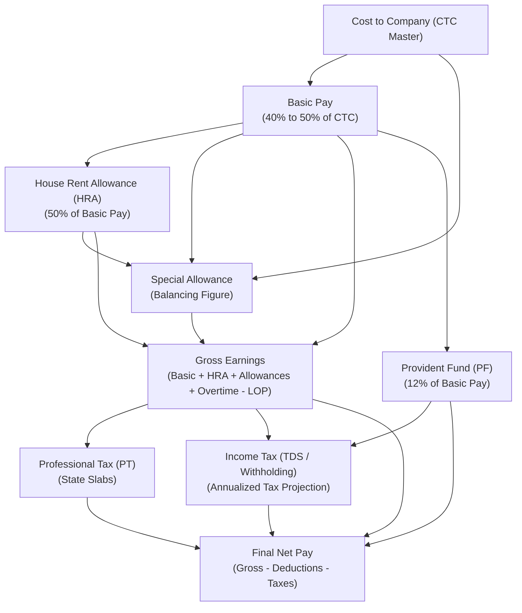
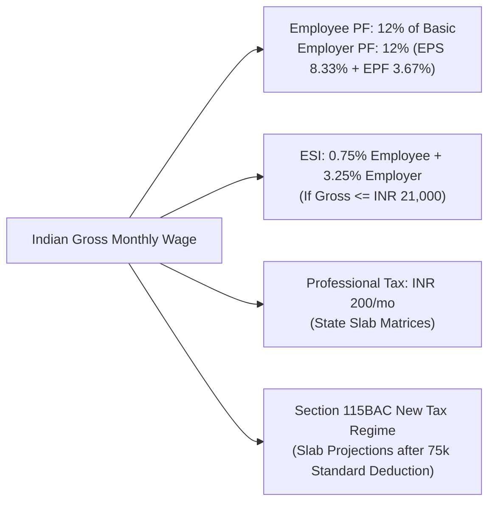

# HRMS Specification: Modular Payroll Engine, DAG Formulation & Statutory Tax Rules

**Document Target:** `research/final_modules/hrms/04_payroll_engine_and_statutory_rules.md`  
**Classification:** Core Financial Engine & Statutory Localization Specifications  

---

## 1. Directed Acyclic Graph (DAG) Component Evaluator

Traditional payroll engines hardcode tax brackets and deductions into monolithic procedures. Innostes implements a **Mathematical Directed Acyclic Graph (DAG)** of salary components, allowing arbitrary formulas and dependencies without circular calculation locks.

### Component Classification Matrix
Every salary component belongs to one of four mathematical tiers:
1. **`EARNING`**: Additions to gross pay (Basic, HRA, Dearness Allowance, Transport, Shift Allowance, Overtime, Performance Bonus).
2. **`DEDUCTION_PRE_TAX`**: Deductions that reduce taxable gross income prior to tax calculation (401k pre-tax contributions, Section 125 health plans, Employee Provident Fund under Section 80C).
3. **`STATUTORY_TAX`**: Mandatory state and federal government withholdings (TDS under Section 192, FICA Social Security, Medicare, State Professional Tax).
4. **`DEDUCTION_POST_TAX`**: Non-tax-exempt deductions recovered from net earnings (Salary advances, loan repayments, company property damage recoveries).

---

## 2. The Zero-Variance Net Pay Invariant

The fundamental mathematical theorem governing Innostes payroll execution:

$$\text{Gross Pay} \equiv \sum \text{Earnings} - \text{Loss of Pay (LOP) Deductions}$$

$$\text{Net Pay} \equiv \text{Gross Pay} - \sum \text{Pre-Tax Deductions} - \sum \text{Statutory Taxes} - \sum \text{Post-Tax Deductions}$$

### System Guardrails & Commit Boundaries
* **Strict Non-Negative Invariant**: $\text{Net Pay} \ge 0.00$. If unexcused absence (LOP) or post-tax advance recoveries exceed total gross earnings, the engine halts execution and alerts the payroll manager to adjust deduction caps.
* **Penny-Rounding Invariant**: All intermediate decimal computations maintain 4 decimal places (`NUMERIC(18, 4)`) and round to the base currency sub-unit (cents or paise) only at the final payslip line generation using Bankers' Rounding (Half to Even).

---

## 3. Statutory Localization Engines: India vs. United States

### 3.0 Startup-First Modular Statutory Toggles

In early-stage companies (1 to 20 employees), statutory compliance obligations differ radically from large corporations:
* **Indian EPF Exemption:** Under Section 1(3) of the *EPF & MP Act 1952*, Provident Fund registration is **not legally mandatory until an organization reaches 20 employees**.
* **Indian ESIC Exemption:** ESIC is not mandatory until 10 employees (and only covers workers earning gross wages $\le \text{INR } 21,000/\text{month}$, which knowledge-worker tech startups rarely employ).

**The Innostes Startup-First Principle:**
All statutory deduction modules are **strictly modular toggles, disabled by default until configured**:
* `enable_epf = FALSE` (Default)
* `enable_esic = FALSE` (Default)
* `enable_pt = FALSE` (Default)

A 5-person startup can run monthly payroll on Day 1 with zero administrative friction:
$$\text{Net Pay} = \text{Gross Base Salary} - \text{TDS Withholding (if taxable)}$$
The system never halts or blocks payroll with errors demanding unobtained EPFO establishment codes or ESIC registration numbers. When the company scales past 20 employees, the admin flips `enable_epf = TRUE`, and the mathematical 12% deduction activates automatically.

---

### 3.1 India (IN) Statutory Engine (When Enabled)

1. **Provident Fund (EPF & EPS)**:
   * **Employee Contribution**: 12% of (Basic + DA).
   * **Employer Matching Contribution**: 12% total:
     * 8.33% allocated to Employee Pension Scheme (EPS) (capped at statutory wage ceiling of INR 15,000/month $\implies$ max INR 1,250/month).
     * Remaining 3.67% allocated to EPF.
     * Employer also pays 0.5% EDLI (insurance) + 0.5% EPF administrative charges.
2. **Employee State Insurance (ESI)**:
   * Applicability: Mandatory if gross wages $\le \text{INR } 21,000/\text{month}$.
   * Employee Deduction: 0.75% of gross wages.
   * Employer Contribution: 3.25% of gross wages.
3. **Professional Tax (PT)**:
   * Evaluated based on the operating state of the employee work location (e.g., Karnataka: INR 200/month; Maharashtra: INR 200/month for 11 months, INR 300 in February, max INR 2,500/year).
4. **Income Tax (TDS Section 192)**:
   * Monthly TDS withholding is calculated by projecting annualized taxable income:
     $$\text{Monthly TDS} = \frac{\text{Projected Annual Tax} - \text{Cumulative TDS Deducted in Prior Months}}{\text{Remaining Months in Fiscal Year}}$$
   * Supports both Section 115BAC New Tax Regime (default with standard deduction of INR 75,000) and Old Tax Regime (evaluating declared Chapter VI-A investments under 80C, 80D, and HRA exemptions under Section 10(13A)).

---

### 3.2 United States (US) Statutory Engine

1. **Federal Income Tax Withholding (FITW)**:
   * Calculated using IRS Percentage Method tables based on employee Form W-4 declarations (filing status, multiple jobs checkbox, dependents credits, and extra withholding).
2. **FICA Taxes (Federal Insurance Contributions Act)**:
   * **Social Security (OASDI)**:
     * Employee deduction: 6.2% on wages up to the annual statutory wage base limit.
     * Employer matching: 6.2%.
   * **Medicare**:
     * Employee deduction: 1.45% on all earnings (no wage ceiling).
     * Employer matching: 1.45%.
     * **Additional Medicare Tax**: 0.9% deducted on employee wages exceeding $200,000 (single) or $250,000 (married filing jointly).
3. **State & Local Income Taxes (SIT / LIT)**:
   * Multi-jurisdictional tax withholding based on resident state vs. physical work location state nexus rules.
4. **Pre-Tax Benefit Deductions**:
   * Pre-tax health insurance premiums (IRC Section 125 Cafeteria Plan).
   * 401(k) traditional retirement contributions (up to statutory annual IRS limits) + employer match formula.
   * Health Savings Account (HSA) pre-tax contributions.

---

## 4. The 3-Step Monthly Payroll Execution Workflow

Executing monthly payroll is designed as a streamlined 3-step administrative cockpit:

### Step 1: Initialize Draft & Ingest Attendance
* Select payroll cycle period (e.g., `2026-11-01` to `2026-11-30`).
* System automatically queries the Attendance & Leave engines:
  * Pulls total unexcused absences and late penalty days to compute exact LOP deductions.
  * Pulls approved overtime hours categorized into standard and holiday tiers.
  * Pulls pending reimbursement claims approved in LedgerFlow.

### Step 2: Calculate Gross-to-Net (Batch Evaluator)
* Executes the DAG component engine across all active employees in parallel.
* Resolves tax brackets, statutory caps, and annualized tax projections.
* Displays a **Payroll Variance Dashboard** comparing the current run against the preceding month:
  * Flags employees with $> 15\%$ month-over-month salary variance for controller inspection.

### Step 3: Review, Commit & Dual Handoff
Upon administrative approval, committing the payroll run triggers two atomic handoffs:
1. **General Ledger Journal Creation (LedgerFlow)**:
   * Automatically generates and commits a balanced journal entry:
     * **Debit**: Salary Expense Accounts (partitioned by Department / Cost Center).
     * **Debit**: Employer Statutory Tax Expense (Employer PF, Employer FICA).
     * **Credit**: Net Salaries Payable Account.
     * **Credit**: Statutory Tax Withholding Liabilities (PF Payable, TDS Payable, FICA Payable).
2. **Bank Payout File Generation**:
   * Generates formatted bank payout batches ready for direct upload:
     * **US**: Formatted NACHA ACH batch file with standard PPD records.
     * **India**: Formatted NEFT / RTGS CSV templates for ICICI, HDFC, or Axis Corporate CMS portals.
3. **Employee Self-Service Distribution**:
   * Automatically renders and distributes encrypted, password-protected PDF payslips directly to employee portal drawers.
