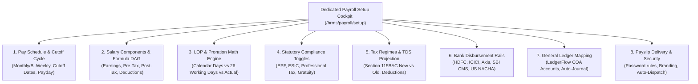
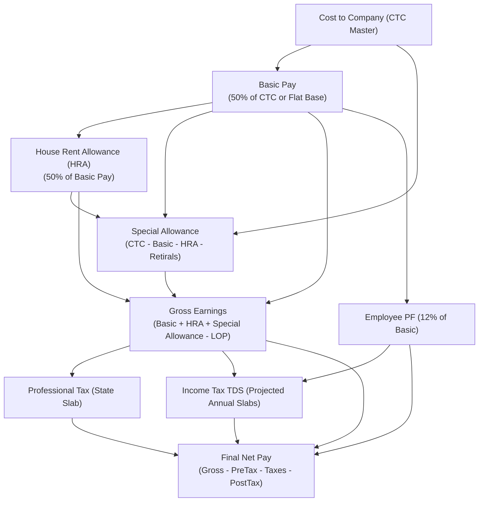
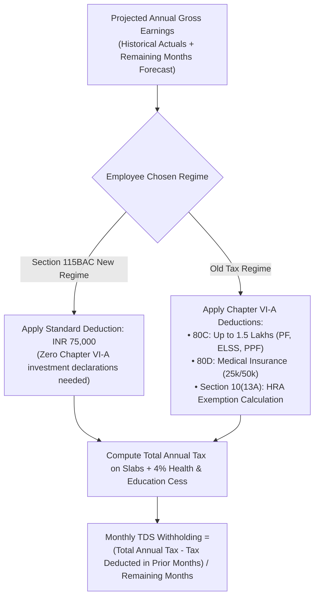
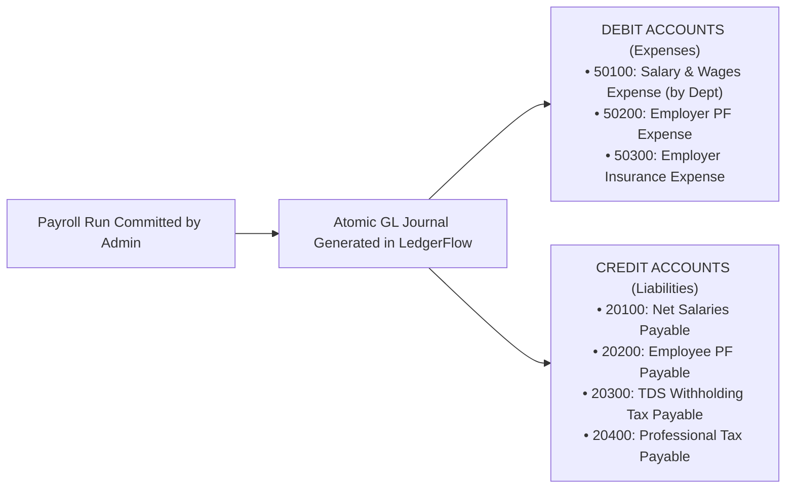

# HRMS Specification: Modular Payroll Engine, Statutory Rules & Comprehensive Payroll Setup

**Document Reference:** `research/final_modules/hrms/04_payroll_engine_and_statutory_rules.md`  
**Classification:** Core Financial Calculation Engine, Statutory Localization & Payroll Operations  
**Status:** Canonical Implementation Specification  

---

## 1. Architectural Philosophy: Startup Simplicity First, Enterprise Depth When Ready

Traditional enterprise payroll systems (SAP, Oracle, Workday) fail startups because they impose heavy statutory setup ceremonies before a company can run its first payroll. Conversely, simplistic payroll tools fail as companies scale because they lack multi-state tax slabs, customizable formula graphs, and double-entry General Ledger integrations.

Innostes Business OS resolves this duality with a **Modular, Two-Tier Payroll Architecture**:

1. **Day-1 Startup Mode (Zero-Ceremony Payroll)**:
   * A 5 to 20-person startup can disburse salaries on Day 1 using a single fixed monthly compensation:
     $$\text{Net Pay} = \text{Base Salary} - \text{TDS (if applicable)}$$
   * All statutory compliance modules (EPF, ESIC, Professional Tax) are **modular toggles, disabled by default until required by headcount thresholds**.
   * No forced establishment codes, no 25-line salary breakdowns, and no circular formula errors.
2. **Enterprise Scale Mode (Mathematical DAG Evaluator)**:
   * As organizations grow past statutory thresholds (e.g. 20 employees in India triggering mandatory EPF), administrators enable statutory modules with 1 click.
   * Full Directed Acyclic Graph (DAG) component evaluator, multi-regime income tax projections (Section 115BAC), LOP deduction math, corporate bank disbursement batches (NEFT/RTGS/ACH), and atomic General Ledger journal postings.

---

## 2. Dedicated Payroll Setup Page Architecture (`/hrms/payroll/setup`)

Innostes strictly isolates operational time-tracking from financial payroll configuration. The dedicated **Payroll Setup Cockpit** (`/hrms/payroll/setup`) organizes all organization-wide compensation rules into 8 modular configuration tabs:



---

### Tab 1: Pay Schedule & Cutoff Cycle Configuration
Defines when and how frequently employees are paid, and the exact cutoffs for attendance and expense ingestion:

| Setting Key | Startup Default | Enterprise Options | Purpose & Impact |
| :--- | :--- | :--- | :--- |
| `pay_frequency` | `MONTHLY` | `MONTHLY`, `BI_WEEKLY`, `SEMI_MONTHLY`, `WEEKLY` | Monthly standard for India/EU; Bi-Weekly standard for US/North America. |
| `cycle_start_day` | `1` (1st of month) | `1`, `21`, `26` (Custom cutoff day) | Standard cycle (1st to 30th/31st) vs Mid-Month cutoff (e.g. 26th to 25th) to give payroll teams 5 days to audit before month-end payday. |
| `payout_day` | `LAST_DAY_OF_MONTH`| `LAST_DAY_OF_MONTH`, `1ST_OF_NEXT_MONTH`, `5TH`, `7TH` | Day on which funds are disbursed to employee bank accounts. |
| `attendance_cutoff_day` | Same as cycle end | `3` days before payday | Cutoff date after which unapproved attendance regularizations roll into the subsequent payroll cycle. |

---

### Tab 2: Salary Components & Formula DAG Evaluator
Components are organized into a strict mathematical hierarchy. Administrators can create unlimited custom components or use pre-configured templates:

#### 1. The 4 Component Tiers
1. **`EARNING`**: Additions to gross pay (Basic, HRA, Special Allowance, Transport, Shift Allowance, Overtime, Performance Bonus).
2. **`DEDUCTION_PRE_TAX`**: Deductions that reduce taxable gross income prior to tax calculations (Employee Provident Fund under Sec 80C, 401(k) pre-tax, Section 125 health plans).
3. **`STATUTORY_TAX`**: Mandatory government withholdings (TDS under Section 192, State Professional Tax, FICA Social Security & Medicare).
4. **`DEDUCTION_POST_TAX`**: Non-tax-exempt deductions recovered from net earnings (Salary advances, loan repayments, equipment damage recoveries).

#### 2. Directed Acyclic Graph (DAG) Formula Resolution
To eliminate circular calculation errors, components are evaluated in topological order:



#### 3. Standard Salary Structure Presets for Startups:
* **Preset A: Startup Flat Base (Zero Hassle)**:
  * 100% of agreed compensation is `Base Salary`. Zero complex allowances.
* **Preset B: Standard Indian CTC Breakdown (Tax Optimized)**:
  * `Basic Pay` = 50% of CTC
  * `HRA` = 50% of Basic Pay (Metro) or 40% (Non-Metro)
  * `Special Allowance` = Residual balancing figure
  * `Employer PF` = 12% of Basic (deducted from CTC if CTC model is used)

---

### Tab 3: Loss of Pay (LOP) & Proration Mathematical Engine
When an employee takes unpaid leave, has unregularized missing punches, or joins mid-month, how is a single day's salary deducted?

Administrators configure the exact calculation denominator:

$$\text{Per Day Salary Rate} = \frac{\text{Monthly Base Salary}}{\mathbf{\text{Divisor Determined by Selected LOP Method}}}$$

| LOP Calculation Method | Formula Divisor | Example (INR 120,000 Base in 31-Day Month) | Ideal For |
| :--- | :--- | :--- | :--- |
| **Method A: Calendar Days in Month** (Default) | $\text{Actual Days in Target Month}$ (28, 29, 30, or 31) | $\text{Daily Rate} = \frac{120,000}{31} = \mathbf{\text{INR } 3,870.97}$ | Tech startups, remote teams, modern software companies. |
| **Method B: Fixed 26 Working Days** | Fixed at $26.0$ every month (assuming 4 Sundays off) | $\text{Daily Rate} = \frac{120,000}{26} = \mathbf{\text{INR } 4,615.38}$ | Manufacturing, factories, companies under Industrial Standing Orders. |
| **Method C: Actual Scheduled Work Days** | $\text{Total Calendar Days} - (\text{Weekly Offs} + \text{Gazetted Holidays})$ | If 21 working days in month: $\text{Daily Rate} = \frac{120,000}{21} = \mathbf{\text{INR } 5,714.28}$ | Output-driven professional services, hourly billing agencies. |

#### Mid-Month Joiner & Leaver Proration Formulation
When an employee starts on November 15th:
$$\text{Payable Days} = \text{Total Active Days from Join Date to Cycle End}$$
$$\text{Prorated Earnings} = \text{Monthly Base Salary} \times \left( \frac{\text{Payable Days}}{\text{Divisor Determined by LOP Method}} \right)$$

---

### Tab 4: Modular Statutory Compliance Toggles (India & Global)

Statutory deductions are strictly modular. Startups toggle ON compliance features only when they reach the statutory employee count thresholds:

```
STATUTORY COMPLIANCE TOGGLES (SETTINGS > PAYROLL > STATUTORY)
[ ] Enable Employee Provident Fund (EPF & EPS)
    (Mandatory in India once company reaches 20 employees. Toggle OFF for early startups.)

[ ] Enable Employee State Insurance (ESIC)
    (Applicable only if gross wages <= INR 21,000/month. Toggle OFF for tech knowledge workers.)

[ ] Enable State Professional Tax (PT)
    (Auto-deducts state-specific monthly slab rates e.g. Karnataka INR 200, Maharashtra INR 200/300.)

[ ] Enable Labour Welfare Fund (LWF)
    (Annual/Bi-annual state welfare deduction e.g. Maharashtra, Karnataka.)

[ ] Enable Statutory Gratuity Provisioning
    (Accrues 15/26 of monthly basic per year of tenure on company balance sheet.)
```

#### Detailed Statutory Rules When Enabled:

1. **Provident Fund (EPF & EPS - India)**:
   * **Employee Contribution**: 12% of (Basic + DA).
   * **Employer Contribution**: 12% total:
     * 8.33% allocated to Employee Pension Scheme (EPS) — **Cap Option**: Admin toggles whether EPS is capped at statutory ceiling of INR 15,000 ($\implies \text{max INR 1,250/month}$) or contributed on actual full basic pay.
     * Remaining 3.67% allocated to EPF.
     * Employer also pays 0.5% EDLI (insurance) + 0.5% EPF administrative charges.
2. **Employee State Insurance (ESIC - India)**:
   * **Applicability Threshold**: Gross monthly earnings $\le \text{INR } 21,000$.
   * Employee Deduction: 0.75% of gross wages.
   * Employer Contribution: 3.25% of gross wages.
3. **State Professional Tax (PT - India)**:
   * Computed based on employee's office location state:
     * **Karnataka**: INR 200/month if gross salary $> \text{INR } 25,000$; zero if $\le \text{INR } 25,000$.
     * **Maharashtra**: INR 200/month (INR 300 in February) if gross $> \text{INR } 10,000$ (Men) or $> \text{INR } 25,000$ (Women).
     * **Telangana / Andhra Pradesh**: INR 200/month if gross $> \text{INR } 20,000$.
4. **United States Statutory Engine (When Configured for US)**:
   * **FICA Social Security**: 6.2% Employee + 6.2% Employer (capped at annual statutory wage base).
   * **FICA Medicare**: 1.45% Employee + 1.45% Employer (no wage cap; +0.9% Additional Medicare on earnings $> \$200,000$).
   * **Federal Income Tax Withholding (FITW)**: Computed based on employee Form W-4 declarations.
   * **State & Local Income Tax (SIT/LIT)**: Computed per employee work state nexus.

---

### Tab 5: Income Tax Regimes & TDS Projection Engine

Innostes implements an automated, annualized tax projection engine for Indian Income Tax under Section 192:



#### Tax Declaration Submission & Verification Workflow:
1. **Declaration Window (April / Onboarding)**: Employees submit proposed investment declarations in ESS.
2. **Monthly Projections**: Payroll engine calculates monthly TDS based on active declarations.
3. **Proof Verification Window (January – February)**: Employees upload actual investment receipts (ELSS statements, rent receipts, medical insurance policies). HR reviews in a dedicated verification cockpit. If proofs are missing, remaining tax is recalculated across the final two payroll cycles (February and March) to prevent statutory tax shortfalls.

---

### Tab 6: Bank Disbursement Rails & Export Templates

When payroll is finalized, Innostes generates corporate bank upload files formatted for direct corporate net banking batch processing:

| Corporate Banking Rail | File Format | Encryption / Format Specifications | Supported Banks |
| :--- | :--- | :--- | :--- |
| **India CMS Template** | `.csv` / `.txt` | Pre-formatted columns: Beneficiary Account, IFSC, Beneficiary Name, Amount, Debit Account, Transaction Narration (`SALARY_NOV_2026`). | HDFC Corporate NetBanking, ICICI CIB, Axis Corporate, SBI CMS. |
| **US NACHA File** | `.ach` / `.txt` | Standard 94-character fixed-width NACHA record layout (File Header Record 1, Batch Header 5, Entry Detail 6 with PPD format, File Control 9). | All US Federal Reserve ACH member banks. |
| **Instant API Payout** (Optional Integration) | Direct REST Webhook | Real-time direct disbursement via banking partner APIs (RazorpayX, Cashfree, Stripe Treasury). | Real-time instant disbursement. |

---

### Tab 7: General Ledger Mapping (LedgerFlow Double-Entry Integration)

Payroll is not an isolated silo; every payroll run posts an atomic, balanced double-entry journal entry to the corporate Chart of Accounts in **LedgerFlow**:



* **Zero-Discrepancy Guarantee**: The journal entry cannot post if $\sum \text{Debits} \ne \sum \text{Credits}$.
* **Departmental Cost Partitioning**: Salary expense accounts are automatically partitioned by Department / Cost Center (`ENG`, `SALES`, `MARKETING`), giving founders instant visibility into departmental burn rates without manual spreadsheet tagging.

---

### Tab 8: Payslip Delivery, Customization & Security

Administrators configure the visual layout and security encryption of employee payslips:

* **Security Guard (AES Encrypted PDFs)**:
  * Each generated payslip PDF is encrypted with an employee-specific password formula:
    * Standard: First 4 characters of employee legal name in CAPS + Date & Month of Birth (e.g. `JANE` born 15 Aug $\implies$ `JANE1508`).
* **Visual Branding**:
  * Corporate logo, registered legal entity name, corporate identification number (CIN / Tax ID), and physical office address.
* **Automated Payday Dispatch**:
  * Master toggle: `auto_dispatch_payslip_emails = TRUE`.
  * The moment the administrator commits payroll, payslips are published to the employee's portal drawer and sent via email.

---

## 3. The 3-Step Monthly Payroll Execution Cockpit (`/hrms/payroll`)

Executing monthly payroll is designed as a fail-safe, guided 3-step sequential stepper:

```
+-----------------------------------------------------------------------------------------------------------------------+
| PAYROLL COCKPIT: NOVEMBER 2026 CYCLE                                                   [ Status: DRAFT / CALCULATING ]|
+-----------------------------------------------------------------------------------------------------------------------+
| [ STEP 1: ATTENDANCE & LOP ] ────> [ STEP 2: CALCULATE & AUDIT ] ────> [ STEP 3: COMMIT, BANK & POST ]                |
+-----------------------------------------------------------------------------------------------------------------------+
```

### Step 1: Attendance & LOP Freeze
* System automatically inspects Time & Attendance and Leave records for the cycle:
  * Pulls total unapproved absences and LOP days.
  * Pulls approved overtime hours and holiday work sessions.
  * Warns administrator if any employee has unregularized missing punches before locking the cycle.

### Step 2: Calculate Gross-to-Net (Batch Evaluator)
* Evaluates the DAG formula across all employee contracts in parallel.
* Resolves annualized TDS withholding and statutory deductions.
* **Variance Dashboard**: Flags any employee whose net pay varies by $> 15\%$ compared to the previous month (e.g. unexpected unpaid leaves or bonus additions) for controller sign-off.

### Step 3: Review, Commit & Dual Handoff
1. Admin clicks **`[ Commit Payroll Run ]`**:
   * Permanently seals the month against further adjustments.
2. System triggers **Dual Handoff**:
   * **`[ Download Bank Transfer CSV ]`**: Formatted NEFT/RTGS/ACH file ready for 1-click corporate banking upload.
   * **`[ Post Balanced Journal to LedgerFlow ]`**: Creates balanced financial journal entry.
   * **`[ Distribute Payslips ]`**: Publishes encrypted PDF payslips to employee ESS portals.

---

## 4. Employee Self-Service (ESS): Tax Declarations & Payslip Vault

Employees have complete visibility over their compensation in the **My Compensation** portal:
1. **Interactive Pay Breakdown**: Visual donut chart showing Gross Pay, Pre-Tax Deductions, Taxes, and Net Take-Home.
2. **Tax Planner**: Side-by-side comparison of estimated tax liability under **New Tax Regime (Section 115BAC)** vs. **Old Tax Regime**, helping the employee select the optimal regime.
3. **Downloadable Payslips**: 1-click download of signed, password-protected PDF payslips for any historical month.
