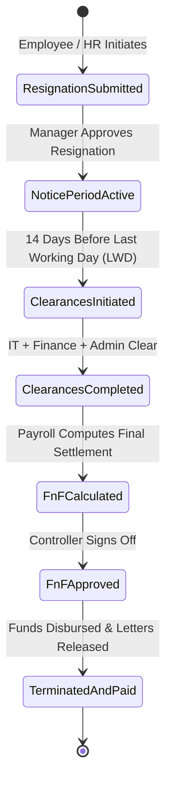
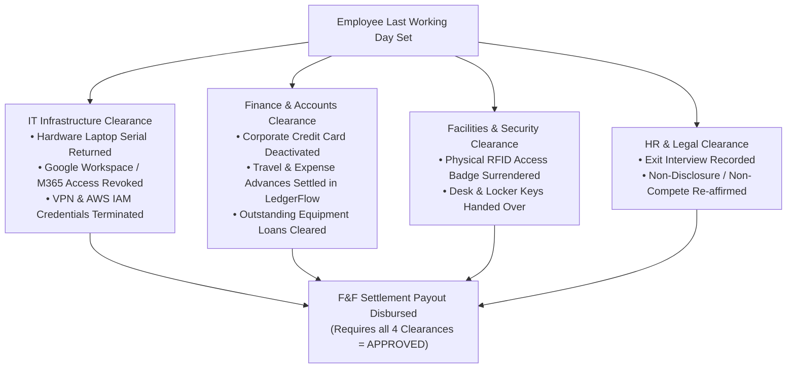

# HRMS Specification: Separation, Offboarding & Full and Final (F&F) Settlement

**Document Target:** `research/final_modules/hrms/05_offboarding_and_final_settlement.md`  
**Classification:** Lifecycle State Machine & Statutory Settlement Specifications  

---

## 1. Employee Separation Lifecycle

Employee separation must follow an auditable, multi-stakeholder protocol to settle financial obligations, recover physical assets, revoke digital access, and issue statutory documentation.

---

## 2. Full and Final (F&F) Settlement Mathematical Formulation

The final financial payout replaces the standard monthly payslip with a comprehensive settlement sheet:

$$\text{Net F&F Payable} \equiv \sum \text{Settlement Earnings} - \sum \text{Settlement Recoveries} - \sum \text{Statutory Withholdings}$$

### 2.1 Settlement Earnings Breakdown ($+$)
1. **Prorated Salary to Last Working Day (LWD)**:
   $$\text{Prorated Salary} = \frac{\text{Monthly Base Salary}}{\text{Calendar Days in Month}} \times \text{Days Worked up to LWD} - \text{Unexcused LOP}$$
2. **Leave Encashment**:
   Accumulated unused earned leave balance multiplied by the basic daily rate:
   $$\text{Leave Encashment Payout} = \text{Remaining PTO Days} \times \left( \frac{\text{Monthly Basic Salary}}{26 \text{ or } 30} \right)$$
3. **Statutory Gratuity (India / Middle East)**:
   Mandatory severance for employees with completed tenure of $\ge 5$ continuous years.
4. **Notice Period Pay (Employer Termination)**:
   If the employer waives the notice period or terminates with immediate effect, unserved notice days are paid out in full.
5. **Pending Variable Pay & Bonuses**:
   Pro-rated annual performance bonuses or unpaid commissions approved in SalesFlow.

### 2.2 Settlement Recoveries Breakdown ($-$)
1. **Notice Period Buyout (Employee Early Exit)**:
   If an employee departs prior to serving their contractual notice period (e.g., 30 or 60 days):
   $$\text{Notice Shortfall Recovery} = (\text{Contractual Notice Days} - \text{Actual Served Days}) \times \left( \frac{\text{Monthly Gross Salary}}{30} \right)$$
2. **Salary Advances & Unsettled Travel Expenses**:
   Recoveries of open corporate balances from LedgerFlow.
3. **Asset Damage or Unreturned Hardware Deductions**:
   Replacement value deducted if company equipment is lost or destroyed.

---

## 3. Statutory Gratuity Formulation (Payment of Gratuity Act)

For employees operating under statutory gratuity jurisdictions (such as India):
* **Eligibility Rule**: Minimum 5 continuous years of active service ($1,825 \text{ days}$).
* **Service Tenure Rounding Rule**: If service in the final year exceeds 6 months ($> 180 \text{ days}$), it is rounded up to the next full year. (e.g., 5 years and 7 months is computed as 6 years).

### Mathematical Gratuity Formula
$$\text{Gratuity Payout} = \frac{15 \times \text{Last Drawn Basic Salary} \times \text{Completed Years of Service}}{26}$$

*Where $26$ represents the standard statutory monthly working day divisor.*
*Tax Exemption*: Gratuity is tax-exempt up to the government statutory ceiling (currently INR 20 Lakhs in India under Section 10(10)).

---

## 4. Exit Clearances: 60-Second Startup Clearance vs. Enterprise Multi-Department DAG

### 4.1 Startup-First Default: 1-Click Admin Quick Clearance
In a startup, the founder or operations lead handles offboarding directly:
* **The Interface:** A single consolidated modal checklist:
  * `[✓] Company laptop & hardware returned`
  * `[✓] Corporate email & SaaS accounts revoked`
  * `[✓] Corporate cards & expense claims settled`
* **Single Action:** The founder clicks **`[ ✓ Complete All Clearances & Proceed to F&F ]`**. 
* The entire clearance process finishes in **30 seconds** with zero bureaucratic delays or blocked workflows.

### 4.2 Enterprise Multi-Department Clearance DAG (Optional Mode)
In enterprises with dedicated functional departments, toggling `enable_departmental_clearances = TRUE` activates independent departmental sign-offs:

---

## 5. Automated Experience & Relieving Document Generation

Once the F&F payout is committed:
1. **Relieving Letter**: Cryptographically signed PDF stating official designation, start date, and Last Working Day, confirming no outstanding employer claims.
2. **Experience & Service Certificate**: Formal certificate detailing accomplishments and department history.
3. **Tax Statement (Form 16 / W-2)**: Provisional certificate detailing total earnings and statutory taxes deducted during the active fiscal tenure.
