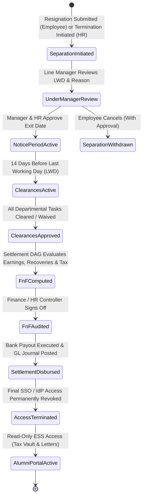
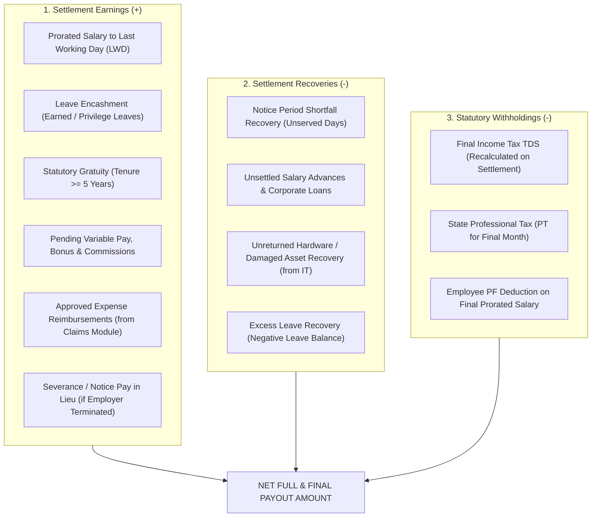
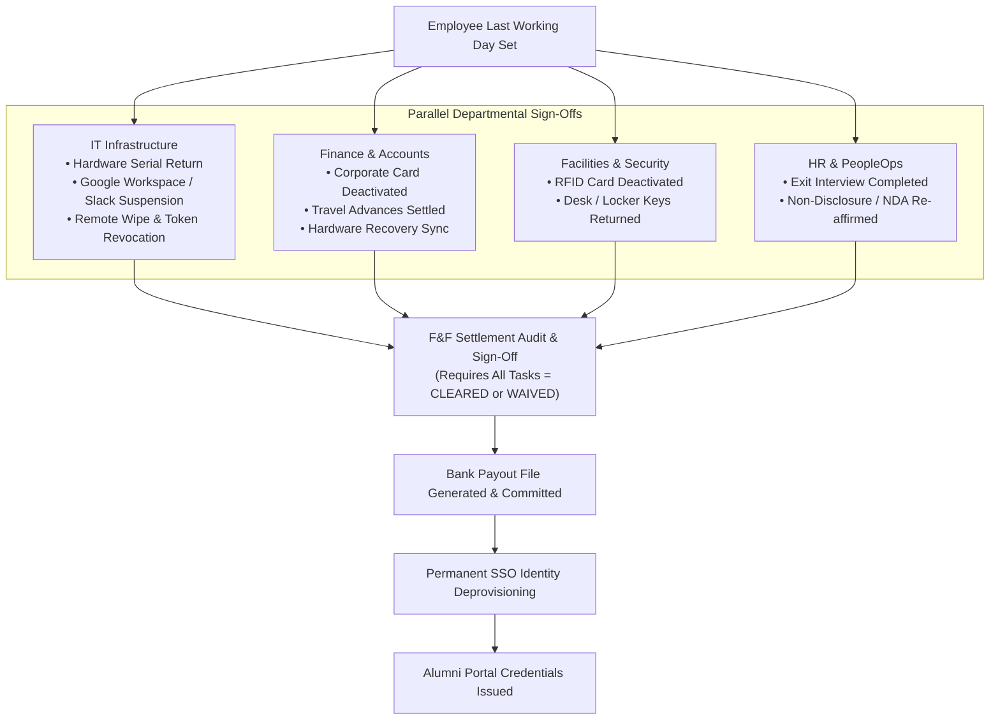
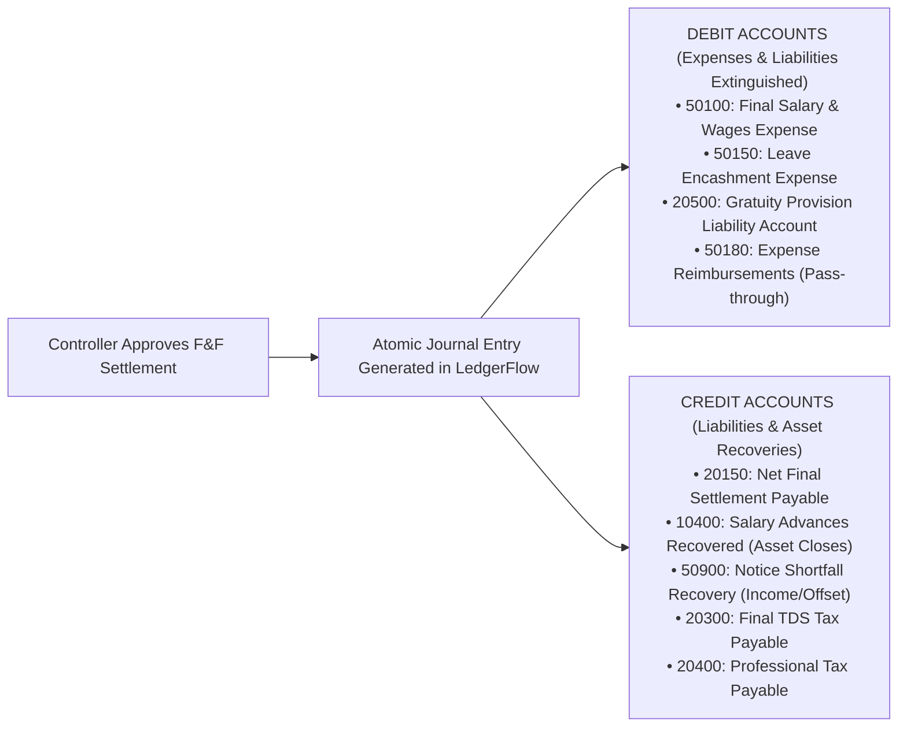

# HRMS Specification: Separation, Offboarding & Full and Final (F&F) Settlement

**Document Reference:** `research/final_modules/hrms/05_offboarding_and_final_settlement.md`  
**Classification:** Lifecycle State Machine, Statutory Severance & Full and Final (F&F) Settlement Engine  
**Status:** Canonical Implementation Specification  

---

## 1. Architectural Philosophy: Startup 60-Second Offboarding vs. Enterprise Clearance DAG

Employee offboarding is among the highest-risk operational workflows in an organization. Errors lead to data theft (unrevoked SaaS credentials), financial leakage (unsettled salary advances, unrecovered laptops), and labor compliance litigation (delayed gratuity, illegal notice deductions).

Innostes Business OS resolves this with a **Two-Tier Separation Architecture**:

1. **Day-1 Startup Mode (60-Second Quick Clearance)**:
   * A 10-person startup has no IT department, facilities desk, or legal committee.
   * The founder or operations lead executes offboarding through a single modal checklist:
     * `[✓] Company laptop & accessories returned`
     * `[✓] Google Workspace, GitHub & Slack access suspended`
     * `[✓] Company cards & expense claims settled`
   * The system computes pro-rata salary and leave encashment in 1 click, exports the bank payout file, and generates the Relieving Letter PDF instantly.
2. **Enterprise Scale Mode (Multi-Department Clearance DAG & Statutory Engine)**:
   * Parallel departmental sign-offs (IT, Finance, Facilities, Legal, HR).
   * Direct financial sync: If IT records an unreturned monitor, the replacement cost automatically injects into the F&F deduction ledger.
   * Multi-tenure statutory gratuity math, notice period buyout calculations, Chapter VI-A final tax recalculation, double-entry General Ledger integration in LedgerFlow, and automated Class 3 DSC digitally signed exit letters.

---

## 2. Separation Lifecycle State Machine & Exit Types

Every employee departure follows a strictly audited, event-driven finite state machine:



### The 4 Statutory Exit Types
1. **`VOLUNTARY_RESIGNATION`**: Employee resigns with contractual notice. Requires manager acceptance of Last Working Day (LWD) and early release negotiation if requested.
2. **`INVOLUNTARY_TERMINATION_WITHOUT_CAUSE`** (Layoff / Redundancy): Requires employer severance pay, payment in lieu of unserved notice, and immediate clearance.
3. **`INVOLUNTARY_TERMINATION_WITH_CAUSE`** (Gross Misconduct): Forfeits notice pay and may forfeit gratuity under Section 4(6) of the Payment of Gratuity Act for willful damage or disorderly conduct.
4. **`RETIREMENT_SUPERANNUATION`**: Standard tenure completion with full gratuity and provident fund settlement.

---

## 3. Notice Period Dynamics, Shortfall Recovery & Early Release

Contractual notice periods vary by company policy and seniority grade (e.g. 30 days for engineering, 90 days for executive leadership).

```mermaid
flowchart LR
    Resign["Resignation Submitted<br/>(Contractual Notice: 60 Days)"] --> LWDChoice{"Requested LWD vs Contractual"}
    
    LWDChoice -->|Full Notice Served| Normal["Zero Shortfall Deduction<br/>Full Salary Paid to LWD"]
    
    LWDChoice -->|Early Release Requested<br/>(e.g. 20 Days Shortfall)| LeadDecision{"Manager / HR Action"}
    
    LeadDecision -->|Waived by Company| Waived["Notice Shortfall Waived<br/>(No financial deduction on employee)"]
    LeadDecision -->|Recovery Mandated| Recover["Recover 20 Days Salary in F&F<br/>(Deducted from Settlement Sheet)"]
    LeadDecision -->|Buyout by New Employer| Buyout["Company Issues Commercial Invoice<br/>to New Employer for Notice Buyout"]
```

### Notice Shortfall Recovery Math
When an employee departs prior to serving their contractual notice period and the shortfall is not waived:

$$\text{Notice Shortfall Days} = \text{Contractual Notice Days} - \text{Actual Served Working Days}$$

Administrators configure the shortfall deduction basis in **Payroll Settings**:
* **Option A: Basic Salary Divisor (30 Days)**:
  $$\text{Shortfall Recovery} = \text{Notice Shortfall Days} \times \left( \frac{\text{Monthly Basic Salary}}{30} \right)$$
* **Option B: Gross Salary Divisor (30 Days)** (Standard Corporate):
  $$\text{Shortfall Recovery} = \text{Notice Shortfall Days} \times \left( \frac{\text{Monthly Gross Salary}}{30} \right)$$

---

## 4. Full and Final (F&F) Settlement Mathematical Formulation

The F&F Settlement Sheet replaces standard monthly payroll with an exhaustive reconciliation of all lifetime assets, liabilities, and statutory dues:

$$\text{Net F&F Payable} \equiv \sum \text{Settlement Earnings} - \sum \text{Settlement Recoveries} - \sum \text{Statutory Withholdings}$$



---

### 4.1 Detailed Settlement Earnings Formulations ($+$)

1. **Prorated Salary up to Last Working Day (LWD)**:
   $$\text{Prorated Salary} = \text{Monthly Base} \times \left( \frac{\text{Active Calendar Days in Exit Month up to LWD} - \text{LOP Absences}}{\text{Calendar Days in Exit Month}} \right)$$
2. **Leave Encashment Formulation**:
   Liquidates all accumulated, encashable leave balances (specifically Earned / Privilege Leave) recorded in `hrms_leave_ledger`:
   $$\text{Leave Encashment Payout} = \text{Encashable PTO Days} \times \left( \frac{\text{Monthly Basic Salary}}{26 \text{ (or } 30 \text{ per company policy)}} \right)$$
   * *Tax Exemption Rule*: Under Indian Section 10(10AA), leave encashment on retirement/separation is tax-exempt up to **INR 25 Lakhs** for non-government employees (Finance Act 2023 limit).
3. **Pending Expense Reimbursements**:
   Automatically ingests all verified, approved expense claims from Module 11 (`status = 'APPROVED_FOR_PAYROLL'`) with zero manual spreadsheet reconciliation.
4. **Notice Pay in Lieu (Severance)**:
   If the company terminates employment without requiring the employee to serve their notice period, the unserved notice duration is credited as a fully taxable earning.

---

### 4.2 Detailed Settlement Recoveries Formulations ($-$)

1. **Notice Shortfall Deduction**: Deducted as computed in Section 3.
2. **Outstanding Salary Advances & Equipment Loans**:
   Pulls live outstanding loan balances from `LedgerFlow` corporate sub-ledger accounts.
3. **IT Asset Damage / Lost Hardware Deduction**:
   If the employee fails to return company hardware (e.g. unreturned charger, broken laptop screen), the IT clearance reviewer enters the replacement charge (`INR 15,000.00`), which automatically syncs into the recovery column.
4. **Negative Leave Balance Recovery**:
   If the employee borrowed leave in advance and exits with a negative ledger balance (e.g. `-2.5` days), the overdraft is deducted at their daily gross rate.

---

### 4.3 Statutory Gratuity Formulation (Payment of Gratuity Act, 1972)

Gratuity is a statutory terminal benefit in India, UAE, and multiple global jurisdictions.

#### Statutory Eligibility Criteria:
* **Service Tenure**: Minimum **5 continuous years of service** ($1,825 \text{ days}$).
  * *Exceptions*: The 5-year requirement is waived in cases of death, permanent disablement, or specific contractual covenants.
* **Service Rounding Rule**: If service in the final year exceeds **6 months** ($> 180 \text{ days}$), it is rounded up to the next full year. (e.g. 5 years and 7 months is rounded to **6 years**; 5 years and 3 months is rounded to **5 years**).

#### Mathematical Formula:
$$\text{Gratuity Payout} = \frac{15 \times \text{Last Drawn Basic Salary} \times \text{Completed Years of Service}}{26}$$

*Where $26$ represents the statutory monthly working days divisor (excluding 4 Sundays).*

#### Statutory Gratuity Calculation Matrix:

| Completed Tenure | Last Basic Salary | Calculation Expression | Gross Gratuity Amount | Taxability u/s 10(10) |
| :--- | :--- | :--- | :--- | :--- |
| **4 Years, 2 Months** | INR 60,000.00 | Ineligible ($< 5 \text{ years}$) | **INR 0.00** | N/A |
| **5 Years, 7 Months** | INR 60,000.00 | $\frac{15 \times 60,000 \times 6}{26}$ | **INR 2,07,692.31** | Fully Tax-Exempt ($\le 20\text{L}$) |
| **10 Years, 4 Months**| INR 1,20,000.00 | $\frac{15 \times 1,20,000 \times 10}{26}$ | **INR 6,92,307.69** | Fully Tax-Exempt ($\le 20\text{L}$) |

* **Statutory Tax Ceiling**: Gratuity received by private-sector employees is exempt from income tax up to **INR 20,00,000 (20 Lakhs)** under Section 10(10). Any excess is taxed at normal slab rates.

---

## 5. Multi-Department Clearance DAG & Asset Handover Engine

Clearances are tracked through an automated, dependency-aware Directed Acyclic Graph (DAG):



### Departmental Clearance Task Catalog:
1. **IT Infrastructure**:
   * Hardware laptop serial inspection (MacBook Pro serial match).
   * Accessory verification (power adapter, monitor cables).
   * Automated Identity Provider (IdP) deprovisioning webhook (Google Workspace, Slack, GitHub, VPN).
   * *Damage Recovery Input*: If charger is lost, IT enters INR 4,000 recovery amount, which automatically injects into the F&F sheet.
2. **Finance & Accounts**:
   * Corporate credit card cancellation and credit limit freeze.
   * Outstanding expense claims audit (Module 11 integration).
   * Employee stock option plan (ESOP) status review (vested vs unvested options).
3. **Facilities & Physical Security**:
   * RFID access badge surrendered and access disabled in turnstiles.
   * Parking sticker and locker key handover.
4. **HR & Legal**:
   * Confidential Exit Interview feedback recorded.
   * Non-Disclosure Agreement (NDA) and Intellectual Property Assignment covenants reaffirmed.

---

## 6. General Ledger Mapping & Double-Entry Settlement Journal

An F&F settlement is not an isolated transaction; upon approval, it automatically commits a balanced, multi-legged journal entry directly into **LedgerFlow**:



* **Integrity Invariant**: $\sum \text{Debits} \equiv \sum \text{Credits}$ enforced at database commit level.
* **Gratuity Liability Clearing**: Gratuity payout clears against the balance sheet provision account (`20500 - Gratuity Provision Payable`), rather than inflating operating expenses in the separation month.

---

## 7. Automated Exit Document Release & Post-Employment Alumni Vault

Once the settlement payout is committed:

### 1. Cryptographically Signed Exit Documents
The system natively renders four official PDFs using headless vector generation, signed via the corporate Class 3 Digital Signature Certificate (DSC):
1. **Relieving Letter**: Formally states employee legal name, employee code, designation, joining date, and confirmed Last Working Day, certifying that the employee has been relieved of all contractual responsibilities with no outstanding liabilities.
2. **Experience & Service Certificate**: Certifies tenure, role history, major achievements, and conduct.
3. **Full & Final Settlement Statement**: Comprehensive itemized statement detailing all earnings, deductions, tax withholdings, and net bank payout.
4. **Provisional Form 16 / Tax Statement**: Summarizes gross earnings and TDS deducted during the final fiscal year to date, allowing the employee's new employer to calculate subsequent tax withholdings without interruption.

### 2. Post-Employment Alumni ESS Access
* The moment corporate SSO credentials (e.g. Google Workspace) are revoked, the employee's internal corporate access ceases.
* **The Alumni Vault Transition**:
  * The system automatically transitions the employee's account to an **Alumni Persona**, authenticated via their verified **personal email** (e.g. `sarah.chen@gmail.com`).
  * Alumni retain permanent read-only access for **7 years** (CBDT / statutory audit requirement) to download:
    * Historical monthly payslips
    * Signed Relieving Letters & Service Certificates
    * Annual Form 16 certificates
