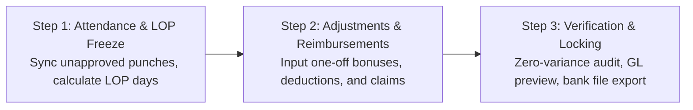

# Innostes Business OS: HRMS (PeopleOps) UI/UX Specifications & Zoho People Benchmark

**Document Reference:** `research/final_modules/hrms/07_ui_ux_specifications_and_zoho_benchmark.md`  
**Target Module:** `PeopleOps` (`apps/web/app/(dashboard)/hrms` and `@innostes/ui`)  
**Design Standard:** Enterprise Ergonomics, Sub-100ms Interactions, Dual-Theme WCAG AAA Compliant  
**Status:** Approved Engineering Blueprint  

---

## 1. Executive Summary & Design Philosophy

Workforce management software fails when daily user interactions introduce friction. In traditional enterprise platforms, routine actions such as recording daily attendance or requesting time off require navigating multi-level hierarchies, submitting verbose tabular forms, and enduring multi-second page reloads.

The Innostes PeopleOps design system adopts the employee-centric ergonomics pioneered by Zoho People and modern consumer tools, paired with enterprise rigor:

1. **Zero-Click Morning Orientation:** The home screen immediately resolves the three questions an employee has upon waking or logging in:
   * *Am I clocked in, and what is my active session duration?*
   * *What are my remaining leave balances?*
   * *Who among my direct teammates is absent, remote, or traveling today?*
2. **Sub-100ms Action Latency:** Check-in, check-out, and approval mutations use optimistic UI updates. State changes reflect instantaneously with background synchronization to the `/api/v1/hrms` endpoints.
3. **Decoupled Headless Consumption:** Every interactive component in `@innostes/ui` connects strictly via typed React Query hooks to standardized OpenAPI 3.1 endpoints. The frontend can be swapped or embedded in custom mobile wrappers without altering core backend mechanics.
4. **Contextual Role Adaptation:** The dashboard dynamically renders specialized widgets based on the user's role: individual contributor, line manager, or HR/payroll administrator.

---

## 2. Benchmark Analysis: Legacy Enterprise Systems vs. Innostes PeopleOps

| Interaction Dimension | Traditional Complex ERP | Zoho People Benchmark | Innostes PeopleOps Architecture |
| :--- | :--- | :--- | :--- |
| **Clock-In / Clock-Out** | Buried under Navigation > HR > Attendance > Timesheets > New Record > Save. | Visible on dashboard top header with punch button and running timer. | Prominent dashboard widget with live high-precision timer, work-mode toggle (`Office`, `Home`, `Client Site`), and IP validation badge. |
| **Leave Balance Visibility** | Requires running a balance report or opening a separate tab. | Visual pill badges displaying current balance per leave type. | Real-time balance badges with accrual forecast; clicking any pill opens a pre-filled 2-step application modal. |
| **Manager Approvals** | Buried in an administrative inbox alongside system alerts and notifications. | Dedicated approvals widget on manager dashboard. | Unified contextual approval cards on the dashboard; inline 1-click `Approve` or `Reject with Reason` with zero navigation. |
| **Team Awareness** | Siloed calendar requiring departmental filtering and date picking. | "Who's Out Today" horizontal carousel. | Real-time presence radar with status indicators (In Office, Remote, On Leave, Half Day, Business Travel). |
| **Payslip Access** | Generated at end-of-month and emailed as attachment or found in financial vault. | Download link under documents sub-tab. | 1-click password-protected PDF download directly from the dashboard sidebar widget. |
| **Theme & Dark Mode** | Rigid desktop-only layout with fixed light styling and low contrast. | Moderate theme support, predominantly light-mode focused. | Native bidirectional theming (Zinc / Slate dark mode and high-contrast light mode) with zero layout shift. |

---

## 3. Desktop Dashboard Layout Wireframe

The primary employee dashboard (`/hrms`) utilizes a 12-column responsive CSS grid with zero extraneous chrome.

```
+---------------------------------------------------------------------------------------------------+
| Top Navigation: Innostes Business OS | Organization Selector | Search (Cmd+K) | Notifications | Profile |
+---------------------------------------------------------------------------------------------------+
| SIDEBAR         | MAIN CONTENT AREA (12 Columns)                                                  |
|                 |                                                                                 |
| Dashboard       | +-----------------------------------------------+ +---------------------------+ |
| Directory       | | ATTENDANCE COCKPIT (Col 1-8)                  | | QUICK PROFILE & PAY (Col 9-12)| |
| Attendance      | | Status: CLOCKED IN (Since 09:15 AM)           | | Jane Doe - Lead Engineer    | |
| Leave           | | Live Workday Timer: 04h 32m 18s               | | Emp ID: EMP-00104           | |
| Payroll         | | Mode: [ Office | (Home) | Client ]            | |                             | |
| Settings        | | [ Clock Out ]  [ Take Break ]                 | | Latest Payslip: Oct 2026    | |
|                 | | Today: 09:15 - Present | Location: Remote/VPN | | [ Download PDF ]            | |
|                 | +-----------------------------------------------+ +---------------------------+ |
|                 |                                                                                 |
|                 | +-----------------------------------------------------------------------------+ |
|                 | | LEAVE BALANCES & QUICK REQUEST (Col 1-12)                                   | |
|                 | | [ Casual: 4.5 days ]  [ Sick: 6.0 days ]  [ Privilege: 14.0 days ]  [Apply]  | |
|                 | +-----------------------------------------------------------------------------+ |
|                 |                                                                                 |
|                 | +-----------------------------------------------+ +---------------------------+ |
|                 | | MANAGER APPROVALS QUEUE (Col 1-7)             | | TEAM PRESENCE RADAR (8-12)  | |
|                 | | Pending Requests (2):                         | | Core Platform Team (8 total)| |
|                 | | 1. Alex Smith - Sick Leave (Nov 4 - Nov 5)    | | Active: 6  Remote: 2  Off: 1| |
|                 | |    [ Approve ]  [ Reject ]  [ View Details ]  | |                             | |
|                 | | 2. Maria Ray - Punch Regularization (Oct 31)  | | * John K. (Sick Leave)      | |
|                 | |    [ Approve ]  [ Reject ]  [ View Details ]  | | * Sarah T. (Remote - WFH)   | |
|                 | +-----------------------------------------------+ +---------------------------+ |
+---------------------------------------------------------------------------------------------------+
```

---

## 4. Component Specification & Behavioral Mechanics

### 4.1 Attendance Cockpit (`AttendanceCockpitWidget`)

* **Primary Function:** Captures daily attendance events and provides immediate visual feedback of active shift elapsed time.
* **Component Path:** `@innostes/ui/src/modules/hrms/AttendanceCockpitWidget.tsx`
* **Sub-elements:**
  1. **Status Indicator:**
     * `NOT_CLOCKED_IN`: Amber pill badge. Action button reads `Web Check-In` (Green background, `#16a34a`).
     * `CLOCKED_IN`: Emerald pulsing badge. Action button reads `Web Check-Out` (Rose background, `#e11d48`).
     * `ON_BREAK`: Blue badge with active break timer.
  2. **Live Workday Clock:**
     * High-precision SVG digital countdown timer calculating elapsed seconds since the earliest normalized punch of the day:
       $$\text{Elapsed Time} = \text{Current Timestamp} - \text{First Check-in Punch}$$
     * Active breaks are subtracted in real-time from the effective working duration.
  3. **Work Mode Segmented Controller:**
     * Segmented radio toggle: `Office` | `Home` | `Client Site`.
     * If `Office` is selected, the client verifies geo-fencing or corporate IP whitelist boundaries. If outside the threshold, a warning badge is displayed: *Outside corporate network*.
  4. **Break Trigger:**
     * Dropdown selector: `Lunch Break`, `Personal Break`, `Coffee Break`. Initiating a break logs a `BREAK_START` punch event and suspends the productive duration counter.

### 4.2 Leave Balances Bar (`LeaveBalanceCards`)

* **Component Path:** `@innostes/ui/src/modules/hrms/LeaveBalanceCards.tsx`
* **Layout:** Horizontal flexbox with compact metric pills.
* **Data Properties:**
  * Type Name (`Casual Leave`, `Medical Leave`, `Earned / Privilege Leave`).
  * Available Balance (`X days`).
  * Expiring Alert (`Expires in 45 days` if carry-forward cutoff is approaching).
* **Interactive Behavior:**
  * Clicking any pill opens the **Quick Leave Application Drawer** with the selected leave type pre-filled.
  * Hovering displays a tooltip breakdown: `Total Allotted: 18 | Consumed: 4 | Pending Approval: 1 | Net Usable: 13`.

### 4.3 Manager Approvals Queue (`ManagerApprovalsWidget`)

* **Visibility Condition:** Rendered only when `auth.user.has_role('line_manager')` or `auth.user.direct_reports_count > 0`.
* **Component Path:** `@innostes/ui/src/modules/hrms/ManagerApprovalsWidget.tsx`
* **Information Architecture:**
  * Displays urgent pending actions submitted by direct or indirect reports:
    * Leave applications awaiting sign-off.
    * Punch regularization requests (forgotten punches, card misreads).
    * Overtime pre-authorizations.
  * Card items feature the applicant's avatar, full name, dates requested, deduction count, and user-provided reason.
* **Action Handlers:**
  * `Approve`: Triggers optimistic removal from queue with instant mutation call to `/api/v1/hrms/leaves/{id}/approve`.
  * `Reject`: Opens a micro-popover requiring a mandatory rejection rationale before sending state update to `/api/v1/hrms/leaves/{id}/reject`.

### 4.4 Team Presence Radar (`TeamPresenceWidget`)

* **Component Path:** `@innostes/ui/src/modules/hrms/TeamPresenceWidget.tsx`
* **Purpose:** Eliminates unnecessary messaging by broadcasting team availability on the primary screen.
* **Display Elements:**
  * Avatars of departmental colleagues grouped by current operational status:
    * **Present (Office):** Solid green ring indicator.
    * **Remote (WFH):** Solid blue ring indicator.
    * **On Leave:** Solid amber ring with return date subtitle.
    * **Holiday:** Flag indicator.

### 4.5 The Monthly Attendance Calendar & Regularization (`/hrms/attendance`)

Daily check-in / check-out is performed **exclusively on the Dashboard widget** (`AttendanceCockpitWidget`). When an employee clicks on the Attendance navigation item (or clicks *"View Full Timesheet"* on their dashboard widget), they land on the **Monthly Attendance Calendar**:

```
+---------------------------------------------------------------------------------------------------+
| TIME & ATTENDANCE                                                   [ < November 2026 > ] [ Today]|
| Monthly Summary: 168h Logged / 160h Target | 20 Days Present | 1 Missing Punch | 1 Approved Leave |
| View Toggle: [• My Attendance Calendar]  [ Team Requests (1) ]                                    |
+---------------------------------------------------------------------------------------------------+
| MON 02 NOV         | TUE 03 NOV         | WED 04 NOV         | THU 05 NOV         | FRI 06 NOV    |
| 09:14 AM - 06:18 PM| 09:30 AM - 06:30 PM| 09:10 AM - [MISSING| 09:15 AM - 06:20 PM| 09:00 - 05:00 |
| Total: 09h 04m     | Total: 09h 00m     | ⚠️ Missing OUT     | Total: 09h 05m     | Total: 08h 00m|
| [ ✓ Present ]      | [ ✓ Present ]      | [⚡Regularize]     | [ ✓ Present ]      | [ ✓ Present ] |
+--------------------+--------------------+--------------------+--------------------+---------------+
| MON 09 NOV         | TUE 10 NOV         | WED 11 NOV         | THU 12 NOV         | FRI 13 NOV    |
| 09:20 AM - 06:15 PM| 09:15 AM - 06:10 PM| DIWALI HOLIDAY     | CASUAL LEAVE       | 09:10 - 06:05 |
| Total: 08h 55m     | Total: 08h 55m     | Declared Holiday   | Full Day Approved  | Total: 08h 55m|
| [ ✓ Present ]      | [ ✓ Present ]      | [ Gazetted Off ]   | [ Approved Leave ] | [ ✓ Present ] |
+---------------------------------------------------------------------------------------------------+
```

#### The 1-Click Missed-Punch Regularization Modal
When an employee clicks `[ ⚡ Regularize ]` on any day flagged with `MISSING_OUT` (e.g. forgot to punch out):

```
+-----------------------------------------------------------------------------------+
| RAISE ATTENDANCE REGULARIZATION                                               [X] |
+-----------------------------------------------------------------------------------+
| Date: Wednesday, 04 November 2026                                                 |
| Recorded Clock-In: 09:10 AM                                                       |
|                                                                                   |
| Proposed Clock-Out Time *                                                         |
| [ 06:30 PM                    ]                                                   |
|                                                                                   |
| Reason for Regularization *                                                       |
| [ Forgot to punch out while leaving office                                      ] |
|                                                                                   |
| [ Cancel ]                                             [ Submit to Manager -> ]   |
+-----------------------------------------------------------------------------------+
```

#### Manager Approvals Tab (`[ Team Requests ]`)
Line managers have a top tab on the same calendar page to review and sign off on direct reports' regularizations in 1 click:

```
+---------------------------------------------------------------------------------------------------+
| PENDING TEAM REGULARIZATIONS (1 PENDING)                                                          |
+---------------------------------------------------------------------------------------------------+
| Sarah Chen (Senior Backend Engineer)                                                              |
| Date: Wed, 04 Nov 2026 | Recorded Punch: 09:10 AM (Missing OUT)                                    |
| Requested OUT Time: 06:30 PM (Total Effective Duration: 09h 20m)                                  |
| Reason: "Forgot to punch out while leaving office"                                                |
|                                                                                                   |
|                                                 [ ✓ Approve Punch ]   [ ✕ Reject with Note ]      |
+---------------------------------------------------------------------------------------------------+
```

---

## 5. Employee Directory, 60-Second Quick-Add & 8-Step Onboarding Stepper

### 5.1 Directory Layout & 60-Second Quick-Add (`/hrms/employees`)

The employee directory supports two presentation modes with a prominent **`[ + Quick Add Employee ]`** button:
1. **Interactive Data Table:** High-density enterprise grid with column sorting, fuzzy search (Name, Email, Role, Department, Employee Code), status filters (`ACTIVE`, `ONBOARDING`, `PROBATION`, `NOTICE_PERIOD`), and bulk action operations.
2. **Card Grid View:** Photo cards featuring designation, reporting manager, direct email/phone buttons, and current presence status.

#### The 60-Second Founder Quick-Add Modal
Startups do not have time to fill 50 fields before hiring someone. A clean modal captures essential details in 30 seconds:

```
+-----------------------------------------------------------------------------------+
| QUICK ADD EMPLOYEE (60-SECOND ONBOARDING)                                     [X] |
+-----------------------------------------------------------------------------------+
| Legal First Name *                            Legal Last Name *                   |
| [ Sarah                             ]         [ Chen                            ] |
|                                                                                   |
| Work Email *                                  Mobile Phone *                      |
| [ sarah.chen@innostes.com           ]         [ +91 98765 43210                 ] |
|                                                                                   |
| Designation / Job Title *                     Department *                        |
| [ Senior Backend Engineer           ]         [ Engineering                     ] |
|                                                                                   |
| Monthly Compensation / CTC (INR) *            Date of Joining *                   |
| [ 180000                            ]         [ 15 Nov 2026                     ] |
|                                                                                   |
| [✓] Auto-generate temporary password & email credentials to candidate             |
| [✓] Allow immediate Day 1 web check-in & dashboard access                         |
|                                                                                   |
| [ Cancel ]                               [ Create Employee & Generate Credentials ]|
+-----------------------------------------------------------------------------------+
```

#### Immediate Credential Hand-Off Modal
Clicking `[ Create Employee & Generate Credentials ]` immediately creates the employee record, assigns the next sequential employee code (`INN-00105`), auto-generates a high-entropy temporary password, and displays this instant confirmation dialog:

```
+-----------------------------------------------------------------------------------+
| EMPLOYEE CREATED & CREDENTIALS GENERATED                                       [X] |
+-----------------------------------------------------------------------------------+
| Sarah Chen has been added as Senior Backend Engineer (Code: INN-00105).           |
|                                                                                   |
| Login Email:                                                                      |
| [ sarah.chen@innostes.com                                                       ] |
|                                                                                   |
| Auto-Generated Temporary Password:                                                |
| [ inn-7kPx-9mRt                                 ]    [ 📋 Copy Credentials ]      |
|                                                                                   |
| Security & Compliance Policy:                                                     |
| • Welcome email with temporary credentials and login link has been dispatched.   |
| • This temporary password is valid for 72 hours.                                  |
| • MANDATORY RESET: On Sarah's very first login, she will be automatically forced  |
|   to create her personal permanent password before accessing any company data.    |
| • Admins will never see or store her permanent confidential password.             |
|                                                                                   |
|                                                                 [ Done / Close ]  |
+-----------------------------------------------------------------------------------+
```

#### First Login Mandatory Password Reset (`/auth/first-login`)
When the employee signs in using their work email and auto-generated temporary password, the system detects `must_change_password = true` and presents a hard-locked screen. All application navigation, menus, and background APIs are strictly blocked until the permanent password is established:

```
+-----------------------------------------------------------------------------------+
| INNOSTES BUSINESS OS                                                              |
+-----------------------------------------------------------------------------------+
| Welcome to Acme Corp, Sarah!                                                      |
| Your administrator provided a temporary login password.                           |
| Please set up your confidential permanent password to activate your account.      |
|                                                                                   |
| New Permanent Password *                                                          |
| [ •••••••••••••••••••••••••••••••• ]  [ Show ]                                    |
| [████████████████████░░░░] Strong (14 characters, numbers & symbols)              |
|                                                                                   |
| Confirm New Password *                                                            |
| [ •••••••••••••••••••••••••••••••• ]                                              |
|                                                                                   |
| Zero-Knowledge Privacy Guarantee:                                                 |
| • Your permanent password is encrypted via Argon2id / bcrypt.                     |
| • Company administrators and founders will never have access to this password.    |
|                                                                                   |
|                                          [ Set Password & Enter Workspace -> ]    |
+-----------------------------------------------------------------------------------+
```

#### Pre-Active Login Barrier (`status != ACTIVE`)
If a candidate attempts to log into the main ERP application (`/auth/login`) while their profile is in `INVITED` or `ONBOARDING` status (before HR gives final approval and activates their profile), the system halts the session and displays this informative barrier card:

```
+-----------------------------------------------------------------------------------+
| INNOSTES BUSINESS OS                                                              |
+-----------------------------------------------------------------------------------+
| ACCOUNT PENDING HR ACTIVATION                                                     |
|                                                                                   |
| Candidate: Sarah Chen (sarah.chen@innostes.com)                                   |
| Status: [ ONBOARDING - UNDER REVIEW ]                                             |
| Expected Joining Date: 15 November 2026                                           |
|                                                                                   |
| Notice:                                                                           |
| • Your pre-onboarding submission has been received and is being verified by HR.   |
| • Full workspace access, company directory, and attendance check-in will be       |
|   automatically enabled on your joining date upon final HR approval.              |
|                                                                                   |
| Need to update your submitted onboarding documents?                               |
| [ -> Return to Pre-Onboarding Portal ]                           [ Back to Login ]|
+-----------------------------------------------------------------------------------+
```

---

### 5.2 Dedicated Candidate Onboarding Portal Shell (`/hrms/onboarding/[token]`)

When a candidate in `ONBOARDING` status signs in, the ERP application shell dynamically isolates them from the main company workspace. They do **not** see the ERP top bar, organization directories, finance modules, or CRM pipelines.

Instead, they experience a **Dedicated Pre-Hire Application** with a customized left sidebar navigation containing exclusively the onboarding intake sections, live completion pills, and contextual HR discussion alerts:

```
+-----------------------------------------------------------------------------------------------------------------------+
| ACME CORP | CANDIDATE ONBOARDING PORTAL           Candidate: Sarah Chen | Joining: 15 Nov 2026 | [ ✓ Saved 2s ago ]   |
+-----------------------------------------------------------------------------------------------------------------------+
| ONBOARDING NAVIGATION (SIDEBAR)   | SECTION 5: PRIOR EMPLOYMENT & WORK HISTORY (MAIN WORKSPACE)                       |
|                                   |                                                                                   |
| Overall Progress: [████████░░] 70%| Add your previous work experience. This will be used for service continuity,     |
| 7 of 10 Sections Completed        | provident fund transfer (Form 13), and Year-to-Date tax calculations.             |
|                                   |                                                                                   |
| [✓] 1. Welcome & Guidelines       | +-------------------------------------------------------------------------------+ |
| [✓] 2. Personal & Demographics    | | PREVIOUS EMPLOYER #1 (Most Recent)                              [ Remove ]    | |
| [✓] 3. Addresses & Emergency      | | Company Name *                              Designation *                     | |
| [✓] 4. Statutory IDs (Aadhaar/PAN)| | [ Infosys Limited                 ]         [ Technology Analyst            ] | |
| [✓] 5. Banking & Direct Deposit   | |                                                                               | |
| [•] 6. Prior Employment (ACTIVE)  | | Start Date *             End Date *         Last Drawn Annual CTC (INR) *     | |
| [○] 7. Skills & Certifications    | | [ 01/06/2022 ]           [ 31/10/2026 ]     [ 1250000                       ] | |
| [○] 8. Educational Qualifications | |                                                                               | |
| [○] 9. Nominees & Insurance       | | Previous PF Member ID (EPFO)                Previous EPS Scheme Certificate   | |
| [○] 10. Equipment Preferences     | | [ PYBOM00123450000012345        ]           [ Optional                      ] | |
| [ ] 11. Review & Submit to HR     | |                                                                               | |
|                                   | | Relieving Letter / Service Certificate *                                      | |
| --- HR FEEDBACK & DISCUSSION ---  | | [ Uploaded: infosys_relieving_letter.pdf (Verified) ]        [ View / Replace]| |
| [✓] All items verified so far     | |                                                                               | |
| (If HR requests changes, flagged  | | Last 3 Months' Payslips (August, September, October) *                        | |
|  sections show [⚠️ Action Req])   | | [ Uploaded: payslips_aug_oct.pdf ]                           [ View / Replace]| |
|                                   | |                                                                               | |
|                                   | | Form 16 / Tax Computation Sheet (for FY 2026-27 TDS adjustment) *             | |
|                                   | | [ Uploaded: form16_part_b.pdf ]                              [ View / Replace]| |
|                                   | |                                                                               | |
|                                   | | Supervisor Reference (for Background Verification / BGV)                      | |
|                                   | | Name: [ Rajesh Kumar             ]  Email: [ rajesh.k@infosys.com           ] | |
|                                   | +-------------------------------------------------------------------------------+ |
|                                   | [ + Add Another Previous Employer ]                                               |
|                                   |                                                                                   |
|                                   | [ Back: Banking ]                                 [ Continue: Skills & Certs -> ] |
+-----------------------------------------------------------------------------------------------------------------------+
```

#### Real-Time Auto-Save Feedback & Resilience Ergonomics:
1. **Zero-Latency Non-Blocking Inputs:** Auto-save operations occur entirely in the background. Keystroke inputs are never locked, throttled, or interrupted by blocking modal spinners.
2. **Dynamic Header Status Pill:**
   * `SAVING`: `[ • Saving draft... ]` (Subtle pulsing indicator triggered 1,500ms after the last typing pause or on field blur).
   * `SAVED_TO_CLOUD`: `[ ✓ All changes saved (2s ago) ]` (Subtle muted green badge confirming server persistence).
   * `OFFLINE_LOCAL`: `[ ⚡ Offline — Saved to device ]` (IndexedDB local cache preserves inputs if Wi-Fi drops).
3. **Sidebar Completion Indicators**:
   * `[ ✓ ] Completed`: Section passed all schema validations and is committed to draft.
   * `[ • ] In Progress`: Candidate has partially entered data in this section.
   * `[ ○ ] Pending`: Unopened / untouched section.
   * `[ ⚠️ Action Required ]`: HR flagged this section in the Verification Cockpit. Clicking it jumps directly to the flagged item with the HR reviewer's note.
4. **Emergency Unload Flush (`navigator.sendBeacon`):**
   * If the candidate closes the browser tab, the browser triggers `navigator.sendBeacon` to dispatch the active form payload to `/peopleops/onboarding/{id}/beacon-flush`.

#### Comprehensive Intake Highlights by Section:
* **Section 1: Personal & Demographics**: Legal Name, Preferred Name, DOB, Gender, Blood Group, Marital Status, Mother Tongue, and Languages Known (with Read/Write/Speak checkboxes).
* **Section 2: Addresses & Emergency Contacts**: Present & Permanent Address with "Same as Present" toggle (0ms copy) and primary/secondary emergency escalation contacts.
* **Section 3: Statutory ID Vault**: Verhoeff-validated 12-digit Aadhaar with automatic masking (`XXXX-XXXX-1234`), 10-char PAN with 4th-char individual persona check (`'P'`), 12-digit UAN, and Passport details for global travel.
* **Section 4: Banking & Direct Deposit**: 11-char IFSC code auto-resolves Bank Name and Branch from RBI directory; dual-entry bank account number confirmation; cancelled cheque leaf upload.
* **Section 5: Prior Employment & Work History**: Chronological company history, start/end dates, last drawn CTC, previous EPFO member ID, uploaded Relieving Letter, last 3 months' payslips, Form 16, and BGV supervisor references.
* **Section 6: Technical Skillsets, Tools & Certifications**:
  * Skill tagging (e.g., Python, React, PostgreSQL, Docker) with hands-on years and proficiency ratings (`BEGINNER`, `INTERMEDIATE`, `EXPERT`, `MASTER`).
  * Professional Certifications (AWS, GCP, CKA, PMP) with credential IDs, verification URLs, and certificate PDFs.
  * Links to GitHub, LinkedIn, and portfolios.
* **Section 7: Educational Qualifications**: Stepper list from 10th Standard to Doctorate (School/University, Board, Graduation Year, CGPA/Percentage, and Degree/Marksheet uploads).
* **Section 8: Family Dependents & Statutory Nominees**: PF, EPS, and Gratuity Form F percentage allocations (strictly validated to sum to 100.00%) and GMC medical insurance dependent coverage.
* **Section 9: Work Equipment, Asset & Office Preferences**:
  * Laptop Hardware & OS preference (`MacBook Pro`, `MacBook Air`, `Linux Dev`, `Windows Enterprise`).
  * Company T-Shirt / Swag size (`XS` to `3XL`).
  * Dietary Preference (`Vegetarian`, `Non-Vegetarian`, `Vegan`, `Jain`, `Halal`, `Gluten-Free`).
  * Ergonomic/accessibility accommodations.
* **Section 10: Review & Submit to HR**: Read-only summary accordion, legal honesty declaration, and final submit button triggering notification to the HR team.
* **Phase 2 Scope Note**: Contractual electronic document signing (Aadhaar eSign, DocuSign integrations, digital signature canvas) is deferred to Phase 2. Executed paper contracts can be uploaded as profile attachments.

#### Onboarding Sealed & Profile Activated Screen (`status == ACTIVE`)
When an employee or external visitor attempts to open `/onboarding/[token]` after HR has approved the package and transitioned their profile to `ACTIVE`, the stepper is strictly locked to prevent unauthorized alterations:

```
+-----------------------------------------------------------------------------------+
| INNOSTES ONBOARDING PORTAL                                                        |
+-----------------------------------------------------------------------------------+
| ONBOARDING COMPLETED & PROFILE ACTIVE                                             |
|                                                                                   |
| Welcome aboard, Sarah Chen!                                                       |
| Your onboarding documentation has been verified and approved by HR.               |
| Your profile is active and your onboarding portal is now permanently sealed.      |
|                                                                                   |
| • Need to update your bank account, PAN, or emergency contacts?                   |
|   Please submit an ESS Change Request from your employee workspace settings.      |
|                                                                                   |
|                                            [ Go to Employee Workspace -> ]        |
+-----------------------------------------------------------------------------------+
```

---

### 5.3 HR Pre-Onboarding Pipeline Tracker (`/hrms/onboarding/pipeline`)

HR administrators track incoming candidates through a high-visibility pipeline dashboard that completely eliminates manual email follow-ups and spreadsheet tracking:

```
+---------------------------------------------------------------------------------------------------+
| PRE-ONBOARDING PIPELINE TRACKER                                     [ + Invite New Candidate ]    |
| Filter: [ All Upcoming Hires (4) v ]   Sort: [ Joining Date (Earliest First) v ]   [ Search... ]  |
+---------------------------------------------------------------------------------------------------+
| CANDIDATE / ROLE          | JOINING DATE | PROGRESS     | CURRENT STATUS            | ACTIONS     |
+---------------------------+--------------+--------------+---------------------------+-------------+
| Sarah Chen                | 15 Nov 2026  | [████████░░] | In Progress (Step 4/8)    | [ 📲 Nudge ]|
| Senior Backend Engineer   | (In 12 days) | 75% Complete | Awaiting: Bank Cheque Leaf| [ View Draft]|
+---------------------------+--------------+--------------+---------------------------+-------------+
| Rohan Gupta               | 18 Nov 2026  | [██████████] | Submitted & Ready         | [ Review &  |
| Product Designer          | (In 15 days) | 100% Done    | Pending HR Audit          |   Verify ]  |
+---------------------------+--------------+--------------+---------------------------+-------------+
| Priya Sharma              | 01 Dec 2026  | [██░░░░░░░░] | Invited (Link Sent)       | [ 📲 Nudge ]|
| Marketing Lead            | (In 28 days) | 20% Complete | Awaiting: Address & IDs   | [ Resend ]  |
+---------------------------+--------------+--------------+---------------------------+-------------+
| Michael Davies            | 10 Nov 2026  | [██████████] | Verified & Ready          | [ View      |
| DevOps Specialist         | (In 7 days)  | 100% Approved| Credentials Dispatched    |   Profile ] |
+---------------------------+--------------+--------------+---------------------------+-------------+
```
* **One-Click Nudge (`[ 📲 Nudge ]`)**:
  * Pre-composes a context-aware message: *"Hi Sarah, we are excited for your Day 1 on 15 Nov! Please take 2 minutes to upload your bank cheque leaf here: https://app.innostes.com/onboard/tk_88a..."*
  * Dispatches across Email and WhatsApp in 1 click.
* **Automated Cron Nudges**: The system automatically fires nudges at **T-7**, **T-3**, and **T-1** days prior to the joining date without requiring any manual HR effort.

---

### 5.4 HR Onboarding Review & Compliance Cockpit (`/hrms/onboarding/review`)

HR administrators review candidate onboarding packages through a dedicated side-by-side verification interface:

```
+---------------------------------------------------------------------------------------------------+
| HR Verification Cockpit: Sarah Chen (INN-00105) | Status: PENDING REVIEW | [ Approve All ] [ Close ]|
+---------------------------------------------------------------------------------------------------+
| CANDIDATE SUBMISSION DATA (50% Screen)          | UPLOADED DOCUMENT PREVIEW (50% Screen)          |
|                                                 |                                                 |
| Step 4: Banking & Disbursement Details          | +---------------------------------------------+ |
| Bank Name: HDFC Bank Ltd (Auto-resolved)        | | [ Scanned Cancelled Cheque / Passbook Image]| |
| Branch: Richmond Road, Bengaluru                | | Pay: .......................................| |
| IFSC Code: HDFC0000240 [ MATCHED RBI ]          | | A/C: 50100481923014                         | |
| Account Number: 50100481923014                  | | Name: Sarah Chen                            | |
| Account Type: Corporate Salary                  | | IFSC: HDFC0000240                           | |
| Account Holder Name: Sarah Chen                 | +---------------------------------------------+ |
| Legal Name Match: 100% MATCH                    |                                                 |
|                                                 | Inline Review Actions for Step 4:               |
| Step 3: Statutory Identification (Verified)     | [ ✓ Approve Bank Info ]  [ ✕ Request Changes ]  |
| Step 2: Address & Emergency Contacts (Verified) | Notes: [ Cheque leaf matches account number ] |
+---------------------------------------------------------------------------------------------------+
```

---

### 5.5 Slide-Over Employee 360 Drawer (`EmployeeDetailDrawer`)

Selecting an employee row or card opens a non-modal slide-over drawer from the right edge (width: 720px on desktop, full width on mobile), preserving the underlying list context.

```
+-----------------------------------------------------------------------------------+
| [X] Close             Employee Profile: INN-00104                          [Edit] |
+-----------------------------------------------------------------------------------+
| Jane Doe                                                                          |
| Senior Backend Engineer - Infrastructure & Core Ops                               |
| Email: jane.doe@innostes.com | Phone: +91 98765 43210                             |
| Status: [ ACTIVE ]  Band: [ L4 Senior ]  Work Mode: [ REMOTE ]                    |
+-----------------------------------------------------------------------------------+
| [ Overview ] [ Statutory ] [ Bank ] [ Leaves ] [ Attendance ] [ Payroll ] [ Docs ] |
+-----------------------------------------------------------------------------------+
| TAB: OVERVIEW & DEMOGRAPHICS                                                      |
| Legal Full Name: Jane Marie Doe             Date of Birth: 12 May 1992 (34 yrs)   |
| Gender: Female      Blood Group: O+ Positive   Marital Status: Married            |
| Father's Name: Robert Doe                   Spouse Name: Michael Doe              |
|                                                                                   |
| Current Address: Flat 402, Palm Heights, Indiranagar, Bengaluru, KA - 560038      |
| Emergency Contact: Michael Doe (Spouse) - +91 98765 00000                         |
| Reporting Manager: John Doe (VP Engineering)                                      |
| Business Unit: Cloud Platforms   Department: Core Kernel   Cost Center: CC-ENG-104|
| Date of Joining: 15 Jan 2024 (2 yrs 10 mos) | Notice Period: 60 Days              |
|                                                                                   |
| TAB: STATUTORY VAULT (MASKED & ENCRYPTED)                                         |
| Aadhaar: XXXX-XXXX-3821 (Verified via Verhoeff)                                   |
| PAN: ABCPD1234M (Verified Individual 'P')                                         |
| UAN: 100987654321 | ESIC: Exempt (> INR 21k) | PT State: Karnataka (Circle 04)  |
| Gratuity Nominee: Michael Doe (100% share)                                        |
+-----------------------------------------------------------------------------------+

---

### 5.6 HR Profile Field Governance Matrix & Employee Change Requests

The platform never assumes or hardcodes what an active employee is allowed to modify. HR configures mutability and approval gates per section:

#### 1. HR Governance Matrix Settings (`/hrms/settings/profile-governance`)
HR administrators configure which attributes active employees can edit in Self-Service (ESS), and whether edits take effect immediately or require manual HR sign-off:

```
+-----------------------------------------------------------------------------------------------------------------------+
| PROFILE FIELD GOVERNANCE & APPROVAL MATRIX                                                 [ Save Changes ]           |
| Configure which fields active employees can edit in Self-Service (ESS), and set Auto vs. Manual approval rules.       |
+-----------------------------------------------------------------------------------------------------------------------+
| SECTION / FIELD CATEGORY          | ALLOW EMPLOYEE EDIT? | APPROVAL WORKFLOW          | MANDATE ATTACHMENT PROOF?     |
+-----------------------------------+----------------------+----------------------------+-------------------------------+
| Technical Skills & Competencies   | [✓] Allow Edit (ESS) | (•) Auto-Approve  ( )Manual| [ ] Optional                  |
| Professional Certifications       | [✓] Allow Edit (ESS) | (•) Auto-Approve  ( )Manual| [✓] Mandate Certificate PDF   |
| Emergency Contacts & Relatives    | [✓] Allow Edit (ESS) | (•) Auto-Approve  ( )Manual| [ ] Optional                  |
| Current Residential Address       | [✓] Allow Edit (ESS) | (•) Auto-Approve  ( )Manual| [ ] Optional                  |
| Permanent Legal Address           | [✓] Allow Edit (ESS) | ( ) Auto-Approve  (•)Manual| [✓] Mandate Address Proof     |
| Bank Account & IFSC Code          | [✓] Allow Edit (ESS) | ( ) Auto-Approve  (•)Manual| [✓] Mandate Cancelled Cheque  |
| Family Dependents & Nominees      | [✓] Allow Edit (ESS) | ( ) Auto-Approve  (•)Manual| [ ] Optional                  |
| Educational Degrees (Post-Hire)   | [✓] Allow Edit (ESS) | ( ) Auto-Approve  (•)Manual| [✓] Mandate Degree / Marksheet|
| Legal Name / PAN / Aadhaar        | [ ] Locked to HR     | Managed exclusively by HR  | Strict legal court order only |
| Job Title / Band / Compensation   | [ ] Locked to HR     | Managed exclusively by HR  | Formal promotion/revision cycle|
+-----------------------------------------------------------------------------------------------------------------------+
```

#### 2. Active Employee Profile with Staged Pending Change Request
When an employee updates a field configured with `MANUAL_APPROVE`, **the live profile does not change**. The proposed data is staged in a pending state until approved by HR:

```
+-----------------------------------------------------------------------------------------------------------------------+
| MY PROFILE | EMPLOYEE SELF-SERVICE (ESS)                                                          [ Edit Profile ]    |
+-----------------------------------------------------------------------------------------------------------------------+
| Active Salary Bank Account:                                                                                           |
| Current Verified Account: HDFC Bank Ltd - A/C ••••••••••••1234 (IFSC: HDFC0000240)                                   |
|                                                                                                                       |
| +-------------------------------------------------------------------------------------------------------------------+ |
| | ⏳ PENDING HR APPROVAL (Submitted on 02 Nov 2026, 14:30)                                           [ Cancel Request ]| |
| | Requested Change: Update Bank Account to ICICI Bank Ltd                                                           | |
| | Proposed New Account Number: 50100481923014 | IFSC: ICIC0000104                                                   | |
| | Attached Proof: new_icici_cheque.pdf                                                                              | |
| | Note: Your salary will continue to be disbursed to HDFC until HR verifies and approves this update.               | |
| +-------------------------------------------------------------------------------------------------------------------+ |
+-----------------------------------------------------------------------------------------------------------------------+
```

#### 3. HR Change Requests Verification Queue (`/hrms/approvals/profile-changes`)
HR audits proposed changes via a dedicated side-by-side diff interface:

```
+-----------------------------------------------------------------------------------------------------------------------+
| HR PROFILE CHANGE REQUESTS QUEUE                                                                   Filter: [ Pending v ]|
+-----------------------------------------------------------------------------------------------------------------------+
| Review Profile Change Request #CR-0042: Rohan Gupta (Senior Product Designer)                                         |
| Requested On: 02 Nov 2026, 14:30 | Section: Bank & Disbursement Information                                           |
+-----------------------------------------------------------------------------------------------------------------------+
| CURRENT VERIFIED MASTER DATA (LIVE)             | PROPOSED EMPLOYEE UPDATE (PENDING APPROVAL)                         |
| Bank Name: HDFC Bank Ltd                        | Bank Name: ICICI Bank Ltd (Auto-resolved)                           |
| Branch: Richmond Road, Bengaluru                | Branch: Koramangala, Bengaluru                                      |
| IFSC Code: HDFC0000240                          | IFSC Code: ICIC0000104                                              |
| Account Number: ••••••••••••1234                | Account Number: 50100481923014                                      |
| Account Holder Name: Rohan Gupta                | Account Holder Name: Rohan Gupta                                     |
+-------------------------------------------------+---------------------------------------------------------------------+
| ATTACHED SUPPORTING PROOF                       | AUDIT DECISION ACTIONS                                              |
| [ Preview: new_icici_cheque.pdf ]               | [ ✓ Approve & Commit to Master ]    [ ✕ Reject Change Request ]      |
| Verified: Name matches account holder 100%      | Rejection Note: [ Explain reason if rejecting...                  ] |
+-----------------------------------------------------------------------------------------------------------------------+
```

---

## 6. Monthly Payroll Admin Cockpit (`/hrms/payroll`)

Payroll administrators require a fail-safe, guided execution flow that prevents unverified disbursements. The Innostes Payroll Cockpit structures execution into a 3-step sequential stepper:



### Screen Specs for Step 3 (Verification & Disbursal)

* **Summary Metrics Bar:**
  * Gross Pay Total (`INR 4,250,000.00`)
  * Total Statutory Withholdings (`INR 620,000.00` - PF, ESI, TDS)
  * Net Disbursal Amount (`INR 3,630,000.00`)
  * Total Headcount (`42 Employees` - 0 Variance against previous month)
* **Pre-Flight Validation Checklist:**
  * Green Check: Zero employees with missing bank account or IFSC data.
  * Green Check: All leave applications for cycle closed or settled.
  * Green Check: General Ledger chart of accounts mapping active and balanced.
* **Dispatch Actions:**
  * `[ Download NEFT / RTGS Bank Transfer CSV ]`
  * `[ Lock & Post to LedgerFlow ]` (Generates atomic balanced journal entry)
  * `[ Send Payslip Notification Emails ]`

---

## 7. Design System & Component Library Tokens

The PeopleOps UI relies on `@innostes/ui` primitives with strict theme variables supporting both Dark and Light themes without style bleeding.

### Color Tokens

| Semantic Token | Light Mode Value | Dark Mode Value | Usage |
| :--- | :--- | :--- | :--- |
| `--surface-primary` | `#ffffff` | `#09090b` (Zinc 950) | Main page background |
| `--surface-secondary`| `#f4f4f5` (Zinc 100) | `#18181b` (Zinc 900) | Card backgrounds, inputs |
| `--surface-elevated` | `#ffffff` | `#27272a` (Zinc 800) | Modals, slide-over drawers |
| `--border-subtle`    | `#e4e4e7` (Zinc 200) | `#27272a` (Zinc 800) | Card borders, dividers |
| `--text-primary`     | `#09090b` (Zinc 950) | `#fafafa` (Zinc 50)  | Headings, primary metrics |
| `--text-secondary`   | `#71717a` (Zinc 500) | `#a1a1aa` (Zinc 400) | Labels, descriptions |
| `--status-active`    | `#16a34a` (Green 600)| `#22c55e` (Green 500)| Check-in status, approved |
| `--status-warning`   | `#d97706` (Amber 600)| `#f59e0b` (Amber 500)| Pending approvals, probation |
| `--status-danger`    | `#dc2626` (Red 600)  | `#ef4444` (Red 500)  | Terminated, rejected, absent |

---

## 8. Mobile & Responsive Ergonomics

Desktop layouts prioritize information density; mobile viewports prioritize speed of single-action execution.

1. **Mobile Bottom Navigation (`< 768px`):**
   * Primary navigation transitions to a persistent bottom tab bar:
     * `[ Home ]` `[ Attendance ]` `[ Leaves ]` `[ Approvals ]` `[ Profile ]`
2. **Mobile Quick Check-In Sheet:**
   * Tapping the persistent floating check-in button opens a half-screen sheet with the large touch target `Clock In / Clock Out` button (minimum touch height: 56px).
   * Supports GPS geolocation capture with user consent for remote field workers.
3. **Responsive Drawers:**
   * On mobile viewports (`width < 640px`), slide-over drawers transform automatically into full-screen dialogs with standard back-swipe gesture support.

---

## 9. Accessibility & Keyboard Navigation (WCAG AAA)

* **Keyboard Navigation:**
  * `Cmd + K` / `Ctrl + K`: Opens global command palette with instant shortcuts:
    * *"Check In"*, *"Check Out"*, *"Apply for Leave"*, *"View My Payslip"*, *"Search Employee"*.
  * Focus traps implemented on all modals and slide-over drawers (`@innostes/ui/src/primitives/FocusTrap.tsx`).
* **ARIA Live Regions:**
  * Active check-in timer uses `aria-live="polite"` with periodic updates throttled to avoid screen-reader chatter.
  * Status badges contain explicit `aria-label` attributes (`aria-label="Active status: Clocked in since 9:15 AM"`).
* **Color Contrast:**
  * All text, badges, and button icons maintain a minimum contrast ratio of 7:1 against their adjacent background surfaces in both light and dark modes.
