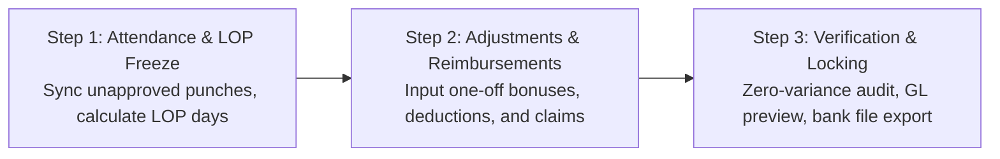

# Innostes Business OS: HRMS (PeopleOps) UI/UX Specifications & Zoho People Benchmark

**Document Reference:** `research/final_modules/hrms/07_ui_ux_specifications_and_zoho_benchmark.md`  
**Target Module:** `PeopleOps` (`apps/web/app/(dashboard)/hrms` and `@innostes/ui`)  
**Design Standard:** Enterprise Ergonomics, Sub-100ms Interactions, Dual-Theme WCAG AAA Compliant  
**Status:** Approved Engineering Blueprint  

---

## 1. Executive Summary & Design Philosophy

Workforce management software fails when daily user interactions introduce friction. In traditional enterprise platforms, routine actions such as recording daily attendance or requesting time off require navigating multi-level hierarchies, submitting verbose tabular forms, and enduring multi-second page reloads.

The Innostes PeopleOps design system adopts the employee-centric ergonomics pioneered by Zoho People and modern consumer tools, paired with enterprise rigor:

1. **Zero-Click Morning Orientation:** The home screen immediately resolves the three questions an employee has upon waking or logging in:
   * *Am I clocked in, and what is my active session duration?*
   * *What are my remaining leave balances?*
   * *Who among my direct teammates is absent, remote, or traveling today?*
2. **Sub-100ms Action Latency:** Check-in, check-out, and approval mutations use optimistic UI updates. State changes reflect instantaneously with background synchronization to the `/api/v1/hrms` endpoints.
3. **Decoupled Headless Consumption:** Every interactive component in `@innostes/ui` connects strictly via typed React Query hooks to standardized OpenAPI 3.1 endpoints. The frontend can be swapped or embedded in custom mobile wrappers without altering core backend mechanics.
4. **Contextual Role Adaptation:** The dashboard dynamically renders specialized widgets based on the user's role: individual contributor, line manager, or HR/payroll administrator.

---

## 2. Benchmark Analysis: Legacy Enterprise Systems vs. Innostes PeopleOps

| Interaction Dimension | Traditional Complex ERP | Zoho People Benchmark | Innostes PeopleOps Architecture |
| :--- | :--- | :--- | :--- |
| **Clock-In / Clock-Out** | Buried under Navigation > HR > Attendance > Timesheets > New Record > Save. | Visible on dashboard top header with punch button and running timer. | Prominent dashboard widget with live high-precision timer, work-mode toggle (`Office`, `Home`, `Client Site`), and IP validation badge. |
| **Leave Balance Visibility** | Requires running a balance report or opening a separate tab. | Visual pill badges displaying current balance per leave type. | Real-time balance badges with accrual forecast; clicking any pill opens a pre-filled 2-step application modal. |
| **Manager Approvals** | Buried in an administrative inbox alongside system alerts and notifications. | Dedicated approvals widget on manager dashboard. | Unified contextual approval cards on the dashboard; inline 1-click `Approve` or `Reject with Reason` with zero navigation. |
| **Team Awareness** | Siloed calendar requiring departmental filtering and date picking. | "Who's Out Today" horizontal carousel. | Real-time presence radar with status indicators (In Office, Remote, On Leave, Half Day, Business Travel). |
| **Payslip Access** | Generated at end-of-month and emailed as attachment or found in financial vault. | Download link under documents sub-tab. | 1-click password-protected PDF download directly from the dashboard sidebar widget. |
| **Theme & Dark Mode** | Rigid desktop-only layout with fixed light styling and low contrast. | Moderate theme support, predominantly light-mode focused. | Native bidirectional theming (Zinc / Slate dark mode and high-contrast light mode) with zero layout shift. |

---

## 3. Desktop Dashboard Layout Wireframe

The primary employee dashboard (`/hrms`) utilizes a 12-column responsive CSS grid with zero extraneous chrome.

```
+---------------------------------------------------------------------------------------------------+
| Top Navigation: Innostes Business OS | Organization Selector | Search (Cmd+K) | Notifications | Profile |
+---------------------------------------------------------------------------------------------------+
| SIDEBAR         | MAIN CONTENT AREA (12 Columns)                                                  |
|                 |                                                                                 |
| Dashboard       | +-----------------------------------------------+ +---------------------------+ |
| Directory       | | ATTENDANCE COCKPIT (Col 1-8)                  | | QUICK PROFILE & PAY (Col 9-12)| |
| Attendance      | | Status: CLOCKED IN (Since 09:15 AM)           | | Jane Doe - Lead Engineer    | |
| Leave           | | Live Workday Timer: 04h 32m 18s               | | Emp ID: EMP-00104           | |
| Payroll         | | Mode: [ Office | (Home) | Client ]            | |                             | |
| Settings        | | [ Clock Out ]  [ Take Break ]                 | | Latest Payslip: Oct 2026    | |
|                 | | Today: 09:15 - Present | Location: Remote/VPN | | [ Download PDF ]            | |
|                 | +-----------------------------------------------+ +---------------------------+ |
|                 |                                                                                 |
|                 | +-----------------------------------------------------------------------------+ |
|                 | | LEAVE BALANCES & QUICK REQUEST (Col 1-12)                                   | |
|                 | | [ Casual: 4.5 days ]  [ Sick: 6.0 days ]  [ Privilege: 14.0 days ]  [Apply]  | |
|                 | +-----------------------------------------------------------------------------+ |
|                 |                                                                                 |
|                 | +-----------------------------------------------+ +---------------------------+ |
|                 | | MANAGER APPROVALS QUEUE (Col 1-7)             | | TEAM PRESENCE RADAR (8-12)  | |
|                 | | Pending Requests (2):                         | | Core Platform Team (8 total)| |
|                 | | 1. Alex Smith - Sick Leave (Nov 4 - Nov 5)    | | Active: 6  Remote: 2  Off: 1| |
|                 | |    [ Approve ]  [ Reject ]  [ View Details ]  | |                             | |
|                 | | 2. Maria Ray - Punch Regularization (Oct 31)  | | * John K. (Sick Leave)      | |
|                 | |    [ Approve ]  [ Reject ]  [ View Details ]  | | * Sarah T. (Remote - WFH)   | |
|                 | +-----------------------------------------------+ +---------------------------+ |
+---------------------------------------------------------------------------------------------------+
```

---

## 4. Component Specification & Behavioral Mechanics

### 4.1 Attendance Cockpit (`AttendanceCockpitWidget`)

* **Primary Function:** Captures daily attendance events and provides immediate visual feedback of active shift elapsed time.
* **Component Path:** `@innostes/ui/src/modules/hrms/AttendanceCockpitWidget.tsx`
* **Sub-elements:**
  1. **Status Indicator:**
     * `NOT_CLOCKED_IN`: Amber pill badge. Action button reads `Web Check-In` (Green background, `#16a34a`).
     * `CLOCKED_IN`: Emerald pulsing badge. Action button reads `Web Check-Out` (Rose background, `#e11d48`).
     * `ON_BREAK`: Blue badge with active break timer.
  2. **Live Workday Clock:**
     * High-precision SVG digital countdown timer calculating elapsed seconds since the earliest normalized punch of the day:
       $$\text{Elapsed Time} = \text{Current Timestamp} - \text{First Check-in Punch}$$
     * Active breaks are subtracted in real-time from the effective working duration.
  3. **Work Mode Segmented Controller:**
     * Segmented radio toggle: `Office` | `Home` | `Client Site`.
     * If `Office` is selected, the client verifies geo-fencing or corporate IP whitelist boundaries. If outside the threshold, a warning badge is displayed: *Outside corporate network*.
  4. **Break Trigger:**
     * Dropdown selector: `Lunch Break`, `Personal Break`, `Coffee Break`. Initiating a break logs a `BREAK_START` punch event and suspends the productive duration counter.

### 4.2 Leave Balances Bar (`LeaveBalanceCards`)

* **Component Path:** `@innostes/ui/src/modules/hrms/LeaveBalanceCards.tsx`
* **Layout:** Horizontal flexbox with compact metric pills.
* **Data Properties:**
  * Type Name (`Casual Leave`, `Medical Leave`, `Earned / Privilege Leave`).
  * Available Balance (`X days`).
  * Expiring Alert (`Expires in 45 days` if carry-forward cutoff is approaching).
* **Interactive Behavior:**
  * Clicking any pill opens the **Quick Leave Application Drawer** with the selected leave type pre-filled.
  * Hovering displays a tooltip breakdown: `Total Allotted: 18 | Consumed: 4 | Pending Approval: 1 | Net Usable: 13`.

### 4.3 Manager Approvals Queue (`ManagerApprovalsWidget`)

* **Visibility Condition:** Rendered only when `auth.user.has_role('line_manager')` or `auth.user.direct_reports_count > 0`.
* **Component Path:** `@innostes/ui/src/modules/hrms/ManagerApprovalsWidget.tsx`
* **Information Architecture:**
  * Displays urgent pending actions submitted by direct or indirect reports:
    * Leave applications awaiting sign-off.
    * Punch regularization requests (forgotten punches, card misreads).
    * Overtime pre-authorizations.
  * Card items feature the applicant's avatar, full name, dates requested, deduction count, and user-provided reason.
* **Action Handlers:**
  * `Approve`: Triggers optimistic removal from queue with instant mutation call to `/api/v1/hrms/leaves/{id}/approve`.
  * `Reject`: Opens a micro-popover requiring a mandatory rejection rationale before sending state update to `/api/v1/hrms/leaves/{id}/reject`.

### 4.4 Team Presence Radar (`TeamPresenceWidget`)

* **Component Path:** `@innostes/ui/src/modules/hrms/TeamPresenceWidget.tsx`
* **Purpose:** Eliminates unnecessary messaging by broadcasting team availability on the primary screen.
* **Display Elements:**
  * Avatars of departmental colleagues grouped by current operational status:
    * **Present (Office):** Solid green ring indicator.
    * **Remote (WFH):** Solid blue ring indicator.
    * **On Leave:** Solid amber ring with return date subtitle.
    * **Holiday:** Flag indicator.

---

## 5. Employee Directory, 60-Second Quick-Add & 8-Step Onboarding Stepper

### 5.1 Directory Layout & 60-Second Quick-Add (`/hrms/employees`)

The employee directory supports two presentation modes with a prominent **`[ + Quick Add Employee ]`** button:
1. **Interactive Data Table:** High-density enterprise grid with column sorting, fuzzy search (Name, Email, Role, Department, Employee Code), status filters (`ACTIVE`, `ONBOARDING`, `PROBATION`, `NOTICE_PERIOD`), and bulk action operations.
2. **Card Grid View:** Photo cards featuring designation, reporting manager, direct email/phone buttons, and current presence status.

#### The 60-Second Founder Quick-Add Modal
Startups do not have time to fill 50 fields before hiring someone. A clean modal captures essential details in 30 seconds:

```
+-----------------------------------------------------------------------------------+
| QUICK ADD EMPLOYEE (60-SECOND ONBOARDING)                                     [X] |
+-----------------------------------------------------------------------------------+
| Legal First Name *                            Legal Last Name *                   |
| [ Sarah                             ]         [ Chen                            ] |
|                                                                                   |
| Work Email *                                  Mobile Phone *                      |
| [ sarah.chen@innostes.com           ]         [ +91 98765 43210                 ] |
|                                                                                   |
| Designation / Job Title *                     Department *                        |
| [ Senior Backend Engineer           ]         [ Engineering                     ] |
|                                                                                   |
| Monthly Compensation / CTC (INR) *            Date of Joining *                   |
| [ 180000                            ]         [ 15 Nov 2026                     ] |
|                                                                                   |
| [✓] Auto-generate temporary password & email credentials to candidate             |
| [✓] Allow immediate Day 1 web check-in & dashboard access                         |
|                                                                                   |
| [ Cancel ]                               [ Create Employee & Generate Credentials ]|
+-----------------------------------------------------------------------------------+
```

#### Immediate Credential Hand-Off Modal
Clicking `[ Create Employee & Generate Credentials ]` immediately creates the employee record, assigns the next sequential employee code (`INN-00105`), auto-generates a high-entropy temporary password, and displays this instant confirmation dialog:

```
+-----------------------------------------------------------------------------------+
| EMPLOYEE CREATED & CREDENTIALS GENERATED                                       [X] |
+-----------------------------------------------------------------------------------+
| Sarah Chen has been added as Senior Backend Engineer (Code: INN-00105).           |
|                                                                                   |
| Login Email:                                                                      |
| [ sarah.chen@innostes.com                                                       ] |
|                                                                                   |
| Auto-Generated Temporary Password:                                                |
| [ inn-7kPx-9mRt                                 ]    [ 📋 Copy Credentials ]      |
|                                                                                   |
| Security & Compliance Policy:                                                     |
| • Welcome email with temporary credentials and login link has been dispatched.   |
| • This temporary password is valid for 72 hours.                                  |
| • MANDATORY RESET: On Sarah's very first login, she will be automatically forced  |
|   to create her personal permanent password before accessing any company data.    |
| • Admins will never see or store her permanent confidential password.             |
|                                                                                   |
|                                                                 [ Done / Close ]  |
+-----------------------------------------------------------------------------------+
```

#### First Login Mandatory Password Reset (`/auth/first-login`)
When the employee signs in using their work email and auto-generated temporary password, the system detects `must_change_password = true` and presents a hard-locked screen. All application navigation, menus, and background APIs are strictly blocked until the permanent password is established:

```
+-----------------------------------------------------------------------------------+
| INNOSTES BUSINESS OS                                                              |
+-----------------------------------------------------------------------------------+
| Welcome to Acme Corp, Sarah!                                                      |
| Your administrator provided a temporary login password.                           |
| Please set up your confidential permanent password to activate your account.      |
|                                                                                   |
| New Permanent Password *                                                          |
| [ •••••••••••••••••••••••••••••••• ]  [ Show ]                                    |
| [████████████████████░░░░] Strong (14 characters, numbers & symbols)              |
|                                                                                   |
| Confirm New Password *                                                            |
| [ •••••••••••••••••••••••••••••••• ]                                              |
|                                                                                   |
| Zero-Knowledge Privacy Guarantee:                                                 |
| • Your permanent password is encrypted via Argon2id / bcrypt.                     |
| • Company administrators and founders will never have access to this password.    |
|                                                                                   |
|                                          [ Set Password & Enter Workspace -> ]    |
+-----------------------------------------------------------------------------------+
```

---

### 5.2 The 8-Step Candidate Self-Service Stepper (`/hrms/onboarding/[token]`)

The candidate completes their detailed bank, tax, and address profile on their own time via an interactive 8-step wizard with real-time auto-saving drafts:

```
+---------------------------------------------------------------------------------------------------+
| INNOSTES ONBOARDING PORTAL | Candidate: Alex Rivera | [ ✓ Saved 3s ago ] [████████░░░░] 50% Done   |
+---------------------------------------------------------------------------------------------------+
| 1. Personal | 2. Addresses | 3. Statutory | 4. Banking | 5. Role | 6. Edu | 7. Exp | 8. Nominees | Submit |
|   (Done)    |    (Done)    |    (Done)    |  (ACTIVE)  | (Wait)  | (Wait) | (Wait) |   (Wait)    | (Wait) |
+---------------------------------------------------------------------------------------------------+
| STEP 4 OF 8: BANKING & DIRECT DISBURSEMENT INFORMATION                                            |
|                                                                                                   |
| Bank IFSC Code *                                    Bank Name (Auto-resolved via RBI directory)   |
| [ HDFC0000240                   ] [ Lookup ]        [ HDFC Bank Ltd                             ] |
|                                                                                                   |
| Branch Name (Auto-resolved)                         Account Type *                                |
| [ Richmond Road, Bengaluru      ]                   (•) Corporate Salary  ( ) Savings  ( ) Current| |
|                                                                                                   |
| Bank Account Number *                               Re-enter Bank Account Number *                |
| [ •••••••••••••••••             ]                   [ •••••••••••••••••                         ] |
|                                                                                                   |
| Account Holder Name (as per Bank Passbook) *                                                      |
| [ Alex Rivera                   ] (Matches legal name 100%)                                       |
|                                                                                                   |
| Cancelled Cheque / Passbook Copy *                                                                |
| +-----------------------------------------------------------------------------------------------+ |
| | [Drag & Drop or Click to Upload PDF/PNG] - Uploaded: cheque_leaf.pdf (Verified)               | |
| +-----------------------------------------------------------------------------------------------+ |
|                                                                                                   |
| Auto-Save Status: [ ✓ Draft saved to cloud ]                     [ Back: Step 3 ]  [ Continue: Step 5 ] |
+---------------------------------------------------------------------------------------------------+
```

#### Real-Time Auto-Save Feedback & Resilience Ergonomics:
1. **Zero-Latency Non-Blocking Inputs:** Auto-save operations occur entirely in the background. Keystroke inputs are never locked, throttled, or interrupted by blocking modal spinners.
2. **Dynamic Header Status Pill:**
   * `SAVING`: `[ • Saving draft... ]` (Subtle pulsing indicator triggered 1,500ms after the last typing pause or on field blur).
   * `SAVED_TO_CLOUD`: `[ ✓ All changes saved (3s ago) ]` (Subtle muted green/zinc badge confirming server persistence).
   * `OFFLINE_LOCAL`: `[ ⚡ Offline — Saved to device ]` (Triggered if network connectivity drops. Informs the user that `IndexedDB` has captured all inputs safely).
   * `NETWORK_RETRY`: `[ ⚠️ Connection unstable — Retrying sync... ]` (Automatic background retry with exponential jitter).
3. **Emergency Unload Flush (`navigator.sendBeacon`):**
   * If the candidate closes the browser tab, restarts their laptop, or accidentally navigates backwards, the browser triggers `navigator.sendBeacon` to dispatch the active form payload to `/peopleops/onboarding/{id}/beacon-flush`.
4. **Cross-Device Hydration Prompt:**
   * When logging in from another device (e.g. mobile after starting on desktop), the UI displays a clean resume banner: *"Resumed from your draft on Desktop (12 minutes ago)"*, with an instant one-click option to continue from the exact field last touched.

#### Step-by-Step Functional & Ergonomic Highlights:
* **Step 1: Personal & Demographics**: First, middle, and last names, date of birth (validates age $\ge 18$), gender, blood group pills, marital status, and statutory father's/mother's/spouse's names.
* **Step 2: Addresses & Emergency Contacts**: Present address with auto-complete, "Same as Present" toggle for permanent address (copies in 0ms), and primary + secondary emergency contacts with relationship badges. Contextual address proof upload.
* **Step 3: Statutory ID Vault**:
  * **Aadhaar Input**: Instant Verhoeff algorithm validation. As digits are entered, the system validates the checksum and automatically masks the first 8 digits (`XXXX-XXXX-1234`). Contextual Aadhaar card scan upload.
  * **PAN Card**: Format validation (`[A-Z]{5}[0-9]{4}[A-Z]{1}`) with instant check that the 4th character is `'P'`. Contextual PAN scan upload.
  * **UAN Number**: 12-digit numeric input with tooltip guide for prior EPFO account transfer.
* **Step 4: Banking & Direct Deposit**:
  * Real-time IFSC lookup: entering `HDFC0000240` instantly populates Bank Name (*HDFC Bank Ltd*), Branch (*Richmond Road*), and MICR code without server reload.
  * Double-entry account number confirmation with copy-paste disabled.
  * Contextual cancelled cheque / passbook copy upload.
* **Step 5: Employment & Taxonomy (HR Pre-filled)**: Displays assigned Business Unit, Department, Job Title, Grade/Band (`L3`), Reporting Manager, Work Mode (`Office` / `Remote`), and Probation terms.
* **Step 6: Educational Qualifications**: Stepper list for degrees (Doctorate, PG, UG, 10th/12th) with field of study, passing year, score, and certificate attachment dropzone.
* **Step 7: Prior Experience**: Chronological company history, start/end dates, last drawn CTC, previous PF member ID, and relieving letter upload.
* **Step 8: Statutory Nominees (Form 2 & Form F)**:
  * Interactive allocation sliders for PF, Pension (EPS), and Gratuity.
  * Real-time validation warning if the total sum does not equal exactly 100.00%.
  * Medical insurance (GMC) dependent checkboxes with pre-existing illness notes.
* **Review & Submit Screen**:
  * Clean, read-only accordion summary of all 8 steps allowing candidate to review information before final submission.
  * 1-Click final submission button transitioning status to `SUBMITTED` for HR compliance audit.
* **Phase 2 Scope Note**: Contractual electronic document signing (Aadhaar eSign, DocuSign integrations, digital signature canvas) is deferred to Phase 2. Executed paper contracts can be uploaded as profile attachments.

---

### 5.3 HR Onboarding Review & Compliance Cockpit (`/hrms/onboarding/review`)

HR administrators review candidate onboarding packages through a dedicated side-by-side verification interface:

```
+---------------------------------------------------------------------------------------------------+
| HR Verification Cockpit: Alex Rivera (EMP-00104) | Status: PENDING REVIEW | [ Approve ] [ Changes ]|
+---------------------------------------------------------------------------------------------------+
| APPLICANT SUBMISSION DATA (50% Screen)          | UPLOADED DOCUMENT PREVIEW (50% Screen)          |
|                                                 |                                                 |
| Step 3: Statutory Identification                | +---------------------------------------------+ |
| Aadhaar (Masked): XXXX-XXXX-4819                | | [ Aadhaar Card Scanned Image ]              | |
| Name on Card: Alex Rivera                       | | Name: Alex Rivera                           | |
| Verhoeff Validation: [ PASSED ]                 | | DOB: 14/08/1994                             | |
|                                                 | | Gender: Male                                | |
| PAN: ABCPR1234F                                 | | Aadhaar: XXXX XXXX 4819                     | |
| Name on PAN: Alex Rivera                        | +---------------------------------------------+ |
| 4th Char Persona Check: [ PASSED ('P') ]        |                                                 |
|                                                 | Inline Review Actions:                          |
| UAN: 101234567890                               | [ ✓ Verify Aadhaar ]  [ ✕ Reject Document ]   |
| Status: Validated against EPFO database         | Rejection Note: [ Blur scan, please re-upload ] |
+---------------------------------------------------------------------------------------------------+
```

---

### 5.4 Slide-Over Employee 360 Drawer (`EmployeeDetailDrawer`)

Selecting an employee row or card opens a non-modal slide-over drawer from the right edge (width: 720px on desktop, full width on mobile), preserving the underlying list context.

```
+-----------------------------------------------------------------------------------+
| [X] Close             Employee Profile: INN-00104                          [Edit] |
+-----------------------------------------------------------------------------------+
| Jane Doe                                                                          |
| Senior Backend Engineer - Infrastructure & Core Ops                               |
| Email: jane.doe@innostes.com | Phone: +91 98765 43210                             |
| Status: [ ACTIVE ]  Band: [ L4 Senior ]  Work Mode: [ REMOTE ]                    |
+-----------------------------------------------------------------------------------+
| [ Overview ] [ Statutory ] [ Bank ] [ Leaves ] [ Attendance ] [ Payroll ] [ Docs ] |
+-----------------------------------------------------------------------------------+
| TAB: OVERVIEW & DEMOGRAPHICS                                                      |
| Legal Full Name: Jane Marie Doe             Date of Birth: 12 May 1992 (34 yrs)   |
| Gender: Female      Blood Group: O+ Positive   Marital Status: Married            |
| Father's Name: Robert Doe                   Spouse Name: Michael Doe              |
|                                                                                   |
| Current Address: Flat 402, Palm Heights, Indiranagar, Bengaluru, KA - 560038      |
| Emergency Contact: Michael Doe (Spouse) - +91 98765 00000                         |
| Reporting Manager: John Doe (VP Engineering)                                      |
| Business Unit: Cloud Platforms   Department: Core Kernel   Cost Center: CC-ENG-104|
| Date of Joining: 15 Jan 2024 (2 yrs 10 mos) | Notice Period: 60 Days              |
|                                                                                   |
| TAB: STATUTORY VAULT (MASKED & ENCRYPTED)                                         |
| Aadhaar: XXXX-XXXX-3821 (Verified via Verhoeff)                                   |
| PAN: ABCPD1234M (Verified Individual 'P')                                         |
| UAN: 100987654321 | ESIC: Exempt (> INR 21k) | PT State: Karnataka (Circle 04)  |
| Gratuity Nominee: Michael Doe (100% share)                                        |
+-----------------------------------------------------------------------------------+

---

## 6. Monthly Payroll Admin Cockpit (`/hrms/payroll`)

Payroll administrators require a fail-safe, guided execution flow that prevents unverified disbursements. The Innostes Payroll Cockpit structures execution into a 3-step sequential stepper:



### Screen Specs for Step 3 (Verification & Disbursal)

* **Summary Metrics Bar:**
  * Gross Pay Total (`INR 4,250,000.00`)
  * Total Statutory Withholdings (`INR 620,000.00` - PF, ESI, TDS)
  * Net Disbursal Amount (`INR 3,630,000.00`)
  * Total Headcount (`42 Employees` - 0 Variance against previous month)
* **Pre-Flight Validation Checklist:**
  * Green Check: Zero employees with missing bank account or IFSC data.
  * Green Check: All leave applications for cycle closed or settled.
  * Green Check: General Ledger chart of accounts mapping active and balanced.
* **Dispatch Actions:**
  * `[ Download NEFT / RTGS Bank Transfer CSV ]`
  * `[ Lock & Post to LedgerFlow ]` (Generates atomic balanced journal entry)
  * `[ Send Payslip Notification Emails ]`

---

## 7. Design System & Component Library Tokens

The PeopleOps UI relies on `@innostes/ui` primitives with strict theme variables supporting both Dark and Light themes without style bleeding.

### Color Tokens

| Semantic Token | Light Mode Value | Dark Mode Value | Usage |
| :--- | :--- | :--- | :--- |
| `--surface-primary` | `#ffffff` | `#09090b` (Zinc 950) | Main page background |
| `--surface-secondary`| `#f4f4f5` (Zinc 100) | `#18181b` (Zinc 900) | Card backgrounds, inputs |
| `--surface-elevated` | `#ffffff` | `#27272a` (Zinc 800) | Modals, slide-over drawers |
| `--border-subtle`    | `#e4e4e7` (Zinc 200) | `#27272a` (Zinc 800) | Card borders, dividers |
| `--text-primary`     | `#09090b` (Zinc 950) | `#fafafa` (Zinc 50)  | Headings, primary metrics |
| `--text-secondary`   | `#71717a` (Zinc 500) | `#a1a1aa` (Zinc 400) | Labels, descriptions |
| `--status-active`    | `#16a34a` (Green 600)| `#22c55e` (Green 500)| Check-in status, approved |
| `--status-warning`   | `#d97706` (Amber 600)| `#f59e0b` (Amber 500)| Pending approvals, probation |
| `--status-danger`    | `#dc2626` (Red 600)  | `#ef4444` (Red 500)  | Terminated, rejected, absent |

---

## 8. Mobile & Responsive Ergonomics

Desktop layouts prioritize information density; mobile viewports prioritize speed of single-action execution.

1. **Mobile Bottom Navigation (`< 768px`):**
   * Primary navigation transitions to a persistent bottom tab bar:
     * `[ Home ]` `[ Attendance ]` `[ Leaves ]` `[ Approvals ]` `[ Profile ]`
2. **Mobile Quick Check-In Sheet:**
   * Tapping the persistent floating check-in button opens a half-screen sheet with the large touch target `Clock In / Clock Out` button (minimum touch height: 56px).
   * Supports GPS geolocation capture with user consent for remote field workers.
3. **Responsive Drawers:**
   * On mobile viewports (`width < 640px`), slide-over drawers transform automatically into full-screen dialogs with standard back-swipe gesture support.

---

## 9. Accessibility & Keyboard Navigation (WCAG AAA)

* **Keyboard Navigation:**
  * `Cmd + K` / `Ctrl + K`: Opens global command palette with instant shortcuts:
    * *"Check In"*, *"Check Out"*, *"Apply for Leave"*, *"View My Payslip"*, *"Search Employee"*.
  * Focus traps implemented on all modals and slide-over drawers (`@innostes/ui/src/primitives/FocusTrap.tsx`).
* **ARIA Live Regions:**
  * Active check-in timer uses `aria-live="polite"` with periodic updates throttled to avoid screen-reader chatter.
  * Status badges contain explicit `aria-label` attributes (`aria-label="Active status: Clocked in since 9:15 AM"`).
* **Color Contrast:**
  * All text, badges, and button icons maintain a minimum contrast ratio of 7:1 against their adjacent background surfaces in both light and dark modes.
