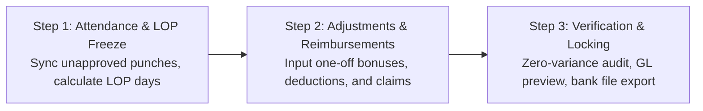

# Innostes Business OS: HRMS (PeopleOps) UI/UX Specifications & Zoho People Benchmark

**Document Reference:** `research/final_modules/hrms/07_ui_ux_specifications_and_zoho_benchmark.md`  
**Target Module:** `PeopleOps` (`apps/web/app/(dashboard)/hrms` and `@innostes/ui`)  
**Design Standard:** Enterprise Ergonomics, Sub-100ms Interactions, Dual-Theme WCAG AAA Compliant  
**Status:** Approved Engineering Blueprint  

---

## 1. Executive Summary & Design Philosophy

Workforce management software fails when daily user interactions introduce friction. In traditional enterprise platforms, routine actions such as recording daily attendance or requesting time off require navigating multi-level hierarchies, submitting verbose tabular forms, and enduring multi-second page reloads.

The Innostes PeopleOps design system adopts the employee-centric ergonomics pioneered by Zoho People and modern consumer tools, paired with enterprise rigor:

1. **Zero-Click Morning Orientation:** The home screen immediately resolves the three questions an employee has upon waking or logging in:
   * *Am I clocked in, and what is my active session duration?*
   * *What are my remaining leave balances?*
   * *Who among my direct teammates is absent, remote, or traveling today?*
2. **Sub-100ms Action Latency:** Check-in, check-out, and approval mutations use optimistic UI updates. State changes reflect instantaneously with background synchronization to the `/api/v1/hrms` endpoints.
3. **Decoupled Headless Consumption:** Every interactive component in `@innostes/ui` connects strictly via typed React Query hooks to standardized OpenAPI 3.1 endpoints. The frontend can be swapped or embedded in custom mobile wrappers without altering core backend mechanics.
4. **Contextual Role Adaptation:** The dashboard dynamically renders specialized widgets based on the user's role: individual contributor, line manager, or HR/payroll administrator.

---

## 2. Benchmark Analysis: Legacy Enterprise Systems vs. Innostes PeopleOps

| Interaction Dimension | Traditional Complex ERP | Zoho People Benchmark | Innostes PeopleOps Architecture |
| :--- | :--- | :--- | :--- |
| **Clock-In / Clock-Out** | Buried under Navigation > HR > Attendance > Timesheets > New Record > Save. | Visible on dashboard top header with punch button and running timer. | Prominent dashboard widget with live high-precision timer, work-mode toggle (`Office`, `Home`, `Client Site`), and IP validation badge. |
| **Leave Balance Visibility** | Requires running a balance report or opening a separate tab. | Visual pill badges displaying current balance per leave type. | Real-time balance badges with accrual forecast; clicking any pill opens a pre-filled 2-step application modal. |
| **Manager Approvals** | Buried in an administrative inbox alongside system alerts and notifications. | Dedicated approvals widget on manager dashboard. | Unified contextual approval cards on the dashboard; inline 1-click `Approve` or `Reject with Reason` with zero navigation. |
| **Team Awareness** | Siloed calendar requiring departmental filtering and date picking. | "Who's Out Today" horizontal carousel. | Real-time presence radar with status indicators (In Office, Remote, On Leave, Half Day, Business Travel). |
| **Payslip Access** | Generated at end-of-month and emailed as attachment or found in financial vault. | Download link under documents sub-tab. | 1-click password-protected PDF download directly from the dashboard sidebar widget. |
| **Theme & Dark Mode** | Rigid desktop-only layout with fixed light styling and low contrast. | Moderate theme support, predominantly light-mode focused. | Native bidirectional theming (Zinc / Slate dark mode and high-contrast light mode) with zero layout shift. |

---

## 3. Desktop Dashboard Layout Wireframe

The primary employee dashboard (`/hrms`) utilizes a 12-column responsive CSS grid with zero extraneous chrome.

```
+---------------------------------------------------------------------------------------------------+
| Top Navigation: Innostes Business OS | Organization Selector | Search (Cmd+K) | Notifications | Profile |
+---------------------------------------------------------------------------------------------------+
| SIDEBAR         | MAIN CONTENT AREA (12 Columns)                                                  |
|                 |                                                                                 |
| Dashboard       | +-----------------------------------------------+ +---------------------------+ |
| Directory       | | ATTENDANCE COCKPIT (Col 1-8)                  | | QUICK PROFILE & PAY (Col 9-12)| |
| Attendance      | | Status: CLOCKED IN (Since 09:15 AM)           | | Jane Doe - Lead Engineer    | |
| Leave           | | Live Workday Timer: 04h 32m 18s               | | Emp ID: EMP-00104           | |
| Payroll         | | Mode: [ Office | (Home) | Client ]            | |                             | |
| Settings        | | [ Clock Out ]  [ Take Break ]                 | | Latest Payslip: Oct 2026    | |
|                 | | Today: 09:15 - Present | Location: Remote/VPN | | [ Download PDF ]            | |
|                 | +-----------------------------------------------+ +---------------------------+ |
|                 |                                                                                 |
|                 | +-----------------------------------------------------------------------------+ |
|                 | | LEAVE BALANCES & QUICK REQUEST (Col 1-12)                                   | |
|                 | | [ Casual: 4.5 days ]  [ Sick: 6.0 days ]  [ Privilege: 14.0 days ]  [Apply]  | |
|                 | +-----------------------------------------------------------------------------+ |
|                 |                                                                                 |
|                 | +-----------------------------------------------+ +---------------------------+ |
|                 | | MANAGER APPROVALS QUEUE (Col 1-7)             | | TEAM PRESENCE RADAR (8-12)  | |
|                 | | Pending Requests (2):                         | | Core Platform Team (8 total)| |
|                 | | 1. Alex Smith - Sick Leave (Nov 4 - Nov 5)    | | Active: 6  Remote: 2  Off: 1| |
|                 | |    [ Approve ]  [ Reject ]  [ View Details ]  | |                             | |
|                 | | 2. Maria Ray - Punch Regularization (Oct 31)  | | * John K. (Sick Leave)      | |
|                 | |    [ Approve ]  [ Reject ]  [ View Details ]  | | * Sarah T. (Remote - WFH)   | |
|                 | +-----------------------------------------------+ +---------------------------+ |
+---------------------------------------------------------------------------------------------------+
```

---

## 4. Component Specification & Behavioral Mechanics

### 4.1 Attendance Cockpit (`AttendanceCockpitWidget`)

* **Primary Function:** Captures daily attendance events and provides immediate visual feedback of active shift elapsed time.
* **Component Path:** `@innostes/ui/src/modules/hrms/AttendanceCockpitWidget.tsx`
* **Sub-elements:**
  1. **Status Indicator:**
     * `NOT_CLOCKED_IN`: Amber pill badge. Action button reads `Web Check-In` (Green background, `#16a34a`).
     * `CLOCKED_IN`: Emerald pulsing badge. Action button reads `Web Check-Out` (Rose background, `#e11d48`).
     * `ON_BREAK`: Blue badge with active break timer.
  2. **Live Workday Clock:**
     * High-precision SVG digital countdown timer calculating elapsed seconds since the earliest normalized punch of the day:
       $$\text{Elapsed Time} = \text{Current Timestamp} - \text{First Check-in Punch}$$
     * Active breaks are subtracted in real-time from the effective working duration.
  3. **Work Mode Segmented Controller:**
     * Segmented radio toggle: `Office` | `Home` | `Client Site`.
     * If `Office` is selected, the client verifies geo-fencing or corporate IP whitelist boundaries. If outside the threshold, a warning badge is displayed: *Outside corporate network*.
  4. **Break Trigger:**
     * Dropdown selector: `Lunch Break`, `Personal Break`, `Coffee Break`. Initiating a break logs a `BREAK_START` punch event and suspends the productive duration counter.

### 4.2 Leave Balances Bar (`LeaveBalanceCards`)

* **Component Path:** `@innostes/ui/src/modules/hrms/LeaveBalanceCards.tsx`
* **Layout:** Horizontal flexbox with compact metric pills.
* **Data Properties:**
  * Type Name (`Casual Leave`, `Medical Leave`, `Earned / Privilege Leave`).
  * Available Balance (`X days`).
  * Expiring Alert (`Expires in 45 days` if carry-forward cutoff is approaching).
* **Interactive Behavior:**
  * Clicking any pill opens the **Quick Leave Application Drawer** with the selected leave type pre-filled.
  * Hovering displays a tooltip breakdown: `Total Allotted: 18 | Consumed: 4 | Pending Approval: 1 | Net Usable: 13`.

### 4.3 Manager Approvals Queue (`ManagerApprovalsWidget`)

* **Visibility Condition:** Rendered only when `auth.user.has_role('line_manager')` or `auth.user.direct_reports_count > 0`.
* **Component Path:** `@innostes/ui/src/modules/hrms/ManagerApprovalsWidget.tsx`
* **Information Architecture:**
  * Displays urgent pending actions submitted by direct or indirect reports:
    * Leave applications awaiting sign-off.
    * Punch regularization requests (forgotten punches, card misreads).
    * Overtime pre-authorizations.
  * Card items feature the applicant's avatar, full name, dates requested, deduction count, and user-provided reason.
* **Action Handlers:**
  * `Approve`: Triggers optimistic removal from queue with instant mutation call to `/api/v1/hrms/leaves/{id}/approve`.
  * `Reject`: Opens a micro-popover requiring a mandatory rejection rationale before sending state update to `/api/v1/hrms/leaves/{id}/reject`.

### 4.4 Team Presence Radar (`TeamPresenceWidget`)

* **Component Path:** `@innostes/ui/src/modules/hrms/TeamPresenceWidget.tsx`
* **Purpose:** Eliminates unnecessary messaging by broadcasting team availability on the primary screen.
* **Display Elements:**
  * Avatars of departmental colleagues grouped by current operational status:
    * **Present (Office):** Solid green ring indicator.
    * **Remote (WFH):** Solid blue ring indicator.
    * **On Leave:** Solid amber ring with return date subtitle.
    * **Holiday:** Flag indicator.

---

## 5. Employee Directory & Profile Drawer

### 5.1 Directory Layout (`/hrms/employees`)

The employee directory supports two presentation modes switched via a persistent user preference:
1. **Interactive Data Table:** High-density enterprise grid with column sorting, fuzzy search (Name, Email, Role, Department), status filters (`ACTIVE`, `ON_NOTICE`, `PROBATION`), and bulk action operations.
2. **Card Grid View:** Photo cards featuring designation, reporting manager, direct email/phone buttons, and current presence status.

### 5.2 Slide-Over Employee 360 Drawer (`EmployeeDetailDrawer`)

Selecting an employee row or card opens a non-modal slide-over drawer from the right edge (width: 640px on desktop, full width on mobile), preserving the underlying list context.

```
+-------------------------------------------------------------+
| [X] Close        Employee Profile: EMP-00104         [Edit] |
+-------------------------------------------------------------+
| Jane Doe                                                    |
| Senior Backend Engineer - Infrastructure & Core Ops        |
| Email: jane.doe@innostes.com | Phone: +91 98765 43210       |
| Status: [ ACTIVE ]  Work Mode: [ REMOTE ]                   |
+-------------------------------------------------------------+
| [ Overview ]  [ Attendance ]  [ Leaves ]  [ Payroll ]  [ Docs ] |
+-------------------------------------------------------------+
| TAB: OVERVIEW                                               |
| Reporting Manager: John Doe (VP Engineering)                |
| Department: Engineering      Location: Bengaluru HQ        |
| Date of Joining: 15 Jan 2024 (2 yrs 10 mos)                |
| Employment Type: Full-time Permanent                        |
| Legal Entity: Innostes Technologies Pvt Ltd                 |
|                                                             |
| Emergency Contact: Mary Doe (Spouse) - +91 98765 00000      |
| Statutory Identifiers (Masked):                             |
| Permanent Account Number: XXXXX1234F                        |
| Universal Account Number: XXXXXXXXX987                      |
+-------------------------------------------------------------+
```

---

## 6. Monthly Payroll Admin Cockpit (`/hrms/payroll`)

Payroll administrators require a fail-safe, guided execution flow that prevents unverified disbursements. The Innostes Payroll Cockpit structures execution into a 3-step sequential stepper:



### Screen Specs for Step 3 (Verification & Disbursal)

* **Summary Metrics Bar:**
  * Gross Pay Total (`INR 4,250,000.00`)
  * Total Statutory Withholdings (`INR 620,000.00` - PF, ESI, TDS)
  * Net Disbursal Amount (`INR 3,630,000.00`)
  * Total Headcount (`42 Employees` - 0 Variance against previous month)
* **Pre-Flight Validation Checklist:**
  * Green Check: Zero employees with missing bank account or IFSC data.
  * Green Check: All leave applications for cycle closed or settled.
  * Green Check: General Ledger chart of accounts mapping active and balanced.
* **Dispatch Actions:**
  * `[ Download NEFT / RTGS Bank Transfer CSV ]`
  * `[ Lock & Post to LedgerFlow ]` (Generates atomic balanced journal entry)
  * `[ Send Payslip Notification Emails ]`

---

## 7. Design System & Component Library Tokens

The PeopleOps UI relies on `@innostes/ui` primitives with strict theme variables supporting both Dark and Light themes without style bleeding.

### Color Tokens

| Semantic Token | Light Mode Value | Dark Mode Value | Usage |
| :--- | :--- | :--- | :--- |
| `--surface-primary` | `#ffffff` | `#09090b` (Zinc 950) | Main page background |
| `--surface-secondary`| `#f4f4f5` (Zinc 100) | `#18181b` (Zinc 900) | Card backgrounds, inputs |
| `--surface-elevated` | `#ffffff` | `#27272a` (Zinc 800) | Modals, slide-over drawers |
| `--border-subtle`    | `#e4e4e7` (Zinc 200) | `#27272a` (Zinc 800) | Card borders, dividers |
| `--text-primary`     | `#09090b` (Zinc 950) | `#fafafa` (Zinc 50)  | Headings, primary metrics |
| `--text-secondary`   | `#71717a` (Zinc 500) | `#a1a1aa` (Zinc 400) | Labels, descriptions |
| `--status-active`    | `#16a34a` (Green 600)| `#22c55e` (Green 500)| Check-in status, approved |
| `--status-warning`   | `#d97706` (Amber 600)| `#f59e0b` (Amber 500)| Pending approvals, probation |
| `--status-danger`    | `#dc2626` (Red 600)  | `#ef4444` (Red 500)  | Terminated, rejected, absent |

---

## 8. Mobile & Responsive Ergonomics

Desktop layouts prioritize information density; mobile viewports prioritize speed of single-action execution.

1. **Mobile Bottom Navigation (`< 768px`):**
   * Primary navigation transitions to a persistent bottom tab bar:
     * `[ Home ]` `[ Attendance ]` `[ Leaves ]` `[ Approvals ]` `[ Profile ]`
2. **Mobile Quick Check-In Sheet:**
   * Tapping the persistent floating check-in button opens a half-screen sheet with the large touch target `Clock In / Clock Out` button (minimum touch height: 56px).
   * Supports GPS geolocation capture with user consent for remote field workers.
3. **Responsive Drawers:**
   * On mobile viewports (`width < 640px`), slide-over drawers transform automatically into full-screen dialogs with standard back-swipe gesture support.

---

## 9. Accessibility & Keyboard Navigation (WCAG AAA)

* **Keyboard Navigation:**
  * `Cmd + K` / `Ctrl + K`: Opens global command palette with instant shortcuts:
    * *"Check In"*, *"Check Out"*, *"Apply for Leave"*, *"View My Payslip"*, *"Search Employee"*.
  * Focus traps implemented on all modals and slide-over drawers (`@innostes/ui/src/primitives/FocusTrap.tsx`).
* **ARIA Live Regions:**
  * Active check-in timer uses `aria-live="polite"` with periodic updates throttled to avoid screen-reader chatter.
  * Status badges contain explicit `aria-label` attributes (`aria-label="Active status: Clocked in since 9:15 AM"`).
* **Color Contrast:**
  * All text, badges, and button icons maintain a minimum contrast ratio of 7:1 against their adjacent background surfaces in both light and dark modes.
