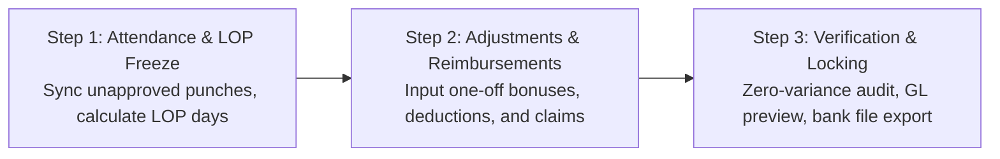

# Innostes Business OS: HRMS (PeopleOps) UI/UX Specifications & Zoho People Benchmark

**Document Reference:** `research/final_modules/hrms/07_ui_ux_specifications_and_zoho_benchmark.md`  
**Target Module:** `PeopleOps` (`apps/web/app/(dashboard)/hrms` and `@innostes/ui`)  
**Design Standard:** Enterprise Ergonomics, Sub-100ms Interactions, Dual-Theme WCAG AAA Compliant  
**Status:** Approved Engineering Blueprint  

---

## 1. Executive Summary & Design Philosophy

Workforce management software fails when daily user interactions introduce friction. In traditional enterprise platforms, routine actions such as recording daily attendance or requesting time off require navigating multi-level hierarchies, submitting verbose tabular forms, and enduring multi-second page reloads.

The Innostes PeopleOps design system adopts the employee-centric ergonomics pioneered by Zoho People and modern consumer tools, paired with enterprise rigor:

1. **Zero-Click Morning Orientation:** The home screen immediately resolves the three questions an employee has upon waking or logging in:
   * *Am I clocked in, and what is my active session duration?*
   * *What are my remaining leave balances?*
   * *Who among my direct teammates is absent, remote, or traveling today?*
2. **Sub-100ms Action Latency:** Check-in, check-out, and approval mutations use optimistic UI updates. State changes reflect instantaneously with background synchronization to the `/api/v1/hrms` endpoints.
3. **Decoupled Headless Consumption:** Every interactive component in `@innostes/ui` connects strictly via typed React Query hooks to standardized OpenAPI 3.1 endpoints. The frontend can be swapped or embedded in custom mobile wrappers without altering core backend mechanics.
4. **Contextual Role Adaptation:** The dashboard dynamically renders specialized widgets based on the user's role: individual contributor, line manager, or HR/payroll administrator.

---

## 2. Benchmark Analysis: Legacy Enterprise Systems vs. Innostes PeopleOps

| Interaction Dimension | Traditional Complex ERP | Zoho People Benchmark | Innostes PeopleOps Architecture |
| :--- | :--- | :--- | :--- |
| **Clock-In / Clock-Out** | Buried under Navigation > HR > Attendance > Timesheets > New Record > Save. | Visible on dashboard top header with punch button and running timer. | Prominent dashboard widget with live high-precision timer, work-mode toggle (`Office`, `Home`, `Client Site`), and IP validation badge. |
| **Leave Balance Visibility** | Requires running a balance report or opening a separate tab. | Visual pill badges displaying current balance per leave type. | Real-time balance badges with accrual forecast; clicking any pill opens a pre-filled 2-step application modal. |
| **Manager Approvals** | Buried in an administrative inbox alongside system alerts and notifications. | Dedicated approvals widget on manager dashboard. | Unified contextual approval cards on the dashboard; inline 1-click `Approve` or `Reject with Reason` with zero navigation. |
| **Team Awareness** | Siloed calendar requiring departmental filtering and date picking. | "Who's Out Today" horizontal carousel. | Real-time presence radar with status indicators (In Office, Remote, On Leave, Half Day, Business Travel). |
| **Payslip Access** | Generated at end-of-month and emailed as attachment or found in financial vault. | Download link under documents sub-tab. | 1-click password-protected PDF download directly from the dashboard sidebar widget. |
| **Theme & Dark Mode** | Rigid desktop-only layout with fixed light styling and low contrast. | Moderate theme support, predominantly light-mode focused. | Native bidirectional theming (Zinc / Slate dark mode and high-contrast light mode) with zero layout shift. |

---

## 3. Desktop Dashboard Layout Wireframe

The primary employee dashboard (`/hrms`) utilizes a 12-column responsive CSS grid with zero extraneous chrome.

```
+---------------------------------------------------------------------------------------------------+
| Top Navigation: Innostes Business OS | Organization Selector | Search (Cmd+K) | Notifications | Profile |
+---------------------------------------------------------------------------------------------------+
| SIDEBAR         | MAIN CONTENT AREA (12 Columns)                                                  |
|                 |                                                                                 |
| Dashboard       | +-----------------------------------------------+ +---------------------------+ |
| Directory       | | ATTENDANCE COCKPIT (Col 1-8)                  | | QUICK PROFILE & PAY (Col 9-12)| |
| Attendance      | | Status: CLOCKED IN (Since 09:15 AM)           | | Jane Doe - Lead Engineer    | |
| Leave           | | Live Workday Timer: 04h 32m 18s               | | Emp ID: EMP-00104           | |
| Payroll         | | Mode: [ Office | (Home) | Client ]            | |                             | |
| Settings        | | [ Clock Out ]  [ Take Break ]                 | | Latest Payslip: Oct 2026    | |
|                 | | Today: 09:15 - Present | Location: Remote/VPN | | [ Download PDF ]            | |
|                 | +-----------------------------------------------+ +---------------------------+ |
|                 |                                                                                 |
|                 | +-----------------------------------------------------------------------------+ |
|                 | | LEAVE BALANCES & QUICK REQUEST (Col 1-12)                                   | |
|                 | | [ Casual: 4.5 days ]  [ Sick: 6.0 days ]  [ Privilege: 14.0 days ]  [Apply]  | |
|                 | +-----------------------------------------------------------------------------+ |
|                 |                                                                                 |
|                 | +-----------------------------------------------+ +---------------------------+ |
|                 | | MANAGER APPROVALS QUEUE (Col 1-7)             | | TEAM PRESENCE RADAR (8-12)  | |
|                 | | Pending Requests (2):                         | | Core Platform Team (8 total)| |
|                 | | 1. Alex Smith - Sick Leave (Nov 4 - Nov 5)    | | Active: 6  Remote: 2  Off: 1| |
|                 | |    [ Approve ]  [ Reject ]  [ View Details ]  | |                             | |
|                 | | 2. Maria Ray - Punch Regularization (Oct 31)  | | * John K. (Sick Leave)      | |
|                 | |    [ Approve ]  [ Reject ]  [ View Details ]  | | * Sarah T. (Remote - WFH)   | |
|                 | +-----------------------------------------------+ +---------------------------+ |
+---------------------------------------------------------------------------------------------------+
```

---

## 4. Component Specification & Behavioral Mechanics

### 4.1 Attendance Cockpit (`AttendanceCockpitWidget`)

* **Primary Function:** Captures daily attendance events and provides immediate visual feedback of active shift elapsed time.
* **Component Path:** `@innostes/ui/src/modules/hrms/AttendanceCockpitWidget.tsx`
* **Sub-elements:**
  1. **Status Indicator:**
     * `NOT_CLOCKED_IN`: Amber pill badge. Action button reads `Web Check-In` (Green background, `#16a34a`).
     * `CLOCKED_IN`: Emerald pulsing badge. Action button reads `Web Check-Out` (Rose background, `#e11d48`).
     * `ON_BREAK`: Blue badge with active break timer.
  2. **Live Workday Clock:**
     * High-precision SVG digital countdown timer calculating elapsed seconds since the earliest normalized punch of the day:
       $$\text{Elapsed Time} = \text{Current Timestamp} - \text{First Check-in Punch}$$
     * Active breaks are subtracted in real-time from the effective working duration.
  3. **Work Mode Segmented Controller:**
     * Segmented radio toggle: `Office` | `Home` | `Client Site`.
     * If `Office` is selected, the client verifies geo-fencing or corporate IP whitelist boundaries. If outside the threshold, a warning badge is displayed: *Outside corporate network*.
  4. **Break Trigger:**
     * Dropdown selector: `Lunch Break`, `Personal Break`, `Coffee Break`. Initiating a break logs a `BREAK_START` punch event and suspends the productive duration counter.

### 4.2 Leave Balances Bar (`LeaveBalanceCards`)

* **Component Path:** `@innostes/ui/src/modules/hrms/LeaveBalanceCards.tsx`
* **Layout:** Horizontal flexbox with compact metric pills.
* **Data Properties:**
  * Type Name (`Casual Leave`, `Medical Leave`, `Earned / Privilege Leave`).
  * Available Balance (`X days`).
  * Expiring Alert (`Expires in 45 days` if carry-forward cutoff is approaching).
* **Interactive Behavior:**
  * Clicking any pill opens the **Quick Leave Application Drawer** with the selected leave type pre-filled.
  * Hovering displays a tooltip breakdown: `Total Allotted: 18 | Consumed: 4 | Pending Approval: 1 | Net Usable: 13`.

#### 4.2.1 Quick Leave Application Modal (`LeaveApplicationModal`)

When an employee clicks **`[ + Apply Leave ]`** or clicks any balance pill on their dashboard:

```
+-----------------------------------------------------------------------------------+
| APPLY FOR TIME OFF                                                            [X] |
+-----------------------------------------------------------------------------------+
| Leave Type *                                                                      |
| [ Casual Leave (CL) — Available: 6.5 Days                                      v] |
|                                                                                   |
| From Date *                                   To Date *                           |
| [ 2026-11-13               ] [ Full Day v ]   [ 2026-11-16     ] [ Full Day v ]   |
|                                                                                   |
| +-------------------------------------------------------------------------------+ |
| | LIVE LEAVE CALCULATION & SANDWICH RULE PREVIEW                                | |
| | Scheduled Working Days: 2.0 Days (Fri, Mon)                                   | |
| | Sandwich Rule: DISABLED (Sat & Sun remain paid weekly off days)               | |
| | Total Days to Deduct:   2.0 Days                                              | |
| | Balance After Leave:    4.5 Days Remaining                                    | |
| +-------------------------------------------------------------------------------+ |
|                                                                                   |
| Reason for Leave *                                                                |
| [ Attending family function out of town                                         ] |
|                                                                                   |
| Supporting Attachment (Optional for CL; Mandatory for SL > 2 days)               |
| [ Drop medical certificate or ticket here / Browse file (Max 10MB)             ] |
|                                                                                   |
| Approving Manager: John Doe (VP Engineering) — Auto-routed via Org Hierarchy      |
|                                                                                   |
| [ Cancel ]                                           [ Submit Leave Request -> ]  |
+-----------------------------------------------------------------------------------+
```

### 4.3 Manager Approvals Queue (`ManagerApprovalsWidget`)

* **Visibility Condition:** Rendered only when `auth.user.has_role('line_manager')` or `auth.user.direct_reports_count > 0`.
* **Component Path:** `@innostes/ui/src/modules/hrms/ManagerApprovalsWidget.tsx`
* **Information Architecture:**
  * Displays urgent pending actions submitted by direct or indirect reports:
    * Leave applications awaiting sign-off.
    * Punch regularization requests (forgotten punches, card misreads).
    * Overtime pre-authorizations.
  * Card items feature the applicant's avatar, full name, dates requested, deduction count, and user-provided reason.
* **Action Handlers:**
  * `Approve`: Triggers optimistic removal from queue with instant mutation call to `/peopleops/leaves/{id}/status`.
  * `Reject`: Opens a micro-popover requiring a mandatory rejection rationale before sending state update to `/peopleops/leaves/{id}/status`.

#### 4.3.1 Manager Leave Sign-Off Card (In `[ Team Requests ]`)

```
+---------------------------------------------------------------------------------------------------+
| PENDING TEAM LEAVE APPLICATIONS (1 PENDING)                                                       |
+---------------------------------------------------------------------------------------------------+
| Alex Smith — Senior Backend Engineer (Reports to: John Doe)                                       |
| Leave Type: Casual Leave (CL)                                                                     |
| Duration: 13 Nov 2026 to 16 Nov 2026 (2.0 Working Days | Fri, Mon)                                |
| Reason: "Attending family function out of town"                                                   |
| Current Balance: 6.5 Days | Balance Post-Approval: 4.5 Days                                       |
|                                                                                                   |
| [ View Team Calendar Radar ]                      [ Approve Leave ]       [ Reject with Note ]    |
+---------------------------------------------------------------------------------------------------+
```

### 4.4 Team Presence Radar (`TeamPresenceWidget`)

* **Component Path:** `@innostes/ui/src/modules/hrms/TeamPresenceWidget.tsx`
* **Purpose:** Eliminates unnecessary messaging by broadcasting team availability on the primary screen.
* **Display Elements:**
  * Avatars of departmental colleagues grouped by current operational status:
    * **Present (Office):** Solid green ring indicator.
    * **Remote (WFH):** Solid blue ring indicator.
    * **On Leave:** Solid amber ring with return date subtitle.
    * **Holiday:** Flag indicator.

### 4.5 The Multi-Horizon & Dual-Mode Attendance Cockpit (`/hrms/attendance`)

Daily check-in / check-out is performed **exclusively on the Dashboard widget** (`AttendanceCockpitWidget`). When an employee clicks on the Attendance navigation item (or clicks *"View Full Timesheet"* on their dashboard widget), they land on the **Attendance Cockpit** equipped with a **Dual-Axis View Switcher**:

1. **Time Horizon**: `(•) Month` (30-day aggregate) | `( ) Day` (Single-day granular punch timeline)
2. **Presentation Mode**: `(•) 📅 Calendar View` (Visual cards with clear badges) | `( ) ☰ List Mode` (Sortable, high-density table)

```
+-----------------------------------------------------------------------------------------------------------------------+
| TIME & ATTENDANCE                                                 [ < November 2026 > ] [ Today ]                     |
| Horizon: (•) Month   ( ) Day                   | Mode: (•) Calendar View   ( ) List Mode                              |
| View Toggle: [• My Attendance]  [ Team Requests (1) ]                                                                 |
+-----------------------------------------------------------------------------------------------------------------------+
```

#### 1. Month Horizon: Calendar View with Clear Status Labels
Visual day cards with color-coded, human-readable labels:

```
+--------------------+--------------------+--------------------+--------------------+---------------+
| MON 02 NOV         | TUE 03 NOV         | WED 04 NOV         | THU 05 NOV         | FRI 06 NOV    |
| 09:14 AM - 06:18 PM| 09:30 AM - 06:30 PM| 09:10 AM - [MISSING| 09:15 AM - 06:20 PM| 09:00 - 05:00 |
| Net: 08h 19m (45m B| Net: 08h 30m (30m B| [ Missing OUT ]    | Net: 08h 20m (45m B| Net: 07h 30m  |
| Mode: [ Office ]   | Mode: [ Home/WFH ] | Mode: [ Office ]   | Mode: [ Office ]   | Mode: [ Office|
| [ Present ]        | [ Present ]        | [ Regularize ]     | [ Present ]        | [ Present ]   |
+--------------------+--------------------+--------------------+--------------------+---------------+
| SAT 07 NOV         | SUN 08 NOV         | MON 09 NOV         | TUE 10 NOV         | WED 11 NOV    |
| WEEKLY OFF         | WEEKLY OFF         | 09:20 AM - 06:15 PM| 09:15 AM - 06:10 PM| DIWALI        |
| Saturday           | Sunday             | Net: 08h 15m       | Net: 08h 15m       | Gazetted      |
| [ Weekend Off ]    | [ Weekend Off ]    | [ Present ]        | [ Present ]        | [ Holiday ]   |
+--------------------+--------------------+--------------------+--------------------+---------------+
```

#### 2. Month Horizon: List Mode (Dense Sortable Table)
For users who prefer high-density tabular scanning, filtering by missing punches, and inline regularizations:

```
+-----------------------------------------------------------------------------------------------------------------------+
| TIME & ATTENDANCE: LIST MODE (NOVEMBER 2026)                       Quick Filters: [ All (30) ] [ Missing (1) ] [ Export v]
+-----------------------------------------------------------------------------------------------------------------------+
| DATE       | DAY | STATUS LABEL       | FIRST IN | LAST OUT | GROSS HRS | BREAKS  | NET HRS | WORK MODE| ACTIONS          |
+------------+-----+--------------------+----------+----------+-----------+---------+---------+----------+------------------+
| 06 Nov 2026| Fri | [ Present ]        | 09:00 AM | 05:00 PM | 08h 00m   | 30 mins | 07h 30m | Office   | [ View Details ] |
| 05 Nov 2026| Thu | [ Present ]        | 09:15 AM | 06:20 PM | 09h 05m   | 45 mins | 08h 20m | Office   | [ View Details ] |
| 04 Nov 2026| Wed | [ Missing OUT ]    | 09:10 AM | --:-- -- | --h --m   | 0 mins  | --h --m | Office   | [ Regularize ]   |
| 03 Nov 2026| Tue | [ Present ]        | 09:30 AM | 06:30 PM | 09h 00m   | 30 mins | 08h 30m | Home/WFH | [ View Details ] |
| 02 Nov 2026| Mon | [ Present ]        | 09:14 AM | 06:18 PM | 09h 04m   | 45 mins | 08h 19m | Office   | [ View Details ] |
| 01 Nov 2026| Sun | [ Weekend Off ]    | --:-- -- | --:-- -- | --        | --      | --      | --       | --               |
+-----------------------------------------------------------------------------------------------------------------------+
```

#### 3. Day Horizon: Detailed Punch Timeline & Break Intervals
Selecting `[ Day ]` or clicking on any date opens the granular intraday breakdown:

```
+-----------------------------------------------------------------------------------------------------------------------+
| ATTENDANCE BREAKDOWN: WEDNESDAY, 04 NOVEMBER 2026                                      [ < Previous Day ] [ Next Day > ]|
| Summary: Recorded Clock-In at 09:10 AM | Status: [ Incomplete Session — Missing OUT Punch ]                           |
+-----------------------------------------------------------------------------------------------------------------------+
| VISUAL TIMELINE:                                                                                                      |
| [=============================================.........................................................................] |
| 09:10 AM (IN)                                01:00 PM (LUNCH) 01:45 PM           06:00 PM (Expected OUT)               |
|                                                                                                                       |
| RAW PUNCH CHRONOLOGY:                                                                                                 |
| * 09:10:24 AM — CLOCK IN    | Source: Web Portal      | IP: 192.168.1.45 (Office Corporate Wi-Fi)                     |
| * 01:00:15 PM — BREAK START | Type: Lunch Break       | Source: Mobile App (GPS: 12.9716 N, 77.5946 E)                |
| * 01:45:30 PM — BREAK END   | Duration: 45 minutes    | Source: Mobile App                                            |
| * [ MISSING OUT PUNCH ]     | Expected Out: ~06:30 PM | Status: No exit punch recorded before shift window closed     |
|                                                                                                                       |
| RESOLUTION ACTION:                                                                                                    |
| [ Raise Regularization for this Day ]                                                                                 |
+-----------------------------------------------------------------------------------------------------------------------+
```

#### 4. The 1-Click Missed-Punch Regularization Modal
When an employee clicks `[ Regularize ]` on any day flagged with `MISSING_OUT`:

```
+-----------------------------------------------------------------------------------+
| RAISE ATTENDANCE REGULARIZATION                                               [X] |
+-----------------------------------------------------------------------------------+
| Date: Wednesday, 04 November 2026                                                 |
| Recorded Clock-In: 09:10 AM                                                       |
|                                                                                   |
| Proposed Clock-Out Time *                                                         |
| [ 06:30 PM                    ]                                                   |
|                                                                                   |
| Reason for Regularization *                                                       |
| [ Forgot to punch out while leaving office                                      ] |
|                                                                                   |
| [ Cancel ]                                             [ Submit to Manager -> ]   |
+-----------------------------------------------------------------------------------+
```

#### 5. Manager Approvals Tab (`[ Team Requests ]`)
Line managers have a top tab on the same calendar page to review and sign off on direct reports' regularizations in 1 click:

```
+---------------------------------------------------------------------------------------------------+
| PENDING TEAM REGULARIZATIONS (1 PENDING)                                                          |
+---------------------------------------------------------------------------------------------------+
| Sarah Chen (Senior Backend Engineer)                                                              |
| Date: Wed, 04 Nov 2026 | Recorded Punch: 09:10 AM (Missing OUT)                                    |
| Requested OUT Time: 06:30 PM (Total Effective Duration: 09h 20m)                                  |
| Reason: "Forgot to punch out while leaving office"                                                |
|                                                                                                   |
|                                                 [ Approve Punch ]   [ Reject with Note ]          |
+---------------------------------------------------------------------------------------------------+
```

#### 6. Monthly Timesheet Submission & Team Lead Approval Card
At the end of the month, the employee submits their timesheet for lead approval, and their reporting lead reviews the roll-up:

```
+---------------------------------------------------------------------------------------------------+
| PENDING MONTHLY TIMESHEET APPROVALS (NOVEMBER 2026)                                               |
+---------------------------------------------------------------------------------------------------+
| Sarah Chen — Senior Backend Engineer (Reporting To: John Doe)                                     |
| Period: 01 Nov 2026 - 30 Nov 2026                                                                 |
|                                                                                                   |
| Summary:                                                                                          |
| * Total Logged: 168h 00m (Target: 160h)  * Present: 20 Days                                       |
| * Approved Leaves: 1 Day (Casual Leave)  * Regularized Punches: 1 Day                             |
| * Status: [ SUBMITTED FOR REVIEW ]                                                                |
|                                                                                                   |
| [ View Full Month Calendar ]              [ Approve Timesheet ]    [ Send Back with Comment ]     |
+---------------------------------------------------------------------------------------------------+
```

---

## 5. Employee Directory, 60-Second Quick-Add & 8-Step Onboarding Stepper

### 5.1 Directory Layout & 60-Second Quick-Add (`/hrms/employees`)

The employee directory supports two presentation modes with a prominent **`[ + Quick Add Employee ]`** button:
1. **Interactive Data Table:** High-density enterprise grid with column sorting, fuzzy search (Name, Email, Role, Department, Employee Code), status filters (`ACTIVE`, `ONBOARDING`, `PROBATION`, `NOTICE_PERIOD`), and bulk action operations.
2. **Card Grid View:** Photo cards featuring designation, reporting manager, direct email/phone buttons, and current presence status.

#### The 60-Second Founder Quick-Add Modal
Startups do not have time to fill 50 fields before hiring someone. A clean modal captures essential details in 30 seconds:

```
+-----------------------------------------------------------------------------------+
| QUICK ADD EMPLOYEE (60-SECOND ONBOARDING)                                     [X] |
+-----------------------------------------------------------------------------------+
| Legal First Name *                            Legal Last Name *                   |
| [ Sarah                             ]         [ Chen                            ] |
|                                                                                   |
| Work Email *                                  Mobile Phone *                      |
| [ sarah.chen@innostes.com           ]         [ +91 98765 43210                 ] |
|                                                                                   |
| Designation / Job Title *                     Department *                        |
| [ Senior Backend Engineer           ]         [ Engineering                     ] |
|                                                                                   |
| Reporting To / Lead *                         Date of Joining *                   |
| [ John Doe (VP Engineering)        v]         [ 15 Nov 2026                     ] |
|                                                                                   |
| Monthly Compensation / CTC (INR) *                                                |
| [ 180000                            ]                                             |
|                                                                                   |
| [✓] Auto-generate temporary password & email credentials to candidate             |
| [✓] Allow immediate Day 1 web check-in & dashboard access                         |
|                                                                                   |
| [ Cancel ]                               [ Create Employee & Generate Credentials ]|
+-----------------------------------------------------------------------------------+
```

#### Immediate Credential Hand-Off Modal
Clicking `[ Create Employee & Generate Credentials ]` immediately creates the employee record, assigns the next sequential employee code (`INN-00105`), auto-generates a high-entropy temporary password, and displays this instant confirmation dialog:

```
+-----------------------------------------------------------------------------------+
| EMPLOYEE CREATED & CREDENTIALS GENERATED                                       [X] |
+-----------------------------------------------------------------------------------+
| Sarah Chen has been added as Senior Backend Engineer (Code: INN-00105).           |
|                                                                                   |
| Login Email:                                                                      |
| [ sarah.chen@innostes.com                                                       ] |
|                                                                                   |
| Auto-Generated Temporary Password:                                                |
| [ inn-7kPx-9mRt                                 ]    [ 📋 Copy Credentials ]      |
|                                                                                   |
| Security & Compliance Policy:                                                     |
| • Welcome email with temporary credentials and login link has been dispatched.   |
| • This temporary password is valid for 72 hours.                                  |
| • MANDATORY RESET: On Sarah's very first login, she will be automatically forced  |
|   to create her personal permanent password before accessing any company data.    |
| • Admins will never see or store her permanent confidential password.             |
|                                                                                   |
|                                                                 [ Done / Close ]  |
+-----------------------------------------------------------------------------------+
```

#### First Login Mandatory Password Reset (`/auth/first-login`)
When the employee signs in using their work email and auto-generated temporary password, the system detects `must_change_password = true` and presents a hard-locked screen. All application navigation, menus, and background APIs are strictly blocked until the permanent password is established:

```
+-----------------------------------------------------------------------------------+
| INNOSTES BUSINESS OS                                                              |
+-----------------------------------------------------------------------------------+
| Welcome to Acme Corp, Sarah!                                                      |
| Your administrator provided a temporary login password.                           |
| Please set up your confidential permanent password to activate your account.      |
|                                                                                   |
| New Permanent Password *                                                          |
| [ •••••••••••••••••••••••••••••••• ]  [ Show ]                                    |
| [████████████████████░░░░] Strong (14 characters, numbers & symbols)              |
|                                                                                   |
| Confirm New Password *                                                            |
| [ •••••••••••••••••••••••••••••••• ]                                              |
|                                                                                   |
| Zero-Knowledge Privacy Guarantee:                                                 |
| • Your permanent password is encrypted via Argon2id / bcrypt.                     |
| • Company administrators and founders will never have access to this password.    |
|                                                                                   |
|                                          [ Set Password & Enter Workspace -> ]    |
+-----------------------------------------------------------------------------------+
```

#### Pre-Active Login Barrier (`status != ACTIVE`)
If a candidate attempts to log into the main ERP application (`/auth/login`) while their profile is in `INVITED` or `ONBOARDING` status (before HR gives final approval and activates their profile), the system halts the session and displays this informative barrier card:

```
+-----------------------------------------------------------------------------------+
| INNOSTES BUSINESS OS                                                              |
+-----------------------------------------------------------------------------------+
| ACCOUNT PENDING HR ACTIVATION                                                     |
|                                                                                   |
| Candidate: Sarah Chen (sarah.chen@innostes.com)                                   |
| Status: [ ONBOARDING - UNDER REVIEW ]                                             |
| Expected Joining Date: 15 November 2026                                           |
|                                                                                   |
| Notice:                                                                           |
| • Your pre-onboarding submission has been received and is being verified by HR.   |
| • Full workspace access, company directory, and attendance check-in will be       |
|   automatically enabled on your joining date upon final HR approval.              |
|                                                                                   |
| Need to update your submitted onboarding documents?                               |
| [ -> Return to Pre-Onboarding Portal ]                           [ Back to Login ]|
+-----------------------------------------------------------------------------------+
```

---

### 5.2 Dedicated Candidate Onboarding Portal Shell (`/hrms/onboarding/[token]`)

When a candidate in `ONBOARDING` status signs in, the ERP application shell dynamically isolates them from the main company workspace. They do **not** see the ERP top bar, organization directories, finance modules, or CRM pipelines.

Instead, they experience a **Dedicated Pre-Hire Application** with a customized left sidebar navigation containing exclusively the onboarding intake sections, live completion pills, and contextual HR discussion alerts:

```
+-----------------------------------------------------------------------------------------------------------------------+
| ACME CORP | CANDIDATE ONBOARDING PORTAL           Candidate: Sarah Chen | Joining: 15 Nov 2026 | [ ✓ Saved 2s ago ]   |
+-----------------------------------------------------------------------------------------------------------------------+
| ONBOARDING NAVIGATION (SIDEBAR)   | SECTION 5: PRIOR EMPLOYMENT & WORK HISTORY (MAIN WORKSPACE)                       |
|                                   |                                                                                   |
| Overall Progress: [████████░░] 70%| Add your previous work experience. This will be used for service continuity,     |
| 7 of 10 Sections Completed        | provident fund transfer (Form 13), and Year-to-Date tax calculations.             |
|                                   |                                                                                   |
| [✓] 1. Welcome & Guidelines       | +-------------------------------------------------------------------------------+ |
| [✓] 2. Personal & Demographics    | | PREVIOUS EMPLOYER #1 (Most Recent)                              [ Remove ]    | |
| [✓] 3. Addresses & Emergency      | | Company Name *                              Designation *                     | |
| [✓] 4. Statutory IDs (Aadhaar/PAN)| | [ Infosys Limited                 ]         [ Technology Analyst            ] | |
| [✓] 5. Banking & Direct Deposit   | |                                                                               | |
| [•] 6. Prior Employment (ACTIVE)  | | Start Date *             End Date *         Last Drawn Annual CTC (INR) *     | |
| [○] 7. Skills & Certifications    | | [ 01/06/2022 ]           [ 31/10/2026 ]     [ 1250000                       ] | |
| [○] 8. Educational Qualifications | |                                                                               | |
| [○] 9. Nominees & Insurance       | | Previous PF Member ID (EPFO)                Previous EPS Scheme Certificate   | |
| [○] 10. Equipment Preferences     | | [ PYBOM00123450000012345        ]           [ Optional                      ] | |
| [ ] 11. Review & Submit to HR     | |                                                                               | |
|                                   | | Relieving Letter / Service Certificate *                                      | |
| --- HR FEEDBACK & DISCUSSION ---  | | [ Uploaded: infosys_relieving_letter.pdf (Verified) ]        [ View / Replace]| |
| [✓] All items verified so far     | |                                                                               | |
| (If HR requests changes, flagged  | | Last 3 Months' Payslips (August, September, October) *                        | |
|  sections show [⚠️ Action Req])   | | [ Uploaded: payslips_aug_oct.pdf ]                           [ View / Replace]| |
|                                   | |                                                                               | |
|                                   | | Form 16 / Tax Computation Sheet (for FY 2026-27 TDS adjustment) *             | |
|                                   | | [ Uploaded: form16_part_b.pdf ]                              [ View / Replace]| |
|                                   | |                                                                               | |
|                                   | | Supervisor Reference (for Background Verification / BGV)                      | |
|                                   | | Name: [ Rajesh Kumar             ]  Email: [ rajesh.k@infosys.com           ] | |
|                                   | +-------------------------------------------------------------------------------+ |
|                                   | [ + Add Another Previous Employer ]                                               |
|                                   |                                                                                   |
|                                   | [ Back: Banking ]                                 [ Continue: Skills & Certs -> ] |
+-----------------------------------------------------------------------------------------------------------------------+
```

#### Real-Time Auto-Save Feedback & Resilience Ergonomics:
1. **Zero-Latency Non-Blocking Inputs:** Auto-save operations occur entirely in the background. Keystroke inputs are never locked, throttled, or interrupted by blocking modal spinners.
2. **Dynamic Header Status Pill:**
   * `SAVING`: `[ • Saving draft... ]` (Subtle pulsing indicator triggered 1,500ms after the last typing pause or on field blur).
   * `SAVED_TO_CLOUD`: `[ ✓ All changes saved (2s ago) ]` (Subtle muted green badge confirming server persistence).
   * `OFFLINE_LOCAL`: `[ ⚡ Offline — Saved to device ]` (IndexedDB local cache preserves inputs if Wi-Fi drops).
3. **Sidebar Completion Indicators**:
   * `[ ✓ ] Completed`: Section passed all schema validations and is committed to draft.
   * `[ • ] In Progress`: Candidate has partially entered data in this section.
   * `[ ○ ] Pending`: Unopened / untouched section.
   * `[ ⚠️ Action Required ]`: HR flagged this section in the Verification Cockpit. Clicking it jumps directly to the flagged item with the HR reviewer's note.
4. **Emergency Unload Flush (`navigator.sendBeacon`):**
   * If the candidate closes the browser tab, the browser triggers `navigator.sendBeacon` to dispatch the active form payload to `/peopleops/onboarding/{id}/beacon-flush`.

#### Comprehensive Intake Highlights by Section:
* **Section 1: Personal & Demographics**: Legal Name, Preferred Name, DOB, Gender, Blood Group, Marital Status, Mother Tongue, and Languages Known (with Read/Write/Speak checkboxes).
* **Section 2: Addresses & Emergency Contacts**: Present & Permanent Address with "Same as Present" toggle (0ms copy) and primary/secondary emergency escalation contacts.
* **Section 3: Statutory ID Vault**: Verhoeff-validated 12-digit Aadhaar with automatic masking (`XXXX-XXXX-1234`), 10-char PAN with 4th-char individual persona check (`'P'`), 12-digit UAN, and Passport details for global travel.
* **Section 4: Banking & Direct Deposit**: 11-char IFSC code auto-resolves Bank Name and Branch from RBI directory; dual-entry bank account number confirmation; cancelled cheque leaf upload.
* **Section 5: Prior Employment & Work History**: Chronological company history, start/end dates, last drawn CTC, previous EPFO member ID, uploaded Relieving Letter, last 3 months' payslips, Form 16, and BGV supervisor references.
* **Section 6: Technical Skillsets, Tools & Certifications**:
  * Skill tagging (e.g., Python, React, PostgreSQL, Docker) with hands-on years and proficiency ratings (`BEGINNER`, `INTERMEDIATE`, `EXPERT`, `MASTER`).
  * Professional Certifications (AWS, GCP, CKA, PMP) with credential IDs, verification URLs, and certificate PDFs.
  * Links to GitHub, LinkedIn, and portfolios.
* **Section 7: Educational Qualifications**: Stepper list from 10th Standard to Doctorate (School/University, Board, Graduation Year, CGPA/Percentage, and Degree/Marksheet uploads).
* **Section 8: Family Dependents & Statutory Nominees**: PF, EPS, and Gratuity Form F percentage allocations (strictly validated to sum to 100.00%) and GMC medical insurance dependent coverage.
* **Section 9: Work Equipment, Asset & Office Preferences**:
  * Laptop Hardware & OS preference (`MacBook Pro`, `MacBook Air`, `Linux Dev`, `Windows Enterprise`).
  * Company T-Shirt / Swag size (`XS` to `3XL`).
  * Dietary Preference (`Vegetarian`, `Non-Vegetarian`, `Vegan`, `Jain`, `Halal`, `Gluten-Free`).
  * Ergonomic/accessibility accommodations.
* **Section 10: Review & Submit to HR**: Read-only summary accordion, legal honesty declaration, and final submit button triggering notification to the HR team.
* **Phase 2 Scope Note**: Contractual electronic document signing (Aadhaar eSign, DocuSign integrations, digital signature canvas) is deferred to Phase 2. Executed paper contracts can be uploaded as profile attachments.

#### Onboarding Sealed & Profile Activated Screen (`status == ACTIVE`)
When an employee or external visitor attempts to open `/onboarding/[token]` after HR has approved the package and transitioned their profile to `ACTIVE`, the stepper is strictly locked to prevent unauthorized alterations:

```
+-----------------------------------------------------------------------------------+
| INNOSTES ONBOARDING PORTAL                                                        |
+-----------------------------------------------------------------------------------+
| ONBOARDING COMPLETED & PROFILE ACTIVE                                             |
|                                                                                   |
| Welcome aboard, Sarah Chen!                                                       |
| Your onboarding documentation has been verified and approved by HR.               |
| Your profile is active and your onboarding portal is now permanently sealed.      |
|                                                                                   |
| • Need to update your bank account, PAN, or emergency contacts?                   |
|   Please submit an ESS Change Request from your employee workspace settings.      |
|                                                                                   |
|                                            [ Go to Employee Workspace -> ]        |
+-----------------------------------------------------------------------------------+
```

---

### 5.3 HR Pre-Onboarding Pipeline Tracker (`/hrms/onboarding/pipeline`)

HR administrators track incoming candidates through a high-visibility pipeline dashboard that completely eliminates manual email follow-ups and spreadsheet tracking:

```
+---------------------------------------------------------------------------------------------------+
| PRE-ONBOARDING PIPELINE TRACKER                                     [ + Invite New Candidate ]    |
| Filter: [ All Upcoming Hires (4) v ]   Sort: [ Joining Date (Earliest First) v ]   [ Search... ]  |
+---------------------------------------------------------------------------------------------------+
| CANDIDATE / ROLE          | JOINING DATE | PROGRESS     | CURRENT STATUS            | ACTIONS     |
+---------------------------+--------------+--------------+---------------------------+-------------+
| Sarah Chen                | 15 Nov 2026  | [████████░░] | In Progress (Step 4/8)    | [ 📲 Nudge ]|
| Senior Backend Engineer   | (In 12 days) | 75% Complete | Awaiting: Bank Cheque Leaf| [ View Draft]|
+---------------------------+--------------+--------------+---------------------------+-------------+
| Rohan Gupta               | 18 Nov 2026  | [██████████] | Submitted & Ready         | [ Review &  |
| Product Designer          | (In 15 days) | 100% Done    | Pending HR Audit          |   Verify ]  |
+---------------------------+--------------+--------------+---------------------------+-------------+
| Priya Sharma              | 01 Dec 2026  | [██░░░░░░░░] | Invited (Link Sent)       | [ 📲 Nudge ]|
| Marketing Lead            | (In 28 days) | 20% Complete | Awaiting: Address & IDs   | [ Resend ]  |
+---------------------------+--------------+--------------+---------------------------+-------------+
| Michael Davies            | 10 Nov 2026  | [██████████] | Verified & Ready          | [ View      |
| DevOps Specialist         | (In 7 days)  | 100% Approved| Credentials Dispatched    |   Profile ] |
+---------------------------+--------------+--------------+---------------------------+-------------+
```
* **One-Click Nudge (`[ 📲 Nudge ]`)**:
  * Pre-composes a context-aware message: *"Hi Sarah, we are excited for your Day 1 on 15 Nov! Please take 2 minutes to upload your bank cheque leaf here: https://app.innostes.com/onboard/tk_88a..."*
  * Dispatches across Email and WhatsApp in 1 click.
* **Automated Cron Nudges**: The system automatically fires nudges at **T-7**, **T-3**, and **T-1** days prior to the joining date without requiring any manual HR effort.

---

### 5.4 HR Onboarding Review & Compliance Cockpit (`/hrms/onboarding/review`)

HR administrators review candidate onboarding packages through a dedicated side-by-side verification interface:

```
+---------------------------------------------------------------------------------------------------+
| HR Verification Cockpit: Sarah Chen (INN-00105) | Status: PENDING REVIEW | [ Approve All ] [ Close ]|
+---------------------------------------------------------------------------------------------------+
| CANDIDATE SUBMISSION DATA (50% Screen)          | UPLOADED DOCUMENT PREVIEW (50% Screen)          |
|                                                 |                                                 |
| Step 4: Banking & Disbursement Details          | +---------------------------------------------+ |
| Bank Name: HDFC Bank Ltd (Auto-resolved)        | | [ Scanned Cancelled Cheque / Passbook Image]| |
| Branch: Richmond Road, Bengaluru                | | Pay: .......................................| |
| IFSC Code: HDFC0000240 [ MATCHED RBI ]          | | A/C: 50100481923014                         | |
| Account Number: 50100481923014                  | | Name: Sarah Chen                            | |
| Account Type: Corporate Salary                  | | IFSC: HDFC0000240                           | |
| Account Holder Name: Sarah Chen                 | +---------------------------------------------+ |
| Legal Name Match: 100% MATCH                    |                                                 |
|                                                 | Inline Review Actions for Step 4:               |
| Step 3: Statutory Identification (Verified)     | [ ✓ Approve Bank Info ]  [ ✕ Request Changes ]  |
| Step 2: Address & Emergency Contacts (Verified) | Notes: [ Cheque leaf matches account number ] |
+---------------------------------------------------------------------------------------------------+
```

---

### 5.5 Slide-Over Employee 360 Drawer (`EmployeeDetailDrawer`)

Selecting an employee row or card opens a non-modal slide-over drawer from the right edge (width: 720px on desktop, full width on mobile), preserving the underlying list context.

```
+-----------------------------------------------------------------------------------+
| [X] Close             Employee Profile: INN-00104                          [Edit] |
+-----------------------------------------------------------------------------------+
| Jane Doe                                                                          |
| Senior Backend Engineer - Infrastructure & Core Ops                               |
| Email: jane.doe@innostes.com | Phone: +91 98765 43210                             |
| Status: [ ACTIVE ]  Band: [ L4 Senior ]  Work Mode: [ REMOTE ]                    |
+-----------------------------------------------------------------------------------+
| [ Overview ] [ Statutory ] [ Bank ] [ Leaves ] [ Attendance ] [ Payroll ] [ Docs ] |
+-----------------------------------------------------------------------------------+
| TAB: OVERVIEW & DEMOGRAPHICS                                                      |
| Legal Full Name: Jane Marie Doe             Date of Birth: 12 May 1992 (34 yrs)   |
| Gender: Female      Blood Group: O+ Positive   Marital Status: Married            |
| Father's Name: Robert Doe                   Spouse Name: Michael Doe              |
|                                                                                   |
| Current Address: Flat 402, Palm Heights, Indiranagar, Bengaluru, KA - 560038      |
| Emergency Contact: Michael Doe (Spouse) - +91 98765 00000                         |
| Reporting Manager: John Doe (VP Engineering)                                      |
| Business Unit: Cloud Platforms   Department: Core Kernel   Cost Center: CC-ENG-104|
| Date of Joining: 15 Jan 2024 (2 yrs 10 mos) | Notice Period: 60 Days              |
|                                                                                   |
| TAB: STATUTORY VAULT (MASKED & ENCRYPTED)                                         |
| Aadhaar: XXXX-XXXX-3821 (Verified via Verhoeff)                                   |
| PAN: ABCPD1234M (Verified Individual 'P')                                         |
| UAN: 100987654321 | ESIC: Exempt (> INR 21k) | PT State: Karnataka (Circle 04)  |
| Gratuity Nominee: Michael Doe (100% share)                                        |
+-----------------------------------------------------------------------------------+

---

### 5.6 HR Profile Field Governance Matrix & Employee Change Requests

The platform never assumes or hardcodes what an active employee is allowed to modify. HR configures mutability and approval gates per section:

#### 1. HR Governance Matrix Settings (`/hrms/settings/profile-governance`)
HR administrators configure which attributes active employees can edit in Self-Service (ESS), and whether edits take effect immediately or require manual HR sign-off:

```
+-----------------------------------------------------------------------------------------------------------------------+
| PROFILE FIELD GOVERNANCE & APPROVAL MATRIX                                                 [ Save Changes ]           |
| Configure which fields active employees can edit in Self-Service (ESS), and set Auto vs. Manual approval rules.       |
+-----------------------------------------------------------------------------------------------------------------------+
| SECTION / FIELD CATEGORY          | ALLOW EMPLOYEE EDIT? | APPROVAL WORKFLOW          | MANDATE ATTACHMENT PROOF?     |
+-----------------------------------+----------------------+----------------------------+-------------------------------+
| Technical Skills & Competencies   | [✓] Allow Edit (ESS) | (•) Auto-Approve  ( )Manual| [ ] Optional                  |
| Professional Certifications       | [✓] Allow Edit (ESS) | (•) Auto-Approve  ( )Manual| [✓] Mandate Certificate PDF   |
| Emergency Contacts & Relatives    | [✓] Allow Edit (ESS) | (•) Auto-Approve  ( )Manual| [ ] Optional                  |
| Current Residential Address       | [✓] Allow Edit (ESS) | (•) Auto-Approve  ( )Manual| [ ] Optional                  |
| Permanent Legal Address           | [✓] Allow Edit (ESS) | ( ) Auto-Approve  (•)Manual| [✓] Mandate Address Proof     |
| Bank Account & IFSC Code          | [✓] Allow Edit (ESS) | ( ) Auto-Approve  (•)Manual| [✓] Mandate Cancelled Cheque  |
| Family Dependents & Nominees      | [✓] Allow Edit (ESS) | ( ) Auto-Approve  (•)Manual| [ ] Optional                  |
| Educational Degrees (Post-Hire)   | [✓] Allow Edit (ESS) | ( ) Auto-Approve  (•)Manual| [✓] Mandate Degree / Marksheet|
| Legal Name / PAN / Aadhaar        | [ ] Locked to HR     | Managed exclusively by HR  | Strict legal court order only |
| Job Title / Band / Compensation   | [ ] Locked to HR     | Managed exclusively by HR  | Formal promotion/revision cycle|
+-----------------------------------------------------------------------------------------------------------------------+
```

#### 2. Active Employee Profile with Staged Pending Change Request
When an employee updates a field configured with `MANUAL_APPROVE`, **the live profile does not change**. The proposed data is staged in a pending state until approved by HR:

```
+-----------------------------------------------------------------------------------------------------------------------+
| MY PROFILE | EMPLOYEE SELF-SERVICE (ESS)                                                          [ Edit Profile ]    |
+-----------------------------------------------------------------------------------------------------------------------+
| Active Salary Bank Account:                                                                                           |
| Current Verified Account: HDFC Bank Ltd - A/C ••••••••••••1234 (IFSC: HDFC0000240)                                   |
|                                                                                                                       |
| +-------------------------------------------------------------------------------------------------------------------+ |
| | ⏳ PENDING HR APPROVAL (Submitted on 02 Nov 2026, 14:30)                                           [ Cancel Request ]| |
| | Requested Change: Update Bank Account to ICICI Bank Ltd                                                           | |
| | Proposed New Account Number: 50100481923014 | IFSC: ICIC0000104                                                   | |
| | Attached Proof: new_icici_cheque.pdf                                                                              | |
| | Note: Your salary will continue to be disbursed to HDFC until HR verifies and approves this update.               | |
| +-------------------------------------------------------------------------------------------------------------------+ |
+-----------------------------------------------------------------------------------------------------------------------+
```

#### 3. HR Change Requests Verification Queue (`/hrms/approvals/profile-changes`)
HR audits proposed changes via a dedicated side-by-side diff interface:

```
+-----------------------------------------------------------------------------------------------------------------------+
| HR PROFILE CHANGE REQUESTS QUEUE                                                                   Filter: [ Pending v ]|
+-----------------------------------------------------------------------------------------------------------------------+
| Review Profile Change Request #CR-0042: Rohan Gupta (Senior Product Designer)                                         |
| Requested On: 02 Nov 2026, 14:30 | Section: Bank & Disbursement Information                                           |
+-----------------------------------------------------------------------------------------------------------------------+
| CURRENT VERIFIED MASTER DATA (LIVE)             | PROPOSED EMPLOYEE UPDATE (PENDING APPROVAL)                         |
| Bank Name: HDFC Bank Ltd                        | Bank Name: ICICI Bank Ltd (Auto-resolved)                           |
| Branch: Richmond Road, Bengaluru                | Branch: Koramangala, Bengaluru                                      |
| IFSC Code: HDFC0000240                          | IFSC Code: ICIC0000104                                              |
| Account Number: ••••••••••••1234                | Account Number: 50100481923014                                      |
| Account Holder Name: Rohan Gupta                | Account Holder Name: Rohan Gupta                                     |
+-------------------------------------------------+---------------------------------------------------------------------+
| ATTACHED SUPPORTING PROOF                       | AUDIT DECISION ACTIONS                                              |
| [ Preview: new_icici_cheque.pdf ]               | [ Approve & Commit to Master ]     [ Reject Change Request ]        |
| Verified: Name matches account holder 100%      | Rejection Note: [ Explain reason if rejecting...                  ] |
+-----------------------------------------------------------------------------------------------------------------------+
```

---

### 5.7 Company Settings: Admin Masters & Dynamic Picklists Cockpit (`/hrms/settings/masters`)

In Innostes Business OS, hardcoded database ENUMs are completely abolished. The tenant administrator has 100% control over all business dropdowns, classifications, and custom options through a unified visual cockpit.

```
+-----------------------------------------------------------------------------------------------------------------------+
| COMPANY SETTINGS: MASTERS & DYNAMIC PICKLISTS                                                                         |
+-----------------------------------------------------------------------------------------------------------------------+
| Select Master Category:                                                                                               |
| (•) Employment Types   ( ) Document Types   ( ) Family Relationships   ( ) Education Degrees   ( ) Clearance Depts    |
| ( ) Blood Groups       ( ) Residence Types  ( ) Bank Account Types     ( ) Disbursal Modes     ( ) Exit Reasons       |
+-----------------------------------------------------------------------------------------------------------------------+
| EMPLOYMENT TYPES & CONTRACT ENGAGEMENT MODELS                                                 [ + Add Custom Option ] |
+-----------------------------------------------------------------------------------------------------------------------+
| Reorder | Code                  | Display Label               | Type     | Status    | Actions                        |
| :---    | :---                  | :---                        | :---     | :---      | :---                           |
| [::]    | PERMANENT_FULL_TIME   | Permanent Full-Time         | SYSTEM   | [ ON ]    | [ Edit ] [ Locked ]            |
| [::]    | PERMANENT_PART_TIME   | Permanent Part-Time         | SYSTEM   | [ ON ]    | [ Edit ] [ Locked ]            |
| [::]    | CONTRACTOR            | Fixed-Term Contractor       | SYSTEM   | [ ON ]    | [ Edit ] [ Locked ]            |
| [::]    | INTERN                | Graduate / Summer Intern    | SYSTEM   | [ ON ]    | [ Edit ] [ Locked ]            |
| [::]    | RETAINER_CONSULTANT   | Strategic Advisor / Retainer| CUSTOM   | [ ON ]    | [ Edit ] [ Delete ]            |
| [::]    | APPRENTICE_GOVT       | NATS / NEEM Govt Apprentice | CUSTOM   | [ ON ]    | [ Edit ] [ Delete ]            |
| [::]    | FREELANCE_PROJECT     | Ad-Hoc Milestone Freelancer | CUSTOM   | [ OFF ]   | [ Edit ] [ Delete ]            |
+-----------------------------------------------------------------------------------------------------------------------+
| Note: Renaming a display label updates all active employee profiles and filter views instantly with zero code changes.|
| Deactivating an item hides it from new hire forms while safely preserving historical employee contracts.              |
+-----------------------------------------------------------------------------------------------------------------------+
```

---

### 5.8 Company Settings: Admin Leave Policy Builder Cockpit (`/hrms/settings/leaves/types`)

Administrators have a dedicated cockpit to configure all corporate time-off policies with zero developer intervention.

#### 1. Policy Overview Directory
```
+-----------------------------------------------------------------------------------------------------------------------+
| LEAVE POLICIES & TIME-OFF TYPES                                                                [ + Create Leave Type ]|
+-----------------------------------------------------------------------------------------------------------------------+
| Quick Startup Preset Archetypes (1-Click Application):                                                                |
| ( ) Modern Unlimited PTO   ( ) Unified 20-Day PTO Bank   (•) Traditional Multi-Bucket   ( ) Custom Blank Slate        |
+-----------------------------------------------------------------------------------------------------------------------+
| Type Name & Code          | Annual Quota    | Accrual Cycle    | Carry Forward      | Encashable | Sandwich Rule| Actions |
| :---                      | :---            | :---             | :---               | :---       | :---         | :---    |
| Privilege Leave (PL)      | 18.0 Days       | Monthly (+1.5/mo)| Capped (Max 30d)   | [ YES ]    | [ Disabled ] | [ Edit ]|
| Casual Leave (CL)         | 12.0 Days       | Annual Lump-Sum  | [ Zero / Lapse ]   | [ NO ]     | [ Disabled ] | [ Edit ]|
| Sick Leave (SL)           | 12.0 Days       | Annual Lump-Sum  | Capped (Max 15d)   | [ NO ]     | [ Disabled ] | [ Edit ]|
| Maternity Leave (ML)      | 26 Weeks        | Event-Triggered  | [ N/A ]            | [ NO ]     | [ Disabled ] | [ Edit ]|
| Paternity Leave (PL)      | 10 Days         | Event-Triggered  | [ 6 Mo Expiry ]    | [ NO ]     | [ Disabled ] | [ Edit ]|
| Compensatory Off (COMP)   | Dynamic Punch   | Weekend Overtime | [ 60-Day Expiry ]  | [ NO ]     | [ Disabled ] | [ Edit ]|
+-----------------------------------------------------------------------------------------------------------------------+
| Note: Quotas above are suggested defaults. Startups can edit quotas to any custom number (e.g. 8 days Casual Leave), |
| collapse CL & SL into a single 20-day PTO bank, or enable Unlimited PTO with zero balance tracking.                   |
+-----------------------------------------------------------------------------------------------------------------------+
```

#### 2. The 4-Tab Leave Policy Builder Drawer (`[ Edit Privilege Leave ]`)

```
+---------------------------------------------------------------------------------------------------+
| CONFIGURE LEAVE POLICY: PRIVILEGE LEAVE (PL)                                                  [X] |
+---------------------------------------------------------------------------------------------------+
| [ TAB 1: QUOTA & ACCRUAL ] [ TAB 2: CARRY-OVER & CASH ] [ TAB 3: BOOKING & RULES ] [ TAB 4: ROUTE] |
+---------------------------------------------------------------------------------------------------+
| TAB 1: QUOTA, ACCRUAL ENGINE & PRORATION                                                          |
|                                                                                                   |
| Annual Quota (Days per year) *               Accrual Frequency *                                  |
| [ 18.00                             ]        [ Monthly Pro-Rata (1.5 days/month)                v]|
|                                                                                                   |
| Accrual Credit Timing *                      Mid-Year Joiner Proration *                          |
| [ Beginning of Month (Advance)      v]       [ Exact Days Remaining in Fiscal Year              v]|
|                                                                                                   |
| [ ] Unlimited PTO Mode (Check to remove quota caps and track purely for calendar awareness)       |
+---------------------------------------------------------------------------------------------------+
| TAB 2: CARRY-FORWARD, EXPIRATION & FINANCIAL ENCASHMENT                                           |
|                                                                                                   |
| [✓] Allow Balance Carry-Forward to Next Year                                                      |
|     Max Rollover Cap: [ 30.00 ] Days (Excess days beyond cap will be encashed or lapsed)          |
|     Carry-Forward Expiry Window: [ 3 ] Months (Must be used before March 31st, or lapses)         |
|                                                                                                   |
| [✓] Allow Financial Leave Encashment                                                              |
|     Encashment Mode: [ Upon Employee Separation (F&F Only)                                      v]|
|     Salary Calculation Basis: [ Basic Salary Only (Statutory Standard)                          v]|
|     Min Retained Balance Required: [ 15.00 ] Days | Max Encashable Per Year: [ 10.00 ] Days        |
+---------------------------------------------------------------------------------------------------+
| TAB 3: BOOKING CONSTRAINTS, PROOFS & SANDWICH RULE                                                |
|                                                                                                   |
| [✓] Allow Half-Day Leaves (First Half / Second Half)                                              |
| Minimum Advance Notice: [ 7 ] Days in advance | Max Consecutive Days: [ 15 ] Days                 |
| Backdated Requests Allowed: [✓] Yes | Max Backdated Window: [ 3 ] Days                             |
| Overdraft / Negative Balance: [ ] Disallowed                                                      |
|                                                                                                   |
| Mandatory Supporting Attachment: [✓] Yes, when applied for more than [ 2 ] consecutive days       |
|                                                                                                   |
| Sandwich Rule Enforcement:                                                                        |
| (•) DISABLED (Modern Standard: Taking Friday + Monday off deducts exactly 2.0 working days)       |
| ( ) SANDWICH WEEKENDS (Intervening Sat + Sun are converted into deducted leave = 4.0 days total)   |
| ( ) SANDWICH ALL (Intervening weekends AND declared public holidays are deducted)                 |
+---------------------------------------------------------------------------------------------------+
| TAB 4: ELIGIBILITY & APPROVAL WORKFLOW                                                            |
|                                                                                                   |
| Applicable Gender: [ ALL v ] | Applicable Contract Types: [✓] Full-Time [✓] Part-Time [ ] Interns |
| Availability During Probation: [ Accrue in background; unlocked on confirmation day             v]|
| Availability During Notice Period: [ Manager Discretion                                         v]|
|                                                                                                   |
| Approval Routing Matrix:                                                                          |
| [ Single-Level Direct Manager Approval (1-Click Dashboard Sign-Off)                             v]|
| Auto-Escalation SLA: Escalate if direct manager takes no action within [ 48 ] Hours               |
|                                                                                                   |
| [ Cancel ]                                                             [ Save Policy Changes ]    |
+---------------------------------------------------------------------------------------------------+
```

---

### 5.9 Company Settings: Admin Holiday Calendar Setup Cockpit (`/hrms/settings/holidays`)

Administrators configure branch-specific holiday calendars, import statutory gazetted packs in 1 click, and manage upcoming holidays while historical holidays remain permanently locked.

#### 1. Annual Holiday Management Cockpit
```
+-----------------------------------------------------------------------------------------------------------------------+
| COMPANY SETTINGS: HOLIDAY CALENDARS & STATUTORY OBSERVANCES                                     [ < 2026 > ] [ Today ]|
+-----------------------------------------------------------------------------------------------------------------------+
| Select Location Calendar:                                                                                             |
| [• Bengaluru HQ (14 Holidays)]  [ Mumbai Branch (13 Holidays) ]  [ US Remote (10 Holidays) ]  [ + New Branch Calendar ]|
+-----------------------------------------------------------------------------------------------------------------------+
| Quick Setup Actions:                                                                                                  |
| [ 1-Click Import: 2027 Karnataka Gazetted Pack ]   [ Copy from 2025 Calendar ]             [ + Add Custom Holiday ]   |
+-----------------------------------------------------------------------------------------------------------------------+
| DATE       | DAY | HOLIDAY NAME                 | TYPE         | DURATION | STATUS / MUTABILITY   | ACTIONS             |
| :---       | :--- | :---                        | :---         | :---     | :---                  | :---                |
| 26 Jan 2026| Mon | Republic Day                 | MANDATORY    | Full Day | [ Locked (Past) ]     | [ Locked ] [ Locked]|
| 08 Mar 2026| Sun | Maha Shivratri               | MANDATORY    | Full Day | [ Locked (Past) ]     | [ Locked ] [ Locked]|
| 25 Mar 2026| Wed | Holi                         | MANDATORY    | Full Day | [ Locked (Past) ]     | [ Locked ] [ Locked]|
| 09 Apr 2026| Thu | Ugadi / Gudi Padwa           | MANDATORY    | Full Day | [ Locked (Past) ]     | [ Locked ] [ Locked]|
| 15 Aug 2026| Sat | Independence Day             | MANDATORY    | Full Day | [ Locked (Past) ]     | [ Locked ] [ Locked]|
| 02 Oct 2026| Fri | Gandhi Jayanti               | MANDATORY    | Full Day | [ Locked (Past) ]     | [ Locked ] [ Locked]|
| 31 Oct 2026| Sat | Diwali / Deepavali           | MANDATORY    | Full Day | [ Locked (Past) ]     | [ Locked ] [ Locked]|
| 01 Nov 2026| Sun | Kannada Rajyotsava           | MANDATORY    | Full Day | [ Locked (Past) ]     | [ Locked ] [ Locked]|
| 11 Nov 2026| Wed | Innostes Foundation Day      | COMPANY_SPEC | Full Day | [ Upcoming - Active ] | [ Edit ]   [ Delete ]|
| 25 Dec 2026| Fri | Christmas                    | MANDATORY    | Full Day | [ Upcoming - Active ] | [ Edit ]   [ Delete ]|
| 31 Dec 2026| Thu | New Year's Eve (Shutdown)    | COMPANY_SPEC | Half Day | [ Upcoming - Active ] | [ Edit ]   [ Delete ]|
+-----------------------------------------------------------------------------------------------------------------------+
| Hard Invariant Note: Past holidays are strictly sealed to protect the integrity of closed payroll runs and approved  |
| timesheets. Upcoming holidays can be freely added, rescheduled, or deleted at any time before their calendar date.     |
+-----------------------------------------------------------------------------------------------------------------------+
```

#### 2. Employee Floating / Optional Holiday Selection Modal (`FloatingHolidayModal`)

```
+-----------------------------------------------------------------------------------+
| SELECT FLOATING / OPTIONAL HOLIDAYS (2026)                                    [X] |
+-----------------------------------------------------------------------------------+
| Policy: Your organization allows you to select up to 2 Floating Holidays per year.|
| Floating holidays count as paid days off and do not consume your Casual or PL bank.|
|                                                                                   |
| Quota Status: [ Selected: 2 / 2 Days Allocated ]                                  |
+-----------------------------------------------------------------------------------+
| AVAILABLE FLOATING FESTIVAL HOLIDAYS (2026):                                      |
|                                                                                   |
| [ ] 14 Apr 2026 (Tue) — Ambedkar Jayanti / Vishu / Baisakhi                       |
| [✓] 27 Aug 2026 (Thu) — Raksha Bandhan                                            |
| [✓] 15 Sep 2026 (Tue) — Onam                                                      |
| [ ] 20 Oct 2026 (Tue) — Karwa Chauth                                              |
| [ ] 06 Nov 2026 (Fri) — Chhath Puja                                               |
| [ ] 25 Nov 2026 (Wed) — Guru Nanak Jayanti                                        |
|                                                                                   |
| Selected Days will be automatically added as paid non-working days on your        |
| Attendance Calendar and synced with your reporting lead's team dashboard.        |
|                                                                                   |
| [ Cancel ]                                         [ Confirm Floating Choices -> ]|
+-----------------------------------------------------------------------------------+
```

---

## 6. Payroll Architecture: Setup Cockpit & 3-Step Execution Stepper

### 6.1 Dedicated Payroll Setup Cockpit (`/hrms/payroll/setup`)

Innostes strictly isolates operational presence tracking from financial compensation configuration. Rather than cramming 8 horizontal tabs into a single top bar (which causes severe horizontal overflow, label truncation, and awkward wrapping on laptop and tablet viewports), Innostes adopts the **Two-Column Vertical Settings Architecture** (the standard of Stripe, Linear, and GitHub Settings):

* **Desktop Viewport (`>= 1024px`)**: A dedicated `w-64` vertical sub-navigation sidebar on the left, organized into 4 logical domains with real-time status badges, paired with a focused `flex-1` form canvas on the right.
* **Tablet & Mobile Viewport (`< 1024px`)**: The left sub-nav collapses seamlessly into a sticky top section combobox selector (`[ Group: Section ▾ ]`), giving the form canvas 100% viewport width with zero horizontal clipping.

#### Desktop Two-Column Layout Wireframe (`lg:flex`)

```
+-----------------------------------------------------------------------------------------------------------------------------------+
| COMPANY SETTINGS: PAYROLL & FINANCIAL LOCALIZATION                                                      [ Cancel ] [ Save Changes ]|
+-----------------------------------------------------+-----------------------------------------------------------------------------+
| SETTINGS NAVIGATION (w-64)                          | ACTIVE CANVAS: PAY SCHEDULE & CUTOFF CYCLE                                  |
|                                                     |                                                                             |
| -- TIMING & DEDUCTIONS --                           | Pay Frequency *                               Attendance Cutoff Cycle *     |
| [•] 1. Pay Schedule & Cutoffs      [Monthly]        | [ Monthly (Standard India / EU)             v][ 1st to Last Day of Month  v]|
| [ ] 2. LOP & Proration Math        [Calendar]       |                                                                             |
|                                                     | Payout Day *                                  Attendance Locking Buffer *   |
| -- COMPENSATION --                                  | [ Last Working Day of Month                 v][ 3 Days before Payday      v]|
| [ ] 3. Salary Components & DAG     [4 Active]       |                                                                             |
|                                                     | --------------------------------------------------------------------------- |
| -- COMPLIANCE & TAXES --                            | ATTENDANCE LOCKING BEHAVIOR                                                 |
| [ ] 4. Statutory Toggles           [2 Active]       | [✓] Automatically freeze timesheets on cutoff date                          |
| [ ] 5. Tax Regimes & TDS           [115BAC]         | [✓] Roll forward unapproved regularizations to following month cycle         |
|                                                     |                                                                             |
| -- DISBURSEMENTS & BOOKS --                         |                                                                             |
| [ ] 6. Bank CMS Rails              [HDFC]           |                                                                             |
| [ ] 7. LedgerFlow GL Mapping       [Linked]         |                                                                             |
| [ ] 8. Payslips & Security         [Encrypted]      |                                                                             |
+-----------------------------------------------------+-----------------------------------------------------------------------------+
```

#### Tablet & Mobile Responsive Layout Wireframe (`< 1024px`)

```
+---------------------------------------------------------------------------------------------------+
| SETTINGS: PAYROLL                                                                  [ Save Changes]|
+---------------------------------------------------------------------------------------------------+
| Active Section:                                                                                   |
| [ Group 1: Pay Schedule & Cutoffs (Monthly)                                                    v]|
| (Tapping opens clean bottom sheet drawer with all 8 sections and live status badges)              |
+---------------------------------------------------------------------------------------------------+
| Pay Frequency *                                                                                   |
| [ Monthly (Standard India / EU)                                                                 v]|
|                                                                                                   |
| Attendance Cutoff Cycle *                                                                         |
| [ 1st to Last Day of Month (Standard)                                                           v]|
|                                                                                                   |
| Payout Day *                                                                                      |
| [ Last Working Day of Month                                                                     v]|
|                                                                                                   |
| Attendance Locking Buffer *                                                                       |
| [ 3 Days before Payday                                                                          v]|
|                                                                                                   |
| [✓] Automatically freeze timesheets on cutoff date                                                |
| [✓] Roll forward unapproved regularizations to following month cycle                              |
+---------------------------------------------------------------------------------------------------+
```

#### Detailed Section Canvases (When Selected in Sub-Nav):

```
+---------------------------------------------------------------------------------------------------+
| SECTION 2: LOSS OF PAY (LOP) & PRORATION MATH ENGINE                                              |
|                                                                                                   |
| Deduction Denominator Method (Single Day Salary Rate Formula):                                    |
| (•) Method A: Actual Calendar Days in Month (Monthly Base / 28, 29, 30, or 31) — Recommended       |
| ( ) Method B: Fixed 26 Working Days (Monthly Base / 26.0) — Standard factory / industrial         |
| ( ) Method C: Actual Scheduled Work Days (Monthly Base / Working Days excluding off & holidays)   |
|                                                                                                   |
| Mid-Month Joiner Proration:                                                                       |
| (•) Prorate by Exact Active Calendar Days remaining in month                                      |
| ( ) Full month salary if joined on or before 15th; half month if after 15th                       |
+---------------------------------------------------------------------------------------------------+
| SECTION 4: MODULAR STATUTORY COMPLIANCE TOGGLES                                                   |
|                                                                                                   |
| [ ] Enable Employee Provident Fund (EPF & EPS)                                                    |
|     (Statutory threshold: Mandatory in India once headcount reaches 20 employees. Disabled default)|
|     EPF Calculation Rule: (•) 12% on Basic (Capped at INR 15,000 ceiling)  ( ) Actual Full Basic    |
|                                                                                                   |
| [ ] Enable Employee State Insurance (ESIC)                                                        |
|     (Mandatory only if gross wages <= INR 21,000/month. Disabled by default for startups.)         |
|                                                                                                   |
| [ ] Enable State Professional Tax (PT)                                                            |
|     (Auto-deducts state slab amounts: Karnataka INR 200, Maharashtra INR 200/300, Telangana 200.) |
|                                                                                                   |
| [ ] Enable Statutory Gratuity Provisioning (Accrues 15/26 of last basic per completed year)       |
+---------------------------------------------------------------------------------------------------+
| SECTION 6: BANK DISBURSEMENT RAILS & CMS FORMATS                                                  |
|                                                                                                   |
| Primary Corporate Disbursement Bank:                                                              |
| [ HDFC Bank Corporate NetBanking (CMS Template Format)                                          v]|
| Corporate Debit Account Number: [ 50200048192031             ] Corporate IFSC: [ HDFC0000240     ]|
| Export Format: CSV Batch with Beneficiary Account, IFSC, Beneficiary Legal Name, Net Amount.       |
+---------------------------------------------------------------------------------------------------+
| SECTION 7: GENERAL LEDGER MAPPING (LEDGERFLOW DOUBLE-ENTRY SYNC)                                  |
|                                                                                                   |
| Salary Expense Account (Debit):       [ 50100 - Salaries & Wages Expense                        v]|
| Net Salaries Payable (Credit):        [ 20100 - Net Payroll Payable                             v]|
| Statutory Tax Liabilities (Credit):   [ 20300 - TDS & Statutory Withholdings Payable            v]|
| [✓] Automatically generate and commit balanced journal in LedgerFlow upon payroll run approval     |
+---------------------------------------------------------------------------------------------------+
| [ Cancel Changes ]                                                     [ Save Payroll Setup ]     |
+---------------------------------------------------------------------------------------------------+
```

---

### 6.2 Visual Salary Structure & Formula Builder (`/hrms/payroll/structures/builder`)

Organizations require complete flexibility to construct role-specific compensation packages without hardcoding formulas in application code. The **Visual Salary Structure Builder** provides a drag-and-drop rule matrix with an instant dry-run sandbox:

```
+-----------------------------------------------------------------------------------------------------------------------------------+
| SALARY STRUCTURE BUILDER: "Engineering Tech Standard (L1 - L4)"                         [ Test Calculation ] [ Save Structure ]   |
+-----------------------------------------------------------------------------------------------------------------------------------+
| Base Compensation Anchor: [ Cost to Company (CTC)  v]     Rounding Rule: [ Nearest Rupee (Round) v]     Status: [ Active (Default)]|
+----+-----------------------+-------------------+----------------------+---------------------------------+-------+-------+---------+
| :: | COMPONENT NAME & CODE | CLASSIFICATION    | CALCULATION MODE     | CALCULATION RULE / EXPRESSION   | PRORAT| SLIP? | ACTIONS |
+----+-----------------------+-------------------+----------------------+---------------------------------+-------+-------+---------+
| :: | Basic Pay             | EARNING           | [ % of Component   v]| [ 50.000 ] % of [ CTC          v| [✓]   | [✓]   | [Edit]  |
|    | [BASIC]               | Taxable           |                      |                                 |       |       |         |
| :: | House Rent Allowance  | EARNING           | [ % of Component   v]| [ 50.000 ] % of [ Basic Pay    v| [✓]   | [✓]   | [Edit]  |
|    | [HRA]                 | Exempt u/s 10(13A)|                      |                                 |       |       |         |
| :: | Conveyance Allowance  | EARNING           | [ Flat Amount      v]| INR [ 1,600.00 / month        ] | [✓]   | [✓]   | [Edit]  |
|    | [CONVEYANCE]          | Non-Taxable       |                      |                                 |       |       |         |
| :: | Special Allowance     | EARNING           | [ Formula Expressionv]| [ CTC - (BASIC + HRA + CONV +   | [✓]   | [✓]   | [Edit]  |
|    | [SPECIAL_ALLOW]       | Balancing Residual|                      |   EMPLOYER_PF + GRATUITY)      ]|       |       |         |
| :: | Employee Provident Fd | DEDUCTION_PRE_TAX | [ % of Component   v]| [ 12.000 ] % of [ Basic Pay    v| [✓]   | [✓]   | [Edit]  |
|    | [EPF_EE]              | Sec 80C Benefit   |                      | Cap Option: (•) 15k  ( ) Actual |       |       |         |
| :: | Professional Tax      | STATUTORY_TAX     | [ Statutory Slab   v]| Lookup state slab by work nexus | [ ]   | [✓]   | [Edit]  |
|    | [PT]                  | State Withholding |                      | (Auto: Karnataka / Maharashtra) |       |       |         |
| :: | Employer PF Contrib   | EMPLOYER_RETIRAL  | [ % of Component   v]| [ 12.000 ] % of [ Basic Pay    v| [✓]   | [ ]   | [Edit]  |
|    | [EPF_ER]              | Part of CTC Cost  |                      | (8.33% EPS + 3.67% EPF)         |       |       |         |
| :: | Gratuity Provisioning | EMPLOYER_RETIRAL  | [ Formula Expressionv]| [ (BASIC * 15) / (26 * 12)     ]| [✓]   | [ ]   | [Edit]  |
|    | [GRATUITY_PROV]       | Part of CTC Cost  |                      | (4.81% of Annual Basic)         |       |       |         |
+----+-----------------------+-------------------+----------------------+---------------------------------+-------+-------+---------+
| [ + Add Component from Catalog ]                                                              [ Run Dependency DAG Audit ]        |
+-----------------------------------------------------------------------------------------------------------------------------------+
| REAL-TIME INTERACTIVE CALCULATION TEST SANDBOX                                                                                    |
| Input Sample Annual CTC: [ INR 1,200,000.00 ]   Target Month: [ November 2026 (30 Days) ]   Sample LOP Days: [ 0.0 Days ]        |
|                                                                                                                                   |
| Monthly Gross Earnings:       INR 93,400.00 (Basic: 50,000 | HRA: 25,000 | Conveyance: 1,600 | Special Allowance: 16,800)       |
| Monthly Pre-Tax Deductions:   INR  6,000.00 (Employee PF: 6,000.00)                                                               |
| Monthly Statutory Taxes:      INR    200.00 (Karnataka Professional Tax: 200.00)                                                  |
| Estimated Net Take-Home Pay:  INR 87,200.00 (Before projected income tax TDS withholding)                                         |
| Monthly Company Retirals:     INR  6,600.00 (Employer PF: 6,000.00 | Gratuity Accrual: 2,404.00)                                 |
| Total Monthly Employer Cost:  INR 100,000.00 (Exact 100.00% match to CTC. Zero rounding variance.)                               |
+-----------------------------------------------------------------------------------------------------------------------------------+
```

---

### 6.3 Visual Payslip Designer & Real-Time Live Previewer (`/hrms/payroll/payslip-designer`)

Administrators configure the exact layout, visual branding, data blocks, and encryption rules for employee payslips with a live split-screen preview:

```
+-----------------------------------------------------------------------------------------------------------------------------------+
| PAYSLIP TEMPLATE DESIGNER: "Acme Corp Standard Template"                            [ Download Sample PDF ] [ Save Template ]     |
+-------------------------------------+---------------------------------------------------------------------------------------------+
| DESIGN CONTROLS & MODULAR BLOCKS    | LIVE INTERACTIVE PREVIEW                                                                    |
|                                     |                                                                                             |
| Layout Theme:                       | +-----------------------------------------------------------------------------------------+ |
| [ Modern Minimal (Dual Card)     v] | | ACME TECHNOLOGIES PVT LTD                          CONFIDENTIAL SALARY PAYSLIP          | |
| Primary Brand Color:                | | CIN: U72200KA2024PTC123456                        Pay Period: NOVEMBER 2026             | |
| [ #2563EB                 ] (Indigo)| | Reg Address: Koramangala, Bengaluru 560034          Disbursement Date: 30 Nov 2026       | |
| Logo Alignment: [ Left  v]          | +-----------------------------------------------------------------------------------------+ |
|                                     | | EMPLOYEE SUMMARY                                                                        | |
| Demographic Fields (Check to show): | | Employee ID:   EMP-1042           Name:           Sarah Chen                            | |
| [✓] Employee ID   [✓] Joining Date  | | Designation:   Tech Lead          Department:     Core Platform Engineering             | |
| [✓] Designation   [✓] Department    | | Bank Account:  *******4819        Bank IFSC:      HDFC0000240                           | |
| [✓] Masked Bank A/c[✓] IFSC Code    | | PAN (Tax ID):  ABCDE****F         PF UAN:         100928319201                          | |
| [✓] Masked PAN    [✓] PF UAN        | | Calendar Days: 30                 Loss of Pay:    1.0 Day         Paid Days: 29.0       | |
| [✓] Calendar Days [✓] LOP Days      | +------------------------------------+----------------------------------------------------+ |
|                                     | | EARNINGS                           | DEDUCTIONS                                         | |
| Modular Cards (Admin Toggles):      | | Basic Pay               50,000.00  | Employee PF (12%)                        6,000.00  | |
| [✓] Leave Balances Snapshot         | | House Rent Allowance    25,000.00  | Professional Tax                           200.00  | |
| [✓] Employer Retirals (CTC Block)   | | Special Allowance       41,774.19  | Income Tax TDS (Section 115BAC)         10,450.00  | |
| [✓] Year-to-Date (YTD) Summary      | | [ LOP Deduction        -3,870.97 ] | [ Voluntary Provident Fund (VPF)             0.00 ]| |
| [✓] Net Pay in Words                | +------------------------------------+----------------------------------------------------+ |
| [✓] Verification QR Code            | | TOTAL GROSS:        INR 112,903.22 | TOTAL DEDUCTIONS:                    INR 16,650.00 | |
| [ ] Display Digital Signature Stamp | +------------------------------------+----------------------------------------------------+ |
|                                     | | NET TAKE-HOME PAY: INR 96,253.22                                                        | |
| Password Security Formula:          | | Amount in Words: Ninety-Six Thousand Two Hundred Fifty-Three Rupees Only                | |
| [ NAME4_DOB_DDMM                  v]| +-----------------------------------------------------------------------------------------+ |
| (First 4 letters of name + DDMM)    | | LEAVE BALANCES (Closing): Casual Leave: 8.5  | Sick Leave: 4.0  | Earned Leave: 11.0     | |
|                                     | +-----------------------------------------------------------------------------------------+ |
| Custom Disclaimer / Footer Note:    | | EMPLOYER RETIRALS (CTC): Employer PF: 6,000.00 | Statutory Gratuity Provision: 2,404.00   | |
| [ This is a system-generated slip,]| +-----------------------------------------------------------------------------------------+ |
| [ requires no physical signature. ] | | [ QR Code: Scan to verify cryptographic authenticity on verify.innostes.com/ps/8f2a1c ] | |
+-------------------------------------+---------------------------------------------------------------------------------------------+
```

---

### 6.4 Monthly Payroll Admin Execution Cockpit (`/hrms/payroll`)

Payroll administrators execute monthly payroll through a guided, zero-variance 3-step sequential stepper:



### Screen Specs for Step 3 (Verification & Disbursal)

* **Summary Metrics Bar:**
  * Gross Pay Total (`INR 4,250,000.00`)
  * Total Statutory Withholdings (`INR 620,000.00` - PF, ESI, TDS)
  * Net Disbursal Amount (`INR 3,630,000.00`)
  * Total Headcount (`42 Employees` - 0 Variance against previous month)
* **Pre-Flight Validation Checklist:**
  * Green Check: Zero employees with missing bank account or IFSC data.
  * Green Check: All leave applications for cycle closed or settled.
  * Green Check: General Ledger chart of accounts mapping active and balanced.
* **Dispatch Actions:**
  * `[ Download NEFT / RTGS Bank Transfer CSV ]`
  * `[ Lock & Post to LedgerFlow ]` (Generates atomic balanced journal entry)
  * `[ Send Payslip Notification Emails ]`

---

### 6.5 Employee ESS Form 12BB Tax Declaration & Proof Submission Cockpit (`/hrms/ess/tax-declarations`)

Employees manage their statutory income tax declarations with real-time tax liability forecasting and automated proof ingestion:

```
+-----------------------------------------------------------------------------------------------------------------------------------+
| MY TAX DECLARATIONS & STATUTORY FORM 12BB: FINANCIAL YEAR 2026-27                        [ Save Draft ] [ Submit Declaration ]    |
+-----------------------------------------------------------------------------------------------------------------------------------+
| REGIME SELECTION:                                                                                                                 |
| (•) Section 115BAC New Tax Regime (Recommended)                 ( ) Old Tax Regime                                                |
|     Standard Deduction: INR 75,000                                  Standard Deduction: INR 50,000                                |
|     Zero tax liability on income up to INR 7.75 Lakhs               Requires Chapter VI-A investment proofs & rent receipts       |
|                                                                                                                                   |
| TAX COMPARATOR RADAR:                                                                                                             |
| Total Estimated Tax Under New Regime: INR  42,500.00 | Total Tax Under Old Regime: INR  68,200.00 | Net Annual Savings: INR 25,700|
+-----------------------------------------------------------------------------------------------------------------------------------+
| DECLARATION CATEGORIES & PROOF SUBMISSION (RULE 26C)                                                                              |
|                                                                                                                                   |
| [▼] SECTION 10(13A): HOUSE RENT ALLOWANCE (HRA) EXEMPTION                                                  [ Total: INR 2,40,000 ]|
|     Monthly Rent Paid:       [ INR 20,000.00 / month      ]   Rental City Type: (•) Metro (50%)  ( ) Non-Metro (40%)              |
|     Rental Property Address: [ Flat 302, Green Glen Layout, Bellandur, Bengaluru 560103                                         ] |
|     Landlord Legal Name:     [ Ramesh Rao                 ]   Landlord PAN:     [ ABCPR1234K        ] (Mandatory: rent > 1L/yr)   |
|     Attached Proofs:         [ Uploaded: rent_agreement_2026.pdf (1.4MB), rent_receipts_q1_q3.pdf (3.1MB)       ] [ View ] [ + ] |
|                                                                                                                                   |
| [▼] SECTION 24(B): LOSS FROM HOUSE PROPERTY (HOME LOAN INTEREST)                                           [ Total: INR 1,80,000 ]|
|     Annual Interest Payable: [ INR 1,80,000.00 (Max 2 Lakhs)] Property Occupancy: (•) Self-Occupied  ( ) Let-Out                  |
|     Lender Institution Name: [ HDFC Bank Limited          ]   Lender PAN:       [ HDFCB1234F        ]                             |
|     Attached Proofs:         [ Uploaded: hdfc_provisional_interest_cert_fy2627.pdf (480KB)                      ] [ View ] [ + ] |
|                                                                                                                                   |
| [▼] CHAPTER VI-A: SECTION 80C DEDUCTIONS                                                        [ Cap: 1.5L | Declared: 1.5L Max ]|
|     • Employee Provident Fund (EPF):  INR  72,000.00 (System auto-calculated from payroll contributions)                          |
|     • ELSS Mutual Fund Investments:   INR  50,000.00 [ Uploaded: cams_elss_statement.pdf                 ] [ View / Replace ]     |
|     • Life Insurance Premium (LIC):   INR  28,000.00 [ Uploaded: lic_premium_receipt.pdf                 ] [ View / Replace ]     |
|                                                                                                                                   |
| [▼] CHAPTER VI-A: OTHER STATUTORY DEDUCTIONS                                                                                      |
|     • Section 80CCD(1B) NPS Tier 1:   INR  50,000.00 [ Uploaded: nps_transaction_statement.pdf           ] [ View / Replace ]     |
|     • Section 80D Health Insurance:   INR  35,000.00 [ Uploaded: star_health_policy.pdf                  ] [ View / Replace ]     |
|       (Self + Family: 25,000 | Senior Citizen Parents: 10,000)                                                                    |
|                                                                                                                                   |
| [▼] FORM 12B: PREVIOUS EMPLOYMENT INCOME (MID-YEAR JOINERS)                                                [ Status: SUBMITTED ]  |
|     Previous Employer:       [ Infosys Limited            ]   Previous Employer TAN: [ BLRI01234E       ]                         |
|     Previous Gross Salary:   [ INR 4,50,000.00            ]   Previous TDS Deducted: [ INR 18,400.00    ]                         |
|     Previous PF Deducted:    [ INR  21,600.00             ]   Previous PT Deducted:  [ INR  1,200.00     ]                         |
|     Attached Form 12B / Payslip: [ Uploaded: infosys_relieving_form12b.pdf (2.2MB)                       ] [ View / Replace ]     |
+-----------------------------------------------------------------------------------------------------------------------------------+
| [ Save Draft as Working Copy ]                                              [ Submit Final Declaration with Statutory E-Sign -> ] |
+-----------------------------------------------------------------------------------------------------------------------------------+
```

---

### 6.6 HR Admin Tax Proof Verification Cockpit (`/hrms/payroll/tax-verification`)

HR reviewers inspect employee investment proofs, validate Landlord/Lender PANs, and approve or reject deductions with automated tax shortfall recalculation:

```
+-----------------------------------------------------------------------------------------------------------------------------------+
| HR TAX PROOF VERIFICATION COCKPIT: FY 2026-27                                       [ Filter: All Departments v] [ Export Summary]|
+------------------------------------+----------------------------------------------------------------------------------------------+
| EMPLOYEE QUEUE (42 TOTAL)          | VERIFICATION CANVAS: Sarah Chen (EMP-1042) — Tech Lead (Old Tax Regime)                      |
|                                    | Declared: INR 3,85,000.00  | Verified: INR 3,25,000.00  | Pending: 1 Item                 |
| [•] EMP-1042: Sarah Chen   [Review]| +------------------------------------------------------------------------------------------+ |
| [ ] EMP-1043: Rahul Verma  [Apprvd]| | SECTION 10(13A): HOUSE RENT ALLOWANCE (HRA)                                              | |
| [ ] EMP-1044: Ananya Sen   [Apprvd]| | Rent Claimed: INR 20,000/month (INR 2,40,000 Annual) | Landlord: Ramesh Rao (PAN: ABCPR1234K)| |
| [ ] EMP-1045: David Miller [Reject]| | Landlord PAN Status: Active on CBDT Database (Name Matches Rental Agreement)             | |
|                                    | | Proof Document: rent_receipts_all.pdf (12 Months Submitted)                               | |
| Queue Filters:                     | |                                                                                          | |
| ( ) Pending Review (4)             | | Action: [✓ Approve Full (2.4L)]   [ Partial Approval ]   [ Reject with Reason ]          | |
| (•) All Employees (42)             | | Decision Note: Verified 12 months receipts with valid bank transaction reference numbers.  | |
| ( ) Rejected Proofs (2)            | +------------------------------------------------------------------------------------------+ |
|                                    | | SPLIT-SCREEN INLINE DOCUMENT INSPECTOR: [ rent_receipts_all.pdf - Page 1 of 12 ]          | |
| Quick Stats:                       | | [ Zoom In ] [ Zoom Out ] [ Rotate ] [ Download Original File ]                           | |
| Total Declared:  INR 1.42 Cr       | | +--------------------------------------------------------------------------------------+ | |
| Total Verified:  INR 1.28 Cr       | | | RENT RECEIPT - OCTOBER 2026                                                          | | |
| Auto-Fallback Recalculation Date:  | | | Received from Ms. Sarah Chen the sum of INR 20,000 via IMPS Ref: 629104819201 for   | | |
| 15 Feb 2027 (Shortfalls to Feb/Mar)| | | rent of Flat 302 Green Glen Layout, Bengaluru. Landlord PAN: ABCPR1234K.             | | |
|                                    | | +--------------------------------------------------------------------------------------+ | |
| [ Recalculate TDS on Verified ]    | +------------------------------------------------------------------------------------------+ |
+------------------------------------+----------------------------------------------------------------------------------------------+
```

---

### 6.7 Form 16 Bulk Generation, TRACES Part A Import & Class 3 DSC Signing Vault (`/hrms/payroll/form16-vault`)

Administrators complete the annual Indian statutory tax cycle through a guided 4-step Form 16 execution pipeline:

```
+-----------------------------------------------------------------------------------------------------------------------------------+
| ANNUAL FORM 16 ISSUANCE VAULT: FINANCIAL YEAR 2026-27 (ASSESSMENT YEAR 2027-28)                                                   |
+-----------------------------------------------------------------------------------------------------------------------------------+
| [ STEP 1: GENERATE PART B ] ──> [ STEP 2: IMPORT TRACES PART A ] ──> [ STEP 3: CLASS 3 DSC SIGN ] ──> [ STEP 4: BULK DISPATCH ]    |
+-----------------------------------------------------------------------------------------------------------------------------------+
| STEP 3: CRYPTOGRAPHIC DIGITAL SIGNATURE SIGNING ENGINE                                                                            |
|                                                                                                                                   |
| Total Employee Certificates: 42 Form 16 Documents (Part A + Part B Merged)                                                        |
| Target Financial Year:        FY 2026-27 (1 Apr 2026 to 31 Mar 2027)                                                               |
| Signing Method:               (•) USB e-Pass 2003 / mToken Hardware Token     ( ) Cloud PFX / PKCS#12 Certificate File            |
| Detected Cryptographic Token: [ e-Pass2003 FIPS 140-2 Level 3 (Connected: USB Port 2)                                           v]|
| Certificate Common Name (CN): [ KESHAV IYER (Chief Financial Officer & Authorized Signatory)                                    v]|
| Certificate Issuer:           [ Capricorn CA Class 3 Individual / Valid until 18 Oct 2028                                         ]|
| Token Security PIN:           [ ••••••••••                     ]                                                                  |
|                                                                                                                                   |
| [ Sign All 42 Form 16 PDFs (Bulk) ]                                                    [ Run Cryptographic Validation Audit ]     |
+-----------------------------------------------------------------------------------------------------------------------------------+
| STEP 4: DISTRIBUTION & EMPLOYEE ESS PUBLISHING                                                                                    |
|                                                                                                                                   |
| [✓] Publish digitally signed Form 16 PDFs instantly to Employee Self-Service "My Tax Documents" Vault                             |
| [✓] Send automated email with password-protected PDF attachment (Password Formula: NAME4_DOB_DDMM)                                |
| [✓] Generate TRACES Form 16 delivery audit log for corporate compliance records                                                   |
|                                                                                                                                   |
| [ Start Automated Bulk Dispatch (42 Employees) -> ]                                                                               |
+-----------------------------------------------------------------------------------------------------------------------------------+
```

---

## 7. Design System & Component Library Tokens

The PeopleOps UI relies on `@innostes/ui` primitives with strict theme variables supporting both Dark and Light themes without style bleeding.

### Color Tokens

| Semantic Token | Light Mode Value | Dark Mode Value | Usage |
| :--- | :--- | :--- | :--- |
| `--surface-primary` | `#ffffff` | `#09090b` (Zinc 950) | Main page background |
| `--surface-secondary`| `#f4f4f5` (Zinc 100) | `#18181b` (Zinc 900) | Card backgrounds, inputs |
| `--surface-elevated` | `#ffffff` | `#27272a` (Zinc 800) | Modals, slide-over drawers |
| `--border-subtle`    | `#e4e4e7` (Zinc 200) | `#27272a` (Zinc 800) | Card borders, dividers |
| `--text-primary`     | `#09090b` (Zinc 950) | `#fafafa` (Zinc 50)  | Headings, primary metrics |
| `--text-secondary`   | `#71717a` (Zinc 500) | `#a1a1aa` (Zinc 400) | Labels, descriptions |
| `--status-active`    | `#16a34a` (Green 600)| `#22c55e` (Green 500)| Check-in status, approved |
| `--status-warning`   | `#d97706` (Amber 600)| `#f59e0b` (Amber 500)| Pending approvals, probation |
| `--status-danger`    | `#dc2626` (Red 600)  | `#ef4444` (Red 500)  | Terminated, rejected, absent |

---

## 8. Mobile & Responsive Ergonomics

Desktop layouts prioritize information density; mobile viewports prioritize speed of single-action execution.

1. **Mobile Bottom Navigation (`< 768px`):**
   * Primary navigation transitions to a persistent bottom tab bar:
     * `[ Home ]` `[ Attendance ]` `[ Leaves ]` `[ Approvals ]` `[ Profile ]`
2. **Mobile Quick Check-In Sheet:**
   * Tapping the persistent floating check-in button opens a half-screen sheet with the large touch target `Clock In / Clock Out` button (minimum touch height: 56px).
   * Supports GPS geolocation capture with user consent for remote field workers.
3. **Responsive Drawers:**
   * On mobile viewports (`width < 640px`), slide-over drawers transform automatically into full-screen dialogs with standard back-swipe gesture support.

---

## 9. Accessibility & Keyboard Navigation (WCAG AAA)

* **Keyboard Navigation:**
  * `Cmd + K` / `Ctrl + K`: Opens global command palette with instant shortcuts:
    * *"Check In"*, *"Check Out"*, *"Apply for Leave"*, *"View My Payslip"*, *"Search Employee"*.
  * Focus traps implemented on all modals and slide-over drawers (`@innostes/ui/src/primitives/FocusTrap.tsx`).
* **ARIA Live Regions:**
  * Active check-in timer uses `aria-live="polite"` with periodic updates throttled to avoid screen-reader chatter.
  * Status badges contain explicit `aria-label` attributes (`aria-label="Active status: Clocked in since 9:15 AM"`).
* **Color Contrast:**
  * All text, badges, and button icons maintain a minimum contrast ratio of 7:1 against their adjacent background surfaces in both light and dark modes.
