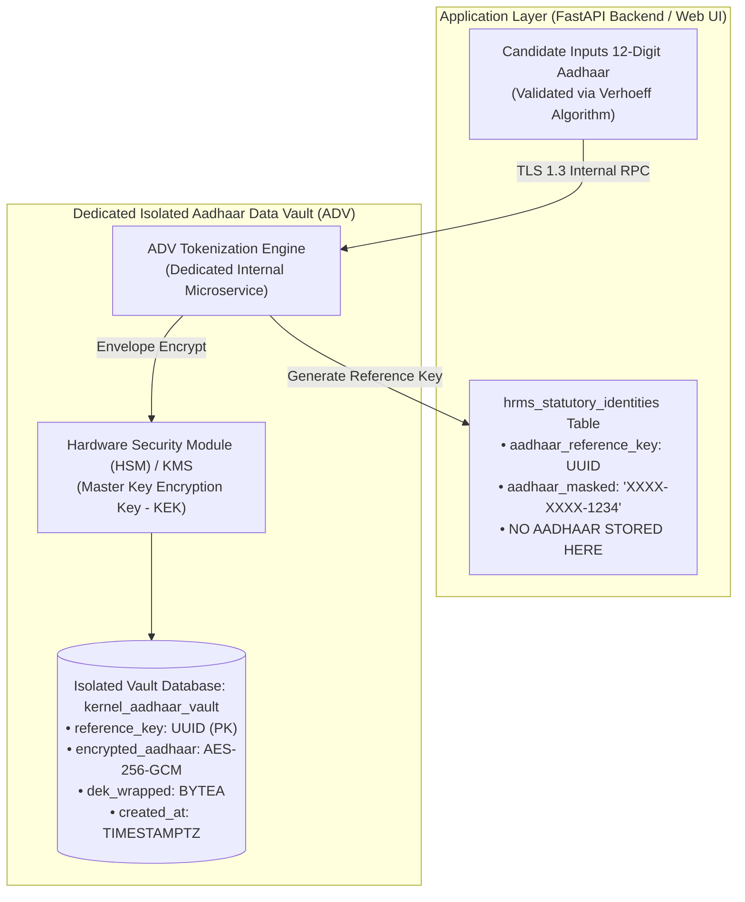
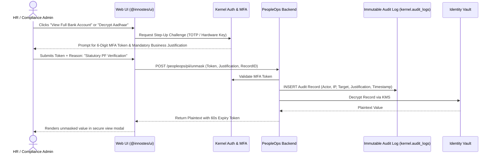

# HRMS Security Specification: Sensitive PII Vault, Encryption Guidelines & Statutory Compliance

**Document Reference:** `research/final_modules/hrms/08_sensitive_data_protection_and_pii_vault.md`  
**Classification:** Information Security Architecture & Cryptographic Engineering Standard  
**Compliance Standards:** UIDAI Aadhaar Data Vault (ADV) Regulations, Digital Personal Data Protection (DPDP) Act 2023, IT Act SPDI Rules 2011, RBI Data Storage Guidelines, ISO/IEC 27001 (Annex A.10), GDPR Article 32  
**Status:** Approved Security Architecture  

---

## 1. Executive Summary & Threat Landscape

Human Resource Management Systems (HRMS) store an enterprise's most vulnerable data assets: national identity numbers (Aadhaar, PAN, SSN), confidential bank accounts, biometric identifiers, salary structures, and dependent health declarations.

A database compromise or unauthorized SQL dump must **never expose raw plaintext identity or financial records**. 

Innostes PeopleOps implements a zero-trust cryptographic defense model:
1. **Aadhaar Data Vault (ADV) Separation**: Raw Aadhaar numbers are never stored in core business tables. The system utilizes tokenized reference keys mapping to an isolated cryptographic vault.
2. **Field-Level Envelope Encryption (FLE)**: Sensitive fields (Aadhaar, PAN, Bank Accounts, Passports) are encrypted using AES-256-GCM authenticated encryption with external KMS / HSM key management.
3. **Blind Indexing for Searchability**: Constant-time queries on encrypted fields (e.g., checking if a PAN already exists) use HMAC-SHA256 blind indexes with isolated salts, eliminating plaintext database indexes.
4. **PostgreSQL Row-Level Security (RLS)**: Enforces tenant data isolation at the storage engine level, preventing cross-tenant data leakage even under compromised application code.
5. **Tamper-Evident Access Auditing**: Any operation that unmasks or decrypts PII requires step-up Multi-Factor Authentication (MFA), logs explicit user justification, and emits an immutable, append-only audit event.

---

## 2. Regulatory Compliance & Statutory Mandates

| Regulation / Standard | Authority | Mandatory Security Constraint in Innostes PeopleOps |
| :--- | :--- | :--- |
| **Aadhaar Regulations (Section 29)** | UIDAI (Government of India) | Raw 12-digit Aadhaar storage is prohibited in primary application tables. Mandates dedicated **Aadhaar Data Vault (ADV)**, tokenization, and strict display masking (`XXXX-XXXX-1234`). |
| **DPDP Act 2023** | Data Protection Board of India | Purpose limitation, strict access control, encryption of sensitive personal data, and automated data purging upon completion of statutory retention. |
| **IT Act (SPDI Rules 2011)** | MeitY (India) | Mandates comprehensive security practices (ISO/IEC 27001 equivalent) for passwords, financial information, biometric data, and medical records. |
| **RBI Payment Storage Directive** | Reserve Bank of India | Bank account numbers and payment credentials must be encrypted at rest and restricted from unprivileged system accounts. |
| **GDPR Article 32** | European Union | Pseudonymization, field-level encryption, regular vulnerability assessment, and confidentiality guarantees. |

---

## 3. The Aadhaar Data Vault (ADV) Architecture

In compliance with UIDAI regulations, the primary database schema **never stores plaintext or encrypted 12-digit Aadhaar numbers in general application tables**:



### 3.1 Tokenization & Reference Key Specification
* When an Aadhaar number is ingested:
  1. The client runs the Verhoeff checksum algorithm.
  2. The raw 12-digit string is transmitted over TLS 1.3 to the internal tokenization engine.
  3. The tokenization engine generates an immutable, non-deterministic UUID v4 (`aadhaar_reference_key`).
  4. The engine encrypts the Aadhaar using AES-256-GCM and stores it in `kernel_aadhaar_vault`.
  5. The application table `hrms_statutory_identities` stores **only** the `aadhaar_reference_key` and the masked string `XXXX-XXXX-1234`.
* **Zero Reverse Lookup**: The business database user role (`innostes_app`) has zero `SELECT`, `UPDATE`, or `DELETE` grants on the `kernel_aadhaar_vault` table. Only the dedicated vault microservice role (`innostes_vault_service`) can query the vault.

---

## 4. Field-Level Envelope Encryption (FLE) Specification

For sensitive fields (PAN, Bank Account Numbers, Passports), Innostes uses **Envelope Encryption**:

```
+-------------------------------------------------------------------------------------------------------+
| ENVELOPE ENCRYPTION ANATOMY (AES-256-GCM)                                                             |
+-------------------------------------------------------------------------------------------------------+
| 1. Master Key (Key Encryption Key - KEK):                                                             |
|    - Stored externally in AWS KMS, GCP KMS, HashiCorp Vault, or local environment HSM.               |
|    - Rotated every 90 days automatically.                                                             |
|                                                                                                       |
| 2. Data Encryption Key (DEK):                                                                         |
|    - A unique 256-bit cryptographically secure pseudorandom key (CSPRNG) generated per record.         |
|    - Encrypts the raw sensitive string using AES-256-GCM.                                             |
|                                                                                                       |
| 3. Ciphertext Storage Structure:                                                                      |
|    kek_version : iv (12 bytes) : auth_tag (16 bytes) : ciphertext : wrapped_dek (BYTEA)              |
|                                                                                                       |
| Key Invariants:                                                                                       |
| * Galois/Counter Mode (GCM) guarantees both confidentiality and ciphertext integrity (tamper-proof).  |
| * Initialization Vectors (IV) are strictly non-repeating (generated freshly for every encryption).    |
| * Key rotation requires re-wrapping DEKs only; existing database table rows do NOT require re-write.  |
+-------------------------------------------------------------------------------------------------------+
```

---

## 5. Blind Indexing for Secure Searchability

Encrypted data cannot be indexed via standard B-Tree indexes without revealing plaintext. To allow constant-time existence checks (e.g. verifying if a PAN card is already registered by another employee) without decrypting records:

$$\text{Search Hash} = \text{HMAC-SHA256}(\text{Secret Salt}, \text{Normalize}(\text{Plaintext}))$$

```
+-------------------------------------------------------------------------------------------------------+
| BLIND INDEX LOOKUP FLOW                                                                               |
+-------------------------------------------------------------------------------------------------------+
| 1. Normalization:                                                                                     |
|    Input PAN: " abcpr1234f " -> Trim & Uppercase -> "ABCPR1234F"                                      |
|                                                                                                       |
| 2. Secret Keyed Hashing:                                                                              |
|    HMAC-SHA256(Key: KMS_BLIND_INDEX_SALT, Message: "ABCPR1234F")                                      |
|    Result: "e3b0c44298fc1c149afbf4c8996fb92427ae41e4649b934ca495991b7852b855"                      |
|                                                                                                       |
| 3. Query Execution:                                                                                   |
|    SELECT id, tenant_id FROM hrms_statutory_identities                                                |
|    WHERE pan_search_hash = 'e3b0c44298fc1c149afbf4c8996fb924...' AND tenant_id = :tenant_id;        |
|                                                                                                       |
| Security Guarantees:                                                                                  |
| * The database holds only a deterministic hash generated with an external KMS salt.                   |
| * Even with a full database dump, an attacker cannot reverse the hash to extract the plaintext PAN.   |
| * The index enables O(1) B-Tree unique constraint lookups without exposing sensitive data.            |
+-------------------------------------------------------------------------------------------------------+
```

---

## 6. PostgreSQL Row-Level Security (RLS) Implementation

To guarantee strict multi-tenant separation and prevent data leakage:

```sql
-- 1. Enable RLS on Sensitive Tables
ALTER TABLE hrms_parties ENABLE ROW LEVEL SECURITY;
ALTER TABLE hrms_statutory_identities ENABLE ROW LEVEL SECURITY;
ALTER TABLE hrms_bank_accounts ENABLE ROW LEVEL SECURITY;
ALTER TABLE hrms_onboarding_drafts ENABLE ROW LEVEL SECURITY;

-- 2. Define Tenant Isolation Policies
CREATE POLICY tenant_isolation_parties ON hrms_parties
    FOR ALL
    USING (tenant_id = NULLIF(current_setting('app.current_tenant_id', true), '')::UUID)
    WITH CHECK (tenant_id = NULLIF(current_setting('app.current_tenant_id', true), '')::UUID);

CREATE POLICY tenant_isolation_statutory ON hrms_statutory_identities
    FOR ALL
    USING (tenant_id = NULLIF(current_setting('app.current_tenant_id', true), '')::UUID)
    WITH CHECK (tenant_id = NULLIF(current_setting('app.current_tenant_id', true), '')::UUID);

CREATE POLICY tenant_isolation_bank_accounts ON hrms_bank_accounts
    FOR ALL
    USING (tenant_id = NULLIF(current_setting('app.current_tenant_id', true), '')::UUID)
    WITH CHECK (tenant_id = NULLIF(current_setting('app.current_tenant_id', true), '')::UUID);

CREATE POLICY tenant_isolation_drafts ON hrms_onboarding_drafts
    FOR ALL
    USING (tenant_id = NULLIF(current_setting('app.current_tenant_id', true), '')::UUID)
    WITH CHECK (tenant_id = NULLIF(current_setting('app.current_tenant_id', true), '')::UUID);
```

Every connection established by the backend sets `SET LOCAL app.current_tenant_id = '...'` within its transaction block. Any query attempting to access or manipulate data belonging to another tenant is blocked directly by the PostgreSQL engine.

---

## 7. Tamper-Evident Access Auditing & Step-Up Authentication

Viewing unmasked PII is strictly controlled and auditable:



### Immutable Audit Log Invariant
Audit records are stored in an append-only table where database permissions revoke `UPDATE` and `DELETE` operations from all application users:

```sql
REVOKE UPDATE, DELETE, TRUNCATE ON kernel_audit_logs FROM innostes_app;
GRANT INSERT, SELECT ON kernel_audit_logs TO innostes_app;
```

---

## 8. Memory & Logging Scrubbing Engine (`PiiScrubber`)

Plaintext sensitive data must never be written to application log streams, Sentry error reports, or APM traces:

1. **FastAPI Middleware / Log Interceptor**:
   * All incoming HTTP request payloads and outbound responses pass through `PiiScrubberMiddleware`.
   * Standard regex patterns detect Aadhaar, PAN, Bank Accounts, and Credit Cards:
     * Aadhaar Regex: `\b[2-9]{1}[0-9]{3}[ \-]?[0-9]{4}[ \-]?[0-9]{4}\b` $\rightarrow$ Replaced with `[REDACTED_AADHAAR]`
     * PAN Regex: `\b[A-Z]{5}[0-9]{4}[A-Z]{1}\b` $\rightarrow$ Replaced with `[REDACTED_PAN]`
     * Bank Account Regex: `\b[0-9]{9,18}\b` in financial endpoints $\rightarrow$ Replaced with `[REDACTED_BANK_ACC]`
2. **Crash Dump Sanitization**:
   * In the event of an unhandled Python exception, stack traces are scrubbed to prevent function local variables containing decrypted PII from being transmitted to Sentry or Datadog.

---

## 9. Compliance Document Vault Storage (S3 / MinIO)

Supporting identity proofs (Aadhaar scans, PAN scans, cancelled cheques, degree marksheets) are secured under strict object storage guidelines:

1. **Private Buckets by Default**: The storage bucket (`innostes-compliance-vault`) has all public access blocked at the AWS S3 / MinIO policy level (`BlockPublicAcls = true`, `BlockPublicPolicy = true`).
2. **Server-Side Encryption with KMS (SSE-KMS)**: Every file is encrypted on write using a dedicated customer-managed KMS key.
3. **Short-Lived Presigned URLs**:
   * The backend never proxies file bytes directly nor issues static public URLs.
   * Authorized requests generate a temporary presigned URL with an expiry time of **$\le 120$ seconds**.
   * Presigned URLs are tied strictly to the requesting user's verified session and IP address.
4. **Antivirus & Malware Ingestion Scanning**:
   * Uploaded files pass through an asynchronous ClamAV daemon scan before being marked as `VERIFIED` in `hrms_document_vault`. Files failing the scan are quarantined and deleted immediately.
