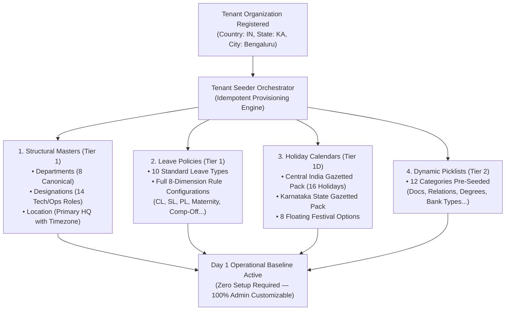

# HRMS Architecture: Heavy Structural Masters vs. Lightweight Picklists & The "Zero-Join" Frontend Pattern

**Document Reference:** `research/final_modules/hrms/09_dynamic_masters_and_tenant_seeders.md`  
**Classification:** Core Data Architecture, Entity Domain Boundaries & Frontend Ergonomics  
**Status:** Approved Architectural Decision  

---

## 1. The Architectural Dilemma: Two Fatal Anti-Patterns

When building extensible Business OS masters, teams commonly fall into one of two traps:

### Anti-Pattern A: The "One True Lookup Table" (OTLT)
Squeezing all master entities (Departments, Locations, Designations, Leave Types, Blood Groups) into a single generic `lookup_masters` table with a `metadata JSONB` column.
* **Why it fails at scale:**
  * Different masters have radically different domain schemas:
    * An **Office Location** has physical coordinates, geofence radius, IP whitelists, city, and timezone.
    * A **Department** has a reporting head of department (`manager_id`), parent department hierarchy, and General Ledger cost centers.
    * A **Leave Type** has accrual rates, carry-forward caps, encashment formulas, and sandwich rule flags.
  * Forcing structural domain entities into a single generic table eliminates database-level referential integrity, destroys foreign key cascades, breaks index performance, and degrades maintainability.

### Anti-Pattern B: The "UUID-Only Foreign Key Hell"
Storing opaque UUIDs (`department_id = "f47ac10b-58cc-4372-a567-0e02b2c3d479"`) in employee records without human-readable context.
* **Why it fails for Frontend & Developers:**
  * **Frontend Join Overhead:** The client cannot simply render `employee.department`. It must fetch all masters, maintain complex client-side hash maps, and resolve UUIDs on every render. If an offline cache is missing, the UI flashes blank or renders ugly UUID strings.
  * **Backend Query Bloat:** Every basic employee query requires 7 to 10 SQL `LEFT JOIN`s (`JOIN departments`, `JOIN designations`, `JOIN locations`, `JOIN contract_types`, `JOIN grade_bands`...), destroying query execution plans on large employee rosters.

### Anti-Pattern C: The "Hardcoded Database / Code ENUM Trap"
Using PostgreSQL `CREATE TYPE ... AS ENUM` or hardcoded backend/frontend enums for business dropdowns and workflow classifications (e.g. `contract_type`, `family_relationship`, `qualification_level`, `document_category`, `disbursal_mode`).
* **Why it fails for Business & Multi-Tenancy:**
  * **Destroys Admin Sovereignty:** Business classifications belong to the tenant administrator, not software engineers. If a hospital or manufacturing tenant needs a specific contract type ("Apprentice", "Retainer Consultant") or document proof ("Medical Fitness Certificate"), an ENUM forces them to file an engineering ticket, wait for a sprint, and require a code release.
  * **Database Migration & Lockout Pain:** In PostgreSQL, modifying ENUM types (`ALTER TYPE ... ADD VALUE`) cannot be rolled back safely, locks schema catalogs, cannot run inside multi-statement transactions in many versions, and cannot delete or reorder values without dropping and recreating the type and rewriting table columns.
  * **Multi-Tenant Monoculture:** PostgreSQL ENUM types are global to the database. Tenant A cannot have a custom relationship or qualification option without forcing it onto Tenant B.

---

## 2. The Innostes Architectural Call: Zero Database ENUMs + Tiered Masters + Hydrated Objects

Innostes resolves these anti-patterns through an unambiguous architectural law: **Zero Hardcoded Database ENUMs**. All dropdowns, classifications, and business categories are 100% dynamically governed by tenant administrators:

```
MASTER DATA ARCHITECTURE (100% ADMIN GOVERNED — ZERO HARDCODED ENUMS)
├── Tier 1: Heavy Structural Domain Tables (Dedicated Relational Schemas)
│   ├── hrms_departments (Hierarchical parent/child, Manager ID, GL Cost Center)
│   ├── hrms_designations (Pure functional role/title - ZERO pay constraints)
│   ├── hrms_locations (Geofence bounds, Lat/Lng, Timezone, IP subnets)
│   ├── hrms_leave_types (Accrual rate, Carry-forward cap, Encashable flag)
│   └── hrms_salary_components (Component type, Tax rules, Formula DAG)
│
├── Tier 2: Lightweight Dynamic Picklists (hrms_picklists Table)
│   ├── DOCUMENT_TYPE (Aadhaar, PAN, Passport, Cheque, Relieving Letter, Form 16...)
│   ├── FAMILY_RELATIONSHIP (Spouse, Son, Daughter, Father, Mother, Guardian...)
│   ├── QUALIFICATION_LEVEL (Doctorate, Post Graduate, Undergraduate, Diploma...)
│   ├── EMPLOYMENT_TYPE (Permanent Full-Time, Part-Time, Contractor, Intern, Consultant...)
│   ├── BLOOD_GROUP (A+, B+, O+, AB+...)
│   ├── RESIDENCE_TYPE (Rented, Owned, Parental, Company-Provided...)
│   ├── BANK_ACCOUNT_TYPE (Savings, Salary Corporate, Current...)
│   ├── DISBURSAL_MODE (NEFT, RTGS, IMPS, ACH, Wire Transfer, Cheque...)
│   └── SALARY_COMPONENT_TYPE (Earning, Pre-Tax Deduction, Post-Tax Deduction, Tax...)
│
└── The API Contract Pattern: Code-First Natural Keys + Hydrated Objects
    ├── In Database: Stored as clean Machine Codes ('ENG', 'STAFF_ENG', 'BLR_HQ')
    └── In API Payloads: Returned as self-contained { code, name } objects (Zero Frontend Joins!)
```

---

## 3. Tier 1: Heavy Structural Master Tables (DDL)

Entities that possess unique relational behaviors, coordinates, or domain rules reside in dedicated tables:

```sql
-- 1. Departments Master (Hierarchical with Head of Department)
CREATE TABLE hrms_departments (
    id UUID PRIMARY KEY DEFAULT uuid_generate_v4(),
    tenant_id UUID NOT NULL,
    code VARCHAR(64) NOT NULL, -- Machine code e.g. 'ENG_KERNEL'
    name VARCHAR(255) NOT NULL, -- Human label e.g. 'Core Kernel Systems'
    parent_id UUID REFERENCES hrms_departments(id) ON DELETE SET NULL,
    manager_id UUID, -- References hrms_employees(id)
    cost_center_code VARCHAR(64), -- Completely optional (startups do not use cost centers)
    is_active BOOLEAN NOT NULL DEFAULT TRUE,
    created_at TIMESTAMPTZ NOT NULL DEFAULT CURRENT_TIMESTAMP,
    CONSTRAINT uq_tenant_dept_code UNIQUE (tenant_id, code)
);

-- 2. Designations Master (Pure Functional Titles - Zero Pay Constraints)
CREATE TABLE hrms_designations (
    id UUID PRIMARY KEY DEFAULT uuid_generate_v4(),
    tenant_id UUID NOT NULL,
    code VARCHAR(64) NOT NULL, -- e.g. 'STAFF_ENG'
    name VARCHAR(255) NOT NULL, -- e.g. 'Staff Distributed Systems Engineer'
    job_family VARCHAR(64),     -- Optional grouping e.g. 'ENGINEERING'
    description TEXT,
    is_active BOOLEAN NOT NULL DEFAULT TRUE,
    created_at TIMESTAMPTZ NOT NULL DEFAULT CURRENT_TIMESTAMP,
    CONSTRAINT uq_tenant_desig_code UNIQUE (tenant_id, code)
);

-- 3. Office Locations & Branches Master (Geofencing & Timezone)
CREATE TABLE hrms_locations (
    id UUID PRIMARY KEY DEFAULT uuid_generate_v4(),
    tenant_id UUID NOT NULL,
    code VARCHAR(64) NOT NULL, -- e.g. 'BLR_HQ'
    name VARCHAR(255) NOT NULL, -- e.g. 'Bengaluru Tech Park HQ'
    physical_address TEXT NOT NULL,
    city VARCHAR(100) NOT NULL,
    state VARCHAR(100) NOT NULL,
    country_code VARCHAR(2) NOT NULL DEFAULT 'IN',
    timezone VARCHAR(64) NOT NULL DEFAULT 'Asia/Kolkata',
    latitude NUMERIC(10, 7),
    longitude NUMERIC(10, 7),
    geofence_radius_meters INT NOT NULL DEFAULT 200,
    ip_whitelist_cidrs TEXT[] DEFAULT '{}',
    is_active BOOLEAN NOT NULL DEFAULT TRUE,
    created_at TIMESTAMPTZ NOT NULL DEFAULT CURRENT_TIMESTAMP,
    CONSTRAINT uq_tenant_loc_code UNIQUE (tenant_id, code)
);
```

---

## 4. Tier 2: Lightweight Dynamic Picklists (`hrms_picklists`)

For single-dimension dropdowns and classifications where entities are code/name pairs, Innostes uses the dynamic `hrms_picklists` table. This allows the business administrator to add, edit, reorder, or disable options from the Settings UI with zero code deployments:

```sql
CREATE TABLE hrms_picklists (
    id UUID PRIMARY KEY DEFAULT uuid_generate_v4(),
    tenant_id UUID NOT NULL,
    category VARCHAR(64) NOT NULL, -- Category identifier (see catalog below)
    code VARCHAR(64) NOT NULL,     -- Natural machine code e.g. 'DOC_AADHAAR', 'REL_SPOUSE', 'EMP_PERM_FT'
    name VARCHAR(255) NOT NULL,    -- Human readable label e.g. 'Aadhaar Card Scan', 'Spouse', 'Permanent Full-Time'
    display_order INT NOT NULL DEFAULT 0,
    is_active BOOLEAN NOT NULL DEFAULT TRUE,
    is_system BOOLEAN NOT NULL DEFAULT FALSE, -- Seed default (prevents accidental hard delete; allows rename/reorder)
    created_at TIMESTAMPTZ NOT NULL DEFAULT CURRENT_TIMESTAMP,
    CONSTRAINT uq_tenant_picklist_code UNIQUE (tenant_id, category, code)
);
CREATE INDEX idx_hrms_picklists ON hrms_picklists(tenant_id, category, is_active, display_order);
```

### Supported Dynamic Picklist Categories
Administrators have complete control over the following dropdown categories in **Company Settings > Masters & Picklists**:

| Category Key | Managed Purpose | Seeded Defaults |
| :--- | :--- | :--- |
| `DOCUMENT_CATEGORY` | Vault grouping buckets | Identity Proof, Address Proof, Academic Record, Experience Letter, Tax Form, Legal Agreement |
| `DOCUMENT_TYPE` | Exact required compliance uploads | Aadhaar Card, PAN Card, Passport, Driving License, Degree Certificate, Relieving Letter, Payslip, Form 16 |
| `FAMILY_RELATIONSHIP` | Nominee and emergency contact links | Spouse, Son, Daughter, Father, Mother, Brother, Sister, Guardian, Domestic Partner |
| `QUALIFICATION_LEVEL` | Education qualification levels | Doctorate, Post Graduate, Undergraduate, Diploma, Higher Secondary, Secondary, Vocational |
| `EMPLOYMENT_TYPE` | Contract & engagement models | Permanent Full-Time, Permanent Part-Time, Fixed-Term Contractor, Intern, Retainer Consultant, Apprentice |
| `BLOOD_GROUP` | Medical & emergency response | A+, A-, B+, B-, AB+, AB-, O+, O- |
| `MARITAL_STATUS` | Demographics & statutory tax profiles | Single, Married, Divorced, Widowed |
| `RESIDENCE_TYPE` | Address tenure verification | Rented, Owned, Parental, Company-Provided |
| `BANK_ACCOUNT_TYPE` | Banking & direct deposit types | Salary Corporate, Savings, Current |
| `DISBURSAL_MODE` | Payment processing rails | NEFT, RTGS, IMPS, ACH, Wire Transfer, Corporate Cheque |
| `SALARY_COMPONENT_TYPE` | Earnings & deduction classification | Earning, Pre-Tax Deduction, Post-Tax Deduction, Statutory Tax |
| `CLEARANCE_DEPARTMENT` | Offboarding handoff owners | IT Hardware, Finance & Accounts, Facilities & Security, HR Operations |
| `EXIT_REASON` | Separation audit categorization | Better Opportunity, Higher Education, Relocation, Health, Career Break, Performance |

---

## 5. The "Zero-Join" API Contract Pattern: Why Frontend Developers Love It

How do we eliminate both frontend join complexity and heavy database query joins?

### The Storage Layer: Clean Machine Codes
In the database, the employee record stores natural machine codes:
* `department_code = 'ENG_KERNEL'`
* `designation_code = 'STAFF_ENG'`
* `location_code = 'BLR_HQ'`
* `employment_type = 'PERMANENT_FULL_TIME'`

### The Caching & Serialization Layer (In FastAPI Backend)
Because master data is small (less than 100 KB total per tenant) and changes infrequently, the backend maintains an in-memory Redis / local LRU cache of active masters:

$$\text{Cache Key: } \mathtt{tenant:\{id\}:masters} \longrightarrow \mathcal{O}(1) \text{ In-Memory Dictionary}$$

When serializing an employee roster or candidate profile, the backend hydrates `{ code, name }` in **0.01 milliseconds in Python memory**. It does **NOT** run 10 SQL `JOIN`s in PostgreSQL!

### The Outbound JSON Response Received by Frontend:
```json
{
  "id": "c71a39f1-9b22-4a0b-8d5f-1491763ef801",
  "employee_code": "INN-00104",
  "legal_name": "Jane Doe",
  "department": {
    "code": "ENG_KERNEL",
    "name": "Core Kernel Systems"
  },
  "designation": {
    "code": "STAFF_ENG",
    "name": "Staff Distributed Systems Engineer",
    "grade_band": "L5"
  },
  "location": {
    "code": "BLR_HQ",
    "name": "Bengaluru Tech Park HQ",
    "timezone": "Asia/Kolkata"
  },
  "employment_type": {
    "code": "PERMANENT_FULL_TIME",
    "name": "Permanent Full-Time"
  }
}
```

### The Huge Wins for Frontend UI:
1. **Zero Client-Side Lookups:**
   ```tsx
   // Direct, clean rendering without joins or ID maps:
   <span>{employee.department.name}</span>
   <Badge>{employee.designation.name}</Badge>
   ```
2. **Effortless Conditional Logic:**
   ```tsx
   // No checking cryptic UUIDs. Developers write clean, readable code:
   if (employee.employment_type.code === 'CONTRACTOR') {
     renderContractorInvoicingTab();
   }
   ```
3. **Instant Filter Dropdowns:**
   The frontend simply calls `GET /peopleops/masters/departments` and maps `<Option value={dept.code}>{dept.name}</Option>`.

---

## 6. How Admin Changes Propagate (Rename vs. Deactivate)

What happens when an Administrator customizes a master item?

| Action by Admin | Technical Execution | Impact on Active & Historical Employees |
| :--- | :--- | :--- |
| **Renaming an Item**<br/>(e.g., Change *"Product Management"* to *"Product Strategy & Design"*)| The admin updates `name` in `hrms_departments`. The in-memory cache is invalidated instantly. | **Instant Zero-Migration Update:** Because employees reference the code `PROD`, all active employee profiles, past payroll summaries, and filter drawers immediately render the updated name *"Product Strategy & Design"*. |
| **Adding a New Department**<br/>(e.g., Admin adds *"AI Labs"*)| Admin inserts a new record with code `AI_LABS`. | Immediately available in all candidate onboarding pickers and employee assignment dropdowns. |
| **Retiring an Item (Deactivation)**<br/>(e.g., Admin discontinues *"Operations"*)| Admin toggles `is_active = false`. | **Safe Retirement:** Existing employees assigned to `"Operations"` retain their department name on their profile and historical tax reports. However, `"Operations"` is automatically hidden from new hire forms and candidate onboarding steps. |
| **Modifying a Code Key**<br/>(Rare administrative refactor)| Postgres foreign key enforces `ON UPDATE CASCADE`: `FOREIGN KEY (tenant_id, department_code) REFERENCES hrms_departments(tenant_id, code) ON UPDATE CASCADE`. | The database automatically cascades the updated code across all referencing employee rows atomically. |

---

## 7. Tenant Seeder Engine & Canonical Master Data Catalog

### 7.1 The Zero-Friction Day 1 Principle
When a new organization registers on Innostes Business OS, the tenant is fully provisioned in under 1 second. The tenant seeder engine populates a production-ready, industry-standard operational baseline across all structural masters, leave policy templates, public holiday schedules, and dynamic picklists.

The founder or HR administrator does not need to type a single row before making their first hire or logging their first workday. Every seeded entity is tagged with `is_system = TRUE`, which guarantees that system integrity is preserved while allowing full administrative freedom to rename labels, adjust quotas, change display order, or toggle active status.



---

### 7.2 Idempotent Seeder Engine Mechanics

The seeder operates under strict idempotency guarantees:
1. **Natural Key Conflict Protection**:
   * All inserts use `ON CONFLICT (tenant_id, code) DO NOTHING` or conditional upsert.
   * If a tenant re-runs `POST /peopleops/masters/reseed-defaults`, custom items created by the administrator are never overwritten or deleted.
2. **System Invariant Flag (`is_system = TRUE`)**:
   * Pre-seeded rows are marked `is_system = TRUE`.
   * Hard `DELETE` operations on system rows are blocked if they are referenced by active contracts or ledgers.
   * However, administrators are **100% permitted to rename** `name`, adjust `display_order`, or set `is_active = FALSE` to deactivate items they do not use.

```sql
-- Architectural Seeder Upsert Pattern
INSERT INTO hrms_departments (tenant_id, code, name, is_system, is_active)
VALUES (v_tenant_id, 'ENG', 'Engineering', TRUE, TRUE)
ON CONFLICT (tenant_id, code) 
DO UPDATE SET is_active = TRUE WHERE hrms_departments.is_system = TRUE;
```

---

### 7.3 Canonical Tier 1 Structural Master Seeders

#### 1. Canonical Departments (`hrms_departments`)
Pre-seeded functional departments reflecting modern business topology:

| Department Code | Default Display Name | Hierarchy Scope |
| :--- | :--- | :--- |
| `ENG` | Engineering & Technology | Software development, infrastructure, QA, DevOps |
| `PROD` | Product Management | Product strategy, UX research, analytics |
| `DESIGN` | Design & Creative | UI/UX design, brand design, interaction design |
| `SALES` | Sales & Business Development | Inbound/outbound sales, account executives, BDRs |
| `MARKETING` | Growth & Marketing | Content, demand gen, performance marketing |
| `PEOPLEOPS` | People Operations & HR | Talent acquisition, HRBP, culture, compliance |
| `FINANCE` | Finance & Legal | Accounting, payroll controllership, tax, compliance |
| `OPERATIONS`| General Operations | Facilities, workplace, administrative operations |

#### 2. Canonical Designations & Roles (`hrms_designations`)
Functional titles decoupled from compensation bands:

| Designation Code | Default Display Name | Job Family |
| :--- | :--- | :--- |
| `SWE_I` | Software Engineer I | Engineering |
| `SWE_II` | Software Engineer II | Engineering |
| `SENIOR_SWE` | Senior Software Engineer | Engineering |
| `STAFF_ENG` | Staff Software Engineer | Engineering |
| `ENG_MGR` | Engineering Manager | Engineering Management |
| `DIR_ENG` | Director of Engineering | Engineering Leadership |
| `APM` | Associate Product Manager | Product Management |
| `PM` | Product Manager | Product Management |
| `SENIOR_PM` | Senior Product Manager | Product Management |
| `PRODUCT_DESIGNER`| Product Designer | Design |
| `BDR` | Business Development Representative | Sales |
| `ACCOUNT_EXEC` | Account Executive | Sales |
| `HR_GENERALIST` | People Operations Generalist | People Operations |
| `FINANCE_MGR` | Finance & Accounts Manager | Finance |

#### 3. Primary Location (`hrms_locations`)
Initialized from tenant registration metadata:

| Code | Default Name | Timezone | Default Geofence Radius |
| :--- | :--- | :--- | :--- |
| `HQ` | Corporate Headquarters | `Asia/Kolkata` (IN) / `America/New_York` (US) | 200 Meters |

---

### 7.4 Canonical Leave Policy Seeders (`hrms_leave_types`)

When a tenant initializes PeopleOps, the seeder creates initial time-off policy templates. 

**Critical Invariant for Startups:** The quota numbers below (e.g. 12 days Casual Leave, 18 days Privilege Leave) are **initial suggested defaults**, not hardcoded constraints. 
* Startups have total freedom: an administrator can change Casual Leave to **6 days, 8 days, 15 days, 20 days**, or any custom number.
* Startups can deactivate separate `CL` and `SL` buckets completely and create a single unified **`PTO` (Paid Time Off)** bucket (e.g. 20 or 25 days/year).
* Startups can toggle **Unlimited PTO** in 1 click, bypassing quota tracking altogether.
* Every quota, policy name, accrual schedule, and carry-forward cap is 100% editable from the visual admin cockpit.

```
+-----------------------------------------------------------------------------------------------------------------------+
| CANONICAL LEAVE TYPES SEEDER SPECIFICATION MATRIX (CUSTOMIZABLE PRESETS)                                              |
+-----------------------------------------------------------------------------------------------------------------------+
| CODE      | NAME                   | QUOTA   | ACCRUAL MODEL     | CARRY-FORWARD CAP | ENCASHABLE | NOTICE | SANDWICH |
| :---      | :---                   | :---    | :---              | :---              | :---       | :---   | :---     |
| CL        | Casual Leave           | 12.0 d  | Annual Lump-Sum   | Zero / Lapses     | No         | 0 Days | Disabled |
| SL        | Sick / Medical Leave   | 12.0 d  | Annual Lump-Sum   | Capped (Max 15d)  | No         | 0 Days | Disabled |
| PL        | Privilege Leave (Earned| 18.0 d  | Monthly (+1.5/mo) | Capped (Max 30d)  | Yes (Basic)| 7 Days | Disabled |
| MATERNITY | Statutory Maternity    | 182.0 d | Event-Triggered   | Event Duration    | No         | 30 Days| Disabled |
| PATERNITY | Paternity Leave        | 10.0 d  | Event-Triggered   | 6-Month Expiry    | No         | 7 Days | Disabled |
| COMP_OFF  | Compensatory Off       | 0.0 d   | Dynamic Punch     | 60-Day Expiry     | No         | 1 Day  | Disabled |
| BEREAVE   | Bereavement Leave      | 5.0 d   | Event-Triggered   | Event Duration    | No         | 0 Days | Disabled |
| MARRIAGE  | Marriage Milestone     | 3.0 d   | Event-Triggered   | 1-Time Lifetime   | No         | 14 Days| Disabled |
| FLOATING  | Floating Festival Off  | 2.0 d   | Pick from 8 List  | Zero / Lapses     | No         | 3 Days | Disabled |
| UNPAID_LOP| Loss of Pay (Unpaid)   | 0.0 d   | Unlimited On Sign | N/A                | N/A        | 1 Day  | Disabled |
+-----------------------------------------------------------------------------------------------------------------------+
```

#### Detailed Policy Invariants in Seed Data:
1. **Casual Leave (`CL`)**:
   * `annual_quota = 12.00`, `accrual_frequency = 'ANNUAL_LUMP_SUM'`, `accrual_timing = 'BEGINNING_OF_PERIOD'`.
   * `can_carry_forward = FALSE`, `carry_forward_cap = 0.00`. Lapses completely on December 31st.
   * `allow_half_day = TRUE`, `min_notice_days = 0`, `max_consecutive_days = 3`.
   * `sandwich_rule_mode = 'DISABLED'`.
2. **Sick Leave (`SL`)**:
   * `annual_quota = 12.00`, `accrual_frequency = 'ANNUAL_LUMP_SUM'`.
   * `can_carry_forward = TRUE`, `carry_forward_cap = 15.00`.
   * `allow_past_dating = TRUE`, `max_past_days = 3`.
   * `requires_attachment = TRUE`, `attachment_mandatory_above_days = 2` (medical certificate mandatory if $> 2$ days).
3. **Privilege Leave (`PL`)**:
   * `annual_quota = 18.00`, `accrual_frequency = 'MONTHLY_PRO_RATA'` ($+1.5$ days/month on 1st).
   * `can_carry_forward = TRUE`, `carry_forward_cap = 30.00`, `carry_forward_expiry_months = 3` (must use rollover by March 31st).
   * `is_encashable = TRUE`, `encashment_mode = 'UPON_SEPARATION_ONLY'`, `encashment_salary_basis = 'BASIC_SALARY'`.
   * `min_notice_days = 7`, `probation_rule = 'ACCRUE_ONLY_LOCKED'` (accrues during probation; unlocked upon confirmation).
4. **Compensatory Off (`COMP_OFF`)**:
   * `annual_quota = 0.00`, `accrual_frequency = 'EVENT_BASED'`.
   * Earned strictly via verified weekend or holiday punch sessions ($\ge 4.0$h $\implies 0.5$d, $\ge 8.0$h $\implies 1.0$d).
   * All credits expire automatically in 60 days from punch date if unused.
5. **Floating Festival Holiday (`FLOATING`)**:
   * `annual_quota = 2.00`. Employees claim any 2 days from the company's designated floating holiday calendar.

---

### 7.5 Official Holiday Calendar Packs & Seeders (`hrms_holiday_calendars` & `hrms_holidays`)

Innostes provides built-in jurisdiction seeder packs so administrators never manually input standard public holidays.

#### Pack 1: Central India Statutory Gazetted Holidays (2026 Baseline)
Seeded under calendar code `IN_CENTRAL_2026`:

| Date | Day | Holiday Name | Statutory Status | Type |
| :--- | :--- | :--- | :--- | :--- |
| 26 Jan 2026 | Monday | Republic Day | Mandatory Gazetted | `MANDATORY` |
| 08 Mar 2026 | Sunday | Maha Shivratri | Gazetted Observance | `MANDATORY` |
| 25 Mar 2026 | Wednesday | Holi | Mandatory Gazetted | `MANDATORY` |
| 31 Mar 2026 | Tuesday | Eid-ul-Fitr | Mandatory Gazetted | `MANDATORY` |
| 03 Apr 2026 | Friday | Good Friday | Mandatory Gazetted | `MANDATORY` |
| 20 Apr 2026 | Monday | Mahavir Jayanti | Gazetted Observance | `MANDATORY` |
| 20 May 2026 | Wednesday | Buddha Purnima | Gazetted Observance | `MANDATORY` |
| 07 Jun 2026 | Sunday | Eid-ul-Adha (Bakrid) | Mandatory Gazetted | `MANDATORY` |
| 06 Jul 2026 | Monday | Muharram | Mandatory Gazetted | `MANDATORY` |
| 15 Aug 2026 | Saturday | Independence Day | Mandatory Gazetted | `MANDATORY` |
| 05 Sep 2026 | Saturday | Milad-un-Nabi | Gazetted Observance | `MANDATORY` |
| 02 Oct 2026 | Friday | Mahatma Gandhi Jayanti | Mandatory Gazetted | `MANDATORY` |
| 20 Oct 2026 | Tuesday | Dussehra (Vijaya Dashami) | Mandatory Gazetted | `MANDATORY` |
| 08 Nov 2026 | Sunday | Diwali (Deepavali) | Mandatory Gazetted | `MANDATORY` |
| 24 Nov 2026 | Tuesday | Guru Nanak Jayanti | Mandatory Gazetted | `MANDATORY` |
| 25 Dec 2026 | Friday | Christmas Day | Mandatory Gazetted | `MANDATORY` |

#### Pack 2: State Gazetted Add-On Packs
When a location is in a specific state, the seeder supplements the central schedule:
* **Karnataka Pack (`IN_KA`)**:
  * 09 Apr 2026 (Thu) — Ugadi
  * 19 Oct 2026 (Mon) — Ayudha Puja
  * 01 Nov 2026 (Sun) — Kannada Rajyotsava
* **Maharashtra Pack (`IN_MH`)**:
  * 01 May 2026 (Fri) — Maharashtra Day
  * 14 Sep 2026 (Mon) — Ganesh Chaturthi
* **Tamil Nadu Pack (`IN_TN`)**:
  * 15 Jan 2026 (Thu) — Pongal
  * 16 Jan 2026 (Fri) — Thiruvalluvar Day

#### Pack 3: Floating / Restricted Holiday Options (8 Pre-Configured Choices)
Seeded with `holiday_type = 'OPTIONAL_FLOATING'`. Employees pick any 2:

| Date | Day | Floating Festival Name | Cultural Observance |
| :--- | :--- | :--- | :--- |
| 15 Jan 2026 | Thursday | Makar Sankranti / Pongal / Magh Bihu | Harvest Festival |
| 14 Apr 2026 | Tuesday | Dr. B.R. Ambedkar Jayanti / Vishu / Baisakhi | Regional New Year |
| 27 Aug 2026 | Thursday | Raksha Bandhan | Cultural Observance |
| 04 Sep 2026 | Friday | Janmashtami | Cultural Observance |
| 15 Sep 2026 | Tuesday | Onam | Kerala Festival |
| 20 Oct 2026 | Tuesday | Karwa Chauth | Cultural Observance |
| 06 Nov 2026 | Friday | Chhath Puja | Sun Festival |
| 31 Dec 2026 | Thursday | New Year's Eve | Year-End Observance |

#### Pack 4: International Baseline Packs
* **US Federal Pack (`US_FED`)**: New Year's Day, Martin Luther King Jr. Day, Washington's Birthday, Memorial Day, Juneteenth, Independence Day, Labor Day, Columbus Day, Veterans Day, Thanksgiving Day, Christmas Day.
* **UK Bank Holidays (`UK_BANK`)**: New Year's Day, Good Friday, Easter Monday, Early May Bank Holiday, Spring Bank Holiday, Summer Bank Holiday, Christmas Day, Boxing Day.

---

### 7.6 Canonical Tier 2 Dynamic Picklists Seeder Catalog (`hrms_picklists`)

All dropdowns across the suite are populated from `hrms_picklists`. Administrators can add, edit, or reorder these at will:

#### 1. Document Proofs & Compliance
* **Category: `DOCUMENT_CATEGORY`**:
  * `DOC_CAT_ID` — Identity Proof
  * `DOC_CAT_ADDR` — Address Proof
  * `DOC_CAT_ACAD` — Academic Record
  * `DOC_CAT_EXP` — Experience & Relieving
  * `DOC_CAT_TAX` — Tax & Statutory Forms
  * `DOC_CAT_LEGAL` — Employment Contracts & Agreements
* **Category: `DOCUMENT_TYPE`**:
  * `DOC_AADHAAR` — Aadhaar Card (Masked)
  * `DOC_PAN` — Permanent Account Number (PAN) Card
  * `DOC_PASSPORT` — Passport
  * `DOC_DRIVING_LIC` — Driving License
  * `DOC_VOTER_ID` — Voter Identification Card
  * `DOC_CANCELLED_CHEQUE` — Cancelled Cheque Leaf / Bank Passbook
  * `DOC_RELIEVING_LTR` — Previous Employer Relieving Letter
  * `DOC_PAYSLIPS_3MO` — Previous 3 Months Payslips
  * `DOC_FORM_16` — Income Tax Form 16 / Certificate
  * `DOC_DEGREE_CERT` — Degree Graduation Certificate
  * `DOC_PROV_CERT` — Provisional Marksheet

#### 2. Relationships & Beneficiaries
* **Category: `FAMILY_RELATIONSHIP`**:
  * `REL_SPOUSE` — Spouse
  * `REL_SON` — Son
  * `REL_DAUGHTER` — Daughter
  * `REL_FATHER` — Father
  * `REL_MOTHER` — Mother
  * `REL_BROTHER` — Brother
  * `REL_SISTER` — Sister
  * `REL_GUARDIAN` — Legal Guardian
  * `REL_PARTNER` — Domestic / Cohabiting Partner

#### 3. Qualifications & Academic Standing
* **Category: `QUALIFICATION_LEVEL`**:
  * `QUAL_DOCTORATE` — Doctorate / Ph.D.
  * `QUAL_POST_GRAD` — Master's Degree / Post-Graduate
  * `QUAL_UNDER_GRAD` — Bachelor's Degree / Undergraduate
  * `QUAL_DIPLOMA` — Professional Diploma / Technical Certification
  * `QUAL_HSC` — Higher Secondary Education (12th Grade)
  * `QUAL_SSC` — Secondary School Certificate (10th Grade)
  * `QUAL_VOCATIONAL` — Vocational / Trade Apprentice

#### 4. Employment & Engagement Models
* **Category: `EMPLOYMENT_TYPE`**:
  * `PERMANENT_FULL_TIME` — Permanent Full-Time
  * `PERMANENT_PART_TIME` — Permanent Part-Time
  * `CONTRACTOR` — Fixed-Term Contractor
  * `INTERN` — Graduate / Summer Intern
  * `RETAINER_CONSULTANT` — Strategic Retainer / Consultant
  * `APPRENTICE_GOVT` — NATS / NEEM Govt Apprentice

#### 5. Demographics, Banking & Operational rails
* **Category: `BLOOD_GROUP`**: `A+`, `A-`, `B+`, `B-`, `AB+`, `AB-`, `O+`, `O-`
* **Category: `MARITAL_STATUS`**: `SINGLE`, `MARRIED`, `DIVORCED`, `WIDOWED`
* **Category: `RESIDENCE_TYPE`**: `RENTED`, `OWNED`, `PARENTAL`, `COMPANY_PROVIDED`
* **Category: `BANK_ACCOUNT_TYPE`**: `SALARY_CORPORATE`, `SAVINGS`, `CURRENT`
* **Category: `DISBURSAL_MODE`**: `NEFT`, `RTGS`, `IMPS`, `ACH`, `WIRE_TRANSFER`, `CHEQUE`
* **Category: `CLEARANCE_DEPARTMENT`**: `IT_HARDWARE`, `FINANCE_ACCOUNTS`, `FACILITIES_SECURITY`, `PEOPLE_OPS`
* **Category: `EXIT_REASON`**: `BETTER_OPPORTUNITY`, `HIGHER_EDUCATION`, `RELOCATION`, `HEALTH_PERSONAL`, `CAREER_BREAK`, `MUTUAL_SEPARATION`

---

### 7.7 Annual Rollover & Multi-Branch Seeder Mechanics

What happens as the calendar advances or the company opens a new branch?

1. **New Calendar Year Provisioning**:
   * In November of each year, the system automatically runs the statutory holiday preparation job.
   * Administrators receive a 1-click notification:  
     **`[ Import 2027 Holiday Schedule for Bengaluru HQ ]`**.
   * Clicking it executes `POST /peopleops/holiday-calendars/{id}/import-pack`, creating the new calendar year with zero typing.
2. **Opening a New Branch Office**:
   * When an administrator adds a new location (e.g. `MUMBAI_BRANCH` in Maharashtra), the system prompts:
     `[✓] Automatically create Maharashtra 2026 Holiday Calendar and link to this branch`.
   * The seeder instantly provisions the combined Central + Maharashtra gazetted schedule.
3. **Reseed Missing Defaults API (`POST /peopleops/masters/reseed-defaults`)**:
   * If an administrator accidentally deletes custom items or wants to restore official system categories, calling this endpoint idempotently restores missing system records without affecting existing company customizations.

