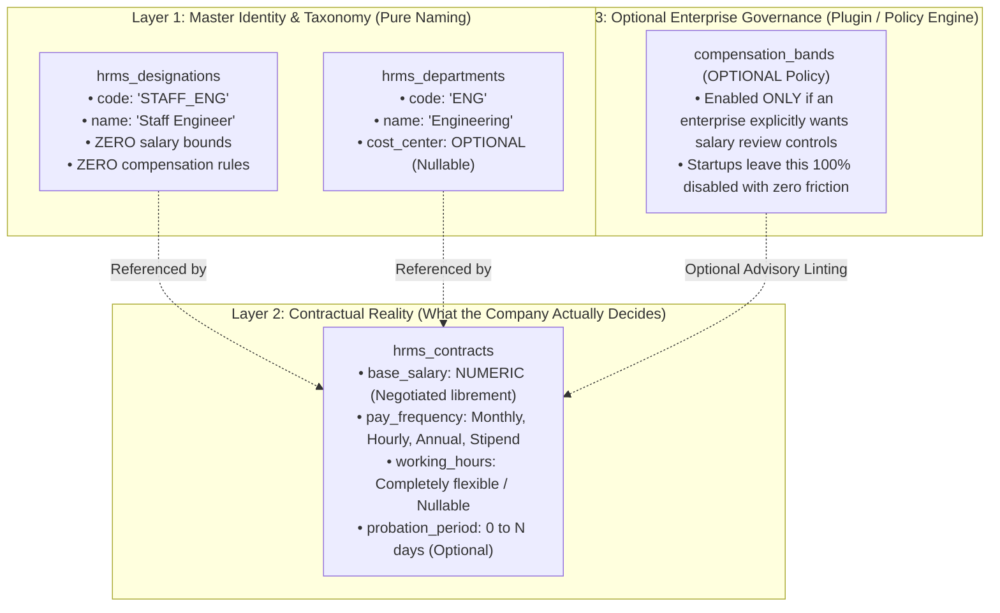

# HRMS Specification: Separation of Master Identity from Business Policies & Total Compensation Freedom

**Document Reference:** `research/final_modules/hrms/10_policy_separation_and_compensation_freedom.md`  
**Classification:** System Architecture, Governance Decoupling & Operational Flexibility  
**Target Audience:** System Architects, Core Engineers & Product Designers  
**Status:** Approved Architectural Standard  

---

## 1. Executive Summary & The Core Architectural Law

A catastrophic design flaw in legacy ERP systems is **polluting Master Data definitions with rigid operational policies**.

* **The Flaw Exposed:**
  * When a system embeds compensation boundaries (e.g., `min_salary`, `max_salary`, `default_ctc`) directly onto a `Designation` master, it breaks down immediately:
    * In a fast-growing startup, an early *"Software Engineer"* might be paid equity + minimum stipend, while a subsequent specialist hire under the same title might command 5x the market rate.
    * In another scenario, an executive or co-founder might hold a senior title with nominal cash pay.
    * If the database or master schema restricts pay to artificial salary bands, the company is blocked from compensating talent freely.
  * Similarly, mandating fixed weekly hours (e.g. `40.00 hrs`), fixed probation periods (e.g. `90 days`), mandatory Indian IFSC codes, or compulsory cost centers treats startups and global firms like rigid legacy factories.

* **The Innostes Core Architectural Law:**
  > **"Masters are pure identifiers, not operational policies. The company has absolute freedom to decide compensation, tenure, and structure without database or master-level constraints."**

---

## 2. Separation of Concerns: Identity vs. Contracts vs. Optional Policies

Innostes enforces strict architectural separation across three distinct domain layers:



---

## 3. Comprehensive Audit: Hostile Constraints Removed Across All Tables

Every table across the PeopleOps domain has been audited to eliminate restrictive assumptions:

| Table | Previous Anti-Pattern / Hostile Constraint | Clean Decoupled Architecture | Why This Matters for Startups & Global Companies |
| :--- | :--- | :--- | :--- |
| **`hrms_designations`** | Embedded `min_salary` / `max_salary` / forced `grade_band NOT NULL`. | Pure title definition: `id`, `code`, `name`, `description`, `is_active`. | Companies determine pay individually per contract. Zero salary handcuffs on job titles. |
| **`hrms_departments`** | Mandated `cost_center_code NOT NULL DEFAULT 'CC-GENERAL'`. | `cost_center_code VARCHAR(64) NULL` (Completely optional). | Early-stage startups do not use cost centers or divisional accounting. |
| **`hrms_contracts`** | Hardcoded `working_hours_per_week NOT NULL DEFAULT 40.00`. | `working_hours_per_week NUMERIC(5,2) NULL`, supports `pay_frequency` (`MONTHLY`, `HOURLY`, `ANNUAL`, `STIPEND`). | Supports 48-hour factory shifts, 35-hour European contracts, flexible startup schedules, and part-time interns. |
| **`hrms_employees`** | Mandated `probation_period_days NOT NULL DEFAULT 90`. | `probation_period_days INT NULL` (Optional). If null, employee is confirmed on Day 1. | Many tech startups hire with zero probation; forcing 90 days creates unnecessary administrative overhead. |
| **`hrms_employees`** | Mandated `grade_band NOT NULL DEFAULT 'L3'`. | `grade_band VARCHAR(64) NULL` (Optional). | Startups do not use enterprise L1-L7 leveling ladders. |
| **`hrms_parties`** | Mandated `father_name NOT NULL` and `mother_name NOT NULL`. | `father_name VARCHAR(150) NULL`, `mother_name VARCHAR(150) NULL`. | Mandatory only when submitting Indian EPF Form 2/11; non-Indian employees and global contractors are never blocked. |
| **`hrms_parties`** | Mandated `blood_group NOT NULL`. | `blood_group blood_group_type NULL`. | Candidates who do not know their blood group immediately are not blocked from completing onboarding. |
| **`hrms_parties`** | Database `CHECK (date_of_birth <= CURRENT_DATE - 18 yrs)`. | Removed database `CHECK`. Age validation handled at service layer based on jurisdiction. | Allows student interns, vocational apprentices (legal at 16+ in many jurisdictions) without database schema errors. |
| **`hrms_bank_accounts`**| Enforced Indian IFSC format as database `CHECK` constraint. | `routing_identifier VARCHAR(64) NOT NULL` (Supports IFSC, US Routing/ABA, UK Sort Code, IBAN). | Enables paying international remote contractors and global employees seamlessly. |
| **`hrms_leave_types`** | Fixed numerical quotas only (`annual_quota NOT NULL`). | Added `is_unlimited BOOLEAN DEFAULT FALSE`. | Natively supports modern **Unlimited / Flexible PTO** policies popular in tech companies. |

---

## 4. The Clean Entity Schemas

### 4.1 Pure Designation Master (Zero Pay Constraints)
```sql
CREATE TABLE hrms_designations (
    id UUID PRIMARY KEY DEFAULT uuid_generate_v4(),
    tenant_id UUID NOT NULL,
    code VARCHAR(64) NOT NULL, -- e.g. 'STAFF_ENG'
    name VARCHAR(255) NOT NULL, -- e.g. 'Staff Distributed Systems Engineer'
    job_family VARCHAR(64),     -- Optional grouping (e.g. 'ENGINEERING')
    description TEXT,
    is_active BOOLEAN NOT NULL DEFAULT TRUE,
    is_system BOOLEAN NOT NULL DEFAULT FALSE,
    created_at TIMESTAMPTZ NOT NULL DEFAULT CURRENT_TIMESTAMP,
    CONSTRAINT uq_tenant_desig_code UNIQUE (tenant_id, code)
);
```

### 4.2 Flexible Employment Contract (Company Decides Pay Freely)
```sql
CREATE TABLE hrms_contracts (
    id UUID PRIMARY KEY DEFAULT uuid_generate_v4(),
    tenant_id UUID NOT NULL,
    employee_id UUID NOT NULL REFERENCES hrms_employees(id) ON DELETE CASCADE,
    contract_type VARCHAR(64) NOT NULL DEFAULT 'PERMANENT_FULL_TIME',
    base_salary NUMERIC(18, 4) NOT NULL, -- The company decides any figure without restriction
    currency VARCHAR(3) NOT NULL DEFAULT 'INR',
    pay_frequency VARCHAR(32) NOT NULL DEFAULT 'MONTHLY', -- MONTHLY, HOURLY, ANNUAL, STIPEND
    working_hours_per_week NUMERIC(5, 2), -- Optional / Flexible
    effective_from DATE NOT NULL,
    effective_to DATE,
    created_at TIMESTAMPTZ NOT NULL DEFAULT CURRENT_TIMESTAMP
);
```

### 4.3 Global-Ready Banking Identifier (No Hardcoded National Regex in SQL)
```sql
CREATE TABLE hrms_bank_accounts (
    id UUID PRIMARY KEY DEFAULT uuid_generate_v4(),
    tenant_id UUID NOT NULL,
    party_id UUID NOT NULL REFERENCES hrms_parties(id) ON DELETE CASCADE,
    bank_name VARCHAR(150) NOT NULL,
    branch_name VARCHAR(150),
    account_number_enc BYTEA NOT NULL,
    account_number_masked VARCHAR(30) NOT NULL,
    account_number_search_hash VARCHAR(64) NOT NULL,
    account_type bank_account_type NOT NULL DEFAULT 'SALARY_CORPORATE',
    routing_identifier VARCHAR(64) NOT NULL, -- Holds IFSC (India), Routing/ABA (US), Sort Code (UK), IBAN (EU)
    routing_identifier_type VARCHAR(32) NOT NULL DEFAULT 'IFSC', -- IFSC, ROUTING_ABA, SORT_CODE, IBAN
    account_holder_name VARCHAR(150) NOT NULL,
    penny_drop_status penny_drop_status NOT NULL DEFAULT 'PENDING',
    disbursal_mode disbursal_mode NOT NULL DEFAULT 'NEFT',
    is_primary BOOLEAN NOT NULL DEFAULT TRUE,
    created_at TIMESTAMPTZ NOT NULL DEFAULT CURRENT_TIMESTAMP
);
```

### 4.4 Flexible Leave Types (Supporting Unlimited PTO)
```sql
CREATE TABLE hrms_leave_types (
    id UUID PRIMARY KEY DEFAULT uuid_generate_v4(),
    tenant_id UUID NOT NULL,
    code VARCHAR(32) NOT NULL,
    name VARCHAR(128) NOT NULL,
    is_unlimited BOOLEAN NOT NULL DEFAULT FALSE, -- Supports modern Unlimited PTO
    annual_quota NUMERIC(5, 2) DEFAULT 12.00,   -- Nullable or 0 if is_unlimited is true
    carry_forward_cap NUMERIC(5, 2) DEFAULT 0.00,
    is_encashable BOOLEAN NOT NULL DEFAULT FALSE,
    requires_approval BOOLEAN NOT NULL DEFAULT TRUE,
    is_sandwich_rule_active BOOLEAN NOT NULL DEFAULT FALSE,
    CONSTRAINT uq_tenant_leave_code UNIQUE (tenant_id, code)
);
```

---

## 5. Summary of Architectural Wins

1. **Zero Operational Friction for Startups**: A 5-person seed stage startup can hire a developer in 30 seconds with no cost centers, no grade bands, no probation period, flexible compensation, and unlimited PTO.
2. **Zero Schema Breakage for Enterprise Scale**: If a 5,000-person enterprise adopts Innostes, they can enable cost centers, configure grade ladders, and attach optional approval policies without modifying a single core database table.
3. **Clean Decoupled Architecture**: All business validation rules (like EPF statutory rules requiring father's name, or RBI IFSC formats) operate strictly in dedicated, modular validation services, keeping database storage clean, international-ready, and resilient.
