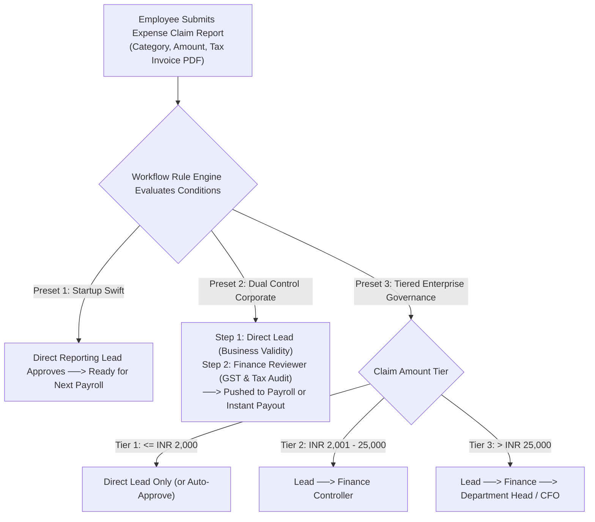

# HRMS Specification: Employee Claims, Reimbursements & Dynamic Approval Workflow Engine

**Document Reference:** `research/final_modules/hrms/11_claims_reimbursements_and_dynamic_approval_engine.md`  
**Classification:** Financial Claims, Corporate Spend Governance & Universal Workflow Engine  
**Status:** Canonical Implementation Specification  

---

## 1. Architectural Strategy: The "Unknown Company Needs" Principle

In enterprise software, hardcoding an approval flow (e.g. hardcoding `Manager -> Finance`) is guaranteed to fail:
* A 10-person startup will reject it because they have no dedicated finance team; they want the team lead to approve and have the amount paid automatically in the next payroll cycle.
* A 150-person venture-backed company will reject it because it lacks spend thresholds: claims under INR 2,000 should be auto-approved, while claims above INR 50,000 require Department Head or CFO sign-off.
* A professional services agency requires dual-routing: the Project Manager approves client-billable expenses, while the Functional Lead approves general company expenses.

To solve this universally without requiring custom code changes, Innostes Business OS implements a **Two-Tier Strategy**:

1. **Zero-Ceremony Day-1 Presets**: Pre-configured out of the box so a startup can process expense claims on Day 1 without configuring complex rule matrices.
2. **Visual Multi-Tier Workflow & Policy Engine**: An administrative rule builder where companies define multi-step approval chains, conditional value thresholds, and role-based routing dynamically.



---

## 2. Universal Workflow & Approval Rule Engine Architecture

The workflow engine is not siloed to expenses; it is a **Universal Approval Framework** that orchestrates approvals across all operational PeopleOps entities:

| Entity Type Code | Entity Description | Standard Approver Sequence |
| :--- | :--- | :--- |
| **`EXPENSE_REIMBURSEMENT`** | Employee expense claims (travel, meals, hardware, broadband) | Direct Lead $\longrightarrow$ Finance Controller $\longrightarrow$ Department Head |
| **`LEAVE_APPLICATION`** | Planned and emergency time-off requests | Direct Lead (Single-tier) or Lead $\longrightarrow$ Skip-Level (if $>3$ days) |
| **`ATTENDANCE_REGULARIZATION`**| Missing punch adjustments and dispute resolution | Direct Lead |
| **`COMP_OFF_GRANT`** | Overtime conversion to compensatory off balance | Direct Lead |
| **`SALARY_ADVANCE_LOAN`** | Short-term emergency payroll advance requests | Direct Lead $\longrightarrow$ Finance Controller $\longrightarrow$ CFO |
| **`SEPARATION_CLEARANCE`** | Multi-departmental exit sign-offs | IT $\parallel$ Facilities $\parallel$ Finance $\parallel$ HR (Parallel DAG) |

---

### The 6 Universal Approver Target Types
When configuring any step in an approval workflow, the administrator selects from 6 deterministic approver types:

1. **`REPORTING_LEAD`**: The employee's primary direct manager (`employees.manager_id`).
2. **`SKIP_LEVEL_MANAGER`**: The manager of the employee's direct manager (2nd-line manager).
3. **`ROLE_BASED`**: Any active user assigned a specific RBAC role machine code (e.g. `FINANCE_CONTROLLER`, `HR_ADMIN`, `EXPENSE_AUDITOR`). Any user holding this role can claim and sign off on the task.
4. **`DEPARTMENT_HEAD`**: The designated leader of the employee's assigned department (`departments.head_employee_id`).
5. **`SPECIFIC_USER`**: A hardcoded designated individual (e.g. Chief Operating Officer).
6. **`AUTO_APPROVE`**: Evaluates conditions and immediately marks the request as `APPROVED` without human intervention (e.g. recurring broadband bills under INR 1,500 with valid receipt attached).

---

### Condition-Based Branching Rules (If-This-Then-That)
Workflows can branch based on dynamic attributes of the request:

```
IF (claim.amount <= 2000 AND claim.category == 'BROADBAND_INTERNET')
   THEN Step 1: AUTO_APPROVE -> DISBURSE_PAYROLL

ELSE IF (claim.amount > 2000 AND claim.amount <= 25000)
   THEN Step 1: REPORTING_LEAD
        Step 2: ROLE_BASED('FINANCE_CONTROLLER') -> DISBURSE_PAYROLL

ELSE IF (claim.amount > 25000 OR claim.is_travel == TRUE)
   THEN Step 1: REPORTING_LEAD
        Step 2: ROLE_BASED('FINANCE_CONTROLLER')
        Step 3: DEPARTMENT_HEAD -> DISBURSE_PAYROLL
```

---

## 3. Employee Expense Reimbursement Lifecycle

### 1. Expense Categories & Policy Guardrails
Administrators configure corporate expense categories with policy limits:

| Category Machine Code | Label & Usage | Maximum Limit per Claim | Mandatory Receipt Threshold | Submission Window |
| :--- | :--- | :--- | :--- | :--- |
| **`TRAVEL_CONVEYANCE`** | Cab, train, flight, auto, and fuel expenses | INR 25,000.00 | Mandatory for all amounts | Within 45 days of journey |
| **`MEALS_ENTERTAINMENT`**| Client dinners, team outings, overtime food | INR 2,500.00 / day | Mandatory above INR 500.00 | Within 30 days of bill |
| **`BROADBAND_INTERNET`** | Monthly remote work internet allowance | INR 1,500.00 / month | Mandatory (Monthly PDF invoice)| Within 30 days of billing |
| **`HARDWARE_PERIPHERAL`**| Ergonomic chair, monitor, keyboard, mouse | INR 20,000.00 (One-time) | Mandatory Tax Invoice with GSTIN| Within 60 days of purchase |
| **`LEARNING_TRAINING`** | Books, conference tickets, certifications | INR 50,000.00 / year | Mandatory Certificate & Invoice| Pre-approval recommended |

#### Policy Guardrails:
* **Invoice Age Guard**: Bills dated $> 60$ days prior to the submission date are automatically flagged: *"Policy Violation: Expense bill date exceeds 60-day submission limit. Requires HR Manager exception approval."*
* **Duplicate Invoice Detection**: System runs a SHA-256 hash check and fuzzy merchant/date matching on uploaded receipt files. If the same invoice is uploaded twice (or claimed by two colleagues for the same meal), it is flagged immediately.

---

### 2. Employee Claim Report Submission (ESS)
Employees bundle multiple line items into an **Expense Claim Report** (e.g. *"Client Pitch Trip to Mumbai — Nov 2026"*):

```
+-----------------------------------------------------------------------------------------------------------------------------------+
| EXPENSE CLAIM SUBMISSION: "Client Pitch Trip to Mumbai"                                  [ Save Draft ] [ Submit for Approval ]   |
+-----------------------------------------------------------------------------------------------------------------------------------+
| Report Title: [ Client Pitch Trip to Mumbai                     ]   Cost Center: [ SALES - Enterprise Deals                     v]|
| Business Purpose: Travel to attend on-site executive presentation with Acme Corp leadership.                                      |
+----+-------------+----------------------+-------------------+---------------+---------------+-------------------+----------------+
| #  | DATE        | CATEGORY             | MERCHANT NAME     | AMOUNT (INR)  | TAX/GST PAID  | RECEIPT ATTACHED  | BILLABLE?      |
+----+-------------+----------------------+-------------------+---------------+---------------+-------------------+----------------+
| 1  | 02 Nov 2026 | TRAVEL_CONVEYANCE    | IndiGo Airlines   |  8,450.00     | 422.50 (CGST) | indigo_ticket.pdf | [✓] Billable   |
| 2  | 02 Nov 2026 | TRAVEL_CONVEYANCE    | Uber India        |    650.00     |  32.50 (GST)  | uber_ride_02.pdf  | [✓] Billable   |
| 3  | 02 Nov 2026 | MEALS_ENTERTAINMENT  | The Oberoi Dining |  4,200.00     | 210.00 (GST)  | dinner_receipt.jpg| [✓] Billable   |
| 4  | 03 Nov 2026 | TRAVEL_CONVEYANCE    | Uber India        |    720.00     |  36.00 (GST)  | uber_ride_03.pdf  | [✓] Billable   |
+----+-------------+----------------------+-------------------+---------------+---------------+-------------------+----------------+
| [ + Add Expense Line Item ]                                               TOTAL CLAIM AMOUNT: INR 14,020.00 (GST: INR 701.00)     |
+-----------------------------------------------------------------------------------------------------------------------------------+
```

---

### 3. Manager Review (Team View)
The reporting manager evaluates operational necessity:
* Can approve all line items, reject individual items (e.g. reject line 3 if alcohol was included without client authorization), or request clarification.
* Once the manager signs off, the claim moves automatically to the next step in the workflow chain (Finance Review).

---

### 4. Finance Verification Cockpit (`/hrms/claims/finance-verification`)
Finance reviewers perform statutory and accounting verification:
* **Tax Invoice Validation**: Verifies that the invoice is made out in the corporate legal entity name with a valid GSTIN for Input Tax Credit (ITC) claiming.
* **Non-Taxable Classification**: Ensures legitimate business expenses are categorized as tax-exempt reimbursements rather than taxable salary perquisites.
* **Actions**: `[ Approve for Payroll Disbursal ]`, `[ Approve for Instant Bank Transfer ]`, or `[ Request Tax Invoice Revision ]`.

```
+-----------------------------------------------------------------------------------------------------------------------------------+
| FINANCE CLAIMS VERIFICATION COCKPIT                                                 [ Status: 6 Pending Verification ] [ Filter v]|
+------------------------------------+----------------------------------------------------------------------------------------------+
| CLAIMS QUEUE                       | CLAIM DETAILS: EXP-8842 — Sarah Chen (Client Pitch Trip to Mumbai)                           |
|                                    | Total Claim: INR 14,020.00 | Manager Approved: INR 14,020.00 by Keshav Iyer                   |
| [•] EXP-8842: Sarah Chen   [14.0k] | +------------------------------------------------------------------------------------------+ |
| [ ] EXP-8843: Rahul Verma  [ 1.5k] | | LINE ITEM 1: IndiGo Airlines (Flight 6E-204 BLR -> BOM)                                  | |
| [ ] EXP-8844: David Miller [ 4.2k] | | Amount: INR 8,450.00 | GSTIN: 29AABCI1234D1Z0 (Valid ITC Eligible)                        | |
|                                    | | Invoice Status: Corporate Name & GSTIN verified on bill.                                 | |
| Quick Actions:                     | | Decision: [✓ Accept Tax Invoice ]  [ Disallow GST ITC ]  [ Reject Item ]                  | |
| (•) All Pending Review (6)         | +------------------------------------------------------------------------------------------+ |
| ( ) High Value (> 25k) (1)         | | SPLIT-SCREEN INLINE RECEIPT VIEWER: [ indigo_ticket.pdf ]                                | |
|                                    | | [ Zoom In ] [ Zoom Out ] [ Rotate ] [ Download Original ]                                | |
| Settlement Destination:            | | Verified GSTIN: 29AABCI1234D1Z0 | GST Amount: INR 422.50 (Passes GSTR-2B verification)   | |
| (•) Include in Next Payroll Run    | +------------------------------------------------------------------------------------------+ |
|     (November 2026 Cycle)          | | FINAL DISBURSEMENT ACTION:                                                               | |
| ( ) Immediate Bank Payout (API)    | | [✓ Approve & Ingest into November Payroll ]    [ Disburse Immediately via Bank Rail -> ] | |
+------------------------------------+----------------------------------------------------------------------------------------------+
```

---

### 5. Disbursement Rails: Payroll Ingestion vs. Instant Payout

When Finance approves an expense claim, the system offers two distinct payout paths:

#### Option A: Ingest into Next Monthly Payroll Run (Standard Default)
* The approved reimbursement amount (`INR 14,020.00`) is automatically queued as a **Non-Taxable Earning Line Item (`EXPENSE_REIMBURSEMENT`)** for the upcoming payroll run.
* **Zero Tax Impact**: It increases net take-home pay without increasing gross taxable income under Section 192.
* **Audit Trail on Payslip**: The employee's monthly payslip lists:
  `Reimbursements (Non-Taxable): INR 14,020.00`.
* **Zero Spreadsheet Ceremony**: Payroll administrators do not need to export, format, or import manual reimbursement spreadsheets. The payroll DAG pulls all `APPROVED_FOR_PAYROLL` claims for the cycle automatically.

#### Option B: Immediate Out-of-Cycle Direct Bank Transfer
* For large claims or urgent travel settlements, Finance can select **`[ Disburse Immediately via Bank Rail ]`**.
* The system triggers an instant payment via corporate banking APIs (RazorpayX, Cashfree, ICICI CIB API, or US NACHA ACH).
* The claim status updates to `PAID_OUT_OF_CYCLE` with the banking transaction reference number (UTR).
* The amount is excluded from the monthly payslip earnings to prevent double payment, but recorded in LedgerFlow as an immediate cash credit and expense debit.

---

## 4. Visual Approval Workflow Builder Wireframe (`/hrms/settings/approval-workflows`)

Administrators configure multi-step approval flows with a visual drag-and-drop rule builder:

```
+-----------------------------------------------------------------------------------------------------------------------------------+
| WORKFLOW BUILDER: "Expense Reimbursements Corporate Policy"                                [ Test Workflow ] [ Save Workflow ]    |
+-----------------------------------------------------------------------------------------------------------------------------------+
| Target Entity: [ EXPENSE_REIMBURSEMENT v]     Policy Status: [ Active (Default) v]     Evaluation Mode: [ Sequential Stepper     v]|
+-----------------------------------------------------------------------------------------------------------------------------------+
| RULE SET 1: SMALL VALUE CLAIMS (<= INR 2,000.00)                                                                                  |
| Trigger Conditions: [ Amount <= 2,000.00 ] AND [ Category IN ('MEALS', 'BROADBAND', 'LOCAL_CONVEYANCE') ]                        |
|                                                                                                                                   |
| [ Step 1: Direct Reporting Lead (REPORTING_LEAD) ] ────> [ Action: Approve & Mark for Next Payroll ]                              |
| SLA: [ 48 Hours v] | On SLA Timeout: [ Auto-Escalate to Skip-Level Manager v]                                                     |
+-----------------------------------------------------------------------------------------------------------------------------------+
| RULE SET 2: STANDARD BUSINESS EXPENSES (INR 2,001.00 TO INR 25,000.00)                                                            |
| Trigger Conditions: [ Amount > 2,000.00 ] AND [ Amount <= 25,000.00 ]                                                             |
|                                                                                                                                   |
| [ Step 1: Direct Reporting Lead ] ──> [ Step 2: Role: FINANCE_CONTROLLER ] ──> [ Action: Choose Payroll vs Bank API ]             |
| Step 1 SLA: [ 48 Hours v] | Step 2 SLA: [ 72 Hours v] | Presence Fallback: [✓] Enable 2nd-Line Manager Fallback if Lead is On Leave |
+-----------------------------------------------------------------------------------------------------------------------------------+
| RULE SET 3: HIGH VALUE & EXECUTIVE CAPITAL CLAIMS (> INR 25,000.00)                                                               |
| Trigger Conditions: [ Amount > 25,000.00 ] OR [ Category == 'HARDWARE_PERIPHERAL' ]                                               |
|                                                                                                                                   |
| [ Step 1: Reporting Lead ] ──> [ Step 2: Finance Controller ] ──> [ Step 3: Department Head / CFO ] ──> [ Action: Approved ]     |
| Step 3 Approver: [ DEPARTMENT_HEAD v] (Fallback to CFO: Keshav Iyer if Department Head is submitter)                              |
+-----------------------------------------------------------------------------------------------------------------------------------+
| [ + Add New Rule Set / Branch ]                                                               [ Run Dependency & Deadlock Audit ] |
+-----------------------------------------------------------------------------------------------------------------------------------+
```
