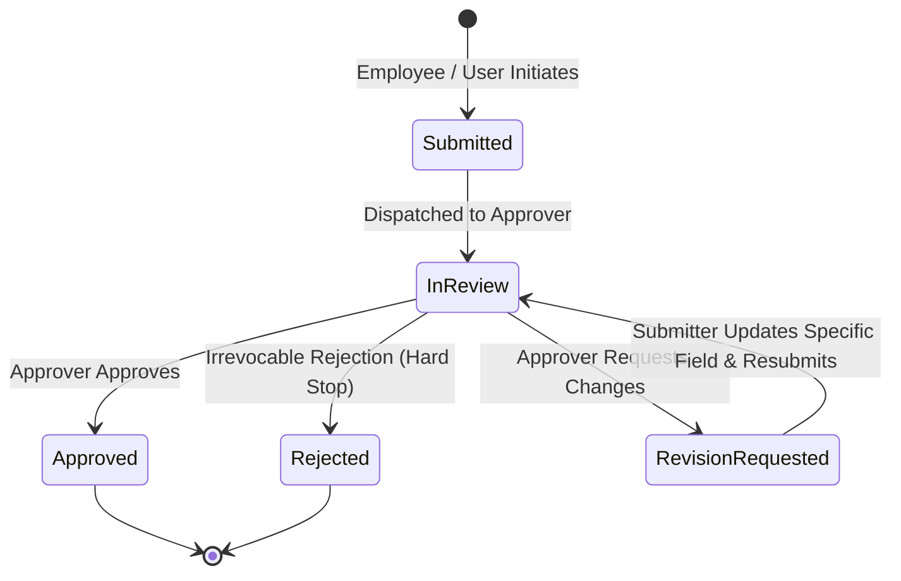

# Innostes Business OS: Universal Workflow & Approval Engine (Phase 2 Architecture)

**Document Reference:** `research/final_modules/hrms/12_phase2_universal_workflow_and_approval_engine.md`  
**Classification:** Phase 2 Cross-Module Architectural Specification & Governance Engine  
**Status:** Reserved for Phase 2 Discussion & Core Implementation  

---

## 1. Executive Vision: Cross-Module Unified Workflow Engine

In traditional ERP implementations, approval workflows are siloed within individual modules (e.g. HR leave approval, sales discount approval, procurement purchase order sign-off). This causes severe code duplication, inconsistent operational policies, and fragmented manager user experiences.

The **Innostes Universal Workflow Engine (Phase 2)** establishes an operating-system-level shared kernel service (`kernel/workflow`) that provides:

1. **A Single Unified Approvals Command Center (`/approvals`)**: A single consolidated inbox where executives and managers review, action, and bulk-process all pending requests across PeopleOps, SalesFlow, Procurement, and LedgerFlow.
2. **Universal Routing Topologies**: Six distinct routing patterns spanning simple 1-click approvals to complex multi-stakeholder parallel DAGs.
3. **Resilience & Governance Primitives**: Presence-aware routing, Out of Office (OOO) proxy delegation, skip-level fallback, maker-checker segregation of duties, SLA auto-escalation, and non-binary decision loops ("Send Back for Revision").
4. **Progressive Complexity by Company Size**: Startup Swift (zero-friction 1-click execution) scaling seamlessly to Tiered Enterprise (multi-level dynamic thresholds and audit trails) without refactoring application code.

---

## 2. The 6 Universal Workflow Routing Topologies

Every business process in Innostes Business OS binds to one of six universal workflow topologies:

```mermaid
flowchart TD
    subgraph T1["1. Hierarchical Chain of Command"]
        H1["Direct Reporting Lead"] --> H2["Skip-Level (2nd-Line Manager)"] --> H3["Department Head / VP"]
    end

    subgraph T2["2. Dynamic Threshold (Stepped)"]
        S1["Transaction Amount / Metric"] --> Cond{"Threshold Band?"}
        Cond -->|"<= INR 5,000 / $100"| Auto["Auto-Approve / Lead Only"]
        Cond -->|"INR 5,001 - 50,000"| L1["Direct Lead + Finance Controller"]
        Cond -->|"> INR 50,000 / $1,000"| L2["Direct Lead + Department VP + CFO"]
    end

    subgraph T3["3. Parallel Multi-Stakeholder DAG"]
        P1["Initiate Process"]
        P1 --> IT["IT Desk"]
        P1 --> FIN["Finance Desk"]
        P1 --> LEG["Legal Desk"]
        IT & FIN & LEG --> FinalMerge["Merged Consensus Approval"]
    end

    subgraph T4["4. Role / Pool (First-to-Claim)"]
        R1["Task Dispatched to Role"] --> Pool["Operations Pool (N Members)"]
        Pool --> Claim["First Available Member Claims & Actions"]
    end
```



### Topology Descriptions & Target Scenarios:

| Topology | Operational Mechanism | Target Scenarios |
| :--- | :--- | :--- |
| **1. Hierarchical Chain** | Traverses organizational reporting links upwards (`manager_id` $\rightarrow$ `skip_level_id` $\rightarrow$ `dept_head`). | Leave applications, comp-off grants, timesheet approvals, promotion recommendations. |
| **2. Dynamic Threshold (Stepped)** | Evaluates financial or operational bounds; additional approval tiers activate dynamically as amounts increase. | Sales deal discounting (>15% needs Sales Manager, >30% needs VP/CFO), Expense claim reports, Purchase Orders. |
| **3. Parallel Multi-Stakeholder (DAG)** | Dispatches concurrent clearance tasks to multiple independent departments. Joins when all (or quorum) complete. | Employee offboarding clearances, enterprise contract / MSA sign-offs (Legal + Security + Finance). |
| **4. Role Pool (First-to-Claim)** | Dispatched to a functional role queue rather than an individual. Any member of the role claims and resolves the item. | IT hardware requests, statutory tax proof verification, customer refund verifications. |
| **5. Matrix / Dotted-Line** | Requires dual sign-off from both the direct administrative lead and the functional project / cost-center manager. | Cross-functional project timesheets, client-billable travel expense claims. |
| **6. Conditional Branching** | If-Else routing evaluated against contextual JSON metadata (e.g. `Client Country == US`, `Margin Floor Breach == TRUE`). | Non-standard payment terms, out-of-policy travel exceptions, hazardous work allowances. |

---

## 3. Real-World Governance & Resilience Engine

### 3.1 Maker-Checker Segregation of Duties (Self-Approval Ban)
* **The Rule**: A requester can **never** approve their own submission, even if they hold the designated approver role (e.g. a Department Head submitting their own business travel claim or personal leave).
* **Automated Redirection**: If `requester_id == approver_id`, the engine automatically:
  1. Identifies the requester's direct superior in the reporting tree (e.g. CEO or Board).
  2. If the requester has no direct superior (e.g. Founder/CEO), the step redirects to an administrative override pool (e.g. Head of Finance / Company Secretary).

### 3.2 Presence-Aware Routing & Out of Office (OOO) Fallback
* When an approval task is dispatched, the engine queries the recipient's real-time operational status:
  1. **Active Proxy Delegation**: If the approver has configured a scheduled OOO delegation, the task routes directly to their chosen proxy.
  2. **Presence-Aware Fallback**: If the approver has no proxy configured but their operational attendance status is `ON_LEAVE` or `SICK`, the engine automatically routes the request to their **2nd-Line (Skip-Level) Manager**.
  3. **Visual Transparency**: The acting approver sees the task annotated with `[ Acting for Rajesh Kumar (On Leave) ]`.

### 3.3 SLA Timeouts & Escalation Ladders
Every workflow step defines an explicit SLA window (e.g. 24 hours, 48 hours):
* **T - 4 Hours**: System dispatches a contextual reminder notification (Email, Slack, WhatsApp).
* **T + 0 Hours (SLA Expiry)**: Task status transitions to `ESCALATED`. The task escalates up the reporting chain to the skip-level manager.
* **T + 24 Hours (Critical Default Rule)**:
  * **Low-Risk Flows** (e.g. punch regularization under 30 mins, expense claims under INR 500): Auto-approve with audit log reason `AUTO_APPROVED_DUE_TO_SLA_EXPIRY`.
  * **High-Risk Flows** (e.g. salary advances, deal discounts >20%, bank batch commits): Freezes item and dispatches an emergency executive alert.

### 3.4 Non-Binary Decision Loop: "Send Back for Revision"
Rather than forcing a binary Approve/Reject that deletes work, the engine implements a three-way state machine:



* **Inline Contextual Annotation**: The approver highlights a specific receipt or field and enters a note (e.g. *"Please attach tax invoice displaying company GSTIN"*).
* **Zero Rework**: The submitter updates only the flagged field and clicks `[ Re-submit for Review ]` without re-entering all line items.

---

## 4. Unified Approvals Command Center (`/approvals`)

The Unified Approvals screen provides executives and managers with a centralized dashboard for all organizational tasks:

```
+-----------------------------------------------------------------------------------------------------------------------------------+
| INNOSTES BUSINESS OS  ::  UNIFIED APPROVAL COMMAND CENTER                                                        [ User: David Kim ]|
+-----------------------------------------------------------------------------------------------------------------------------------+
| [ Action Required (7) ]   [ Delegated to Me as Proxy (2) ]   [ Escalated (1) ]   [ My Submissions (3) ]   [ Completed History ]   |
|                                                                                                                                   |
| Filters: Module [ All Modules v ]   Priority [ All Priorities v ]   Search: [ Search employee, client, PO#...                  ]   |
+----+-------------+--------------------+---------------------------------------+-------------+-------------+-----------+-----------+
| #  | MODULE      | REQUEST TYPE       | SUBJECT / ENTITY                      | SUBMITTER   | AMOUNT/DAYS | SLA LEFT  | ACTIONS   |
+----+-------------+--------------------+---------------------------------------+-------------+-------------+-----------+-----------+
| 1  | PeopleOps   | Leave Application  | Casual Leave (3 Days: Nov 12 - Nov 14)| Sarah Chen  | 3.0 Days    | 18 Hours  | [✓] [✕] [v]|
| 2  | SalesFlow   | Deal Discount (25%)| Acme Corp Expansion (ARR $120,000)    | Mark Taylor | -$30,000.00 | 4 Hours   | [✓] [✕] [v]|
| 3  | PeopleOps   | Expense Report     | Client Meeting & Travel (Mumbai)      | Sarah Chen  | INR 14,020  | 36 Hours  | [✓] [✕] [v]|
| 4  | Procurement | Purchase Order     | AWS Server Expansion (PO-2026-088)    | Infra Team  | $4,500.00   | 12 Hours  | [✓] [✕] [v]|
| 5  | SalesFlow   | Payment Terms (Net)| CyberDyne Systems (Request: Net 90)   | Lisa Ray    | Non-Std Term| 24 Hours  | [✓] [✕] [v]|
| 6  | PeopleOps   | Timesheet Sign-Off | October Monthly Hours (168h worked)   | Vikram M.   | 168.0 Hours | 48 Hours  | [✓] [✕] [v]|
| 7  | LedgerFlow  | Journal Entry      | Accrued Bonus Adjustment (JE-901)     | Fin Control | INR 2.50 L  | 8 Hours   | [✓] [✕] [v]|
+----+-------------+--------------------+---------------------------------------+-------------+-------------+-----------+-----------+
| [ Bulk Actions v ] -> [ ✓ Approve Selected (3) ]  [ ✕ Reject Selected ]        Showing 7 pending items requiring your sign-off     |
+-----------------------------------------------------------------------------------------------------------------------------------+
```

---

## 5. Universal Database Schema DDL (Shared Kernel Service)

The schema operates under `kernel/workflow` and services all modules via strict foreign key decoupling:

```sql
-- ============================================================================
-- 1. WORKFLOW DEFINITIONS & MASTER RULES
-- ============================================================================

CREATE TABLE sys_workflow_definitions (
    id UUID PRIMARY KEY DEFAULT uuid_generate_v4(),
    tenant_id UUID NOT NULL,
    module_code VARCHAR(64) NOT NULL, -- 'PEOPLEOPS', 'SALESFLOW', 'PROCUREMENT', 'LEDGERFLOW'
    entity_type VARCHAR(64) NOT NULL, -- 'HRMS_LEAVE', 'HRMS_CLAIM', 'SALES_DEAL_DISCOUNT', 'PURCHASE_ORDER'
    workflow_name VARCHAR(255) NOT NULL,
    description TEXT,
    is_active BOOLEAN NOT NULL DEFAULT TRUE,
    created_at TIMESTAMPTZ NOT NULL DEFAULT CURRENT_TIMESTAMP,
    updated_at TIMESTAMPTZ NOT NULL DEFAULT CURRENT_TIMESTAMP
);
CREATE UNIQUE INDEX idx_sys_wf_def_tenant ON sys_workflow_definitions(tenant_id, entity_type);

CREATE TABLE sys_workflow_rules (
    id UUID PRIMARY KEY DEFAULT uuid_generate_v4(),
    tenant_id UUID NOT NULL,
    definition_id UUID NOT NULL REFERENCES sys_workflow_definitions(id) ON DELETE CASCADE,
    rule_name VARCHAR(255) NOT NULL,
    priority INT NOT NULL DEFAULT 100, -- Evaluated in ascending priority order
    condition_expression JSONB NOT NULL DEFAULT '{}'::jsonb, -- e.g. {"operator": "GREATER_THAN", "field": "discount_pct", "value": 20.0}
    created_at TIMESTAMPTZ NOT NULL DEFAULT CURRENT_TIMESTAMP
);

CREATE TABLE sys_workflow_rule_steps (
    id UUID PRIMARY KEY DEFAULT uuid_generate_v4(),
    tenant_id UUID NOT NULL,
    rule_id UUID NOT NULL REFERENCES sys_workflow_rules(id) ON DELETE CASCADE,
    step_order INT NOT NULL, -- 1, 2, 3...
    step_name VARCHAR(255) NOT NULL,
    approver_type VARCHAR(64) NOT NULL, -- 'DIRECT_MANAGER', 'SKIP_LEVEL_MANAGER', 'DEPARTMENT_HEAD', 'ROLE_POOL', 'SPECIFIC_USER'
    approver_target_id UUID, -- Role ID or specific User ID if approver_type requires it
    sla_hours INT NOT NULL DEFAULT 48,
    action_on_sla_breach VARCHAR(32) NOT NULL DEFAULT 'ESCALATE_TO_SKIP_LEVEL', -- 'ESCALATE_TO_SKIP_LEVEL', 'AUTO_APPROVE', 'NOTIFY_ADMIN'
    is_required BOOLEAN NOT NULL DEFAULT TRUE
);
CREATE INDEX idx_sys_wf_steps ON sys_workflow_rule_steps(rule_id, step_order);

-- ============================================================================
-- 2. WORKFLOW RUNTIME INSTANCES & TASKS
-- ============================================================================

CREATE TABLE sys_workflow_instances (
    id UUID PRIMARY KEY DEFAULT uuid_generate_v4(),
    tenant_id UUID NOT NULL,
    definition_id UUID NOT NULL REFERENCES sys_workflow_definitions(id),
    matched_rule_id UUID REFERENCES sys_workflow_rules(id),
    entity_type VARCHAR(64) NOT NULL,
    entity_id UUID NOT NULL, -- ID of the target record (e.g. leave_application_id, deal_id)
    requester_id UUID NOT NULL,
    current_step_order INT NOT NULL DEFAULT 1,
    status VARCHAR(32) NOT NULL DEFAULT 'IN_PROGRESS', -- 'IN_PROGRESS', 'APPROVED', 'REJECTED', 'REVISION_REQUESTED', 'CANCELLED'
    context_payload JSONB NOT NULL DEFAULT '{}'::jsonb,
    created_at TIMESTAMPTZ NOT NULL DEFAULT CURRENT_TIMESTAMP,
    completed_at TIMESTAMPTZ
);
CREATE INDEX idx_sys_wf_instances ON sys_workflow_instances(tenant_id, entity_type, entity_id);

CREATE TABLE sys_workflow_tasks (
    id UUID PRIMARY KEY DEFAULT uuid_generate_v4(),
    tenant_id UUID NOT NULL,
    instance_id UUID NOT NULL REFERENCES sys_workflow_instances(id) ON DELETE CASCADE,
    step_order INT NOT NULL,
    assigned_user_id UUID NOT NULL,
    acting_proxy_user_id UUID, -- Populated if actioned by an OOO proxy
    is_escalated BOOLEAN NOT NULL DEFAULT FALSE,
    sla_expires_at TIMESTAMPTZ NOT NULL,
    status VARCHAR(32) NOT NULL DEFAULT 'PENDING', -- 'PENDING', 'APPROVED', 'REJECTED', 'REVISED'
    decision_notes TEXT,
    actioned_at TIMESTAMPTZ,
    created_at TIMESTAMPTZ NOT NULL DEFAULT CURRENT_TIMESTAMP
);
CREATE INDEX idx_sys_wf_tasks_user ON sys_workflow_tasks(assigned_user_id, status);

CREATE TABLE sys_workflow_action_logs (
    id UUID PRIMARY KEY DEFAULT uuid_generate_v4(),
    tenant_id UUID NOT NULL,
    task_id UUID NOT NULL REFERENCES sys_workflow_tasks(id),
    action VARCHAR(32) NOT NULL, -- 'SUBMITTED', 'APPROVED', 'REJECTED', 'REVISION_REQUESTED', 'DELEGATED', 'ESCALATED'
    actor_id UUID NOT NULL,
    actor_ip_address VARCHAR(45),
    comments TEXT,
    created_at TIMESTAMPTZ NOT NULL DEFAULT CURRENT_TIMESTAMP
);
```

---

## 6. Programmatic Module Integration Pattern

Any backend module integrates into the Universal Workflow Engine with zero boilerplate:

```python
# Calling pattern from any module (e.g. SalesFlow, PeopleOps)
from kernel.workflow.service import workflow_engine

# Step 1: Initiate workflow
instance = await workflow_engine.initiate(
    tenant_id=tenant_id,
    module_code="SALESFLOW",
    entity_type="SALES_DEAL_DISCOUNT",
    entity_id=quote.id,
    requester_id=current_user.id,
    context={
        "discount_percent": 25.0,
        "deal_value_inr": 1200000.0,
        "customer_tier": "STRATEGIC",
        "margin_floor_breached": True,
    },
    callback_hook="salesflow.services.quotes.handle_workflow_result"
)

# Step 2: System evaluates rules, generates task in recipient's Unified Inbox,
# manages SLAs, handles OOO delegations, and executes callback on completion.
```

---

## 7. Progressive Preset Configurations by Organization Size

| Tier | Configuration Model | Operational SLA | Friction Level |
| :--- | :--- | :--- | :--- |
| **Startup Swift** | Single-tier direct manager sign-off. Low-value transactions (< INR 10,000 / < 15% discount) auto-approve immediately. | 48 Hours | Zero friction, 1-click execution. |
| **Growth Dual-Control** | Direct Lead + Finance Controller. Auto-fallback to skip-level manager if lead is absent. | 24 - 48 Hours | Balanced speed with corporate checks. |
| **Tiered Enterprise** | Multi-step stepped dynamic thresholds, parallel multi-department DAG clearances, Maker-Checker enforcement, and Class 3 DSC signing. | 12 - 24 Hours | Full SOX / ISO compliance with audit trail. |

---

## 8. Implementation Roadmap (Phase 2 Milestones)

1. **Sprint 1**: Kernel Workflow Engine Core (`kernel/workflow/service.py`, rules evaluator, DAG task scheduler).
2. **Sprint 2**: Unified Approvals Inbox Frontend (`apps/web-app/src/app/approvals/page.tsx` with bulk action bars and contextual drawer).
3. **Sprint 3**: Integration with PeopleOps (Leaves, Claims, Regularizations, F&F Settlement sign-offs).
4. **Sprint 4**: Integration with SalesFlow (Quote discounting, payment term exceptions, contract approvals).
5. **Sprint 5**: Integration with Procurement & LedgerFlow (Purchase Orders, manual journal entry postings).
