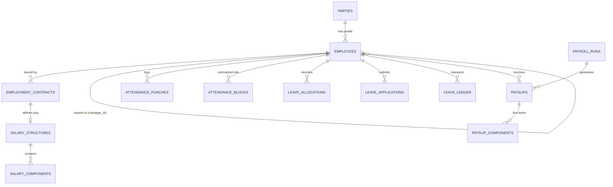

# Innostes Business OS: HRMS (PeopleOps) Consolidated Specification

**Target Module:** `PeopleOps` (`modules/peopleops`)  
**Classification:** Canonical Domain Specification & Technical Implementation Blueprint  
**Status:** Consolidated & Approved for Core Engineering  

---

## 1. Executive Summary

This folder contains the consolidated, production-grade functional and technical specifications for the **HRMS & Workforce Suite (PeopleOps)** of the Innostes Business Operating System.

It synthesizes findings from:
* **Enterprise Benchmarks:** Workday HCM, Rippling, Deel, Frappe HR, and Zoho People.
* **Modern Employee UX:** Immediate 1-click Web Check-In / Check-Out, live workday timer, work location toggle (`Office` / `Home`), team presence indicators (*"Who's out today"*), and unified line manager approval queues.
* **Architectural Decoupling:** Standalone execution of the FastAPI backend via strict OpenAPI 3.1 schemas, independent of whether the client uses `@innostes/ui` or a custom portal.
* **Statutory Compliance Engines:** Full mathematical models for Indian statutory deductions (PF, ESI, PT, TDS Section 115BAC) and US payroll withholdings (W-4, FICA, Medicare, SIT).
* **Zero-Variance Financial Integrity:** Immutable leave and payroll ledgers, automatic General Ledger journal entry generation into LedgerFlow, and gapless employee codes.

---

## 2. Document Index & Navigation

| Document | Focus Area | Key Deliverables |
| :--- | :--- | :--- |
| **[`01_architecture_and_party_model.md`](./01_architecture_and_party_model.md)** | Core Architecture & Identity | Unified Party-to-Employee model, legal vs operational hierarchies, lifecycle state machine, and encrypted PII vault. |
| **[`02_time_attendance_and_shifts.md`](./02_time_attendance_and_shifts.md)** | Time, Attendance & Scheduling | Web check-in widget, shift topologies, punch normalization pipeline, grace periods, LOP deduction math, and overtime tiers. |
| **[`03_leave_governance_and_accruals.md`](./03_leave_governance_and_accruals.md)** | Leave Management & Ledgers | Automated accrual engine, proration formulas, sandwich rules, carry-forward caps, leave encashment, and multi-tier approval chains. |
| **[`04_payroll_engine_and_statutory_rules.md`](./04_payroll_engine_and_statutory_rules.md)** | Gross-to-Net Payroll & Tax | Salary component DAG, zero-variance net pay invariant, India vs US statutory engines, GL journal dispatch, and bank payment file generators. |
| **[`05_offboarding_and_final_settlement.md`](./05_offboarding_and_final_settlement.md)** | Separation & F&F Workflows | Full & Final (F&F) settlement formulation, gratuity math, notice period buyouts, and dependent clearance DAG. |
| **[`06_api_contracts_and_database_schema.md`](./06_api_contracts_and_database_schema.md)** | Database DDL & REST APIs | Complete PostgreSQL relational schema, indexes, constraints, triggers, and full REST OpenAPI 3.1 endpoint catalog. |
| **[`07_ui_ux_specifications_and_zoho_benchmark.md`](./07_ui_ux_specifications_and_zoho_benchmark.md)** | Modern Employee & Manager UX | Zoho People-style dashboard, line manager approval queues, profile drawers, and `@innostes/ui` component mappings. |

---

## 3. High-Level Entity-Relationship Model

